# Панель администрирования Grav 2.0 {: #the-grav-2-0-administration-panel }

Grav 2.0 заменяет классическую админку, рендерившуюся через Twig, на **Admin Next**: одностраничное приложение (SPA), написанное с нуля на **SvelteKit 5**, отдаваемое вашим веб-сервером как статические ресурсы и полностью работающее на официальном [плагине Grav API](../api/index.md). Это админка по умолчанию в Grav 2.0, она бесплатна и устанавливается по тому же маршруту `/admin`, который использовала классическая админка.

---

> [!NOTE] Примечание
> Эта страница — обзор Admin Next, пока пишется полная документация по админке Grav 2.0. В ней описано, что представляет собой интерфейс и что делает каждая область. Справочник по классической админке в [документации Grav 1.7](https://learn.getgrav.org/17/admin-panel) по-прежнему описывает старый интерфейс и не относится к Grav 2.0.

> [!IMPORTANT] Важно
> Несколько слов о названиях. **Admin Next** — само приложение на SvelteKit. **Admin2** — плагин Grav, который поставляет Admin Next и отдаёт его через маршрут Grav (по умолчанию `/admin`). То есть Admin Next — это опыт взаимодействия, а Admin2 — плагин, который вы устанавливаете, чтобы его получить. **Admin Classic** — название оригинального плагина админки Grav 1.x, здесь он упоминается только для противопоставления.

## Зачем новая админка

Классическая админка была тесно связана с рендерингом Twig и жизненным циклом запросов публичного сайта. Каждая страница админки была серверным шаблоном, и каждое взаимодействие шло туда-обратно через PHP. Расширение означало написание дополнительного Twig и PHP или прикручивание jQuery поверх существующих шаблонов, а темизация была ограничена теми же шаблонами, которые рендерили всё — от конфигурации до страниц.

Admin Next использует другой подход. Админка — это SPA, слой данных — плагин API, а каждая часть интерфейса (боковая панель, панель управления, редактор страниц, формы конфигурации, страницы плагинов) — компонент, который плагины могут расширять через чётко определённые хуки. В результате админка быстрая, отзывчивая и создана для последовательного расширения. Разработчикам о расширяемости см. [документацию API](../api/index.md) и [руководство по обновлению для разработчиков](../migration/developer-upgrade-guide/index.md).

## Оболочка

Оболочка — это фиксированное обрамление вокруг единственной прокручиваемой области: боковая панель на одном краю, верхняя панель сверху, а область содержимого — единственная прокручиваемая часть.

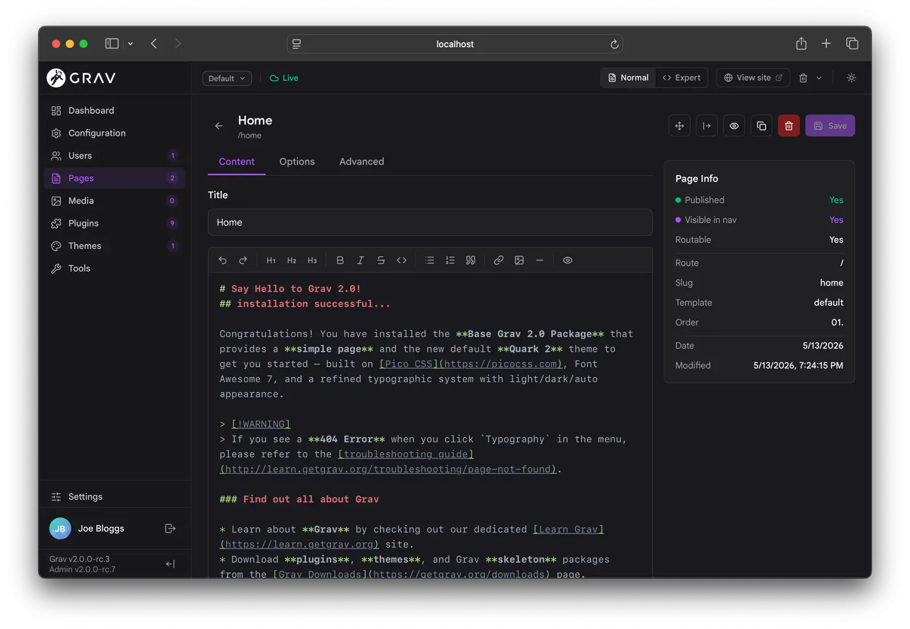

Admin Next поставляется с полной поддержкой светлой и тёмной темы, а также настраиваемым акцентным цветом, логотипом, шрифтами и размерами шрифта.

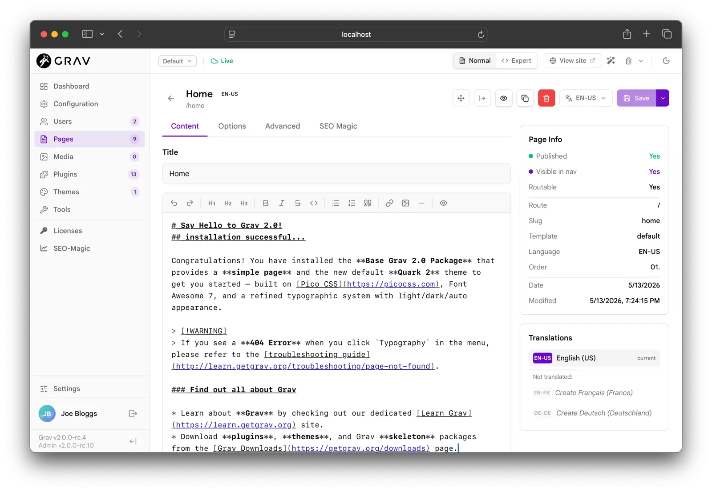

Несколько деталей оболочки, которые стоит знать:

- **Переключатель окружений** в верхней панели переключает между `Default` и любой целью конфигурации `user/env/*`, не покидая админку. Сохранение конфигурации записывает в выбранное окружение через дифференциальное сохранение (только ключи, отличающиеся от действующей базовой конфигурации). Также можно создать новое окружение из выпадающего списка.
- **Кластер присутствия** показывает живые аватары всех других администраторов, которые редактируют вместе с вами, с цветной точкой, указывающей состояние синхронизации. Для этого нужен необязательный плагин **sync**.
- **Метки версий в боковой панели** показывают работающие версии `Grav` и `Admin` и автоматически обновляются после самообновления.
- Интерфейс адаптивен вплоть до ширины телефона: на мобильных боковая панель уезжает, панели инструментов сворачиваются в иконки, а списки страниц скрывают второстепенные столбцы.

## Панель управления

Панель управления — полностью настраиваемая сетка из нескольких виджетов, которую каждый пользователь может переставлять. Супер-администраторы могут сохранить общий макет сайта, чтобы все начинали с одного места.

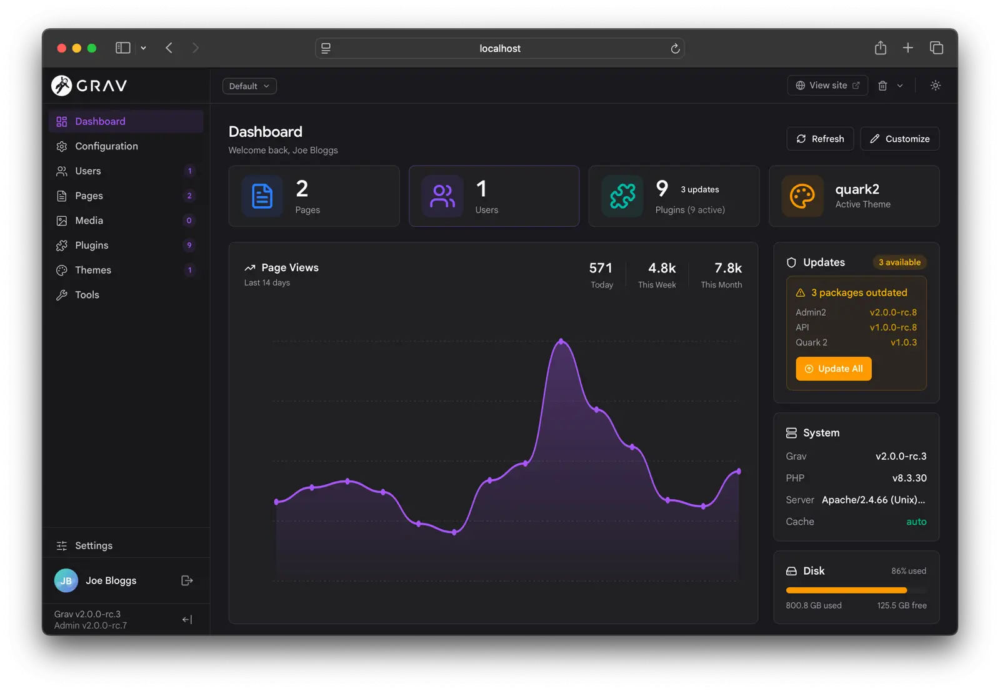

Нажмите карандаш **Настроить** в заголовке, чтобы войти в режим редактирования. У каждого виджета появляется панель инструментов с ручкой перетаскивания, выбором размера (`SM` / `MD` / `LG` / `XL`, где поддерживается) и переключателем скрытия. Плитка «Добавить виджет» возвращает всё, что вы скрыли. В панели инструментов настройки доступны три набора: **По умолчанию**, **Минимум** (статистика и недавние страницы) и **Компактный** (каждый виджет минимального размера). Супер-администраторы также получают **Сохранить как настройку сайта по умолчанию**.

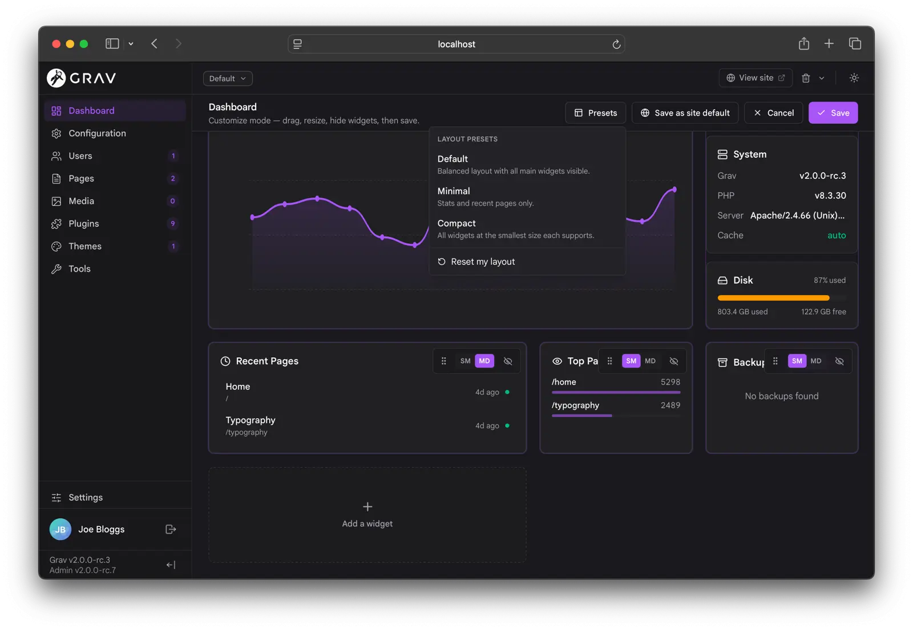

Сетка использует адаптивный макет из 4 столбцов. Несколько стандартных виджетов:

- **Обновления** на видном месте: уведомление ядра Grav (текущая → доступная версия с кнопкой обновления) над панелью пакетов с чипами версий в каждой строке и кнопкой «Обновить все».
- **Уведомления** отображают промо-карточки, информацию, уведомления и предупреждения с иконками, сообщениями в Markdown и относительными датами.
- **Состояние системы** отслеживает версии PHP и Grav, доступные обновления, состояние планировщика и кэша.
- **Просмотры страниц**, **Популярные страницы**, **Недавние страницы** и **Резервные копии** дополняют стандартный набор.

Плагины могут добавлять собственные виджеты через API, и они автоматически появляются в средстве выбора и выборе размера.

## Страницы

Представление страниц поставляется с тремя первоклассными представлениями: **Дерево**, **Список** и **Колонки** (Миллер).

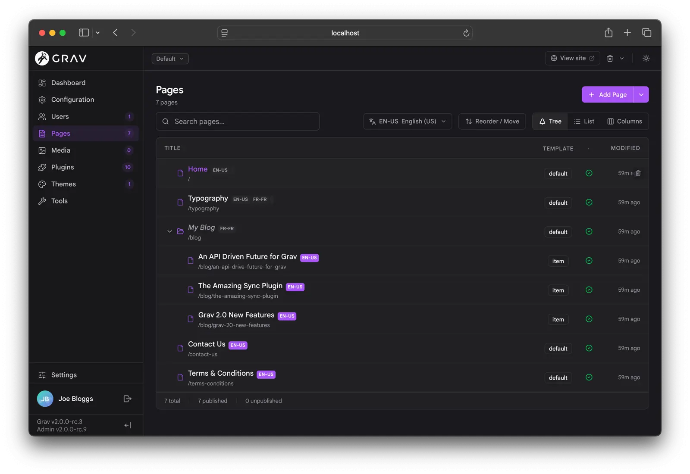

Панель инструментов общая для всех трёх представлений: выбор режима представления, поле поиска, выполняющее поиск по всему сайту через API (с задержкой, не более 500 результатов), выбор языка для многоязычных сайтов, переключатель изменения порядка и кнопка **Добавить страницу**.

Кнопка **Добавить страницу** разделена на три части: основная кнопка добавляет обычную страницу, а шеврон открывает меню с пунктами **Добавить папку** (папка маршрутизации или группировки без файла `.md`) и **Добавить модуль** (модульная подстраница, имя папки которой автоматически получает префикс `_` по соглашению Grav о модулях).

Несколько моментов, на которые стоит обратить внимание во всех представлениях:

- **Видимость страницы** показывается двухцветной иконкой: видимые страницы используют акцентный цвет, невидимые становятся приглушённо-серыми.
- **Черновики** имеют янтарную метку **Черновик**.
- **Значки переводов** стоят рядом с заголовком и подсвечивают активный язык.
- **Индикаторы символических ссылок** появляются на плагинах, темах и страницах, установленных через символическую ссылку.
- **Фоновые обновления происходят незаметно.** Когда другая вкладка сохраняет страницу, затронутая строка обновляется на месте без мигания скелетона.

**Представление «Колонки»** даёт иерархический просмотр в стиле Finder с встроенной панелью предпросмотра на широких экранах.

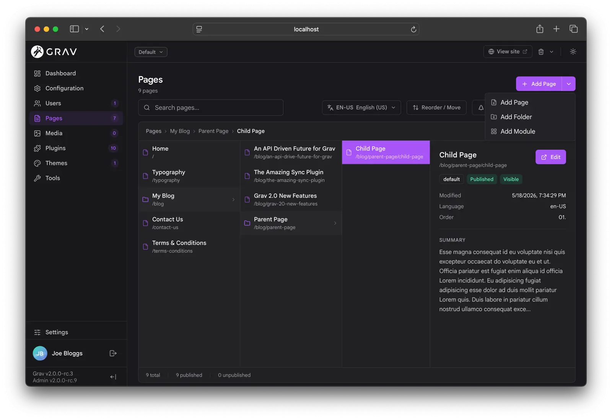

Поддержка нескольких языков — важный акцент этой версии: легче понять, на каком языке вы находитесь, сохранить как другой поддерживаемый язык и проверить состояние перевода в правой панели. Также можно повторно синхронизировать страницу с языком по умолчанию.

## Редактор страниц

Редактор страниц рендерит форму прямо из схемы страницы. Каждый стандартный тип поля (текст, текстовая область, переключатель, выбор, список, массив, файл, медиа, выбор цвета, выбор даты, редактор кода, редактор Markdown) — нативный компонент Svelte с поддержкой клавиатуры, ARIA-хуками и живой валидацией по блоку `validate:` схемы. Пользовательские типы полей из плагинов загружаются по требованию как веб-компоненты.

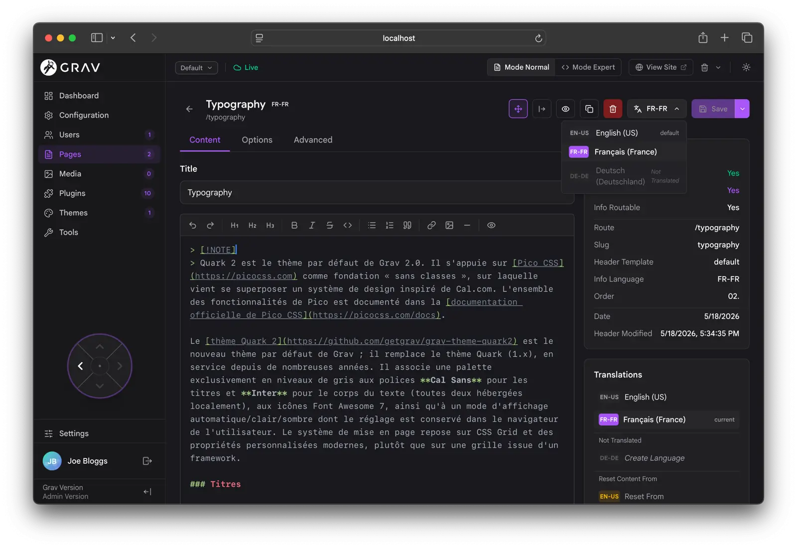

Несколько главных изменений:

- Переключатель **Обычный/Эксперт** (между формой на основе схемы и редактированием необработанных метаданных страницы) находится в глобальной верхней панели рядом с пунктом «Просмотр сайта».
- **Аватары присутствия** для страницы находятся в верхней панели. Нажмите на них, чтобы увидеть, кто ещё редактирует.
- **Правая панель** (Информация о странице, Переводы, Медиафайлы страницы) сворачивается, и её состояние сохраняется для каждого браузера.
- **Навигатор по страницам** — небольшой плавающий элемент управления, который переходит к родительской, предыдущей или следующей соседней странице либо к первой дочерней.
- **Копирование страницы** вернулось, рядом с «Сохранить», «Предпросмотр», «Удалить» и разделением «Сохранить как» для каждого языка.

Режим эксперта показывает необработанные метаданные страницы и дополнительные настройки страницы, когда их нужно редактировать напрямую.

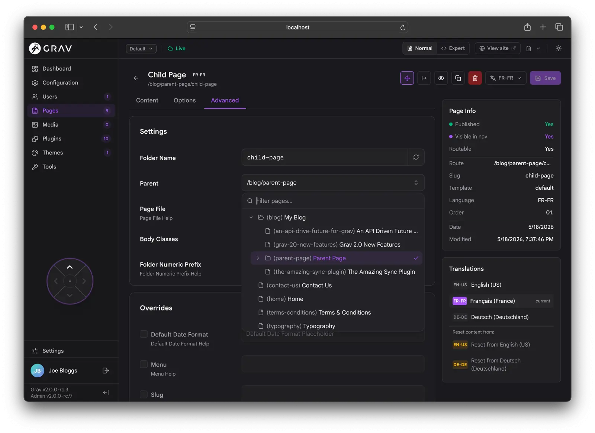

### Совместное редактирование в реальном времени

Редактор страниц поддерживает **совместное редактирование в реальном времени**, включаемое в разделе **Настройки → Редактирование → Совместная работа в реальном времени**. Несколько пользователей могут одновременно редактировать одну страницу и видеть изменения друг друга посимвольно, с именованными курсорами в редакторе содержимого и живыми аватарами присутствия в верхней панели.

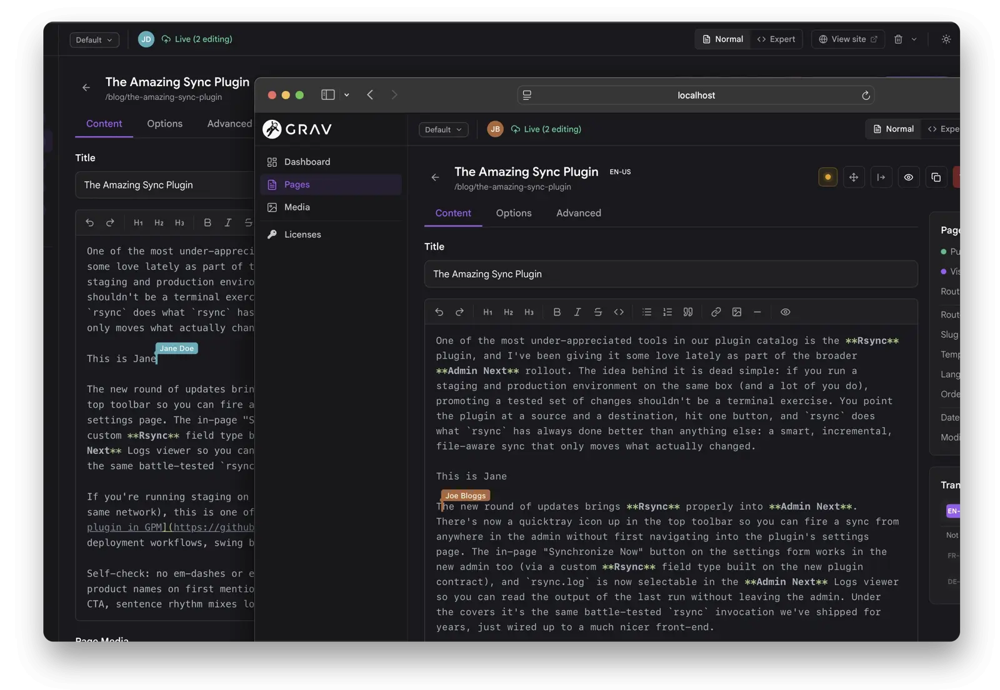

Под капотом вся схема зеркалируется в общий документ **Yjs**, а не только тело Markdown. Длинные текстовые поля используют посимвольный CRDT, переключатели и выборы — принцип «побеждает последняя запись», а поля списков и массивов объединяют одновременные добавления, а не перезаписывают их. Транспорт по умолчанию — короткий опрос; установка плагина `sync-mercure` переводит его на **Mercure** Server-Sent Events для обновлений менее чем за 50 мс.

## Конфигурация

Страница конфигурации охватывает разделы «Система», «Сайт», «Медиа», «Безопасность», «Информация», «Плагины» и «Темы». У неё есть единое общее **поле фильтра**, которое ищет по всем видимым панелям и вкладкам, раскрывая разделы с совпадениями и подсвечивая найденный текст.

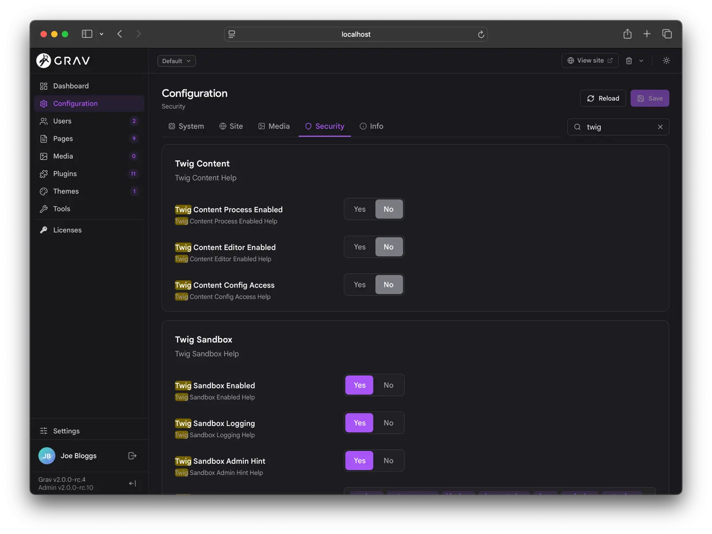

Несколько моментов, которые стоит знать:

- **Twig в контенте** — панель безопасности, которая ограничивает Twig, написанный редакторами в контенте страниц, объединяя глобальный переключатель, переключатель разрешений редактора и переключатель доступа к `config` в одном месте. Полное описание фичи см. в разделе [Twig в контенте](../content/twig-in-content/index.md).
- **Справка по схемам и тела разделов рендерят HTML.** Встроенные теги `<code>`, `<strong>` и подобные работают как в классической админке. Модель доверия та же: YAML схем контролируется сервером, а не отправляется пользователем.
- **Сохранение только переопределений** — стандарт: при сохранении конфигурации или конфигурации плагина записываются только значения, отличающиеся от значений по умолчанию, поэтому всегда можно понять, что действительно изменилось.

## Плагины, темы и пользователи

Страницы списков плагинов и тем имеют общий макет: фильтруемый список слева, панель предпросмотра справа на широких экранах и верхняя панель инструментов с массовыми действиями вроде **Обновить все**.

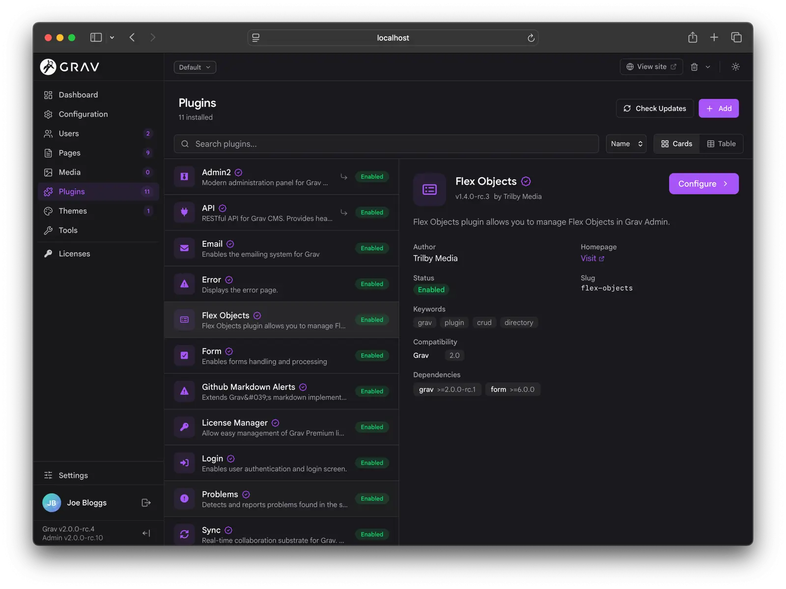

«Обновить все» показывает причины сбоя прямо в строке (слишком старая версия Grav, слишком старая версия PHP, конфликт версий), а не просто список слагов. Установка плагина автоматически подтягивает недостающие зависимости схем, а модальные окна подтверждения сопровождают каждое обновление, обновление версии и удаление.

Управление пользователями показывает пользователей слева с деталями справа и раздел «Разрешения», который представляет всё дерево ACL в виде рекурсивного трёхпозиционного выбора (Разрешено / Запрещено / Не задано).

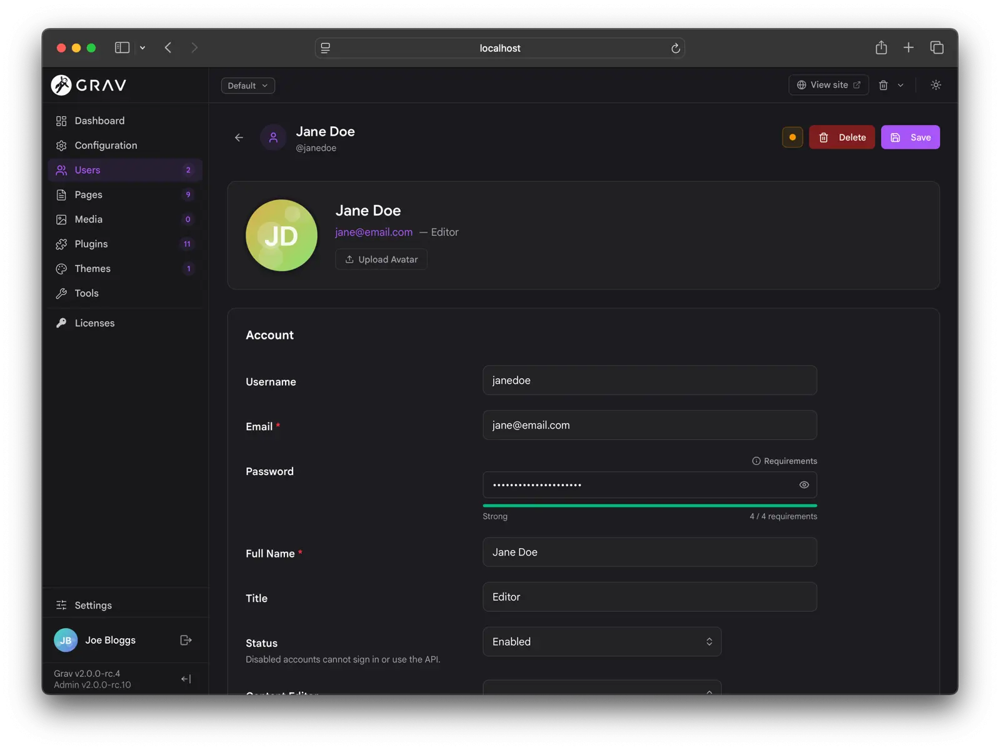

Несколько деталей:

- Поле **Состояние** (Включено / Отключено) отображается в форме. Admin Next внедряет его в схему учётной записи во время запроса, с ограничением для менеджеров, поэтому пользователя можно отключить без ручного редактирования YAML.
- **Поля пароля** поставляются с живым индикатором надёжности и подсказкой о требованиях. Правила берутся из `system.pwd_regex` (или нового списка именованных правил `system.pwd_rules`), поэтому пользователь видит то, что требует сервер.
- **Подключение 2FA** встроено: включите, отсканируйте QR-код в приложении-аутентификаторе и подтвердите шестизначным кодом. Резервные коды выдаются при настройке, и их можно перевыпустить.

## Настройки, персонализация и настройки сайта по умолчанию

«Настройки» — это дом личных предпочтений. Каждый пользователь может задать **Внешний вид** (цветовой режим, акцентный цвет, шрифт, размер шрифта), **Настройки страниц по умолчанию** (режим представления и количество элементов на странице), предпочтения **Редактора** и **Язык админки**.

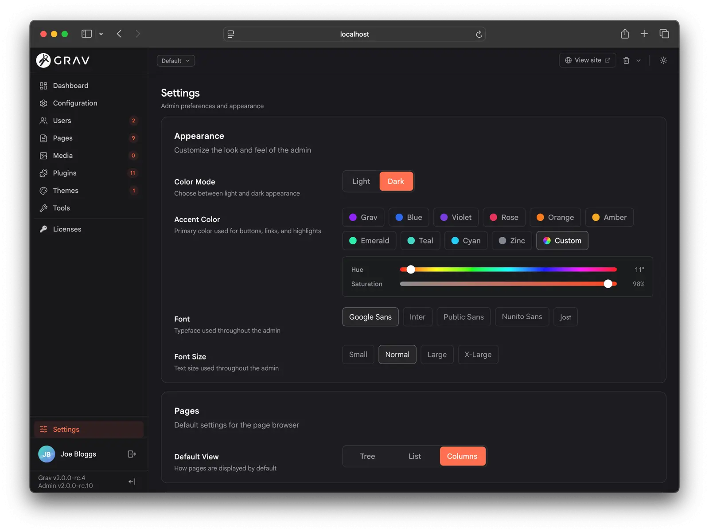

Персонализация сохраняется для каждого пользователя через API, поэтому при входе в другом браузере или на другом устройстве ваши настройки подхватываются автоматически. Изменения распространяются на открытые вкладки, а фоновый опрос заодно поддерживает сессию активной.

Супер-администраторы получают отдельный раздел **Настройки сайта по умолчанию** для **брендинга сайта** (логотип для светлой/тёмной темы и текст бренда), **базового внешнего вида и настроек редактора** для всех пользователей (пользователи всё ещё могут их переопределить), **поведения редактирования на уровне сайта** (автосохранение, совместная работа в реальном времени) и **ссылок в строке меню**, отображаемых в верхней панели инструментов для всех.

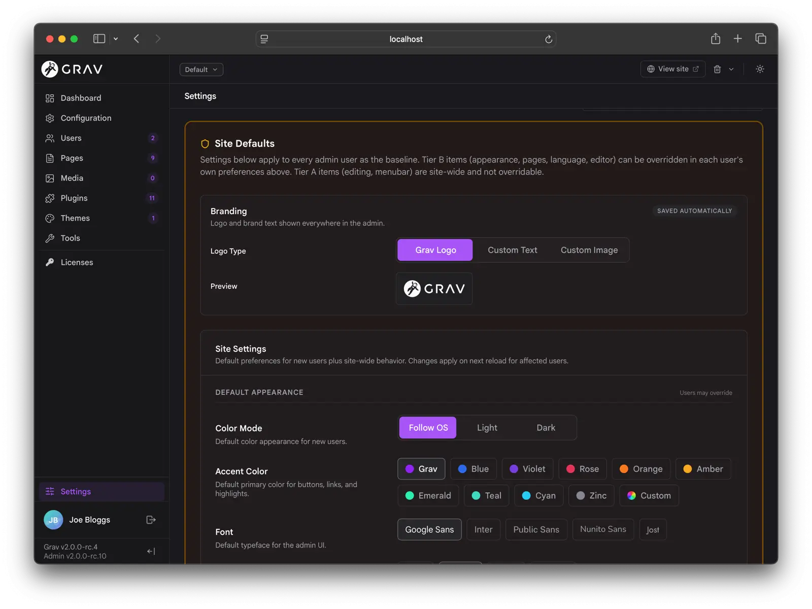

## Языки и направление текста

Admin Next имеет полноценный слой переводов на **ICU MessageFormat** с заполнителями, множественными числами, вариантами select и категориями множественного числа с учётом CLDR для каждой локали. Каждый ключ перевода сначала ищется как `ICU.<key>` (проходит через ICU MessageFormat), а затем как `<key>` (возвращается как есть). Плагин может поставлять один языковой файл, который работает и в Grav 1 / классической админке, и в Grav 2 / Admin Next. Подробности см. в разделе [Переводы админки](../plugins/admin-translations/index.md).

Админка поставляется с полным `en.yaml`, охватывающим каждое всплывающее уведомление, заголовок кнопки, aria-label, заполнитель и встроенную метку. Выбор локали, которую Grav помечает как письмо справа налево (арабский, иврит, персидский, урду и другие), переключает всю админку в режим **RTL**.

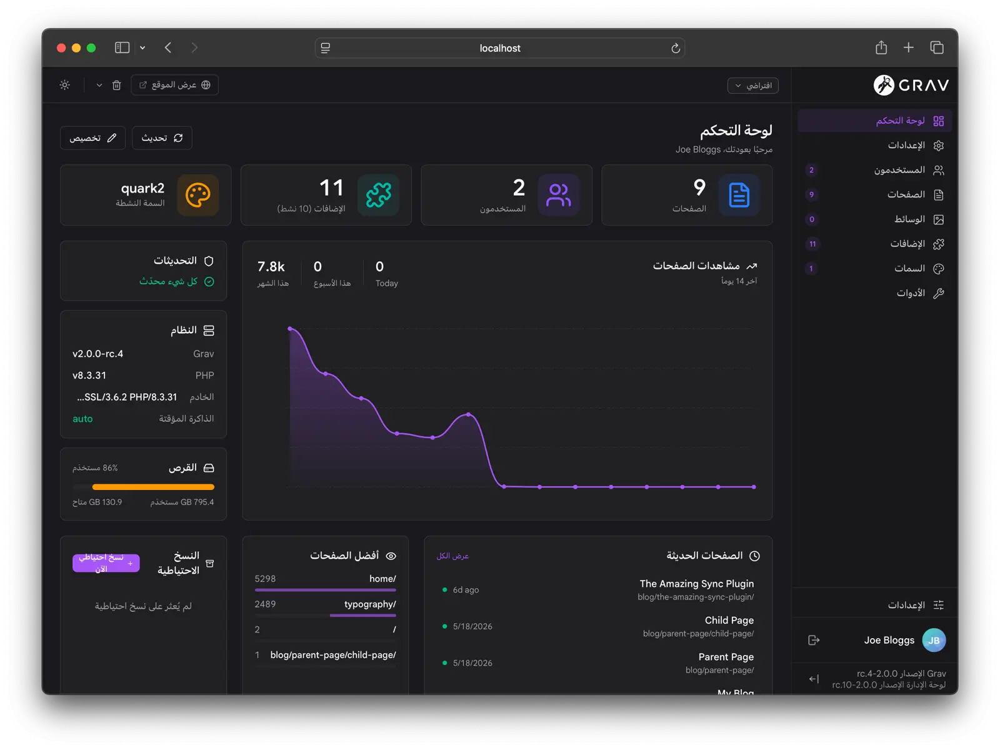

Переход в RTL — это больше, чем смена направления CSS: боковая панель и панели прикрепляются и анимируются с правильных краёв, направленные иконки переворачиваются вместе с языком, а навигатор по страницам меняет семантику соседних страниц, чтобы стрелка «далее» всегда указывала по направлению чтения. Редакторы кода остаются слева направо, потому что сам код не переворачивается.

## Инструменты

Раздел **Инструменты** собирает утилиты админки, которым нет места в других разделах: просмотр **Журналов**, страницу **Отчётов**, представление **Планировщика**, элементы управления **Кэшем** и менеджер **Резервных копий**.

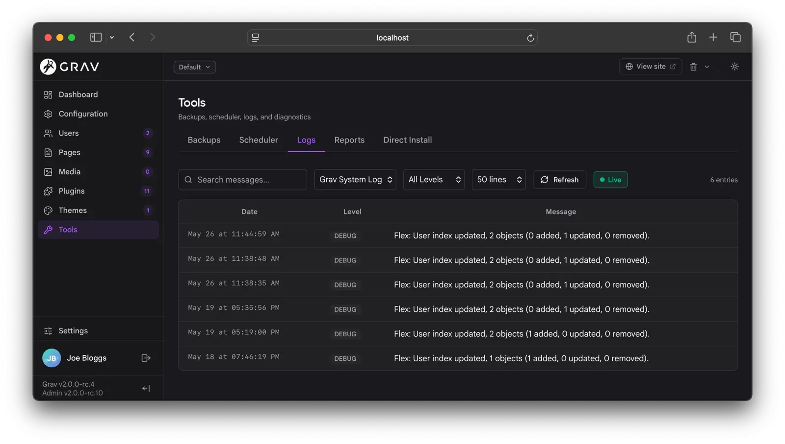

Просмотр **Журналов** перечисляет `grav.log`, `email.log`, `scheduler.log` и любой файл журнала, который добавляет плагин. При установке по умолчанию, где существуют только журналы ядра, выбор файлов скрыт.

Страница **Отчётов** расширяется плагинами. Встроенные отчёты охватывают конфигурацию безопасности и проверку YAML, и один из них — отчёт [Twig в контенте](../content/twig-in-content/index.md), который перечисляет страницы, чей контент отдавал бы сырой Twig. Плагины могут добавлять собственные диагностические карточки.

## Переводы

Раздел **Переводы** в боковой панели между «Темами» и «Инструментами» позволяет переформулировать любую строку, отображаемую сайтом, на любом языке без редактирования файлов плагина или темы. Изменения хранятся как переопределения в `user/languages/<lang>.yaml`, поэтому обновление плагина или темы никогда их не сотрёт.

Отправная точка — дерево исходников слева: ядро Grav, затем каждый установленный плагин и тема, каждый раскрывается в пространства имени, которые он предоставляет. Это ответ на вопрос «Я только что установил эту тему и хочу переформулировать пять вещей», когда у вас ещё нет поискового запроса и нужно просто увидеть, что можно изменить.

Когда вы уже знаете, что ищете, поиск сопоставляет и ключ, и текущую формулировку. Вы почти никогда не знаете, что слово «Поиск» в вашей боковой панели находится по адресу `THEME_TYPHOON.SIDEBAR.SIMPLE_SEARCH.HEADLINE`, поэтому ввод `Search` находит его так же хорошо, как ввод ключа.

Откройте сколько угодно языков в средстве выбора **Языки**, и каждый станет строкой внутри каждой записи: исходный язык первым, остальные ниже. Каждое значение редактируется на месте и показывает, откуда оно взялось, — именно это делает раздел диагностическим инструментом, а не текстовым полем:

| Состояние | Значение |
| ----- | ------- |
| **Поставляется** | Значение берётся из собственного языкового файла плагина или темы. Не изменено вашим сайтом. |
| **Переопределено** | Вы изменили его здесь. Исходная формулировка сохраняется, и один щелчок возвращает её. |
| **Отсутствует** | В этом языке значения нет, поэтому посетители на самом деле видят резервный язык. |

Отфильтруйте по *Отсутствует* для языка — и у вас список задач по переводу. Отфильтруйте по *Переопределено* — и вы увидите обзор всего, что ваш сайт изменил. Фильтр *Неизвестно* ловит противоположную проблему: переопределения, которые называют ключ, ничего не предоставляющее на сайте, — обычно опечатка или остаток от плагина, который вы уже удалили.

> [!NOTE] Примечание
> Переопределение, совпадающее с тем, что уже поставляет плагин или тема, не сохраняется. Его хранение молча остановило бы отслеживание будущих изменений формулировки в источнике, поэтому оно считается возвратом к исходному значению.

**Редактировать как YAML** заменяет сетку текстовым представлением того же фильтра для вставки или просмотра многих строк сразу. Если выбран источник, сохранение ограничивается этим пространством имён и не трогает остальную часть файла.

Если установлен и настроен плагин **AI Translate**, кнопка перевода у любого значения заполняет одну эту строку, та же кнопка у исходного значения заполняет все открытые языки для этой строки, а **Перевести отсутствующие** обрабатывает всю видимую страницу. Предложения готовятся к проверке, и ничего не записывается, пока вы их не примете. Заполнители вроде `%1$s` и `{count}` защищены от механизма перевода и проверяются после него; предложение, в котором заполнитель потерян или испорчен, отклоняется, а не сохраняется. Множественные числа и сообщения select в ICU всегда оставляются человеку, потому что количество категорий множественного числа, необходимых языку, не может вывести механизм перевода.

### Переход с плагина Translation Strings

Плагин [Translation Strings](https://github.com/trilbymedia/grav-plugin-translation-strings) выполнял эту работу в Grav 1.7, храня переопределения каждого языка как фрагмент YAML в конфигурации собственного плагина. В Grav 2.0 эта фича встроена, поэтому теперь этот плагин предназначен только для 1.7.

Если на сайте всё ещё есть сохранённые в нём переопределения, экран «Переводы» сообщает об этом и предлагает их импортировать. Перед подтверждением он разбирает импорт по языкам: сколько строк новые, сколько расходятся с чем-то уже имеющимся в `user/languages`, сколько уже есть, сколько всё равно совпадают с тем, что поставляет плагин или тема, и сколько называют ключи, которых на сайте нет. `bin/plugin api i18n:migrate --dry-run` выводит тот же отчёт из командной строки.

Если оба хранилища называют один и тот же ключ с разными формулировками, побеждает значение плагина, потому что именно его сейчас отображает сайт. Переопределения, написанные вами вручную, о которых плагин ничего не знает, остаются нетронутыми.

> [!IMPORTANT] Важно
> Сначала импортируйте, затем отключите плагин, и никогда наоборот. Translation Strings объединяет свои строки *после* встроенного редактора, поэтому, пока он включён, он переопределяет всё, что вы здесь меняете. Отключение до импорта на время оставило бы сайт без всех переопределений. Экран требует именно такого порядка и предлагает кнопку **Отключить плагин** только когда импортировать больше нечего.

Ничего не удаляется: конфигурация плагина сохраняет свои фрагменты, поэтому вернуться к нему можно, снова включив его.

## Единый опыт для плагинов

Admin Next построен так, чтобы сложные плагины ощущались частью админки, а не отдельным интерфейсом, прикрученным сбоку. Та же инфраструктура, что питает основную админку (API, система схем, контракт веб-компонентов и реестры боковой панели, строки меню, виджетов, панелей и отчётов), используется каждым плагином. Когда плагин поставляет собственный раздел админки, он появляется как первоклассный пункт боковой панели, открывается с той же оболочкой, что «Страницы» или «Пользователи», рендерит формы теми же компонентами полей и соблюдает те же разрешения, тёмную тему, акцентный цвет и язык.

Точки интеграции охватывают то, что обычно нужно сложному плагину:

- **Полные страницы плагинов** с собственным пунктом боковой панели, в *режиме схемы* (поставляется YAML-форма, админка её рендерит) или *режиме компонента* (поставляется веб-компонент, админка его монтирует).
- **Пользовательские типы полей схем** как веб-компоненты, загружаемые по требованию.
- **Панели настроек** для конфигурации, которая должна находиться рядом с системными настройками.
- **Пункты строки меню** для действий в один щелчок в верхней панели инструментов.
- **Плавающие виджеты** для постоянного интерфейса, сохраняющегося при навигации по страницам.
- **Контекстные панели**, вставляемые с края редакторов для инструментов, ограниченных редактором.
- **Пользовательские отчёты** и **пользовательские виджеты панели управления**.

Каждый следует одному рецепту: небольшой хук событий PHP в плагине, необязательный JavaScript-веб-компонент в `admin-next/{kind}/{slug}.js` и любые пользовательские конечные точки REST, нужные интерфейсу. Полный справочник разработчика — в [документации API](../api/index.md) и [руководстве по обновлению для разработчиков](../migration/developer-upgrade-guide/index.md).

## Как попробовать

Admin Next поставляется как админка по умолчанию в Grav 2.0. Разверните чистую установку Grav 2.0 на **PHP 8.3+**, создайте первого пользователя — и вы внутри. Если вы переходите с Grav 1.7, раздел [Миграция](../migration/index.md) описывает поэтапную установку рядом: чистая версия 2.0 создаётся рядом с существующей, мастер миграции импортирует контент и конфигурацию, и вы переключаетесь, когда всё устраивает.

Классический плагин админки остаётся доступным в ветке 1.7 для сайтов, которым он нужен, но Admin Next — путь вперёд, и всё новое появляется сначала там.
