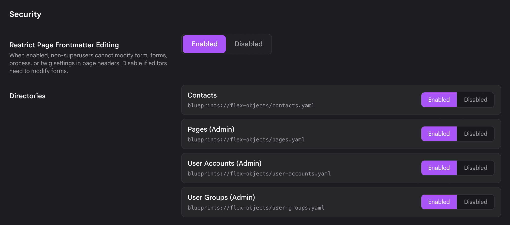
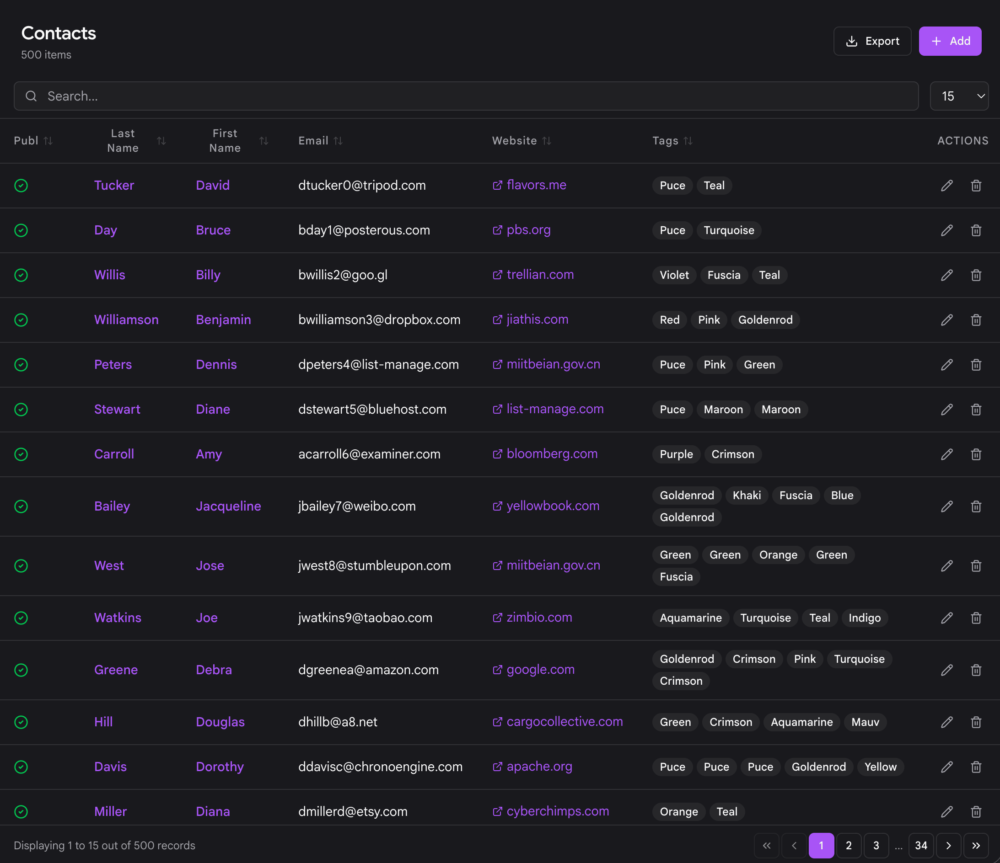
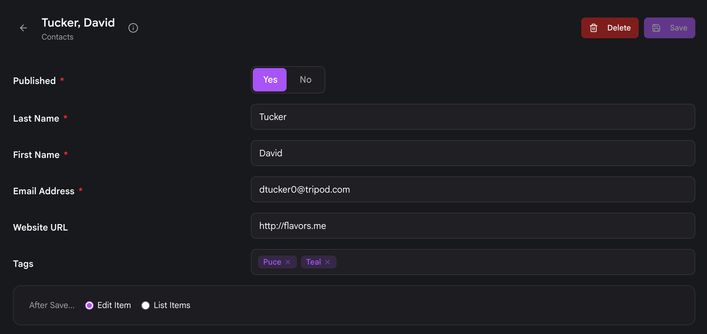

# Управление Flex в Admin Next

Плагин **[Flex Objects](../index.md)** даёт каждой директории Flex полноценный интерфейс управления в **Admin Next** — одностраничной админке на SvelteKit, которая общается с **[плагином API](../../../api/index.md)**. Вы получаете автоматически созданный пункт боковой панели, список с поиском и сортировкой, редактор объектов, построенный из схемы директории, и загрузку медиафайлов для директорий, которые хранят объекты в папках. Ничего из этого не требует писать код интерфейса: вы объявляете схему, включаете директорию, и Admin Next строит экраны по вашим настройкам `config.admin`.

Эта страница проходит по всему жизненному циклу — от включения директории до редактирования отдельных объектов.

> [!NOTE] Примечание
> Классическая админка на Vue для Flex была удалена в flex-objects **1.4.2**. Теперь Flex Objects работает только с Admin Next, поэтому если вы пришли со старой установки Grav, некоторые описанные здесь экраны будут выглядеть иначе, чем вы помните.

## Включение директории

Директория Flex невидима, пока вы её не включите. Перейдите в **Plugins** > **Flex Objects** и найдите поле **Directories**. В нём перечислены все директории Flex, обнаруженные Grav: входящие в плагин, в другой плагин или тему либо лежащие в вашей папке `user/blueprints/flex-objects/`.

Выберите директории, которыми хотите управлять, убедитесь, что каждая включена, и нажмите **Save**. Включение директории здесь дописывает путь к её схеме в конфигурацию плагина, и именно это активирует её в Admin Next, REST API, шорткоде `[flex-objects]` и маршрутизации фронтенда.



> [!IMPORTANT] Важно
> Сам плагин **Flex Objects** должен быть включён, прежде чем заработает любая пользовательская директория. Если плагин выключен, ни одна директория из этого списка ничего не делает.

После сохранения включённая директория появится в боковой панели Admin Next при следующей загрузке. Полный разбор создания директории с нуля см. в разделе **[Определение типа Flex](../custom-types/blueprint-reference/index.md)**.

## Пункт в боковой панели

Каждая включённая директория автоматически получает собственный пункт в боковой панели Admin Next. Нет никакого общего меню, в которое нужно углубляться: директория находится прямо в навигации, и нажатие на неё открывает вид списка этой директории.

У пункта есть **бейдж с количеством**, показывающий, сколько объектов сейчас содержит директория, так что размер коллекции виден сразу, без открытия. На скриншотах ниже у пункта **Contacts** бейдж 500.

Как выглядит пункт и где он находится, определяется блоком `admin.menu` в схеме директории:

```yaml
config:
  admin:
    menu:
      list:
        title: Contacts
        icon: fa-address-book
        priority: 5
```

- **title** и **icon** задают название и иконку пункта боковой панели. Если совсем не указывать `admin.menu`, Admin Next использует собственные `title` и `icon` директории (или общую иконку базы данных), поэтому директория без блока menu всё равно появится, а не исчезнет.
- **priority** задаёт порядок пункта относительно других элементов боковой панели. Больший приоритет поднимает его выше.

### Скрытие директории из боковой панели

Иногда плагин уже регистрирует собственный пункт Admin Next для директории и не хочет, чтобы рядом дублировался общий автоматически созданный. Задайте `hidden_in_admin_next` в записи меню, чтобы отказаться от автоматической регистрации:

```yaml
config:
  admin:
    menu:
      list:
        title: Contacts
        hidden_in_admin_next: true
```

Директория остаётся полностью включённой (API, шорткод и фронтенд продолжают работать), просто она больше не добавляет свою строку в боковую панель.

> [!WARNING] Предупреждение
> Директория также пропускается в боковой панели, если у текущего пользователя нет разрешения на вывод её списка или если задано `config.admin.disabled`. Разрешения здесь важны: начиная с flex-objects **1.4.3** директория, схема которой не объявляет блок разрешений, закрыта для всех, кроме суперадминистраторов. О том, как предоставить доступ, см. **[Права доступа Flex](../custom-types/blueprint-reference/index.md#permissions)**.

### Директории с собственными страницами

Три встроенных типа под капотом являются директориями Flex, но **не** используют общий интерфейс Flex, потому что у них есть собственные специально созданные экраны Admin Next:

- **Страницы**
- **Учётные записи пользователей**
- **Группы пользователей**

Они намеренно исключены из автоматически создаваемой боковой панели Flex, чтобы вы управляли ими через их собственные страницы. Всё на этой странице относится к вашим пользовательским директориям и к встроенным примерам директорий вроде Contacts.

## Вид списка {: #the-list-view }

Нажатие на директорию в боковой панели открывает её **вид списка**: таблицу объектов этой директории с постраничным выводом. Колонки берутся из `config.admin.list.fields`, поэтому каждая директория показывает поля, которые для неё имеют смысл.



```yaml
config:
  admin:
    list:
      fields:
        name:
          link: edit
        email:
        phone:
      options:
        per_page: 20
        order:
          by: name
          dir: asc
```

Вид списка даёт вам:

- **Поиск**: текстовое поле, фильтрующее объекты по мере ввода.
- **Сортировку**: нажмите на заголовок колонки, чтобы отсортировать по этому полю по возрастанию или убыванию.
- **Постраничный вывод**: перелистывание больших коллекций. Размер страницы и сортировка по умолчанию берутся из `admin.list.options` (`per_page` и `order.by` / `order.dir`).
- **Экспорт**: кнопка экспорта, скачивающая коллекцию (например, в CSV); управляется `config.admin.export`.
- **Действия в строке**: в каждой строке есть действия, например **Edit** и **Delete**.

Кнопка **Add** создаёт новый объект: она открывает редактор с пустой формой.

### Вложенные строки с подробностями

Если директория определяет `config.admin.list.detail`, каждая строка может раскрываться, показывая связанные объекты из другой директории прямо в списке — облегчённый вариант представления «главное-подчинённое». Это удобно, когда один объект владеет набором дочерних (скажем, компания и её контакты) и вы хотите видеть их, не покидая список.

```yaml
config:
  admin:
    list:
      detail:
        enabled: true
        label: Contacts
        icon: fa-address-book
        relation:
          type: contacts
          local_key: id
          foreign_key: company_id
        actions: true
```

Блок `relation` связывает родительский объект со связанной директорией по ключу. Когда включено `actions`, вложенные строки тоже могут предлагать Edit и Delete, но только если у текущего пользователя есть разрешения `update` / `delete` на связанную директорию и у этой директории есть маршрут редактирования в Admin Next. Вложенные колонки по умолчанию берут поля списка самой связанной директории; их можно переопределить в `detail.fields`.

## Редактор объектов

Выбор строки (или нажатие **Add**) открывает **редактор объектов**. Форма строится целиком из раздела `form` схемы директории, поэтому вы видите то, что специфично для редактируемого типа.



- **Вкладки и разделы**: схемы обычно организуют поля во вкладки и разделы, чтобы длинные формы оставались удобными. Admin Next отображает эти группировки как вкладки.
- **Поля**: доступно любое стандартное [поле формы](../../../forms/blueprints/fields-available/index.md) Grav.
- **Загрузка медиафайлов**: директории, использующие **FolderStorage** (одна папка на объект), поддерживают медиафайлы для каждого объекта, поэтому поля файлов и изображений позволяют загружать прямо в папку объекта. В директориях с **SimpleStorage** (все объекты в одном файле) медиафайлов для отдельных объектов нет, поэтому медиаполя там не применяются. О различиях см. **[Хранилище Flex](../custom-types/blueprint-reference/index.md#storage)**.

Когда вы нажимаете **Save**, Admin Next записывает объект и возвращает вас в вид списка (сохранение с перенаправлением), где изменение сразу видно. **Delete** удаляет объект и так же возвращает вас в список.

> [!NOTE] Примечание
> Каждое изменение здесь проходит через REST API. Если вы хотите автоматизировать те же операции создания, обновления и удаления, эндпоинты описаны в **[API Flex-объектов](../../../api/endpoints/flex-objects/index.md)**.

## Где находятся настройки кэширования

В старом Flex у каждой директории был собственный вид **Configuration** в админке для редактирования настроек уровня директории: кэширования индекса, объектов и рендеринга. Этот экран Configuration для каждой директории **удалён** из Admin Next.

Теперь эти настройки находятся на **странице настроек плагина, которому принадлежит директория**. Для директорий из комплекта плагина Flex Objects это **Plugins** > **Flex Objects**. Для директории из другого плагина откройте страницу настроек этого плагина. Поведение кэширования директории по-прежнему определяется в схеме (`config.data.*` и параметры кэширования), вы просто меняете доступные настройки из плагина-владельца, а не на вкладке Configuration самой директории.

Если отрендеренный шаблон выдаёт динамический контент, который никогда не должен кэшироваться при рендеринге, вы по-прежнему можете отключить кэширование рендеринга внутри шаблона Twig для отдельного блока.

## Что дальше

- **[Определение типа Flex](../custom-types/blueprint-reference/index.md)**: создайте схему директории с нуля.
- **[Хранилище Flex](../custom-types/blueprint-reference/index.md#storage)**: выберите SimpleStorage, FileStorage или FolderStorage.
- **[Права доступа Flex](../custom-types/blueprint-reference/index.md#permissions)**: предоставьте редакторам доступ к директории.
- **[API Flex-объектов](../../../api/endpoints/flex-objects/index.md)**: управляйте объектами через REST.
