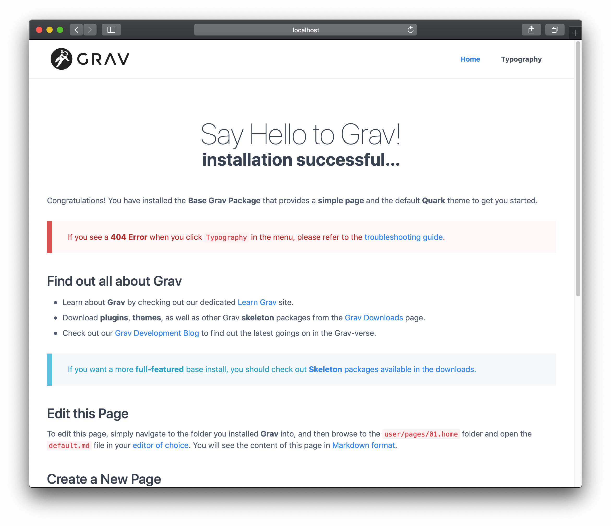
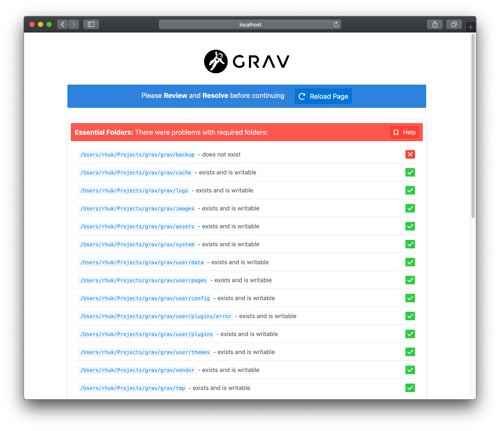

# Установка {: #installation }

Установка Grav — тривиальный процесс. На самом деле никакой установки нет. Есть несколько способов установить Grav. Первый — и самый простой — скачать **zip**-архив и распаковать его. Второй способ — установить с помощью **Composer**. Третий — клонировать исходный проект прямо с **GitHub**, а затем выполнить включённую в него команду-скрипт для установки нужных зависимостей. Есть и [другие варианты](#further-options), связанные с запуском поставляемых скриптов.

## Проверка версии PHP {: #check-for-php-version }

Grav невероятно просто настроить и запустить. Grav 2.0 требует **PHP 8.3.11 или выше**. Проверьте, что у вас установлено, открыв терминал и набрав `php -v`:

```bash
php -v
PHP 8.3.11 (cli) (built: Aug 29 2024 00:00:00) (NTS)
Copyright (c) The PHP Group
Zend Engine v4.3.11, Copyright (c) Zend Technologies
    with Zend OPcache v8.3.11, Copyright (c), by Zend Technologies
```

Grav также требует несколько расширений PHP, и в частности `zip` используется как Composer, так и GPM. Перед тем как идти дальше, ознакомьтесь с полным списком на странице [Требования](../requirements/index.md).

## Вариант 1. Установка из ZIP-пакета {: #option-1-install-from-zip-package }

Самый простой способ установить Grav — скачать ZIP-пакет и распаковать его:

1. Скачайте новейший пакет **[Grav](https://getgrav.org/download/core/grav/latest)** или **[Grav + Admin](https://getgrav.org/download/core/grav-admin/latest)**. **Grav + Admin** — это ядро с уже включёнными плагинами [API](../../api/index.md) и [Admin Next](../../admin-panel/index.md), так что вы сразу получаете работающую админку, и больше ничего устанавливать не нужно.
2. Распакуйте ZIP-файл в [webroot](https://www.wordnik.com/words/webroot) вашего веб-сервера, например `~/webroot/grav`

> [!NOTE] Примечание
> Доступны пакеты [Skeleton](https://getgrav.org/downloads/skeletons), которые включают ядро Grav, примеры страниц, плагины и конфигурацию. Это отличный способ начать: просто [скачайте понравившийся пакет Skeleton](https://getgrav.org/downloads/skeletons) и выполните шаги выше.

Вы также можете скачать любой готовый пакет установки [отмеченного тегом релиза](https://github.com/getgrav/grav/tags) с getgrav.org. Используйте формат `https://getgrav.org/download/TYPE/PACKAGE/VERSION`.

- [getgrav.org/download/core/grav/2.0.22](https://getgrav.org/download/core/grav/2.0.22) скачивает Grav Core версии 2.0.22
- [getgrav.org/download/core/grav-admin/2.0.22](https://getgrav.org/download/core/grav-admin/2.0.22) скачивает Grav Core 2.0.22 с плагинами API и Admin Next
- [getgrav.org/download/core/grav-update/2.0.22](https://getgrav.org/download/core/grav-update/2.0.22) скачивает пакет обновления для Grav Core
- [getgrav.org/download/plugins/admin2/latest](https://getgrav.org/download/plugins/admin2/latest) скачивает последний плагин Admin Next
- [getgrav.org/download/themes/quark/latest](https://getgrav.org/download/themes/quark/latest) скачивает последнюю тему Quark

> [!TIP] Совет
> Если вы скачали ZIP-файл и планируете переместить его в webroot, перемещайте **ВСЮ ПАПКУ**, так как она содержит несколько скрытых файлов (например, `.htaccess`), которые по умолчанию не будут выбраны. Отсутствие этих скрытых файлов может вызвать проблемы при работе Grav.

## Вариант 2. Установка с помощью composer {: #option-2-install-with-composer }

Альтернативный метод — установить Grav с помощью [composer](https://getcomposer.org/doc/00-intro.md#installation-linux-unix-osx). Всегда указывайте мажорную версию, чтобы Composer громко завершился с ошибкой, если ваше окружение PHP не удовлетворяет требованиям Grav 2.0:

```bash
composer create-project getgrav/grav ~/webroot/grav "^2.0"
```

> [!WARNING] Предупреждение
> Если убрать `"^2.0"` и в вашем PHP не будет нужного Grav расширения — чаще всего `zip` — Composer не остановится. Он выведет одну легко пропускаемую строку о том, что не может использовать последнюю версию, а затем будет перебирать версии назад, пока не найдёт релиз, подходящий вашему окружению, — возможно, Grav многолетней давности. В итоге вы увидите никак не связанную с этим жалобу на старую зависимость, которой нужен PHP 5.5. Указание ограничения превращает это в явную ошибку с именем расширения. Установите его (`sudo apt install php8.3-zip`, `brew install php` или раскомментируйте `extension=zip.so` в вашем `php.ini`) и запустите команду снова.

Если вы хотите поработать с самой свежей версией Grav, добавьте `2.x-dev` дополнительным параметром:

```bash
composer create-project getgrav/grav ~/webroot/grav 2.x-dev
```

Composer устанавливает только ядро Grav. О том, как добавить интерфейс админки, см. [Установка админки](#install-the-admin-panel) ниже.

## Вариант 3. Установка с GitHub {: #option-3-install-from-github }

Ещё один метод — клонировать Grav из репозитория GitHub, а затем запустить простой скрипт установки зависимостей:

1. Клонируйте репозиторий Grav с [GitHub](https://github.com/getgrav/grav) в папку в webroot вашего сервера, например `~/webroot/grav`. Запустите **терминал** или **консоль** и перейдите в папку webroot:

   ```bash
   cd ~/webroot
   git clone -b master https://github.com/getgrav/grav.git
   ```

2. Установите **зависимости vendor** через [composer](https://getcomposer.org/doc/00-intro.md#installation-linux-unix-osx):

   ```bash
   cd ~/webroot/grav
   composer install --no-dev -o
   ```

3. Установите **зависимости плагинов** и **тем** с помощью [приложения Grav CLI](../../cli-console/grav-cli/index.md) `bin/grav`:

   ```bash
   cd ~/webroot/grav
   bin/grav install
   ```

   Это автоматически **клонирует** необходимые зависимости с GitHub прямо в эту установку Grav.

## Установка админки {: #install-the-admin-panel }

Если вы установили ZIP-пакет **Grav + Admin**, админка уже на месте, и этот раздел можно пропустить.

В противном случае установите [Admin Next](../../admin-panel/index.md) одной командой GPM из корня вашей установки Grav:

```bash
cd ~/webroot/grav
bin/gpm install admin2
```

Admin Next зависит от [плагина API](../../api/index.md), который, в свою очередь, зависит от Login, Form, Email и Shortcode Core. GPM разрешает всю эту цепочку за вас и один раз спрашивает, устанавливать ли зависимости, так что `bin/gpm install admin2` — всё, что нужно набрать.

> [!WARNING] Предупреждение
> **Не** запускайте `bin/gpm install admin`. Это классический плагин админки Grav 1.x, и он не работает в Grav 2.0. Админка Grav 2.0 — это пакет `admin2`.

После завершения откройте свой сайт в браузере и перейдите по адресу `/admin`. Admin Next работает по тому же маршруту `/admin`, что и классическая админка, а на сайте, где ещё нет учётных записей пользователей, он проведёт вас через создание первого администратора.

```bash
https://my-site.example/admin
```

## Дополнительные варианты {: #further-options }

### Установка с Docker {: #install-with-docker }

[Docker](https://en.wikipedia.org/wiki/Docker_(software)) — чрезвычайно эффективный способ развернуть платформы и сервисы как на серверах, так и в локальных окружениях. Если вы настраиваете несколько окружений, которые должны быть одинаковыми, или работаете сообща, он предлагает простой способ обеспечить согласованность между установками. Если вы разрабатываете несколько сайтов на Grav, можете упростить их настройку с помощью Docker.

Доступны стабильные образы Docker, использующие веб-серверы [Apache](https://github.com/getgrav/docker-grav) (официальный образ), [Nginx](https://github.com/dsavell/docker-grav) и [Caddy](https://github.com/hughbris/grav-daddy). Если поискать, вы найдёте и другие, которые можно попробовать. В любом образе обязательно создайте тома (volumes) для сохранения папок `user`, `backups` и `logs` Grav. (Резервные копии и журналы необязательны, если вам не нужно хранить эти данные.)

### Установка на Cloudron {: #install-on-cloudron }

Cloudron — комплексное решение для запуска приложений на вашем сервере с поддержанием их в актуальном и безопасном состоянии. На своём Cloudron вы можете установить Grav в несколько кликов. Если вы размещаете несколько сайтов, их можно установить полностью изолированно друг от друга на одном сервере.

[](https://cloudron.io/store/org.getgrav.cloudronapp.html)

Исходный код пакета можно найти [здесь](https://git.cloudron.io/cloudron/grav-app).

### Установка через Linode Marketplace {: #install-through-linode-marketplace }

Если вы используете серверы Linode, есть [простой документированный способ через Linode Marketplace](https://www.linode.com/docs/marketplace-docs/guides/grav/). Он создаст новый сайт Grav на новом выделенном виртуальном сервере Linode. За виртуальный сервер будет взиматься периодическая плата.

## Веб-серверы {: #webservers }

#### Apache/IIS/Nginx {: #apache-iis-nginx }

Использовать Grav с веб-сервером, таким как Apache, IIS или Nginx, так же просто, как распаковать Grav в папку внутри [webroot](https://www.wordnik.com/words/webroot). Для работы нужен только PHP 8.3.11 или выше, поэтому убедитесь, что ваш сервер соответствует этому требованию. Дополнительную информацию о требованиях Grav можно найти в главе [Требования](../requirements/index.md) этого руководства.

Если ваш webroot, например, `~/public_html`, вы можете распаковать Grav в эту папку и открыть его по адресу `http://localhost`. Если вы распаковали его в `~/public_html/grav`, он будет доступен по адресу `http://localhost/grav`.

> [!NOTE] Примечание
> Каждый веб-сервер должен быть настроен. Grav по умолчанию поставляется с `.htaccess` для Apache и с некоторыми [файлами конфигурации сервера по умолчанию](https://github.com/getgrav/grav/tree/master/webserver-configs) для `nginx`, `caddy server`, `iis` и `lighttpd`. Используйте их соответствующим образом, когда это необходимо.

#### Запуск Grav со встроенным веб-сервером PHP {: #running-grav-with-the-built-in-php-webserver }

Вы можете запустить Grav простой командой из терминала / командной строки, используя встроенный сервер PHP, доступный при условии, что у вас установлен PHP.

Всё, что нужно, — перейти в корень вашей установки Grav с помощью терминала или командной строки и ввести `bin/grav server`.

> [!CAUTION] Внимание
> Хотя технически вам достаточно установленного PHP, если вы установите [приложение Symfony CLI](https://symfony.com/download), сервер предоставит SSL-сертификат, чтобы можно было использовать `https://` и PHP-FPM для лучшей производительности.

При вводе этой команды вы увидите вывод, похожий на следующий:

```bash
➜ bin/grav server

Grav Web Server
===============

Tailing Web Server log file (/Users/joeblow/.symfony/log/96e710135f52930318e745e901e4010d0907cec3.log)
Tailing PHP-FPM log file (/Users/joeblow/.symfony/log/96e710135f52930318e745e901e4010d0907cec3/53fb8ec204547646acb3461995e4da5a54cc7575.log)
Tailing PHP-FPM log file (/Users/joeblow/.symfony/log/96e710135f52930318e745e901e4010d0907cec3/53fb8ec204547646acb3461995e4da5a54cc7575.log)

[OK] Web server listening
The Web server is using PHP FPM 8.0.8
https://127.0.0.1:8000

[Web Server ] Jul 30 14:54:53 |DEBUG  | PHP    Reloading PHP versions
[Web Server ] Jul 30 14:54:54 |DEBUG  | PHP    Using PHP version 8.0.8 (from default version in $PATH)
[PHP-FPM    ] Jul  6 14:40:17 |NOTICE | FPM    fpm is running, pid 64992
[PHP-FPM    ] Jul  6 14:40:17 |NOTICE | FPM    ready to handle connections
[PHP-FPM    ] Jul  6 14:40:17 |NOTICE | FPM    fpm is running, pid 64992
[PHP-FPM    ] Jul  6 14:40:17 |NOTICE | FPM    ready to handle connections
[Web Server ] Jul 30 14:54:54 |INFO   | PHP    listening path="/usr/local/Cellar/php/8.0.8_2/sbin/php-fpm" php="8.0.8" port=65140
[PHP-FPM    ] Jul 30 14:54:54 |NOTICE | FPM    fpm is running, pid 73709
[PHP-FPM    ] Jul 30 14:54:54 |NOTICE | FPM    ready to handle connections
[PHP-FPM    ] Jul 30 14:54:54 |NOTICE | FPM    fpm is running, pid 73709
[PHP-FPM    ] Jul 30 14:54:54 |NOTICE | FPM    ready to handle connections
```

Ваш терминал также будет в реальном времени показывать любую активность на этом импровизированном сервере. Вы можете скопировать URL, указанный в строке `[OK] Web server listening`, и вставить его в браузер, чтобы открыть свой сайт, включая админку.

```
https://127.0.0.1:8000
```

> [!TIP] Совет
> Это полезный инструмент для быстрой разработки, и его **не** следует использовать вместо выделенного веб-сервера, такого как Apache или Nginx.

## Успешная установка {: #successful-installation }

При первой загрузке Grav предварительно компилирует некоторые файлы. Если теперь обновить браузер, вы получите более быструю, кэшированную версию.



> [!CAUTION] Внимание
> В предыдущих примерах **$** обозначает приглашение командной строки. На разных платформах оно может выглядеть иначе.

По умолчанию Grav поставляется с несколькими примерами страниц, чтобы вам было с чего начать. Ваш сайт уже полностью работоспособен, и вы можете настраивать его, добавлять контент, расширять или кастомизировать сколько угодно.

## Проблемы с установкой и настройкой {: #installation-setup-problems }

Если при первой загрузке страницы (или после события сброса кэша) обнаружатся какие-либо проблемы, вы можете увидеть страницу ошибки:



Обратитесь к разделу [Решение проблем](../../troubleshooting/index.md) за помощью по конкретным вопросам.

> [!WARNING] Предупреждение
> Если у вас проблемы с правами доступа к файлам, ознакомьтесь с [документацией по решению проблем с правами](../../troubleshooting/permissions/index.md). Также вы можете посмотреть [руководства по хостингу](https://learn.getgrav.org/17/webservers-hosting), где есть конкретные инструкции для различных хостинговых окружений.

## Обновления Grav {: #grav-updates }

Чтобы поддерживать сайт в актуальном состоянии, прочитайте [Обновление Grav и плагинов](../updates/index.md).
