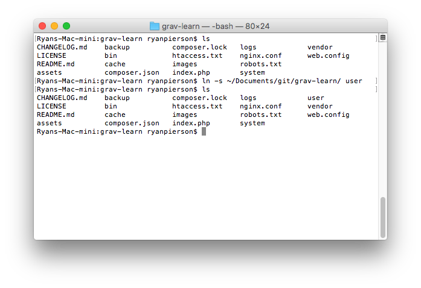

# Введение в командную строку

Ни для кого не секрет, что Grav создавался с расчётом на командную строку. Плагин Admin, безусловно, упрощает решение многих задач без открытия терминала (MacOS и Linux) или командной строки (Windows), но нельзя не сказать о скорости и уровне контроля, которые даёт работа в командной строке.

Особенно это верно для тех, кто использует собственные серверы разработки или удалённый сервер, к командной строке которого у них есть доступ. Количество инструментов, доступных из командной строки, впечатляет. Практически всеми аспектами хостинга вашего сайта, Grav, его плагинами и темами можно управлять несколькими нажатиями клавиш.

В конечном счёте всё сводится к личным предпочтениям. На этой странице мы перечислим несколько полезных ресурсов, которые помогут вам освоиться с командной строкой.

> [!CAUTION] Внимание
> Не все операционные системы совместимы друг с другом в отношении команд. Между MacOS и многими дистрибутивами Linux есть небольшие различия, а командная строка Windows имеет совсем другой набор команд по сравнению с этими двумя.

## MacOS

MacOS основана на Unix и соответствует стандартам POSIX. Это означает, что большинство команд, знакомых вам по другим Unix- или Linux-системам, будут работать в MacOS именно так, как ожидается. Из правила есть исключения, и именно поэтому мы рекомендуем уточнять команды терминала для той операционной системы, с которой вы работаете.

Вот несколько полезных ресурсов, которые помогут вам привыкнуть к работе с терминалом в MacOS:

* [Руководство по командам терминала MacOS от Майкла Хогга](http://michael-hogg.co.uk/os_x_terminal.php) — практический ресурс о командах терминала для MacOS: что они делают и как их использовать.
* [Руководство по терминалу от MacRumors](http://guides.macrumors.com/Terminal) — полезный ресурс по навигации и работе в терминале, включая советы по использованию вместе с графическим интерфейсом.
* [Советы и приёмы работы в терминале от Envato Tuts+](http://computers.tutsplus.com/tutorials/40-terminal-tips-and-tricks-you-never-thought-you-needed--mac-51192) — 40 хитростей для освоения терминала. Включает команды, которых не найти во многих базовых вводных руководствах.
* [Укрощение терминала от Envato Tuts+](http://computers.tutsplus.com/articles/new-mactuts-session-taming-the-terminal--mac-45471) — подробный курс по работе с терминалом из нескольких частей. Включает видео, скриншоты и многое другое.

## Linux

У подавляющего большинства дистрибутивов Linux (и Unix) есть одна общая черта: интерфейс командной строки Bash (терминал). Независимо от того, используете ли вы графическую среду, такую как Gnome, Unity или KDE, велика вероятность, что при работе с дистрибутивом Linux на настольном компьютере или ноутбуке вы уже обращались к командной строке.

В конце концов, она мощная. Практически всё, что можно сделать через графический интерфейс, можно сделать прямо в командной строке, часто с большим контролем над выполнением команд. Вот несколько отличных ресурсов, которые помогут вам освоить терминал в Linux:

* [Руководство для начинающих по командной строке Linux от TechSpot](http://www.techspot.com/guides/835-linux-command-line-basics/) — отличное вводное руководство по командной строке.
* [Краткое руководство по началу работы с командной строкой Linux от MakeUseOf](http://www.makeuseof.com/tag/a-quick-guide-to-get-started-with-the-linux-command-line/) — ещё один отличный ресурс для изучения терминала.
* [Справочник команд Linux от O'Reilly Linux DevCenter](http://www.linuxdevcenter.com/cmd/) — указатель команд, доступных в терминале.
* [Учебник по Linux от Ryan's Tutorials](http://ryanstutorials.net/linuxtutorial/) — отличное универсальное руководство по Linux и интерфейсу командной строки Bash (терминалу).

## Windows

Windows выделяется на общем фоне по ряду причин. Многие команды в командной строке Windows напоминают о её корнях в DOS. Привычная команда `ls` для вывода содержимого папки здесь не работает. Вместо неё нужно ввести `dir`. Вот несколько ресурсов, которые помогут вам освоить командную строку Windows:

* [Руководство для начинающих по командной строке Windows от MakeUseOf](http://www.makeuseof.com/tag/a-beginners-guide-to-the-windows-command-line/) — хорошо написанное введение в командную строку Windows.
* [DOSPrompt.info](http://dosprompt.info/) — целый сайт, посвящённый знакомству пользователей с командной строкой.

> [!CAUTION] Внимание
> Все команды CLI Grav основаны на PHP, но в Windows он доступен не сразу. Проверить, установлен ли он, можно, открыв консоль и введя `php -v`. Если выводится `'php' is not recognized as an internal or external command ...`, значит, PHP не установлен.

Чтобы добавить PHP в систему Windows, нужно найти «Переменные среды» — через поиск в меню «Пуск» или через Панель управления -> Дополнительные параметры системы -> кнопка «Переменные среды».

В разделе «Системные переменные» найдите «Path» и нажмите «Изменить». Скопируйте «значение переменной» в блокнот и добавьте в конце точку с запятой — она разделяет переменные. Затем найдите путь к вашей установке PHP ([установленной с нуля](http://windows.php.net/) или входящей в вашу среду разработки) и добавьте его в конец этого длинного списка переменных. Нужен путь к папке, без `php.exe`.

После этого откройте новую консоль (или перезапустите текущую), чтобы новый путь применился. Затем снова попробуйте `php -v` — вывод должен быть примерно таким: `PHP 7.0.7 (cli) ...`. При запуске команд Grav нужно будет добавлять перед ними `php`, например `php grav/gpm index`.

## Команды, специфичные для Grav

Одна из самых замечательных особенностей Grav — множество мощных команд, доступных для всего: от установки дополнительных плагинов и тем до добавления пользователей в Admin. В этом разделе мы перечислим многие из наиболее часто используемых команд.

Все перечисленные ниже команды совместимы с <strong>любой операционной системой.</strong>

| Команда                           | Описание                                                                                                                           |
| :----------------                | :--------------------------------------                                                                                           |
| `bin/grav list`                   | Выводит список всех команд, доступных в Grav (кроме GPM).                                                                          |
| `bin/grav help <command>`         | Выводит справку по конкретной команде.                                                                                             |
| `bin/grav new-project <location>` | Используется для создания нового чистого экземпляра Grav в другой папке. Может запускаться из существующей установки Grav.         |
| `bin/grav install`                | Эта команда устанавливает зависимости, необходимые для работы текущей установки Grav.                                              |
| `bin/grav cache`                  | Эта команда очищает кэш вашей установки Grav. Доступные параметры: `--all`, `--assets-only`, `--images-only` и `--cache-only`      |
| `bin/grav backup`                 | Создаёт zip-архив резервной копии текущего сайта Grav.                                                                             |
| `bin/grav composer`               | Обновляет вручную установленные vendor-пакеты на основе composer.                                                                 |
| `bin/grav security`               | Выполняет настроенные проверки безопасности XSS на всех страницах Grav                                                             |
| `bin/gpm list`                    | Выводит список всех команд, доступных через GPM Grav (менеджер пакетов Grav)                                                       |
| `bin/gpm help <command>`          | Выводит справку по конкретной команде.                                                                                             |
| `bin/gpm index`                   | Показывает список всех доступных ресурсов в репозитории Grav, упорядоченный по темам и плагинам.                                   |
| `bin/gpm info`                    | Отображает сведения о нужном пакете: описание, автора, домашнюю страницу и т. д.                                                   |
| `bin/gpm install`                 | Устанавливает ресурс из репозитория в текущую установку Grav одной простой командой.                                               |
| `bin/gpm update`                  | Проверяет установленные плагины и темы на наличие обновлений и выводит их список.                                                  |
| `bin/gpm uninstall`               | Удаляет установленную тему или плагин и очищает кэш.                                                                               |
| `bin/gpm self-upgrade`            | Позволяет обновить Grav до последней версии.                                                                                       |
| `bin/gpm logviewer`               | Удобный просмотр журналов Grav с настройками выбора файла журнала, количества строк и подробности                                 |
| `bin/gpm scheduler`               | Управление запланированными заданиями и при необходимости ручной запуск планировщика                                               |

> [!CAUTION] Внимание
> Эти команды подробнее описаны в документации [Grav CLI](../grav-cli/index.md) и [Grav GPM](../grav-cli-gpm/index.md).

Перечисленные ниже команды совместимы с <strong>системами Mac или Unix.</strong>

| Команда                                  | Описание                                                                                                                  |
| :----------------                        | :--------------------------------------                                                                                  |
|  `bin/gpm index | grep '| installed'`  | Выводит список всех плагинов и тем, установленных в данный момент. |

## Символические ссылки {: #symbolic-links }

Символические ссылки (также известные как симлинки) невероятно полезны и просты в создании из командной строки. Они создают виртуальную копию (клон) заданной папки или её содержимого и помещают её туда, куда вы укажете. В отличие от настоящей копии, это всего лишь туннель к оригиналу, поэтому всё, что вы видите и меняете, отражается сразу в нескольких местах.

Ещё одно большое преимущество — практически нулевой дополнительный объём на диске, поскольку копий одних и тех же файлов не создаётся.

В случае с Grav символические ссылки — отличный способ добавлять плагины, темы и контент в несколько экземпляров так, чтобы их было бесконечно проще обновлять и изменять. Вы вносите изменение один раз, и оно появляется везде, где файлы связаны символической ссылкой.

Процесс создания символической ссылки довольно прост, с небольшими различиями между операционными системами.

### Символические ссылки в MacOS и Linux

Команда следует общей схеме `ln -s <original file, directory, or its contents> <put virtual copies here>`.

Команды, создающие символическую ссылку, различаются в зависимости от операционной системы. В MacOS и большинстве дистрибутивов Unix и Linux это `ln -s`. Часть `ln` сообщает системе, что вы хотите создать ссылку. Ключ `-s` делает ссылку символической.

### Символические ссылки в Windows

Базовая структура команды в Windows: `mklink <type> <put virtual copies here> <original file, directory, or its contents>`. В отличие от MacOS или Linux, здесь нужно указать аргумент типа файла, для которого создаётся символическая ссылка. Кроме того, источник и назначение меняются местами: новая символическая ссылка указывается перед файлом, на который она ссылается. Здесь можно использовать три аргумента:

* `/j` — наиболее часто используемый аргумент. Создаёт символическую ссылку на папку.
* `/h` — создаёт символическую ссылку для конкретного файла.
* `/d` — создаёт мягкую ссылку, или ярлык. Для описанных здесь целей вряд ли пригодится.

### Примеры команд

По сути, вы указываете команду, создающую символическую ссылку, то, что связываете, и место, куда помещаете виртуальные копии. Ниже приведены подробные примеры таких команд:

##### Связывание содержимого одной папки с другой

| MacOS и Linux               | Windows                           |
| :-----                      | :-----                            |
| `ln -s ~/folder1 ~/folder2` | `mklink /J C:\folder2 C:\folder1` |

Эта команда создаёт символическую ссылку, которая берёт содержимое, изначально находящееся в **folder1**, и помещает его символически связанную копию в **folder2**. Если **folder2** ещё не существует, она создаётся этой командой.

##### Связывание целых папок из одного места в другое

| MacOS и Linux                | Windows                            |
| :-----                       | :-----                             |
| `ln -s ~/folder1 ~/folder2/` | `mklink /J C:\folder2\ C:\folder1` |

Эта команда копирует всю папку **folder1** и помещает её в целевое расположение (в данном случае **folder2**). В этом случае **folder2** должна уже существовать, так как эта команда её не создаст.
Обратите внимание на косую черту или обратную косую черту в конце при указании **folder2**.

##### Связывание отдельных файлов из одного места в другое {: #link-individual-file-s-from-one-place-to-another }

| MacOS и Linux                        | Windows                                     |
| :-----                               | :-----                                      |
| `ln -s ~/folder1/file.jpg ~/folder2` | `mklink /H C:\folder2\ C:\folder1\file.jpg` |

Это полезная команда для создания символических ссылок на отдельные файлы. Особенно удобна, если у вас есть файлы, общие для нескольких папок, и вы хотите, чтобы они обновлялись везде одновременно. Помните, что оригинальный файл — единственная реальная копия, поэтому он должен оставаться на месте, чтобы все символические ссылки работали.
