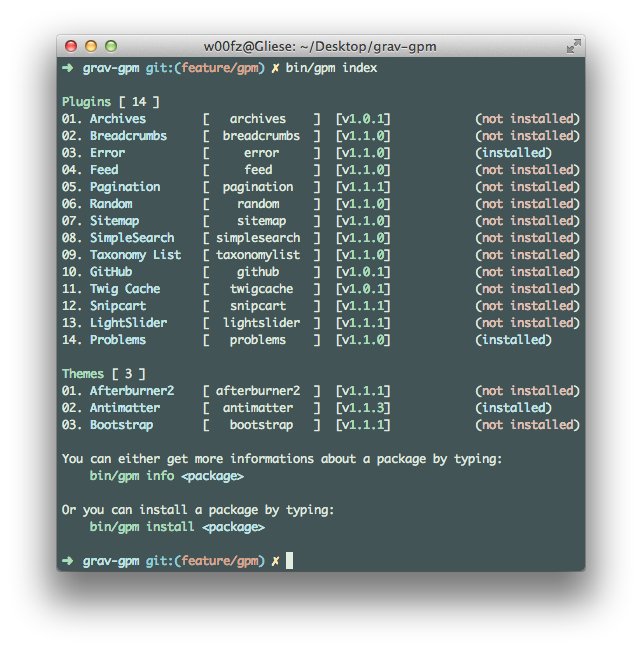
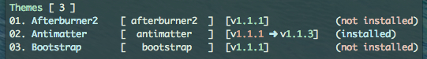
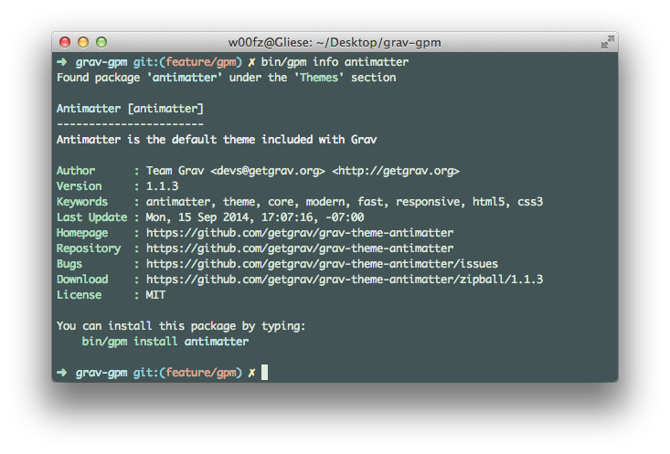
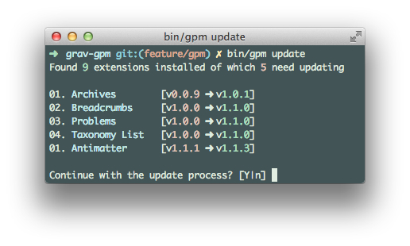
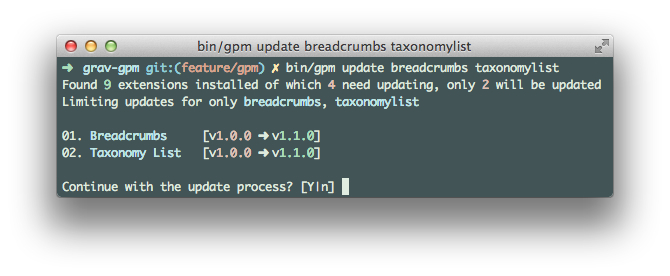
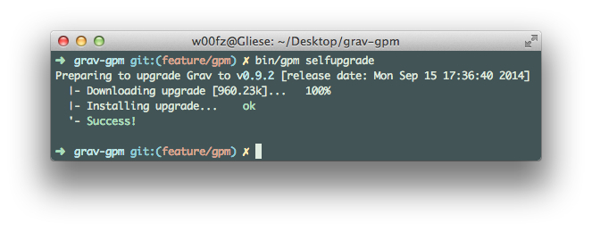

# Команда GPM

Начиная с версии **0.9.3** Grav включает _GPM_ (менеджер пакетов Grav), который позволяет устанавливать, обновлять, удалять и перечислять все темы и плагины, доступные в репозитории Grav, а также обновлять сам Grav до последней версии.

Как и [Grav CLI](../grav-cli/index.md), _GPM_ — инструмент командной строки, требующий запуска команд через интерфейс командной строки, например **Терминал** в MacOS. Команды в стиле UNIX изначально недоступны в командной строке Windows. Установка пакета [msysgit](https://msysgit.github.io/) в Windows добавляет [Git](https://git-scm.com/) и Git BASH — альтернативную командную строку, в которой доступны команды UNIX.

Чтобы начать работу с _GPM_, выполните следующую команду, чтобы получить список всех доступных в данный момент команд:

```bash
bin/gpm list
```

Чтобы получить справку по конкретной команде, добавьте `help` перед командой:

```bash
bin/gpm help install
```

> [!CAUTION] Внимание
> Для выполнения **install**, **upgrade** и **selfupgrade** в PHP должно быть включено расширение `php_openssl`. Если при загрузке возникает фатальная ошибка, вероятная причина именно в этом.

#### Информация о PHP CGI-FCGI

Чтобы определить, работает ли на вашем сервере `cgi-fcgi` в командной строке, введите:

```bash
php -v
PHP 5.5.17 (cgi-fcgi) (built: Sep 19 2014 09:49:55)
Copyright (c) 1997-2014 The PHP Group
Zend Engine v2.5.0, Copyright (c) 1998-2014 Zend Technologies
    with the ionCube PHP Loader v4.6.1, Copyright (c) 2002-2014, by ionCube Ltd.
```

Если вы видите упоминание `(cgi-fcgi)`, нужно добавлять `php-cli` перед всеми командами `bin/gpm`. Либо можно настроить псевдоним в оболочке, например `alias php="php-cli"`, чтобы из командной строки запускалась именно **CLI**-версия PHP.

## Как это работает?

_GPM_ загружает метаданные репозитория с **GetGrav.org**. Репозиторий содержит все сведения о доступных пакетах, и _GPM_ также умеет определять, установлен ли уже какой-либо из этих пакетов и нужно ли его обновлять.

Сам репозиторий кэшируется локально на машине с экземпляром Grav, где выполняется команда, на 24 часа. Последующие запросы после создания кэша не обращаются к серверу **GetGrav.org**, а используют локально сохранённый репозиторий. Такой подход обеспечивает гораздо более быстрый отклик.

Большинство команд (перечисленных ниже) поддерживают параметр `--force (-f)`, позволяющий принудительно заново загрузить репозиторий. Это может быть крайне полезно, если известно о наличии обновления и пользователь не хочет ждать полного 24-часового цикла до очистки кэша.

## Команды

Ниже разобраны все команды, доступные в _GPM_. Чтобы выполнить команду, запустите любимое приложение терминала и из корня экземпляра Grav введите `bin/gpm <command>`.

## Index

Команда `index` показывает список всех доступных ресурсов в репозитории Grav, упорядоченный по _темам_ и _плагинам_.



В каждой строке отображаются **имя**, **slug**, **версия** и признак того, установлен ли ресурс.

В этом представлении также можно быстро определить, появилась ли новая версия какого-либо из уже установленных ресурсов.

Например, если у нас очень старая версия Antimatter (v1.1.1), а последняя версия — v1.1.3, это будет отображаться в списке так, как показано ниже.



> [!CAUTION] Внимание
> Можно использовать параметр `--installed-only`, чтобы показать состояние **только установленных** плагинов и тем.

## Info

Команда `info` отображает сведения о нужном пакете: описание, автора, домашнюю страницу и т. д.



> [!CAUTION] Внимание
> С помощью этого параметра также будет предложено просмотреть **журнал изменений** плагина/темы.

## Install

Команда `install` делает именно то, что заявлено: устанавливает ресурс из репозитория в текущий экземпляр Grav одной простой командой.

Команда также определит, установлен ли ресурс уже или является ли он символической ссылкой, и предложит выбрать дальнейшие действия.

Можно установить несколько ресурсов сразу, разделив их slug'и пробелом.

[plugin:youtube](https://www.youtube.com/watch?v=SUUtcYl2xrE)

> [!CAUTION] Внимание
> Можно использовать параметр `--all-yes (-y)`, чтобы пропустить все запросы. Существующие ресурсы будут перезаписаны, а если они являются символическими ссылками, будут автоматически пропущены.

## Update

Команда `update` показывает список обновляемых ресурсов и работает аналогично `install`.



[plugin:youtube](https://www.youtube.com/watch?v=jkxk2xBr5TM)

Кроме того, можно ограничить обновления только определёнными ресурсами.



[plugin:youtube](https://www.youtube.com/watch?v=rSWdmdx9TDA)

## Uninstall

Команда `uninstall` удаляет установленную тему или плагин и очищает кэш. Поскольку Grav работает исключительно с файловой системой, удаление темы или плагина означает физическое удаление папки.

Команда также определит, является ли ресурс символической ссылкой, и предложит выбрать дальнейшие действия.

Можно удалить несколько ресурсов сразу, разделив их slug'и пробелом.

> [!CAUTION] Внимание
> Можно использовать параметр `--all-yes (-y)`, чтобы пропустить все запросы. Если ресурс определён как символическая ссылка, он будет автоматически пропущен.

## Self-upgrade

Команда `self-upgrade` (или `selfupgrade`) позволяет обновить Grav до последней доступной версии. Если обновление не требуется, вы увидите сообщение об этом, а также информацию о текущей версии и дате её выпуска.

Настоятельно рекомендуется всегда делать резервную копию перед самообновлением (см. раздел _Резервное копирование_ в [разделе CLI](../grav-cli/index.md)).

> [!CAUTION] Внимание
> Самообновление обновляет только части экземпляра Grav: папку `system/`, папку `vendor/`, `index.php` и другие. Папки **`user`** и **`images`** никогда не затрагиваются.



[plugin:youtube](https://www.youtube.com/watch?v=15-E8l5aaUo)

## Важная информация для разработчиков

#### Схемы

С появлением _GPM_ появились строгие правила для корректных `blueprints`. Независимо от того, разрабатываете ли вы _тему_ или _плагин_, всегда следите за тем, чтобы `blueprints` были оформлены правильно.

Схема (blueprint) может выполнять несколько разных задач, в том числе определять идентичность вашего ресурса. Подробную документацию о том, что такое схемы и как их следует составлять, см. в разделе [Схемы](../../forms/blueprints/index.md).

#### Релизы

Репозиторий Grav обновляется каждый час и автоматически обнаруживает новые релизы; это означает, что как разработчик вы соблюдали наши [требования к участию](https://github.com/getgrav/grav#contributing).

С вашей стороны нужно лишь убедиться, что схемы обновлены с новой версией, а также что новая версия помечена тегом и выпущена. Остальное репозиторий Grav сделает сам: как только ваш релиз будет обнаружен, он станет доступен всем через сайт Grav или через _GPM_.

#### Добавление ресурса в репозиторий

Следуйте инструкциям в разделе [Процесс выпуска темы или плагина](../../advanced/grav-development/index.md).

Чтобы добавить новый плагин/тему в репозиторий Grav, откройте issue в репозитории Grav на GitHub. Также можно [воспользоваться этой готовой ссылкой](https://github.com/getgrav/grav/issues/new?title=[add-resource]%20New%20Plugin/Theme&body=I%20would%20like%20to%20add%20my%20new%20plugin/theme%20to%20the%20Grav%20Repository.%0AHere%20are%20the%20project%20details:%20**user/repository**). Не забудьте указать в теле правильный `user/repository`.

Будем рады дополнительным сведениям о том, что делает плагин/тема; их можно указать в issue.

Также учтите, что перед добавлением в репозиторий команда Grav проверит ваш плагин/тему на соответствие стандартам Grav. Команда также может запросить дополнительную информацию, предложить небольшие улучшения и т. п. перед закрытием issue и добавлением плагина/темы.
