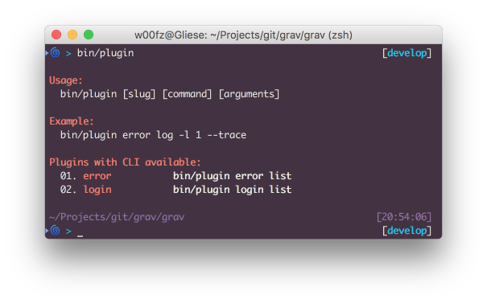
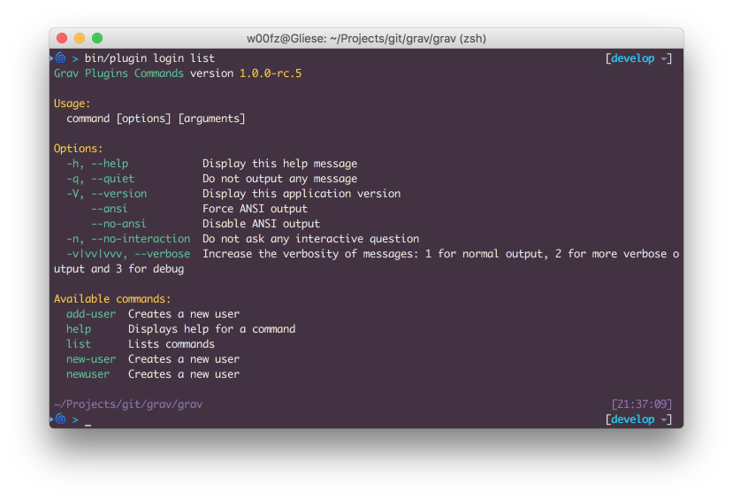
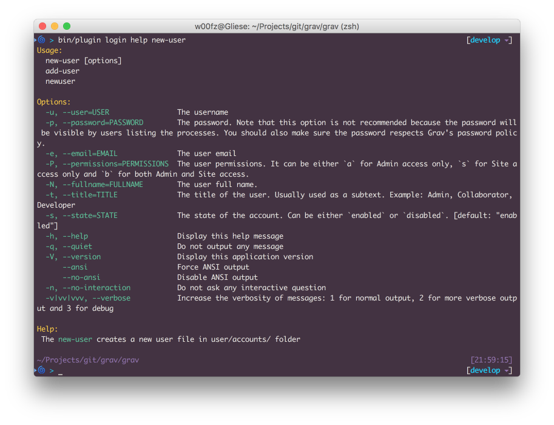
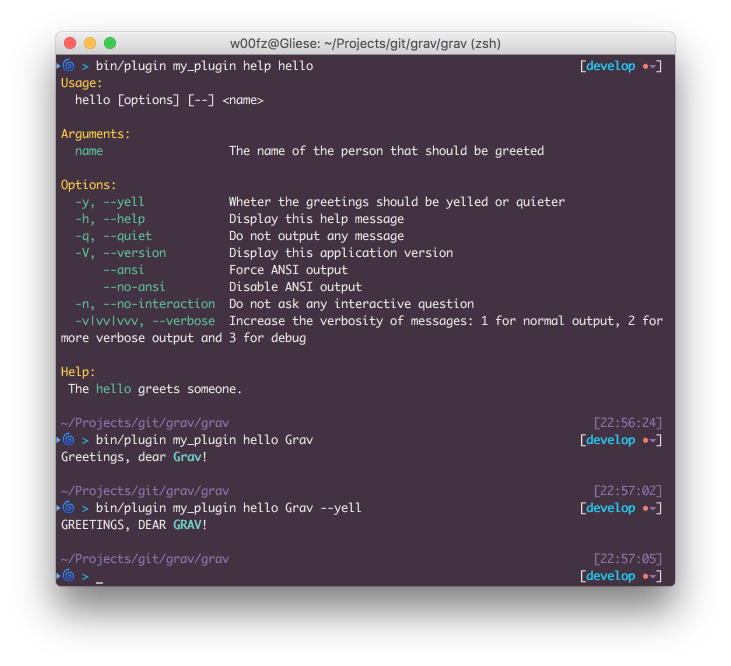

# Команда Plugin

Плагины могут интегрироваться в CLI Grav `bin/plugin` и расширять функциональность плагинов через терминал, выполняя определённые задачи.

Как описано в разделе [Grav CLI](../grav-cli/index.md), для выполнения команд нужен **терминал**.

При выполнении команды `bin/plugin` выводится список всех плагинов, поддерживающих интеграцию с CLI.



Первый аргумент, передаваемый в `bin/plugin`, всегда является slug'ом плагина (например, _error_, _login_ и т. д.). Второй аргумент — это собственно _команда_, предоставляемая плагином.

В зависимости от реализации плагина далее могут следовать другие параметры; узнать о каждом из них можно, выполнив команду `bin/plugin [slug] list`.

## Зарезервированные команды и параметры {: #reserved-commands-and-options }

Есть несколько зарезервированных _команд_ и _параметров_, которые всегда доступны в любом плагине. Их особенно важно учитывать разработчикам, реализующим собственные задачи, поскольку зарезервированные команды и параметры использовать нельзя.

| **Команды** |                             |
|-------------|-----------------------------|
| `help`      | Выводит справку по команде  |
| `list`      | Выводит список команд       |

| **Параметры**              |                                                                                                    |
|----------------------------|----------------------------------------------------------------------------------------------------|
| `-h`, `--help`             | Показать сообщение справки                                                                         |
| `-q`, `--quiet`            | Не выводить сообщения                                                                              |
| `-v`, `--version`          | Показать версию приложения                                                                         |
| `--ansi`                   | Принудительно использовать вывод ANSI                                                              |
| `--no-ansi`                | Отключить вывод ANSI                                                                               |
| `-n`, `--no-interaction`   | Не задавать интерактивных вопросов                                                                 |
| `-v|vv|vvv`, `--verbose`   | Повысить подробность сообщений: 1 — обычный вывод, 2 — более подробный, 3 — отладочный            |

## Как использовать CLI для плагинов

Команды **list** и **help** очень полезны, когда вы ещё не знаете, как пользоваться CLI конкретного плагина.

С помощью **list** можно увидеть все доступные команды и краткое описание того, что делает каждая из них.

Вот пример с плагином **login** при выполнении команды `bin/plugin login list`.

> [!WARNING] Предупреждение
> Если после slug'а плагина не указана команда, автоматически используется `list`. Это значит, что `bin/plugin [slug] list` и `bin/plugin [slug]` эквивалентны.



Как видите, большинство параметров и команд соответствуют [списку зарезервированных](#reserved-commands-and-options). Собственно команды, предлагаемые плагином login: `add-user`, `new-user` и `newuser`.

Как можно заметить, описание в справке у всех трёх команд одинаковое. Это потому, что все три команды намеренно полностью идентичны. **add-user** и **newuser** фактически являются псевдонимами **new-user**, что позволяет легко угадать команду, не зная и не запоминая её.

Теперь, когда мы знаем, что в плагине login есть команда `new-user`, осталось научиться ею пользоваться. Здесь и пригодится зарезервированная команда **help**. Выполним `bin/plugin login help new-user`.



Теперь у нас есть полное представление о команде `new-user` и мы знаем, как её использовать.
Попробуем создать нового пользователя. Поскольку все параметры по определению необязательны, пароль мы намеренно опустим (его запросят позже в диалоге).

```bash
bin/plugin login newuser -u joeuser -e joeuser@grav.org -P b -N "Joe User" -t "Site Administrator"
Creating new user

Enter a password: *********
Repeat the password: *********

Success! User joeuser created.
```

## Разработчикам: интеграция CLI в плагин {: #developers-integrate-the-cli-in-plugin }

Как разработчик, вы можете захотеть создать команды CLI для администраторов или пользователей. Добавить такую функциональность в плагин крайне просто.

Первым делом создайте подпапку `cli/` в корне плагина. Эта папка будет обрабатываться `bin/plugin`, который просканирует её на наличие классов команд.

CLI Grav основан на замечательном [компоненте Symfony Console](http://symfony.com/doc/current/components/console/introduction.html), и для полного справочника вполне можно пользоваться их документацией; есть лишь несколько важных моментов, которые стоит учесть.

1. Имя файла класса стандартизировано. Оно должно начинаться с заглавной буквы и заканчиваться на **Command.php**.
    * `Hello.php`: НЕВЕРНО
    * `helloworldCommand.php`: НЕВЕРНО
    * `HelloworldCommand.php`: ВЕРНО
    * `HelloWorldCommand.php`: ВЕРНО
2. Всегда наследуйте `ConsoleCommand` — это даёт дополнительные возможности Grav: форматированные цвета, прямой доступ к экземпляру Grav и другие утилиты ([подробнее](https://github.com/getgrav/grav/blob/develop/system/src/Grav/Console/ConsoleTrait.php)).
3. Symfony Console требует метод `execute`. При наследовании **ConsoleCommand** он становится `serve`.

Ниже — простой пример для начала. Его можно проверить как есть, сохранив как `HelloCommand.php` и поместив в корневую папку `cli/` плагина (**user/plugins/my_plugin/cli/HelloCommand.php**).

```php linenums="1"
<?php
namespace Grav\Plugin\Console;

use Grav\Console\ConsoleCommand;
use Symfony\Component\Console\Input\InputArgument;
use Symfony\Component\Console\Input\InputOption;

/**
 * Class HelloCommand
 *
 * @package Grav\Plugin\Console
 */
class HelloCommand extends ConsoleCommand
{
    /**
     * @var array
     */
    protected $options = [];

    /**
     * Приветствует человека с криком или без
     */
    protected function configure()
    {
        $this
            ->setName("hello")
            ->setDescription("Greets a person.")
            ->addArgument(
                'name',
                InputArgument::REQUIRED,
                'The name of the person that should be greeted'
            )
            ->addOption(
                'yell',
                'y',
                InputOption::VALUE_NONE,
                'Wheter the greetings should be yelled or quieter'
            )
            ->setHelp('The <info>hello</info> greets someone.')
        ;
    }

    /**
     * @return int|null|void
     */
    protected function serve()
    {
        // Собирает определённые аргументы и параметры
        $this->options = [
            'name' => $this->input->getArgument('name'),
            'yell' => $this->input->getOption('yell')
        ];

        // Готовим строки для вывода и оборачиваем имя в голубой цвет
        // Другие цвета доступны здесь:
        // https://github.com/getgrav/grav/blob/develop/system/src/Grav/Console/ConsoleTrait.php
        $greetings = 'Greetings, dear <cyan>' . $this->options['name'] . '</cyan>!';

        // Если передан необязательный параметр I39 или I40, переводим всё в верхний регистр
        if ($this->options['yell']) {
            $greetings = strtoupper($greetings);
        }

        // наконец выводим приветствие
        $this->output->writeln($greetings);
    }
}
```



> [!WARNING] Предупреждение
> Ещё один хороший простой пример можно найти в [плагине Error (LogCommand.php)](https://github.com/getgrav/grav-plugin-error/blob/develop/cli/LogCommand.php). Если нужен более сложный пример, посмотрите [плагин Login (NewUserCommand.php)](https://github.com/getgrav/grav-plugin-login/blob/develop/cli/NewUserCommand.php)
