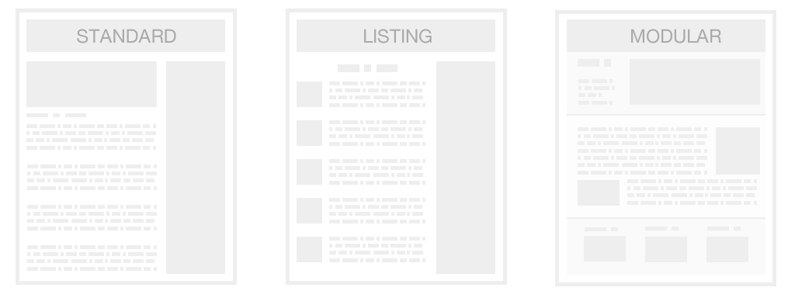
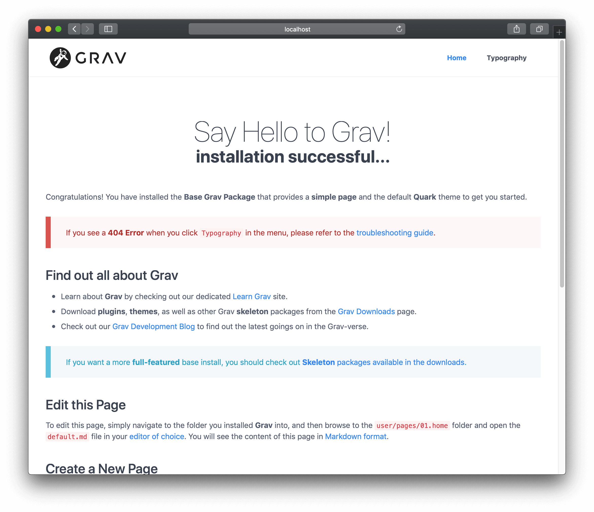
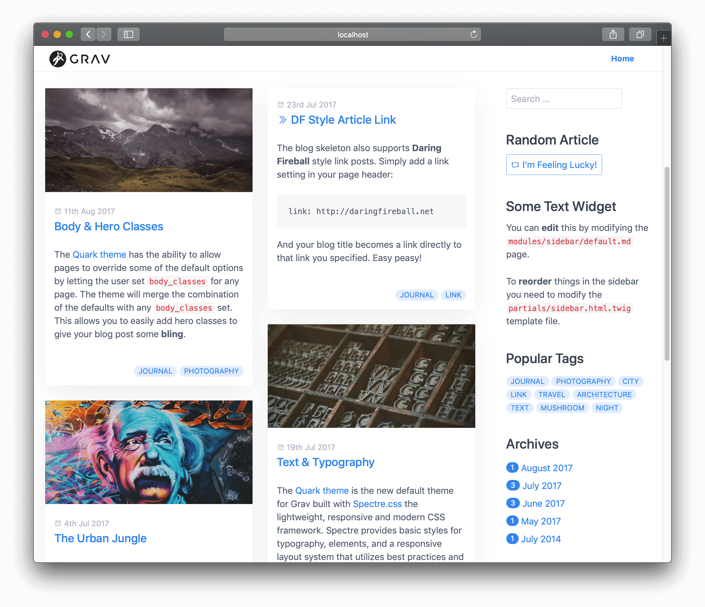

# Страницы

На языке Grav **страницы** — это основные строительные блоки вашего сайта. Именно так вы создаёте контент и обеспечиваете навигацию в системе Grav.

Сочетание контента и навигации делает систему интуитивно понятной даже для самых неопытных авторов контента. При этом вместе с мощными возможностями таксономии эта система достаточно гибка для сложных требований к контенту.

Grav нативно поддерживает **3 типа страниц**, которые позволяют создавать богатый набор веб-контента. Это:

---



#### Обычная страница



Обычная страница — это, как правило, отдельная страница, например **запись блога**, **контактная форма**, **страница ошибки** и т. п. Это самый распространённый тип страницы. По умолчанию страница считается обычной, если вы не указали Grav иное.

Когда вы скачиваете и устанавливаете пакет **Core Grav**, вас встречает стандартная страница. Создание простой обычной страницы описано в [базовом руководстве](../../basics/basic-tutorial/index.md).

#### Страница-список



Это расширение обычной страницы. Такая страница содержит ссылку на коллекцию страниц.

Самый простой способ настроить её — создать **дочерние страницы** внутри страницы-списка. Пример — **страница списка блога**, где выводится краткий список записей блога, существующих как дочерние страницы.

Есть также параметры конфигурации, которые позволяют **управлять порядком** вывода, **ограничивать количество элементов** и включать или отключать **пагинацию**.

> [!CAUTION] Внимание
> Пример **Blog Skeleton** со **страницей-списком** можно найти в [загрузках Grav](https://getgrav.org/downloads/skeletons).

#### Модульная страница


**Модульная страница** — особый тип страницы-списка, потому что она собирает **одну страницу** из своих **дочерних страниц** или **модулей**. Это позволяет строить очень сложные **одностраничные макеты** из модулей. Для этого **модульная страница** собирается из нескольких **модулей**, находящихся в основной папке модульной страницы.

> [!CAUTION] Внимание
> Пример **One-Page Skeleton** с **модульной страницей** можно найти в [загрузках Grav](https://getgrav.org/downloads/skeletons).

Каждый из этих типов страниц следует одной и той же базовой структуре, поэтому прежде чем углубляться в детали каждого типа, нужно объяснить, как устроены страницы в Grav.

> [!CAUTION] Внимание
> Модуль, поскольку он предназначен быть частью другой страницы, по своей природе не является страницей, доступной напрямую по URL. Поэтому все страницы модулей по умолчанию помечены как **немаршрутизируемые**.

## Папки {: #folders }

Все страницы контента находятся в папке `/user/pages`. Каждую **страницу** следует размещать в собственной папке.

> [!CAUTION] Внимание
> Имена папок также должны быть допустимыми **слагами**. Слаги состоят только из строчных букв; акцентированные символы заменяются буквами латиницы, а пробелы — дефисом или подчёркиванием, чтобы избежать кодирования.

Grav понимает, что любое целое число перед точкой служит только для порядка, и внутренне удаляет его. Например, если у вас есть папка `01.home`, Grav будет считать её папкой `home`, но при порядке по умолчанию она окажется перед `02.blog`.

```text linenums="1"
/user
└── /pages
    ├── /01.home
    │   ├── /_header
    │   ├── /_features
    │   ├── /_body
    ├── /02.blog
    │   ├── /blog-item-1
    │   ├── /blog-item-2
    │   ├── /blog-item-3
    │   ├── /blog-item-4
    │   └── /blog-item-5
    ├── /03.about-us
    └── /error
```

У вашего сайта должна быть точка входа, чтобы он знал, куда идти, когда вы открываете корень сайта в браузере. Например, если ввести в браузере `http://my-site.example`, по умолчанию Grav ожидает псевдоним `home/`, но расположение домашней страницы можно переопределить, изменив параметр `home.alias` в [файле конфигурации Grav](../../basics/grav-configuration/index.md).

**Модули** определяются символом подчёркивания (`_`) перед именем папки. Это особый тип папки, предназначенный только для **модульного контента**. Такие папки **не маршрутизируются** и **не видны** в навигации. Пример настройки модульной страницы — папка вроде `user/pages/01.home`. Home настроена как **модульная страница**, которая содержит коллекцию **модулей** и собирается из папок `_header`, `_features` и `_body` внутри папки home.

Текстовое имя каждой папки по умолчанию становится *слагом*, который система использует в URL. Например, если у вас есть папка `/user/pages/02.blog`, слаг этой страницы по умолчанию будет `blog`, а полный URL — `http://my-site.example/blog`. Страница записи блога, расположенная в `/user/pages/02.blog/blog-item-5`, будет доступна по адресу `http://my-site.example/blog/blog-item-5`.

Если числовой префикс в имени папки отсутствует, страница считается **невидимой** и не появляется в навигации. Пример — страница `error` в структуре папок выше.

> [!CAUTION] Внимание
> На самом деле это можно переопределить в самой странице, установив [параметр `visible`](../headers/index.md#visible) в заголовках.

## Порядок

При работе с коллекциями доступно несколько параметров, управляющих порядком папок. Самый важный задаётся в `content.order.by` в настройках страницы. Варианты:

| Свойство | Описание |
| -------- | ----------- |
| **default**  | Порядок основан на файловой системе, то есть `01.home` идёт перед `02.advark` |
| **title**    | Порядок основан на заголовке, определённом на каждой странице |
| **basename** | Порядок основан на алфавитном имени папки без числового префикса |
| **date**     | Порядок основан на дате, определённой на каждой странице |
| **modified** | Порядок основан на отметке времени последнего изменения страницы |
| **folder**   | Порядок основан на имени папки без числового префикса, то есть `01.` |
| **header.x** | Порядок основан на любом поле заголовка страницы, то есть `header.taxonomy.year`. Также можно указать значение по умолчанию через вертикальную черту, то есть `header.taxonomy.year|2015` |
| **manual**   | Порядок основан на переменной `order_manual` |
| **random**   | Порядок случайный |

Вы можете явно задать ручной порядок, передав список параметров в настройку `content.order.custom`. Она работает вместе с `content.order.by`: сначала Grav пытается упорядочить страницы вручную, а страницы, не указанные в ручном порядке, упорядочиваются согласно заданному способу.

> [!CAUTION] Внимание
> Вы можете переопределить **поведение по умолчанию** для порядка папок и направление сортировки, установив параметры `pages.order.dir` и `pages.order.by` в [файле системной конфигурации Grav](../../basics/grav-configuration/index.md).

## Файл страницы

Внутри папки страницы мы создаём собственно файл страницы. Имя файла должно заканчиваться на `.md`, что указывает на файл в формате Markdown. Технически это Markdown с YAML-метаданными страницы — звучит внушительно, но на самом деле ничего сложного. Детали структуры файла мы скоро рассмотрим.

Важно понимать, что имя файла напрямую задаёт имя файла шаблона темы, который будет использоваться для рендеринга. Стандартное имя основного файла шаблона — **default**, поэтому файл будет называться `default.md`.

Разумеется, вы можете назвать файл как угодно, например `document.md`; тогда Grav будет искать в теме подходящий файл шаблона, например Twig-шаблон **document.html.twig**.

> [!CAUTION] Внимание
> Это поведение можно переопределить в странице, установив [параметр `template`](../headers/index.md#template) в заголовках.

Пример файла страницы может выглядеть так:

```yaml linenums="1"
---
title: Page Title
taxonomy:
    category: blog
---
```

```markdown linenums="1"
# Page Title

Lorem ipsum dolor sit amet, consectetur adipiscing elit. Pellentesque porttitor eu
felis sed ornare. Sed a mauris venenatis, pulvinar velit vel, dictum enim. Phasellus
ac rutrum velit. **Nunc lorem** purus, hendrerit sit amet augue aliquet, iaculis
ultricies nisl. Suspendisse tincidunt euismod risus, _quis feugiat_ arcu tincidunt
eget. Nulla eros mi, commodo vel ipsum vel, aliquet congue odio. Class aptent taciti
sociosqu ad litora torquent per conubia nostra, per inceptos himenaeos. Pellentesque
velit orci, laoreet at adipiscing eu, interdum quis nibh. Nunc a accumsan purus.
```

Параметры между двумя маркерами `---` называются YAML-метаданными страницы и состоят из базовых YAML-настроек страницы.

В этом примере мы явно задаём заголовок, а также таксономию **blog**, чтобы фильтровать страницы позже. Контент после второго `---` — это собственно содержимое, которое будет скомпилировано и отрендерено как HTML на вашем сайте. Оно написано на [Markdown](../markdown/index.md), который подробно рассматривается в отдельной главе. Просто знайте, что маркеры `#`, `**` и `_` означают **заголовок 1**, **жирный** и *курсив* соответственно.

> [!CAUTION] Внимание
> Убедитесь, что файлы `.md` сохранены в кодировке `UTF-8`. Это гарантирует корректную работу со специальными символами разных языков.

### Размер аннотации и разделитель

В файле `site.yaml` есть параметр, который задаёт размер аннотации по умолчанию (в символах). Аннотацию можно вывести через `page.summary()`, чтобы показать краткое содержание страницы. Это особенно полезно для блогов, где в списке нужна только краткая информация, а не полное содержимое страницы.

По умолчанию это значение — `300` символов. Его можно переопределить в файле `user/config/site.yaml`, но ещё удобнее использовать ручной **разделитель аннотации**: `===`.

Убедитесь, что в контенте перед разделителем и после него есть пустые строки. Например:

```markdown linenums="1"
Lorem ipsum dolor sit amet, consectetur adipisicing elit, sed do eiusmod
tempor incididunt ut labore et dolore magna aliqua. Ut enim ad minim veniam,
quis nostrud exercitation ullamco laboris nisi ut aliquip ex ea commodo
consequat.

===

Duis aute irure dolor in reprehenderit in voluptate velit esse
cillum dolore eu fugiat nulla pariatur. Excepteur sint occaecat cupidatat non
proident, sunt in culpa qui officia deserunt mollit anim id est laborum. Lorem ipsum dolor sit amet, consectetur adipisicing elit, sed do eiusmod
tempor incididunt ut labore et dolore magna aliqua. Ut enim ad minim veniam,
quis nostrud exercitation ullamco laboris nisi ut aliquip ex ea commodo
consequat. Duis aute irure dolor in reprehenderit in voluptate velit esse
cillum dolore eu fugiat nulla pariatur. Excepteur sint occaecat cupidatat non
proident, sunt in culpa qui officia deserunt mollit anim id est laborum.
```

Тогда `page.summary()` будет использовать текст над разделителем, а `page.content()` — полное содержимое страницы.

> [!CAUTION] Внимание
> При использовании `page.summary()` параметр размера аннотации применяется, если разделитель не найден в контенте страницы.

### Поиск других страниц

В Grav есть полезная фича, позволяющая находить другую страницу и выполнять над ней действия. Это делается с помощью метода `find()`, который принимает **маршрут** и возвращает новый объект `Page`.

Так можно реализовать самые разные вещи на любой странице сайта Grav. Например, вывести список всех текущих проектов на странице конкретного проекта:

```twig linenums="1"
# All Projects
<ul>

<li><a href="{{ p.url|e }}">{{ p.title|e }}</a></li>

</ul>
```

> [!CAUTION] Внимание
> Объект `pages` недоступен при [обработке Twig напрямую в Markdown-контенте](https://learn.getgrav.org/content/headers#process). Однако объект `page` и унаследованный метод `find()` доступны, поэтому вместо примера выше можно использовать ``. Обратите внимание: `pages` — это все страницы, доступные Grav, а `page` — одна страница, часто текущая.

В следующих разделах мы продолжим подробно разбирать страницы и коллекции страниц.

### contentMeta

Ссылаться на страницы и контент несложно, но как быть с контентом, который не выводится на фронтенде вместе с остальной страницей?

Когда Grav читает контент страницы, он кэширует его. Так при следующем рендеринге страницы не нужно снова читать весь контент из файла `.md`. Обычно этот контент полностью выводится на фронтенд. Однако иногда полезно хранить дополнительные данные вместе со страницей в кэше.

Для этого и нужен `contentMeta()`. Мы используем ContentMeta в нашем [плагине Shortcode](https://github.com/getgrav/grav-plugin-shortcode-core), чтобы [получать секции из других страниц](https://github.com/getgrav/grav-plugin-shortcode-core#sections-from-other-pages) с помощью шорткодов. Например:

```twig linenums="1"
<div id="author">{{ page.find('/my/custom/page').contentMeta.shortcodeMeta.shortcode.section.author|e }}</div>
```

Мы использовали это в Shortcode Core для хранения ресурсов CSS и JS, необходимых шорткоду на странице, но эта фича позволяет хранить почти любую нужную структуру данных.
