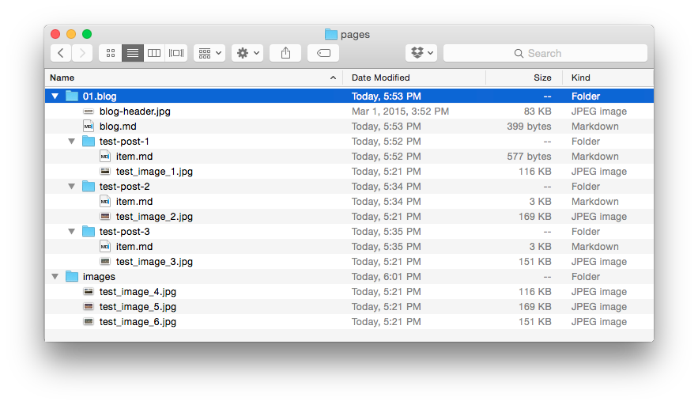

# Связывание изображений

В Grav есть множество гибких возможностей связывания, которые позволяют ссылаться на изображения с одной страницы на другую и даже на удалённые источники. Если вы когда-либо связывали файлы с помощью HTML или работали с файловой системой из командной строки, многое из этого покажется элементарным.

---

Рассмотрим несколько простых примеров, используя эту базовую упрощённую модель того, как может выглядеть папка **pages** сайта Grav.



На примере этой структуры папок мы рассмотрим различные типы ссылок, которые можно использовать для отображения медиафайлов в контенте. В каждой папке есть файлы изображений, включая по одному изображению для каждой записи блога, а в специальной папке `/images`, которая действует как страница, но содержит только медиафайлы, есть три изображения.

Использование папки `/images` — пример того, как можно поддерживать простую централизованную папку изображений для файлов, которые часто используются несколькими страницами. Это упрощает связывание в таких случаях.

> [!TIP] Совет
> Если вы решите использовать централизованную папку изображений, учтите, что она должна находиться внутри папки `/pages`, поскольку эта папка предназначена для контента фронтенда.

Для начала кратко рассмотрим стандартные компоненты тега изображения Grav на основе Markdown.

```markdown

```

| Строка | Описание                                                                                                              |
| :----- | :-----                                                                                                                   |
| `!`    | Если поставить в начале традиционного тега ссылки Markdown, это означает, что перед нами тег изображения.                      |
| `[]`   | В квадратных скобках заключается **необязательный** alt-текст изображения.                                              |
| `()`   | В круглых скобках заключается ссылка на само изображение. Они ставятся сразу после квадратных скобок. |
| `../`  | При использовании в ссылке означает переход на уровень выше по папкам.                                                               |

> [!NOTE] Примечание
> Можно комбинировать обычную ссылку на страницу и ссылку на изображение, чтобы обернуть изображение в ссылку: `[](http://example.net/)`

### Относительно слага

**Относительные** ссылки на изображения используют назначения, заданные относительно текущей страницы. Это может быть просто ссылка на другой файл в текущей папке, например на изображение, связанное с текущей страницей, или переход на несколько уровней вверх и затем вниз к конкретной папке или файлу, где может находиться изображение.

При относительных ссылках расположение исходного файла так же важно, как и расположение целевого. Если любой из файлов переместить, изменив путь между ними, ссылка может сломаться.

Преимущество такой структуры связывания в том, что можно быстро переключаться между локальным сервером разработки и рабочим сервером с другим доменным именем, и пока структура файлов остаётся неизменной, ссылки должны работать без проблем.

Ссылка на файл указывает на конкретный файл по имени, а не по его папке или слагу. Если вы создаёте ссылку на изображение со страницы `pages/01.blog/test-post-1/item.md` на `/pages/01.blog/test-post-3/test-image-3.jpg`, используйте такую команду:

```markdown

```

Эта ссылка поднимается на одну папку вверх, как указывает `../`, а затем спускается на одну папку вниз, указывая непосредственно на `test-image-3.jpg` как на назначение.

Если нужно загрузить `blog-header.jpg` из папки `01.blog`, сделаем так:

```markdown

```

> [!WARNING] Предупреждение
> Для ссылок относительно слага не нужно указывать порядковые номера (`01.`).

Grav имеет встроенную поддержку слагов в заголовке основного Markdown-файла страницы. Этот слаг заменяет имя папки страницы и всех медиафайлов внутри неё.

Например, у **Test Post 2** слаг задан через её Markdown-файл (`/pages/01.blog/test-post-2/item.md`). Заголовок этого файла содержит следующее:

```yaml linenums="1"
---
title: Test Post 2
slug: test-slug
taxonomy:
    category: blog
---
```

Вы заметите, что задан слаг `test-slug`. Слаги, заданные таким образом, полностью необязательны и могут отсутствовать. Как упоминалось в предыдущей главе, они дают простой способ связывания. Если слаг задан, любая ссылка на медиафайл внутри этой папки должна быть либо **относительно слага**, либо **абсолютной** с полным URL в ссылке.

Если нужно связать `test-image-2.jpg` из **Test Post 2**, введите следующее:

```markdown

```

Вы заметите, что мы поднялись на одну папку вверх с помощью (`../`), а затем спустились в папку страницы `test-slug`, используя слаг, заданный в файле `/pages/01.blog/test-post-2/item.md`.

### Относительно папки

**Относительные к папке** ссылки на изображения используют назначения, заданные относительно текущей страницы. Главное отличие от ссылок относительно слага в том, что вместо URL-слагов используется полный путь с именами папок.

Пример:

```markdown

```

> [!CAUTION] Внимание
> Главное преимущество этого способа в том, что целостность ссылок можно сохранить в других системах вне Grav, например в GitHub.

### Абсолютные

Абсолютные ссылки похожи на относительные, но отсчитываются от корня сайта. В **Grav** это обычно папка **/user/pages/**. Такие ссылки можно создавать двумя способами.

Можно использовать способ, аналогичный **ссылкам относительно слага**, где для простоты в пути применяется слаг или имя папки. Этот метод исключает потенциальные проблемы, когда изменение порядка (номера в начале имени папки) позже ломает ссылку. Обычно это самый распространённый способ абсолютного связывания.

В абсолютной ссылке путь начинается с `/`. Вот пример абсолютной ссылки на `pages/01.blog/test-post-2/test-image-2.jpg` в стиле **слага** со страницы `pages/01.blog/blog.md`.

```markdown

```

> [!NOTE] Примечание
> Мощный приём — создать в сайте Grav папку `user/pages/images/` и складывать изображения туда. Тогда на них можно легко ссылаться по абсолютному URL с любой страницы Grav: `/images/test-image-4.jpg`, и при этом по-прежнему выполнять [действия с медиа](../media/index.md).

### Потоки PHP {: #php-streams }

Grav также умеет ссылаться на изображения и связывать их через потоки PHP. Есть несколько встроенных потоков PHP, которые могут быть полезны:

* `user://` — папка пользователя, например `user/`
* `page://` — папка страниц, например `user/pages/`
* `image://` — папка изображений, например `user/images/`
* `plugins://` — папка плагинов, например `user/plugins/`
* `theme://` — текущая тема, например `user/themes/antimatter/`

Они позволяют легко обращаться к изображениям, которые традиционно находятся вне иерархии страниц (`user/pages/`).

```markdown

```

или:

```markdown

```

Полный список расположений потоков по умолчанию см. в разделе [Настройка мультисайта — Потоки](../../advanced/multisite-setup/index.md#streams).

### Удалённые

Удалённые ссылки на изображения позволяют напрямую отображать практически любой медиафайл по его URL. Это не обязательно должен быть контент вашего сайта, но может быть и он. Вот пример отображения удалённого файла изображения.

```markdown

```

Можно ссылаться практически на любой прямой URL, включая защищённые HTTPS-ссылки.

### Действия с изображениями

Одно из главных преимуществ использования изображений, связанных со страницами, — возможность применять [мощные действия с медиа в Grav](../media/index.md). Например, так можно загрузить изображение с другой страницы:

```markdown

```

или воспользоваться потоками, чтобы обратиться к изображению в текущей теме:

```markdown

```

Подробнее о действиях и других [возможностях работы с медиафайлами](../media/index.md) — в следующей главе.

### Атрибуты изображений

Отличная новая фича — задавать атрибуты изображения прямо через синтаксис Markdown. Это позволяет легко добавлять HTML-атрибуты **classes** и **id** без необходимости в [Markdown Extra](https://michelf.ca/projects/php-markdown/extra/).

Примеры:

##### Один класс

```markdown

```

в результате получится HTML, похожий на:

```html

```

##### Несколько классов

```markdown

```

в результате получится HTML, похожий на:

```html

```

##### Атрибут ID

```markdown

```

в результате получится HTML, похожий на:

```html

```
