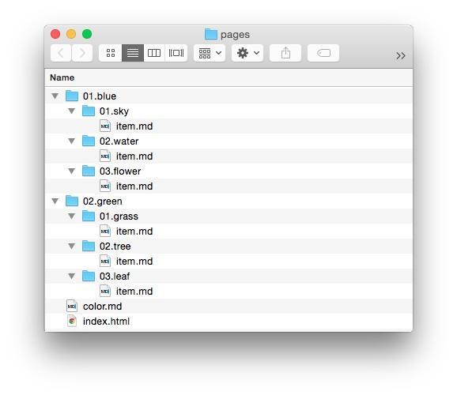

# Связывание страниц

В Grav есть множество гибких возможностей связывания, которые позволяют ссылаться с одной страницы на другую и даже на удалённые страницы. Если вы когда-либо связывали файлы с помощью HTML или работали с файловой системой из командной строки, многое из этого покажется очень простым.

---

Рассмотрим несколько простых примеров, используя эту базовую упрощённую модель того, как может выглядеть папка **pages** сайта Grav.



На примере этой структуры папок мы рассмотрим различные типы ссылок, которые можно использовать в контенте.

Для начала кратко рассмотрим основные компоненты ссылки Grav и их назначение.

```markdown
[Linked Content](../path/slug/page)
```

| Строка | Описание |
| :----- | :----- |
| `[]`   | В квадратных скобках заключается текст или альтернативный контент, который становится ссылкой. В HTML это контент между `<a href="">` и `</a>`. |
| `()`   | В круглых скобках заключается сама ссылка. Они ставятся сразу после квадратных скобок. |
| `../`  | При использовании в ссылке означает переход на уровень выше по папкам. |

### Относительно слага

Grav не ограничивает внутренние ссылки конкретными именами внутри структуры файлов и папок. Он также может использовать слаги, заданные как в заголовке файла, так и имя папки по умолчанию. Это упрощает создание быстрых ссылок: не нужно запоминать конкретное имя файла, достаточно легко запоминающегося (и подходящего) слага.

Шаблонизатор Grav использует имена файлов, чтобы определить, какой шаблон применить. Например, блог может использовать стандартное имя файла `item.md` для каждой записи. Самой записи блога можно назначить более осмысленный слаг, например `grass` или `grass-is-green`.

Имена папок также получают номера, помогающие с порядком. В ссылках относительно слага эти номера указывать не нужно. Grav игнорирует их при создании слага, поэтому структура URL сайта получается чище.

Вот несколько примеров ссылок относительно слага.

В этом примере мы поднимаемся на уровень выше и загружаем страницу по умолчанию из папки `pages/01.blue/02.water/item.md` со страницы `pages/01.blue/01.sky/item.md`. У файла `item.md` нет назначенного слага, поэтому Grav использует имя папки.

```markdown
[link](../water)
```

Следующий пример делает почти то же самое: ссылается со страницы `pages/01.blue/01.sky/item.md` на `pages/02.green/02.tree/item.md`, но при загрузке файла `item.md` ему назначен слаг `tree-is-green`.

```markdown
[link](../../green/tree-is-green)
```

Слаг, указанный в заголовке `item.md`, заменяет слаг `green`, который был бы взят из имени папки по умолчанию.

### Относительно папки

Ссылки **относительно папки** используют назначения, заданные относительно текущей страницы. Это может быть просто ссылка на другой файл в текущей папке, например на изображение, или переход на несколько уровней вверх и затем вниз к нужной папке или файлу.

При относительных ссылках расположение исходного файла так же важно, как и расположение целевого. Если любой из файлов переместить, изменив путь между ними, ссылка может сломаться.

Преимущество такой структуры связывания в том, что можно легко переключаться между локальным сервером разработки и рабочим сервером с другим доменным именем, и пока структура файлов остаётся неизменной, ссылки должны работать без проблем.

Ссылка на файл указывает на конкретный файл по имени, а не по его папке или слагу. Если вы создаёте ссылку со страницы `pages/01.blue/01.sky/item.md` на `/pages/02.green/01.grass/item.md`, используйте такую команду:

```markdown
[link](../../02.green/01.grass/item.md)
```

Эта ссылка поднимается на две папки вверх, как указывает `../../`, а затем спускается на две папки вниз, указывая непосредственно на `item.md` как на назначение.

Иногда нужно просто направить пользователя на один уровень выше, загрузив страницу по умолчанию. Поскольку конкретный файл не указан, Grav сам выбирает подходящий. Для хорошо организованного сайта Grav это не проблема.

В этом примере мы связываем `pages/01.blue/01.sky/item.md` с `/pages/02.green/`, что по умолчанию загрузит файл `color.md`.

```markdown
[link](../../02.green)
```

Если нужно сослаться на папку на два уровня выше, это делается таким же образом.

Следующий пример очень похож на ссылку на файл, показанную ранее. Вместо прямого указания файла мы ссылаемся на его папку, которая всё равно должна загрузить нужный файл, поскольку он является файлом по умолчанию. Если вы создаёте ссылку со страницы `pages/01.blue/01.sky/item.md` на `/pages/02.green/01.grass/`, используйте такую команду:

```markdown
[link](../../02.green/01.grass)
```

### Абсолютные

Абсолютные ссылки похожи на относительные, но отсчитываются от корня сайта. В **Grav** это обычно папка **/user/pages/**. Такие ссылки можно создавать двумя способами.

Можно использовать способ, аналогичный **ссылкам относительно слага**, где для простоты в пути применяется слаг или имя папки. Этот метод исключает потенциальные проблемы, когда изменение порядка (номера в начале имени папки) позже ломает ссылку. Обычно это самый распространённый способ абсолютного связывания.

В абсолютной ссылке путь начинается с `/`. Вот пример абсолютной ссылки на `pages/01.blue/01.sky/item.md` в стиле **слага**.

```markdown
[link](/17/blue/sky)
```

Второй способ повторяет стиль **относительно папки**, описанный выше. Он сохраняет элементы вроде порядковых номеров в начале имён папок. Хотя это добавляет риск сломанной ссылки при изменении порядка контента, такой способ надёжнее при работе с сервисами вроде [Github](https://github.com), где ссылки на контент не пользуются гибкостью Grav. Вот пример абсолютной ссылки на `pages/01.blue/01.sky/item.md` в этом стиле.

```markdown
[link](/01.blue/01.sky)
```

### Удалённые

Удалённые ссылки позволяют напрямую ссылаться практически на любой файл или документ по его URL. Это не обязательно должен быть контент вашего сайта, но может быть и он. Вот пример ссылки на главную страницу Google.

```markdown
[link](http://www.google.com)
```

Можно ссылаться практически на любой прямой URL, включая защищённые HTTPS-ссылки. Например:

```markdown
[link](https://github.com)
```

### Атрибуты ссылок

Отличная новая фича — задавать атрибуты ссылки прямо через синтаксис Markdown. Это позволяет легко добавлять HTML-атрибуты **class**, **id**, **rel** и **target** без необходимости в [Markdown Extra](https://michelf.ca/projects/php-markdown/extra/).

Примеры:

##### Атрибут class/classes {: #class-classes-attribute }

```markdown
[Big Button](../some-page?classes=button,big)
```

в результате получится HTML, похожий на:

```html
<a href="/your/pages/some-page" class="button big">Big Button</a>
```

##### Атрибут ID

```markdown
[Unique Button](../some-page?id=important-button)
```

в результате получится HTML, похожий на:

```html
<a href="/your/pages/some-page" id="important-button">Unique Button</a>
```

##### Атрибут rel

```markdown
[NoFollow Link](../some-page?rel=nofollow)
```

в результате получится HTML, похожий на:

```html
<a href="/your/pages/some-page" rel="nofollow">NoFollow Link</a>
```

##### Атрибут target

```markdown
[Link in new Tab](../some-page?target=_blank)
```

в результате получится HTML, похожий на:

```html
<a href="/your/pages/some-page" target="_blank">Link in new Tab</a>
```

##### Комбинации атрибутов

```markdown
[Combinations of Attributes](../some-page?target=_blank&classes=button)
```

в результате получится HTML, похожий на:

```html
<a href="/your/pages/some-page" target="_blank" class="button">Combinations of Attributes</a>
```

##### Комбинации атрибутов с якорями

```markdown
[Element Anchor](../some-page?target=_blank&classes=button#element-id)
```

в результате получится HTML, похожий на:

```html
<a href="/your/pages/some-page#element-id" target="_blank" class="button">Element Anchor</a>
```

##### Ссылки на якоря на той же странице

```markdown
[Element Anchor](?classes=button#element-id)
```

в результате получится HTML, похожий на:

```html
<a href="#element-id" class="button">
```

Обратите внимание: якорь должен идти _после_ строки запроса, как обсуждается в [Issue 1324](https://github.com/getgrav/grav/issues/1324#issuecomment-282587549).

##### Проброс неподдерживаемых атрибутов

```markdown
[Pass-through of 'cat' attribute](../some-page?classes=underline&cat=black)
```

в результате получится HTML, похожий на:

```html
<a href="/your/pages/some-page?cat=black" class="underline">Pass-through of 'cat' attribute</a>
```

##### Пропустить все атрибуты

```markdown
[Skip all attributes](../some-page?classes=underline&rel=nofollow&noprocess)
```

в результате получится HTML, похожий на:

```html
<a href="/your/pages/some-page?rel=nofollow&classes=underline">Skip All attributes</a>
```

##### Пропустить определённые атрибуты

```markdown
[Skip Certain attributes](../some-page?id=myvariable&classes=underline&target=_blank&noprocess=id,classes)
```

в результате получится HTML, похожий на:

```html
<a href="/your/pages/some-page?id=myvariable&classes=underline" target="_blank">Skip Certain attributes</a>
```

Это полезно, когда нужно пропустить один или несколько конкретных атрибутов, не затрагивая остальные.
