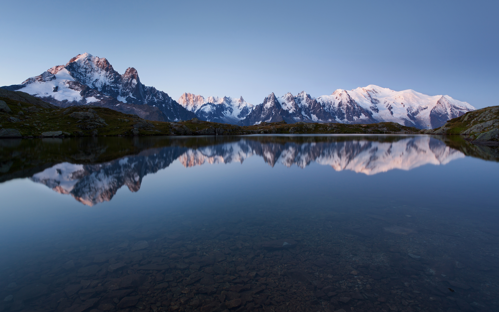

# Медиафайлы

При создании контента в **Grav** часто нужно отображать разные типы медиафайлов: **изображения**, **видео** и различные другие **файлы**. Grav автоматически находит и обрабатывает эти файлы, и они становятся доступны любой странице.

---

Это особенно удобно, потому что можно использовать встроенные возможности страницы для работы с миниатюрами, доступа к метаданным и динамического изменения медиафайлов (например, изменения размера изображений, установки размера отображения видео и т. д.) по мере необходимости.

Grav использует систему **умного кэширования**, которая при необходимости автоматически создаёт копии динамически сгенерированных медиафайлов в кэше. Так все последующие запросы могут использовать кэшированную версию, а не генерировать медиафайлы заново.

## Поддерживаемые медиафайлы

Grav нативно поддерживает следующие типы медиафайлов. Дополнительная поддержка медиафайлов и потоковых вставок может добавляться плагинами.

| Тип медиафайла      | Тип файла                                                                                                                                                             |
| :-----              | :-----                                                                                                                                                                |
| Изображение         | jpg, jpeg, png                                                                                                                                                        |
| Аудио               | mp3, wav, wma, ogg, m4a, aiff, aif                                                                                                                                    |
| Анимированное изображение | gif                                                                                                                                                             |
| Векторное изображение | svg                                                                                                                                                                 |
| Видео               | mp4, mov, m4v, swf, flv, webm, ogv                                                                                                                                    |
| Данные / информация | txt, doc, docx, html, htm, pdf, zip, gz, 7z, tar, css, js, json, xml, xls, xlt, xlm, xlsm, xld, xla, xlc, xlw, xll, ppt, pps, rtf, bmp, tiff, mpeg, mpg, mpe, avi, wmv |

Полный список поддерживаемых MIME-типов можно найти в файле `system/config/media.yaml`. Если нужного MIME-типа там нет, просто создайте собственный `user/config/media.yaml` и добавьте его. Главное — соблюдайте тот же формат, что и в исходном файле `system`. Проще всего скопировать весь исходный файл и внести правки.

## Куда помещать медиафайлы

Обычно медиафайл используется внутри страницы, поэтому просто положите его в папку страницы и ссылайтесь на него в Markdown этой страницы, например:

```markdown

```

Если вы хотите хранить все изображения в одной папке, поместите их в `user/pages/images`. Тогда в Twig к ним можно обращаться так:

```twig

```

а также легко находить их через Markdown и выполнять над ними действия:

```markdown

```

Либо можно поместить их в тему — к ним легко обращаться через CSS или из Markdown-файла с помощью потока `theme://`:

```markdown

```

Ещё один вариант — `user/images`, где для доступа используется поток `image://`:

```markdown

```

Фактически можно использовать любой поток, включая любую папку внутри `user/`, через поток `user://`:

```markdown

```

То же самое можно делать с помощью Twig-объекта `Media`:

```twig
{{ media['user://themes/mytheme/images/my-image.jpg'].html()|raw }}
```

> [!TIP] Совет
> В Grav есть папка `/images`. Не помещайте туда свои изображения: в ней хранятся автоматически сгенерированные и кэшированные изображения Grav.

Можно также хранить все медиафайлы в отдельной папке, чтобы обращаться к ним сразу. Например, вы можете держать все MP3-файлы в папке `user/pages/mp3s` (невидимой) и указывать имя MP3-файла, связанного с конкретной страницей, в поле заголовка `thistrack`. Если затем нужно получить файл для конкретной страницы и воспроизвести его через HTML5-элемент audio, понадобится такой код:

```twig linenums="1"
<audio controls>
  <source src="{{ page.find('/mp3s').media[page.header.thistrack~'.mp3']|e }}">
</audio>
```

## Режимы отображения

Grav предоставляет несколько режимов отображения для каждого типа медиаобъекта.

| Режим     | Объяснение                                                                     |
| :-----    | :-----                                                                          |
| source    | Визуальное представление самого медиа, то есть собственно изображение, видео или файл |
| text      | Текстовое представление медиа                                             |
| thumbnail | Миниатюра для этого медиаобъекта                                       |

> [!TIP] Совет
> Медиа типа **Данные / информация** не поддерживают режим `source`; они по умолчанию используют режим `text`, если явно не выбран другой.

## Расположение миниатюр

Grav ищет миниатюру в трёх местах.

1. В той же папке, что и медиафайл: `[media-name].[media-extension].thumb.[thumb-extension]`, где `media-name` и `media-extension` — соответственно имя и расширение исходного медиафайла, а `thumb-extension` — любое расширение, поддерживаемое типом медиа `image`. Примеры: `my_video.mp4.thumb.jpg` и `my-image.jpg.thumb.png`.
**Только для изображений!** В качестве миниатюры будет использоваться само изображение.
2. В папке пользователя: `user/images/media/thumb-[media-extension].png`, где `media-extension` — расширение исходного медиафайла. Примеры: `thumb-mp4.png` и `thumb-jpg.jpg`.
3. В системной папке: `system/images/media/thumb-[media-extension].png`, где `media-extension` — расширение исходного медиафайла. **Миниатюры в системных папках предоставляются Grav заранее.**

> [!CAUTION] Внимание
> Нужную миниатюру также можно выбрать вручную действиями, описанными ниже.

## Ссылки и лайтбоксы

Режимы отображения выше можно использовать вместе со ссылками и лайтбоксами, которые подробнее описаны ниже. Однако важно отметить:

> [!TIP] Совет
> Grav не предоставляет функциональность лайтбокса из коробки — для этого нужен плагин. Можно использовать [плагин FeatherLight для Grav](https://github.com/getgrav/grav-plugin-featherlight).

Когда вы используете возможности медиа Grav для рендеринга лайтбокса, Grav лишь выводит тег **anchor** с некоторыми атрибутами, которые читает плагин лайтбокса. Если вы хотите использовать библиотеку лайтбоксов, которой нет в нашем репозитории плагинов, или создать собственный плагин, таблица ниже может служить справочником.

| Атрибут     | Объяснение                                                                                                  |
| :-----      | :-----                                                                                                       |
| rel         | Простой индикатор того, что это не обычная ссылка, а ссылка лайтбокса. Значение всегда `lightbox`. |
| href        | URL самого медиаобъекта.                                                                             |
| data-width  | Ширина, запрошенная пользователем для этого лайтбокса.                                                             |
| data-height | Высота, запрошенная пользователем для этого лайтбокса.                                                            |
| data-srcset | Для медиа-изображений содержит строку `srcset`. ([подробнее](#responsive-images))         |

## Действия

Grav использует **шаблон построителя** (builder pattern) при работе с медиа, поэтому над конкретным медиа можно выполнять **несколько действий**. Некоторые действия доступны для любого типа медиа, другие — только для конкретного.

### Общие

Эти действия доступны для всех типов медиа.

#### url

> [!CAUTION] Внимание
> Этот метод предназначен только для **Twig**-шаблонов, поэтому у него нет синтаксиса Markdown.

Возвращает **исходный URL-путь** к медиа.

```twig title="Twig"
{{ page.media['sample-image.jpg'].url|e }}
```

#### html

> [!CAUTION] Внимание
> В Markdown этот метод неявно вызывается при использовании синтаксиса `![]`.

Действие `html` выводит корректный HTML-тег для медиа на основе текущего режима отображения.

```markdown title="Markdown"

```

```twig title="Twig"
{{ page.media['sample-image.jpg'].html('My title', 'Some ALT text', 'myclass')|raw }}
```

#### display

Используйте это действие для переключения между различными режимами отображения, которые предоставляет Grav. После переключения режима все предыдущие действия сбрасываются. Исключения — действия `lightbox` и `link`, а также любые действия, выполненные до этих двух.

Например, миниатюра, полученная вызовом `page.media['sample-image.jpg'].sepia().display('thumbnail').html()`, не будет иметь применённого действия `sepia()`, а `page.media['sample-image.jpg'].display('thumbnail').sepia().html()` будет.

> [!WARNING] Предупреждение
> После переключения в режим миниатюры вы работаете с изображением. Это значит, что даже если текущее медиа — видео, к миниатюре можно применять все действия для изображений.

#### link

Превращает медиаобъект в ссылку. Все действия, вызванные до `link()`, применяются к цели ссылки, а действия после — к тому, что отображается на странице.

> [!CAUTION] Внимание
> После вызова `link()` Grav автоматически переключает режим отображения на **thumbnail**.

Следующий пример выводит текстовую ссылку (`display('text')`) на версию `sample-image.jpg` в сепии:

```markdown title="Markdown"

```

```twig title="Twig"
{{ page.media['sample-image.jpg'].sepia().link().display('text').html('Image link')|raw }}
```

#### Только кэш

Grav можно настроить на кэширование всех файлов изображений — это может ускорить отдачу файлов. Однако изображения проходят через систему обработки изображений Grav, что может заметно увеличить размер файлов, уже оптимизированных до Grav. Обработку изображений можно обойти.

Включите `cache_all` в `system/config/system.yaml`:

```yaml
images:
  default_image_quality: 85
  cache_all: false
```

Отключите обработку изображения параметром `cache`:

```markdown title="Markdown"

```

```twig title="Twig"
{{ page.media['sample-image.jpg'].cache.html()|raw }}
```

#### lightbox

Действие lightbox по сути совпадает с действием link, но с несколькими дополнениями. Как объяснялось выше ([Ссылки и лайтбоксы](https://learn.getgrav.org/16/content/media#links-and-lightboxes)), действие lightbox не делает ничего, кроме создания ссылки с дополнительными атрибутами. От link оно отличается тем, что добавляет атрибут `rel="lightbox"` и принимает атрибуты `width` и `height`.

Если возможно (сейчас только для изображений), Grav изменит размер медиа до запрошенных ширины и высоты. Иначе он просто добавит к ссылке атрибуты `data-width` и `data-height`.

```markdown title="Markdown"

```

```twig title="Twig"
{{ page.media['sample-image.jpg'].lightbox(600,400).resize(200,200).html('Sample Image')|raw }}
```

##### Результат:


#### thumbnail

Вручную выбирает миниатюру, которую должен использовать Grav. Для любого типа медиа можно выбрать `page` и `default`, а для изображений также `media`, если в качестве миниатюры нужно использовать сам медиаобъект.

```markdown title="Markdown"

```

```twig title="Twig"
{{ page.media['sample-image.jpg'].thumbnail('default').display('thumbnail').html('Sample Image')|raw }}
```

##### Результат: {: #result-1 }


#### attribute

Добавляет дополнительный HTML-атрибут к выводу.

```markdown title="Markdown"

```

```twig title="Twig"
{{ page.media['sample-image.jpg'].attribute('myattribute', 'myvalue').html('Sample Image')|raw }}
```

## Действия с изображениями

#### resize

Изменение размера делает именно то, что ожидается. `resize` создаёт новое изображение на основе `width` и `height`. Пропорции сохраняются, а новое изображение будет содержать пустые области цвета **необязательного** фона, заданного как `hex value`, например `0xffffff`. Параметр фона необязателен; если он не указан, по умолчанию используется **прозрачный** для PNG или **белый** для JPEG.

```markdown title="Markdown"

```

```twig title="Twig"
{{ page.media['sample-image.jpg'].resize(400, 200).html()|raw }}
```

##### Результат: {: #result-2 }


#### forceResize

Изменяет размер изображения до указанных `width` и `height`. `forceResize` не соблюдает исходные пропорции и растягивает изображение по необходимости, чтобы вписать в новый размер.

```markdown title="Markdown"

```

```twig title="Twig"
{{ page.media['sample-image.jpg'].forceResize(200, 300).html()|raw }}
```

##### Результат: {: #result-3 }


#### cropResize

`cropResize` изменяет изображение до меньшего или большего размера на основе `width` и `height`. Пропорции сохраняются, а новое изображение вписывается в ограничивающую рамку, заданную `width` и `height`. Иными словами, любая фоновая область, которая была бы видна при обычном `resize`, обрезается.

Например, если изображение `640` x `480` и к нему применить `cropResize(100, 100)`, получится изображение `100` x `75`.

```markdown title="Markdown"

```

```twig title="Twig"
{{ page.media['sample-image.jpg'].cropResize(300, 300).html()|raw }}
```

##### Результат: {: #result-4 }


#### crop

`crop` вообще не изменяет размер изображения, а лишь обрезает оригинал так, что для нового изображения используется только часть ограничивающей рамки, заданной `width` и `height` и начинающейся в точке `x` и `y`.

Например, для изображения `640` x `480` вызов `crop(0, 0, 400, 100)` создаст изображение шириной `400` и высотой `100`, начиная с левого верхнего угла, заданного `0, 0`.

```markdown title="Markdown"

```

```twig title="Twig"
{{ page.media['sample-image.jpg'].crop(100,100,300,200).html()|raw }}
```

##### Результат: {: #result-5 }


#### cropZoom

Похоже на обычный `cropResize`, но `cropZoom` также принимает `width` и `height` и **изменяет размер и обрезает** изображение так, чтобы результат был точно запрошенного размера. Пропорции сохраняются, но части изображения могут обрезаться, при этом результат центрируется.

> [!CAUTION] Внимание
> Главное отличие **cropResize** от **cropZoom** в том, что при cropResize изображение масштабируется с сохранением пропорций так, чтобы было видно всё изображение, а лишнее пространство считается фоном.

При **cropZoom** изображение масштабируется так, чтобы фон не был виден, а лишняя область за пределами нового размера обрезается.

Например, если изображение `640` x `480` и к нему применить `cropZoom(400, 100)`, результат сначала масштабируется до `400` x `300`, а затем высота обрезается, давая изображение `400` x `100`.

```markdown title="Markdown"

```

```twig title="Twig"
{{ page.media['sample-image.jpg'].cropZoom(600,200).html()|raw }}
```

> [!CAUTION] Внимание
> Тем, кто привык использовать для этой цели `zoomCrop`, будет приятно узнать, что в Grav он тоже работает.

##### Результат: {: #result-6 }


#### quality

Динамически задаёт **процент сжатия** `value` для изображения от `0` до `100`. Меньшее число означает более низкое качество, `100` — максимальное качество.

```markdown title="Markdown"

```

```twig title="Twig"
{{ page.media['sample-image.jpg'].cropZoom(300,200).quality(25).html()|raw }}
```

##### Результат: {: #result-7 }


#### negate

Применяет к изображению **негативный фильтр**, инвертируя цвета.

```markdown title="Markdown"

```

```twig title="Twig"
{{ page.media['sample-image.jpg'].cropZoom(300,200).negate.html()|raw }}
```

##### Результат: {: #result-8 }


#### brightness

Применяет к изображению **фильтр яркости** со значением `value` от `-255` до `+255`. Большие отрицательные числа делают изображение темнее, большие положительные — светлее.

```markdown title="Markdown"

```

```twig title="Twig"
{{ page.media['sample-image.jpg'].cropZoom(300,200).brightness(-100).html()|raw }}
```

##### Результат: {: #result-9 }


#### contrast

Применяет к изображению **фильтр контраста** со значением `value` от `-100` до `+100`. Большие отрицательные числа увеличивают контраст, большие положительные — уменьшают.

```markdown title="Markdown"

```

```twig title="Twig"
{{ page.media['sample-image.jpg'].cropZoom(300,200).contrast(-50).html()|raw }}
```


#### grayscale

Обрабатывает изображение **фильтром оттенков серого**.

```markdown title="Markdown"

```

```twig title="Twig"
{{ page.media['sample-image.jpg'].cropZoom(300,200).grayscale.html()|raw }}
```

##### Результат: {: #result-10 }


#### emboss

Обрабатывает изображение **фильтром тиснения**.

```markdown title="Markdown"

```

```twig title="Twig"
{{ page.media['sample-image.jpg'].cropZoom(300,200).emboss.html()|raw }}
```

##### Результат: {: #result-11 }


#### smooth

Применяет к изображению **фильтр сглаживания** на основе значения `value` от `-10` до `10`.

```markdown title="Markdown"

```

```twig title="Twig"
{{ page.media['sample-image.jpg'].cropZoom(300,200).smooth(5).html()|raw }}
```

##### Результат: {: #result-12 }


#### sharp

Применяет к изображению **фильтр повышения резкости**.

```markdown title="Markdown"

```

```twig title="Twig"
{{ page.media['sample-image.jpg'].cropZoom(300,200).sharp.html()|raw }}
```

##### Результат: {: #result-13 }


#### edge

Применяет к изображению **фильтр выделения краёв**.

```markdown title="Markdown"

```

```twig title="Twig"
{{ page.media['sample-image.jpg'].cropZoom(300,200).edge.html()|raw }}
```

##### Результат: {: #result-14 }


#### colorize

Можно раскрасить изображение, изменив значения `red`, `green` и `blue` для изображения от `-255` до `+255` для каждого цвета.

```markdown title="Markdown"

```

```twig title="Twig"
{{ page.media['sample-image.jpg'].cropZoom(300,200).colorize(100,-100,40).html()|raw }}
```

##### Результат: {: #result-15 }


#### sepia

Применяет к изображению **фильтр сепии** для винтажного вида.

```markdown title="Markdown"

```

```twig title="Twig"
{{ page.media['sample-image.jpg'].cropZoom(300,200).sepia.html()|raw }}
```

##### Результат: {: #result-16 }


#### gaussianBlur

**Размывает** изображение с коэффициентом, определяющим, сколько раз применяется фильтр размытия. По умолчанию — 1 раз.

```markdown title="Markdown"

```

```twig title="Twig"
{{ page.media['sample-image.jpg'].gaussianBlur(3).html()|raw }}
```

##### Результат: {: #result-17 }


#### rotate

**Поворачивает** изображение на `angle` градусов против часовой стрелки; отрицательные значения поворачивают по часовой.

```markdown title="Markdown"

```

```twig title="Twig"
{{ page.media['sample-image.jpg'].cropZoom(300,200).rotate(-90).html()|raw }}
```

##### Результат: {: #result-18 }


#### flip

**Отражает** изображение в заданных направлениях. Оба параметра могут быть `0|1`. Два `0` означают отсутствие отражения в обоих направлениях.

```markdown title="Markdown"

```

```twig title="Twig"
{{ page.media['sample-image.jpg'].cropZoom(300,200).flip(0,1).html()|raw }}
```

##### Результат: {: #result-19 }


#### fixOrientation

Исправляет ориентацию изображения, если поворот задан через данные EXIF (относится к JPEG-изображениям, снятым на телефоны и камеры).

```markdown title="Markdown"

```

```twig title="Twig"
{{ page.media['sample-image.jpg'].fixOrientation().html()|raw }}
```

#### watermark

**Действие watermark** объединяет два изображения — водяной знак и исходное изображение — в итоговое изображение с водяным знаком. Это очень специфичное действие, требующее более подробного описания, чем другие действия и фильтры. В частности, нужно учитывать его поведение при [комбинировании фильтров](#combinations). Для интересующихся есть очень подробная [статья в блоге о действии watermark](https://www.grav.cz/blog/vodoznak-aneb-nepokrades-kelisova) от [Vít Petira](https://github.com/petira), но только на чешском. Впрочем, инструкции легко понять.

> [!WARNING] Предупреждение
> Если вы используете [поток](../image-linking/index.md#php-streams) уровня страницы, префиксы страницы также нужно указывать.

```markdown title="Markdown"

```

```twig title="Twig"
{{ page.media['sample-image.jpg'].watermark('user://pages/17/02.content/07.media/sample-watermark.png','top-left',50).html()|raw }}
```

##### Результат: {: #result-20 }


#### loading

Атрибут `loading` у изображений даёт авторам контроль над тем, когда браузер должен начать загружать ресурс. Значение атрибута `loading` может быть `auto` (по умолчанию), `lazy` или `eager`.
Значение можно задать в `system.images.defaults.loading` как значение по умолчанию или для отдельного изображения в Markdown через `?loading=lazy`.
Если выбрано `auto`, атрибут `loading` не добавляется, и браузер сам определяет стратегию.

```markdown title="Markdown"

```

```twig title="Twig"
{# Использование значения по умолчанию, заданного в 'config.system.images.defaults.loading' #}
{{ page.media['sample-image.jpg'].loading.html('Sample Image')|raw }}

{# Использование явного значения #}
{{ page.media['sample-image.jpg'].loading('lazy').html('Sample Image')|raw }}
```

#### decoding

Атрибут `decoding` у изображений даёт авторам контроль над тем, когда браузер должен начать декодировать ресурс. Значение атрибута `decoding` может быть `auto` (по умолчанию), `sync` или `async`.
Значение можно задать в `system.images.defaults.decoding` как значение по умолчанию или для отдельного изображения в Markdown через `?decoding=async`.
Если выбрано `auto`, атрибут `decoding` не добавляется, и браузер сам определяет стратегию.

```markdown title="Markdown"

```

```twig title="Twig"
{# Использование значения по умолчанию, как описано в I129 #}
{{ page.media['sample-image.jpg'].decoding.html('Sample Image')|raw }}

{# Использование явного значения #}
{{ page.media['sample-image.jpg'].decoding('async').html('Sample Image')|raw }}
```

#### fetchpriority

Атрибут `fetchpriority` даёт авторам контроль над тем, насколько приоритетно браузер должен загружать изображение относительно других изображений. Значение атрибута `fetchpriority` может быть `auto` (по умолчанию), `high` или `low`.
Значение можно задать в `system.images.defaults.fetchpriority` как значение по умолчанию или для отдельного изображения в Markdown через `?fetchpriority=high`.
Если выбрано `auto`, атрибут `fetchpriority` не добавляется, и браузер сам определяет стратегию.

```markdown title="Markdown"

```

```twig title="Twig"
{# Использование значения по умолчанию, как описано в I137 #}
{{ page.media['sample-image.jpg'].fetchpriority.html('Sample Image')|raw }}

{# Использование явного значения #}
{{ page.media['sample-image.jpg'].fetchpriority('high').html('Sample Image')|raw }}
```

## Действия с анимированными и векторными медиа

#### resize {: #resize-1 }

Поскольку PHP не умеет динамически изменять размер таких типов медиа, действие resize только гарантирует, что на теге ``/`<video>` или `<a>` будут заданы атрибуты `width` и `height` либо `data-width` и `data-height` соответственно. Это значит, что изображение или видео будет отображаться в запрошенном размере, но сам файл изображения или видео никак не преобразуется.

```markdown title="Markdown"

```

```twig title="Twig"
{{ page.media['sample-trailer.mov'].resize(400, 200).html('Sample Trailer')|raw }}
```

#### Примеры

Некоторые примеры:

```markdown title="Vector Image"

```

```markdown title="Animated Image"

```

```markdown title="Video"

```

##### Результаты:


## Действия с аудио

Аудиомедиа отображается как ссылка HTML5 audio:

```markdown title="Markdown"

```

```twig title="Twig"
{{ page.media['hal9000.mp3'].html()|raw }}
```

##### Результат: {: #result-21 }


#### controls

Позволяет явно задать или убрать стандартные элементы управления HTML5. Передача `0` скрывает элементы управления браузера для воспроизведения, громкости и т. д.

```markdown title="Markdown"

```

```twig title="Twig"
{{ page.media['hal9000.mp3'].controls(0)|raw }}
```

#### preload

Позволяет задать свойство `preload`, которое по умолчанию равно `auto`. Допустимые значения: `auto`, `metadata` и `none`.

> [!CAUTION] Внимание
> <q cite="https://developer.mozilla.org/en-US/docs/Web/HTML/Element/audio#attr-preload">Если атрибут не задан, его значение по умолчанию определяется браузером (то есть у каждого браузера может быть своё значение). Спецификация рекомендует устанавливать <code>metadata</code>.</q>

> [!CAUTION] Внимание
> Атрибут `preload` игнорируется, если присутствует `autoplay`.

```markdown title="Markdown"

```

```twig title="Twig"
{{ page.media['hal9000.mp3'].preload('metadata')|raw }}
```

#### autoplay

Позволяет задать, будет ли аудио `autoplay` при загрузке страницы. По умолчанию, если не задано, считается `false`.

> [!CAUTION] Внимание
> Если в данном элементе `audio` присутствуют и `autoplay`, и `preload`, `preload` будет игнорироваться.

```markdown title="Markdown"

```

```twig title="Twig"
{{ page.media['hal9000.mp3'].autoplay(1)|raw }}
```

#### controlsList

Позволяет задать свойство `controlsList`, которое принимает одно или несколько из трёх возможных значений: `nodownload`, `nofullscreen` и `noremoteplayback`.

> [!CAUTION] Внимание
> Если в Markdown задаётся несколько параметров, разделяйте их дефисом (`-`). В выходном HTML они будут заменены пробелами.

```markdown title="Markdown"

```

```twig title="Twig"
{{ page.media['hal9000.mp3'].controlsList('nodownload nofullscreen noremoteplayback')|raw }}
```

#### muted

Позволяет задать, будет ли аудио `muted` при загрузке. По умолчанию, если не задано, считается `false`.

```markdown title="Markdown"

```

```twig title="Twig"
{{ page.media['hal9000.mp3'].muted(1)|raw }}
```

#### loop

Позволяет задать, будет ли аудио `loop` после воспроизведения до конца. По умолчанию, если не задано, считается `false`.

```markdown title="Markdown"

```

```twig title="Twig"
{{ page.media['hal9000.mp3'].loop(1)|raw }}
```

## Действия с файлами

На данный момент Grav не предоставляет пользовательских действий для файлов, и планов их добавлять нет. Если у вас есть идеи, свяжитесь с нами.

```markdown title="Markdown"
[View Text File](acronyms.txt)
```

```twig title="Twig"
<a href="{{ page.media['acronyms.txt'].url()|raw }}">View Text File</a>
```

##### Результат: {: #result-22 }

[View Text File](acronyms.txt)

### Комбинации {: #combinations }

Как видите, Grav предоставляет мощную функциональность обработки изображений, которая делает работу с ними действительно простой! Настоящая сила проявляется при комбинировании нескольких эффектов для получения очень сложных динамических манипуляций с изображениями. Например, вполне допустимо следующее:

```markdown title="Markdown"

```

```twig title="Twig"
{{ page.media['sample-image.jpg'].negate.lightbox.cropZoom(200,200)|raw }}
```

##### Результат: {: #result-23 }


#### Сброс многократных вызовов одного изображения

Когда вы обращаетесь к одному изображению несколько раз на странице, заданные для него действия по умолчанию не сбрасываются. Поэтому если изменить размер изображения и вывести HTML, а затем позже на той же странице просто вывести URL изображения, вы также получите URL изменённого изображения. Вероятно, вы ожидали URL оригинала.

Чтобы этого избежать, можно сбросить действия, передав `false` в метод `url()`:

```twig

    
    <a href="{{ image.url(false)|e }}">
      
    </a>

```

### Адаптивные изображения {: #responsive-images }

#### Дисплеи с высокой плотностью

Grav имеет встроенную поддержку адаптивных изображений для дисплеев с высокой плотностью (например, экранов **Retina**). Grav делает это, реализуя `srcset` из [HTML-предложения Picture element](https://html.spec.whatwg.org/multipage/embedded-content.html#the-picture-element). Хорошая статья для более глубокого понимания — [эта статья Эрика Портеса](http://ericportis.com/posts/2014/srcset-sizes/).

> [!CAUTION] Внимание
> По умолчанию Grav устанавливает аргумент `sizes`, упомянутый в статьях выше, равным полной ширине области просмотра. Используйте действие `sizes`, показанное ниже, чтобы выбрать самостоятельно.

Чтобы начать использовать адаптивные изображения, достаточно добавить на страницы изображения с более высокой плотностью, добавив суффикс к имени файла. Если вы предоставите только изображения высокой плотности, Grav автоматически сгенерирует версии более низкого качества. Именование работает так: `[image-name]@[density-ratio]x.[image-extension]`. Например, если добавить на страницу `sample-image@3x.jpg`, Grav по умолчанию создаст версии `2x` и `1x` (обычного размера).

> [!WARNING] Предупреждение
> Эти файлы, сгенерированные Grav, будут храниться в папке кэша `images/`, а не в папке вашей страницы.

Допустим, у вас есть файл `retina@2x.jpg`. В ссылках вы обращаетесь к нему как `retina.jpg`; Grav не найдёт это изображение и начнёт искать варианты размеров retina. Он найдёт `retina@2x.jpg` и поймёт, что нужно создать вариант `@1x`, а затем выведет подходящий `srcset`:

```markdown title="Markdown"

```

```twig title="Twig"
{{ page.media['retina.jpg'].sizes('80vw').html()|raw }}
```

##### Результат: {: #result-24 }



> [!TIP] Совет
> В зависимости от вашего дисплея, реализации и поддержки `srcset` в браузере вы можете никогда не увидеть разницы.

##### Размеры с медиазапросами

Grav также поддерживает медиазапросы внутри атрибута `sizes`, что позволяет использовать разные ширины в зависимости от размера экрана устройства. В отличие от первого метода, создавать несколько изображений не нужно — они создаются автоматически. Резервным изображением служит текущее, поэтому браузер без поддержки `srcset` отобразит оригинал.

```markdown title="Markdown"

```

```twig title="Twig"
{{ page.media['retina.jpg'].sizes('(max-width:26em) 100vw, 50vw').html('Retina Image')|raw }}
```

##### Результат: {: #result-25 }


> [!TIP] Совет
> В зависимости от вашего дисплея, реализации и поддержки `srcset` в браузере вы можете никогда не увидеть разницы.

##### Размеры с медиазапросами через derivatives

Если нужно настроить размеры автоматически создаваемых файлов, используйте метод `derivatives()` (как показано ниже). Первый параметр — ширина самого маленького из генерируемых изображений. Второй — максимальная ширина (не включая её) генерируемых изображений. Третий и единственный необязательный параметр задаёт интервалы, с которыми генерируются изображения (по умолчанию 200). Например, если задать первый параметр `320`, а третий `100`, Grav сгенерирует изображения для 320, 420, 520, 620 и так далее, пока не достигнет заданного максимума.

В нашем примере максимум равен `1600`. Это даст шаги по 300 от `320` до `1520`, поскольку `1620` был бы выше порога.

> [!CAUTION] Внимание
> На данный момент это не работает внутри Markdown, только в ваших ```twig```-файлах.

```markdown title="Markdown"

```

```twig title="Twig"
{{ page.media['retina.jpg'].derivatives(320,1600,300).sizes('(max-width:26em) 100vw, 50vw').html()|raw }}
```

##### Результат: {: #result-26 }


> [!TIP] Совет
> В зависимости от вашего дисплея, реализации и поддержки `srcset` в браузере вы можете никогда не увидеть разницы.

#### Ручное определение размеров

Вместо того чтобы позволять Grav генерировать размеры равными шагами между заданными границами, можно вручную определить, какие размеры должен создавать Grav:

```markdown

```

Это создаст уменьшенные версии изображения `retina.jpg` в трёх ширинах: 360, 720 и 1200 px.

## Метафайлы {: #metafiles }

Каждый медиафайл, на который вы ссылаетесь в Grav, — например, `image1.jpg`, `sample-trailer.mov` или даже `archive.zip` — может иметь переменные, заданные или даже переопределённые через **метафайл**. Такие файлы имеют формат `<filename>.meta.yaml`. Например, для изображения с именем `image1.jpg` можно создать метафайл `image1.jpg.meta.yaml`.

Этим способом можно добавить практически любую настройку или фрагмент метаданных.

Содержимое этого файла должно быть в синтаксисе YAML. Пример:

```yaml
image:
    filters:
        default:
            - [cropResize, 300, 300]
            - sharp
alt_text: My Alt Text
```

Если вы используете этот способ, чтобы добавить стили или метатеги для конкретного файла, YAML-файл следует положить в ту же папку, что и файл, на который вы ссылаетесь. Так файл будет извлекаться вместе с YAML-данными. Это удобный способ задать метаданные конкретного файла, поскольку из самой страницы это сделать нельзя.

Допустим, вы хотите получить только значение `alt_text`, указанное для файла `sample-image.jpg`. Тогда создайте файл `sample-image.jpg.meta.yaml` и поместите его в папку с изображением. Затем вставьте данные из примера выше и сохраните YAML-файл. В Markdown-файле страницы эти данные можно вывести такой строкой:

```yaml
{{ page.media['sample-image.jpg'].meta.alt_text|e }}
```

Она выведет пример фразы `My Alt Text` вместо изображения. Это лишь базовый пример. Этот способ можно использовать для многих вещей, в том числе для создания галереи с несколькими уникальными точками данных, на которые нужно ссылаться для каждого изображения. По сути, у ваших изображений есть собственный набор данных, к которому легко обратиться и извлечь его по необходимости.

## Фильтрация медиа по метаданным {: #filtering-media-by-metadata }

> [!NOTE] Примечание
> Методы запросов к коллекции ниже добавлены в **Grav 2.0**.

Когда у ваших медиа есть метаданные через [метафайлы](#metafiles), можно запрашивать всю коллекцию по этим значениям, а не перебирать каждый элемент вручную. Методы находятся в коллекции медиа (`page.media`) и каждый **возвращает новую коллекцию**, поэтому они выстраиваются в цепочки и итерируются точно как `page.media`:

```twig

    {{ image.html }}

```

Даны три изображения с такими метафайлами:

```yaml
# beach.jpg.meta.yaml
rating: 5
copyright: Jane Doe
tags: [sunset, beach]
```
```yaml
# peak.jpg.meta.yaml
rating: 3
copyright: John Smith
tags: [mountain, sunset]
```
```yaml
# street.jpg.meta.yaml
rating: 1
copyright: Jane Doe
tags: [city]
```

### filterBy

`filterBy(field, value, operator = '==')` оставляет только те медиа, у которых `field` удовлетворяет сравнению.

```twig
{# изображения с рейтингом 3 и выше #}
{{ page.media.filterBy('rating', 3, '>=') }}      {# beach.jpg, peak.jpg #}

{# изображения с тегом 'sunset' #}
{{ page.media.filterBy('tags', 'sunset', 'contains') }}  {# beach.jpg, peak.jpg #}
```

Доступные операторы:

| Оператор | Значение |
| :- | :- |
| `==`, `!=` | Равно / не равно |
| `>`, `>=`, `<`, `<=` | Числовое сравнение, если обе стороны числовые, иначе строковое сравнение |
| `in` | Значение поля входит в заданный список, например `filterBy('rating', [4, 5], 'in')` |
| `contains` | Поле-список (например, `tags`) содержит значение, или текстовое поле содержит его как подстроку |

Сравнения типобезопасны: числовое — только если оба операнда числовые, иначе точное строковое сравнение (так что `'0'` никогда не равно `'false'`). Медиа, у которого **нет значения** для поля, никогда не соответствует фильтру — изображения без рейтинга не попадут в результат `rating < 3`.

### where

`where(criteria)` фильтрует сразу по нескольким полям, и все они должны совпасть (логическое И). Скалярное значение означает «равно», значение-массив — «входит в список»:

```twig
{{ page.media.where({ 'copyright': 'Jane Doe', 'rating': [4, 5] }) }}   {# beach.jpg #}
```

### sortBy

`sortBy(field, direction = 'asc')` возвращает коллекцию, упорядоченную по полю метаданных. Числовые значения сортируются численно; всё остальное — естественно и без учёта регистра. Медиа без указанного поля всегда сортируются в конец, в обоих направлениях.

```twig
...
```

### groupBy

`groupBy(field)` возвращает карту `value => collection`. Поле с несколькими значениями, например `tags`, помещает медиа под **каждое** значение, которое оно содержит, что делает индексы тегов тривиальными:

```twig

    <h3>{{ tag }} ({{ images|length }})</h3>
    {{ image.html }}

```

Медиа без значения для поля группируются под ключом пустой строки.

### findBy, withMeta, hasMeta, metaKeys

- `findBy(field, value, operator = '==')` возвращает **первое** подходящее медиа (или ничего).
- `withMeta()` возвращает только медиа, у которых есть метафайл `.meta.yaml`, отбрасывая файлы без него.
- Для отдельного медиа `hasMeta` равно `true`, когда у него есть метафайл, а `metaKeys` перечисляет заданные в нём ключи:

```twig

    <em>{{ image.metaKeys|join(', ') }}</em>

```

> [!NOTE] Примечание
> Эти методы читают любой ключ, присутствующий в sidecar-файле `.meta.yaml`; ядро Grav не делает предположений о том, какие ключи существуют. Когда вы фильтруете те же медиа через [REST API](../../api/endpoints/media/index.md), поля, доступные для фильтрации, наоборот ограничены схемой метаданных, настроенной для плагина API.

## Параметры видео

Параметры управления встроенным видео — ещё одна возможность Grav. Эти параметры, добавляемые прямо к имени файла, позволяют задать `autoplay`, `controls` и `loop` для встроенного видео.

Пример:

```markdown

```

Параметры следующие:

| Атрибут     | Объяснение                                                                               |
| :-----      | :-----                                                                                    |
| autoplay    | Включает (`1`) или отключает (`0`) автовоспроизведение видео при загрузке страницы.                       |
| controls    | Включает (`1`) или отключает (`0`) элементы управления медиа для встроенного видео.                    |
| loop        | Включает (`1`) или отключает (`0`) автоматическое повторение видео после окончания. |
| muted       | Отключает звук видео и обычно позволяет ему автоматически воспроизводиться.                                            |
