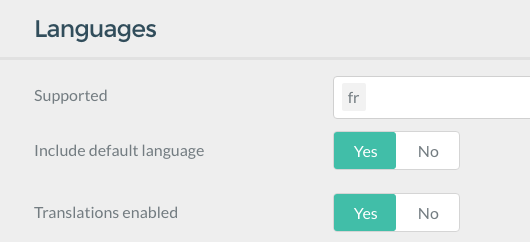

# Многоязычность

Поддержка многоязычности в Grav — прямой результат большого [обсуждения сообщества](https://github.com/getgrav/grav/issues/170) на эту тему. Сейчас мы разберём всё по порядку и приведём примеры того, как настроить сайт Grav с несколькими языками.

---

## Один язык, отличный от английского

Если вы используете только один язык, включите переводы и добавьте код языка в файл `user/config/system.yaml`:

```yaml linenums="1"
languages:
  supported:
    - fr
```

или в конфигурации системы в админке:



Это гарантирует, что Grav использует правильные языковые строки на фронтенде. Кроме того, если тема это поддерживает, код языка будет добавлен в HTML-тег.

## Основы многоязычности

Поскольку вы уже должны быть знакомы с тем, как Grav использует Markdown-файлы в папках для определения архитектурной структуры, важных параметров страницы и контента, мы не будем подробно разбирать этот механизм. Однако учтите, что по умолчанию Grav ищет в папке **один** `.md` файл, представляющий страницу.
Если вы не уверены, что достаточно знакомы с этим принципом, обратитесь к разделу [Базовое руководство](../../basics/basic-tutorial/index.md), прежде чем продолжить.
Когда многоязычность включена, Grav будет искать файл, соответствующий нужному языку, например `default.en.md` или `default.fr.md`.

### Конфигурация языков {: #language-configuration }

Чтобы Grav мог это делать, сначала нужно настроить базовую конфигурацию языков в файле `user/config/system.yaml` (с комментариями для удобства чтения):

```yaml linenums="1"
languages:
  supported: # Поддерживаемые языки:
    - en # Английский язык
    - fr # Французский язык
  default_lang: en # Установить язык по умолчанию — английский
  include_default_lang: true # Если true, использовать /en/path вместо /path для английского языка по умолчанию.
include_default_lang_file_extension: true # Если true, использовать расширение .en.md вместо .md для языка по умолчанию.
  content_fallback:
    en: ['en'] # Нет резервного языка для английского.
    fr: ['fr', 'en'] # Французский откатывается к английской версии страницы.
```

Указав блок `languages` со списком `supported` языков, вы фактически включаете поддержку многоязычности в Grav.

В этом примере описаны два поддерживаемых языка (`en` и `fr`). Они позволяют поддерживать **английский** и **французский** языки.

Если язык явно не запрошен (через URL или кодом), Grav использует порядок указанных языков, чтобы выбрать правильный. Так, в примере выше **язык по умолчанию** — `en`, или английский. Если бы первым был `fr`, языком по умолчанию стал бы французский.

По умолчанию все языки откатываются к языку по умолчанию. Если это нежелательно, можно переопределить резервные языки с помощью `content_fallback`, где ключ — язык, а значение — массив языков.

> [!CAUTION] Внимание
> Разумеется, можно указать сколько угодно языков и даже использовать коды локали вроде `en-GB`, `en-US` и `fr-FR`. Если вы используете такие имена на основе локали, придётся заменить все короткие коды языков версиями с локалью.

### Страницы на нескольких языках

По умолчанию в Grav каждая страница представлена Markdown-файлом, например `default.md`. Когда вы включаете многоязычность, Grav ищет Markdown-файл с соответствующим именем. Например, поскольку английский — наш язык по умолчанию, сначала он будет искать `default.en.md`.

Если этот файл не найден, Grav откатывается к стандартному поведению и ищет `default.md`, чтобы получить информацию для страницы.

> [!CAUTION] Внимание
> Это поведение по умолчанию изменилось в **Grav 1.7**. Раньше Grav показывал несуществующую английскую страницу на французском; теперь все языки откатываются только к языку по умолчанию, если иное не указано в `content_fallback`. Поэтому если страницу не удаётся найти ни на одном из резервных языков, отображается **страница ошибки 404**.

Если у нас был бы самый базовый сайт Grav с единственным файлом `01.home/default.md`, можно начать с переименования `default.md` в `default.en.md`; его содержимое могло бы выглядеть так:

```markdown linenums="1"
---
title: Homepage
---

This is my Grav-powered homepage!
```

Затем можно создать новую страницу в той же папке `01.home/` с именем `default.fr.md` и содержимым:

```markdown linenums="1"
---
title: Page d'accueil
---

Ceci est ma page d'accueil générée par Grav !
```

Теперь у вас определены две страницы текущей домашней страницы на разных языках.

> [!WARNING] Предупреждение
> Если вы переводите существующий сайт на многоязычность, можно вместо этого установить `include_default_lang_file_extension: false`, чтобы продолжить использовать простое расширение `.md` для основного языка. [Подробнее...](#default-file-extension).

### Активный язык через URL

Поскольку английский — язык по умолчанию, если открыть браузер без указания языка, вы получите контент из файла `default.en.md`, но можно также явно запросить английский, открыв в браузере

```text linenums="1"
http://my-site.example/en
```

Чтобы открыть французскую версию, разумеется, используйте

```text linenums="1"
http://my-site.example/fr
```

> [!WARNING] Предупреждение
> Если вы предпочитаете не использовать языковой префикс для языка по умолчанию, установите `include_default_lang: false`. [Подробнее…](#default-language-prefix).

### Активный язык через браузер

Большинство браузеров позволяют настроить предпочитаемые языки контента. Grav умеет читать значения `http_accept_language`, сравнивать их с текущими поддерживаемыми языками сайта и, если конкретный язык не обнаружен, показывать контент на предпочитаемом языке.

Чтобы это работало, включите параметр в файле `user/system.yaml` в разделе `languages:`:

```yaml linenums="1"
languages:
  http_accept_language: true
```

### Активный язык на основе сессии

Если нужно запоминать активный язык независимо от URL, можно включить **хранение активного языка в сессии**. Для этого убедитесь, что в [файле system.yaml](../../basics/grav-configuration/index.md) задано `session: enabled: true`. Затем включите настройку языка:

```yaml linenums="1"
languages:
  session_store_active: true
```

После этого активный язык будет храниться в сессии.

### Установка локали по активному языку

Логическая настройка задаёт для PHP-метода `setlocale()` локаль активного языка; это управляет денежными значениями, датами, сравнением строк, классификацией символов и другими локальными настройками. По умолчанию — `false`, и тогда используется системная локаль; если установить `true`, локаль будет переопределена текущим активным языком.

```yaml linenums="1"
languages:
   override_locale: false
```

### Префикс языка по умолчанию {: #default-language-prefix }

По умолчанию код языка по умолчанию добавляется префиксом ко всем URL. Например, если поддерживаются английский и французский (`en` и `fr`), а по умолчанию используется английский, маршрут страницы может выглядеть как `/en/my-page` на английском и `/fr/ma-page` на французском. Однако часто удобнее, чтобы язык по умолчанию был без префикса; для этого установите параметр в `false`, и английская страница будет доступна как `/my-page`.

```yaml linenums="1"
languages:
    include_default_lang: false
```

### Расширение файла по умолчанию {: #default-file-extension }

Если вы переводите существующий сайт на многоязычность, преобразование всех существующих страниц к новому расширению `.en.md` (при использовании английского) может показаться сложной задачей. В этом случае можно отключить языковое расширение для исходного языка.

```yaml linenums="1"
languages:
    include_default_lang_file_extension: false
```

### Маршрутизация в многоязычном сайте

Обычно Grav использует имена папок для создания URL-маршрута конкретной страницы. Это позволяет легко понимать и реализовывать архитектуру сайта в виде вложенного набора папок. Однако на многоязычном сайте может понадобиться URL, который лучше звучит на конкретном языке.

Если у нас была бы такая структура папок:

```yaml linenums="1"
- 01.animals
  - 01.mammals
    - 01.bats
    - 02.bears
    - 03.foxes
    - 04.cats
  - 02.reptiles
  - 03.birds
  - 04.insets
  - 05.aquatic
```

она давала бы URL вроде `http://my-site.example/animals/mammals/bears`. Это отлично для английского сайта, но для французской версии вы, вероятно, предпочли бы соответствующий перевод. Проще всего добавить собственный [слаг](../headers/index.md#slug) для каждого файла страницы `fr.md`. Например, страница млекопитающих могла бы выглядеть так:

```markdown linenums="1"
---
title: Mammifères
slug: mammiferes
---

Les mammifères (classe des Mammalia) forment un taxon inclus dans les vertébrés, traditionnellement une classe, définie dès la classification de Linné. Ce taxon est considéré comme monophylétique...
```

Вместе с соответствующими **переопределениями слагов** в других файлах это должно дать URL `http://my-site.example/animaux/mammiferes/ours`, который выглядит гораздо более по-французски!

Другой вариант — использовать поддержку [маршрутов на уровне страницы](../headers/index.md#routes) и задать странице полный псевдоним маршрута.

### Домашняя страница в зависимости от языка

Если переопределить маршрут или слаг домашней страницы, Grav не сможет найти домашнюю страницу, определённую параметром `home.alias` в `system.yaml`. Он будет искать `/homepage`, а у французской домашней страницы может быть маршрут `/page-d-accueil`.

Для поддержки многоязычных домашних страниц в Grav есть новый параметр, который можно использовать вместо `home.alias`, — просто `home.aliases`; он может выглядеть так:

```yaml linenums="1"
home:
  aliases:
    en: /homepage
    fr: /page-d-accueil
```

Так Grav знает, как направить вас на домашнюю страницу, если активный язык — английский или французский.

### Twig-шаблоны в зависимости от языка

По умолчанию Grav использует имя Markdown-файла, чтобы определить Twig-шаблон для рендеринга. С многоязычностью это работает так же. Например, для `default.fr.md` Grav будет искать Twig-файл `default.html.twig` в соответствующих путях Twig-шаблонов текущей темы и любых плагинов, регистрирующих пути Twig-шаблонов. При многоязычности Grav также добавляет текущий активный язык в структуру путей. Это значит, что если нужен шаблон для конкретного языка, достаточно положить его в языковую папку на корневом уровне. Например, если текущая тема использует шаблон `templates/default.html.twig`, можно создать папку `templates/fr/` и положить туда французский Twig-файл: `templates/fr/default.html.twig`.

Другой вариант, требующий ручной настройки, — переопределить параметр `template:` в заголовках страницы. Например:

```yaml linenums="1"
template: default.fr
```

Grav будет искать шаблон `templates/default.fr.html.twig`.

Так у вас есть два варианта языковых переопределений Twig.

> [!CAUTION] Внимание
> Если Twig-шаблон для конкретного языка не предоставлен, будет использован шаблон по умолчанию.

### Перевод через Twig

Самый простой способ использовать строки перевода в Twig-шаблонах — фильтр `|t`. Можно также использовать Twig-функцию `t()`, но, честно говоря, фильтр чище и делает то же самое:

```twig linenums="1"
<h1 id="site-name">{{ "SITE_NAME"|t|e }}</h1>
<section id="header">
    <h2>{{ "HEADER.MAIN_TEXT"|t|e }}</h2>
    <h3>{{ "HEADER.SUB_TEXT"|t|e }}</h3>
</section>
```

С Twig-функцией `t()` решение аналогично:

```twig linenums="1"
<h1 id="site-name">{{ t("SITE_NAME")|e }}</h1>
<section id="header">
    <h2>{{ t("HEADER.MAIN_TEXT")|e }}</h2>
    <h3>{{ t("HEADER.SUB_TEXT")|e }}</h3>
</section>
```

Ещё один новый Twig-фильтр/функция позволяет переводить из массива. Это особенно полезно для списков значений, например месяцев года или дней недели. Допустим, у вас есть такой перевод:

```yaml linenums="1"
en:
  GRAV:
    MONTHS_OF_THE_YEAR: [January, February, March, April, May, June, July, August, September, October, November, December]
```

Тогда получить подходящий перевод месяца записи можно так:

```twig linenums="1"
{{ 'GRAV.MONTHS_OF_THE_YEAR'|ta(post.date|date('n') - 1)|e }}
```

Это также можно использовать как Twig-функцию `ta()`.

### Переводы с переменными

В переводах Twig можно использовать переменные с синтаксисом [PHP sprintf](https://php.net/sprintf):

```yaml linenums="1"
SIMPLE_TEXT: There are %d monkeys in the %s
```

А затем заполнить эти переменные в Twig:

```twig linenums="1"
{{ "SIMPLE_TEXT"|t(12, "London Zoo")|e }}
```

в результате получится перевод:

```text linenums="1"
There are 12 monkeys in the London Zoo
```

### Сложные переводы {: #complex-translations }

Иногда требуется выполнять сложные переводы с заменой для конкретных языков. Можно использовать всю мощь метода `translate()` объекта Language с помощью фильтра/функции `tl`. Например:

```twig linenums="1"
{{ ["SIMPLE_TEXT", 12, 'London Zoo']|tl(['fr'])|e }}
```

Это переведёт строку `SIMPLE_TEXT` и заменит заполнители на `12` и `London Zoo` соответственно. Также передаётся массив языков для перевода, которые перебираются в порядке первого найденного. Результат будет на французском:

```text linenums="1"
Il y a 12 singes dans le Zoo de Londres
```

### Переводы в PHP

Помимо Twig-фильтра и функций, тот же подход можно использовать в плагине Grav:

```php linenums="1"
$translation = $this->grav['language']->translate(['HEADER.MAIN_TEXT']);
```

Можно также указать язык:

```php linenums="1"
$translation = $this->grav['language']->translate(['HEADER.MAIN_TEXT'], ['fr']);
```

Чтобы перевести конкретный элемент массива, используйте:

```php linenums="1"
$translation = $this->grav['language']->translateArray('GRAV.MONTHS_OF_THE_YEAR', 3);
```

### Переводы в плагинах и темах

Собственные переводы можно также предоставлять в плагинах и темах. Для этого создайте файл `languages.yaml` в корне плагина или темы (например, `/user/plugins/error/languages.yaml` или `user/themes/antimatter/languages.yaml`); он должен содержать все поддерживаемые языки с префиксом кода языка или локали:

```yaml linenums="1"
en:
  PLUGIN_ERROR:
    TITLE: Error Plugin
    DESCRIPTION: The error plugin provides a simple mechanism for handling error pages within Grav.
fr:
  PLUGIN_ERROR:
    TITLE: Plugin d'Erreur
    DESCRIPTION: Le plugin d'erreur fournit un mécanisme simple de manipulation des pages d'erreur au sein de Grav.
```

> [!WARNING] Предупреждение
> Соглашение для плагинов — использовать `PLUGIN_PLUGINNAME.*` как префикс для всех языковых строк, чтобы избежать конфликтов имён. В темах конфликты языковых строк менее вероятны, но строки, добавленные в темы, всё равно желательно снабжать префиксом `THEME_THEMENAME.*`.

### Переопределение переводов {: #translation-overrides }

Если нужно переопределить конкретный перевод, просто поместите изменённую пару ключ/значение в подходящий языковой файл в папке `user/languages/`. Например, файл `user/languages/en.yaml` может содержать:

```yaml linenums="1"
PLUGIN_ERROR:
  TITLE: My Error Plugin
```

Так можно всегда переопределить строку перевода, не трогая сами плагины или темы, и избежать перезаписи собственного перевода при их обновлении.

## Дополнительно

### Обработка языков на основе окружения {: #environment-based-language-handling }

Можно использовать [конфигурацию окружения Grav](../../advanced/environment-config/index.md), чтобы автоматически направлять пользователей на правильную версию сайта в зависимости от URL. Например, если у вас есть URL `http://french.example.com`, являющийся псевдонимом стандартного `http://www.example.com`, можно настроить конфигурацию окружения:

`/user/french.example.com/config/system.yaml`

```yaml linenums="1"
languages:
  supported:
    - fr
    - en
```

Здесь используется **обратный порядок языков**, поэтому языком по умолчанию теперь становится `fr`, и французский язык будет отображаться по умолчанию.

### Псевдонимы маршрутов языков

Поскольку каждая страница может иметь собственный маршрут, переключаться между разными языковыми версиями одной страницы было бы сложно. Однако в объекте Page есть новый метод **`Page.rawRoute()`**, который возвращает один и тот же исходный маршрут для разных языковых переводов одной страницы. Нужно лишь добавить код языка в начало, чтобы получить правильный маршрут к конкретной языковой версии страницы.

Например, допустим, вы находитесь на английской странице с собственным маршрутом:

```text linenums="1"
/my-custom-english-page
```

У французской страницы собственный маршрут:

```text linenums="1"
/ma-page-francaise-personnalisee
```

Можно получить исходный маршрут английской страницы, и он может быть таким:

```text linenums="1"
/blog/custom/my-page
```

Затем просто добавьте нужный язык — и это ваш новый URL:

```text linenums="1"
/fr/blog/custom/my-page
```

Он приведёт на ту же страницу, что и `/ma-page-francaise-personnalisee`.

## Поддержка переводов

Grav предоставляет простой, но мощный механизм переводов в Twig, а также через PHP для тем и плагинов. Он включён по умолчанию и использует язык `en`, если языки не определены. Чтобы вручную включить или отключить переводы, есть настройка в `system.yaml`:

```yaml linenums="1"
languages:
  translations: true
```

Переводы используют тот же список языков, что определён в `languages: supported:` в `system.yaml`.

Система переводов работает аналогично конфигурации Grav, и есть несколько мест и способов предоставления переводов.

Первое место, где Grav ищет файлы переводов, — папка `system/languages`. Файлы должны быть созданы в формате `en.yaml`, `fr.yaml` и т. д. Каждый YAML-файл должен содержать массив или вложенные массивы пар ключ/значение:

```yaml linenums="1"
SITE_NAME: My Blog Site
HEADER:
    MAIN_TEXT: Welcome to my new blog site
    SUB_TEXT: Check back daily for the latest news
```

Для удобства идентификации Grav предпочитает использовать языковые строки с заглавными буквами: это помогает находить непереведённые строки и делает их более понятными в Twig-шаблонах.

Grav умеет перебирать поддерживаемые языки в поисках перевода, если перевод для активного языка не найден. Это включено по умолчанию, но можно отключить параметром `translations_fallback`:

```yaml linenums="1"
languages:
  translations_fallback: true
```

> [!NOTE] Примечание
> Помогите Grav охватить больше пользователей, предоставив переводы на **ваш язык**. Мы используем [платформу переводов Crowdin](https://crowdin.com/) для перевода [ядра Grav](https://crowdin.com/project/grav-core) и [плагина Grav Admin](https://crowdin.com/project/grav-admin). [Зарегистрируйтесь](https://crowdin.com/join) и начните переводить уже сегодня!

### Переключатель языков

Простой плагин **переключения языков** можно скачать через плагин Admin или через GPM:

```bash
bin/gpm install langswitcher
```

[Документацию по настройке и реализации можно найти на GitHub](https://github.com/getgrav/grav-plugin-langswitcher).

### Настройка с доменами для конкретных языков

Настройте сайт с помощью [обработки языков на основе окружения](#environment-based-language-handling), чтобы назначить языки по умолчанию (первый язык) доменам.

Убедитесь, что параметр

```yaml linenums="1"
pages.redirect_default_route: true
```

установлен в `true` в вашем `system.yaml`.

Добавьте следующее в файл **.htaccess** и адаптируйте слаги языков и доменные имена под свои нужды:

```apache linenums="1"
# http://www.cheat-sheets.org/saved-copy/mod_rewrite_cheat_sheet.pdf
# http://www.workingwith.me.uk/articles/scripting/mod_rewrite

# Обработать верхний уровень, например http://grav-site.com/de
RewriteRule ^en/?$ "http://grav-site.com" [R=302,L]
RewriteRule ^de/?$ "http://grav-site.de" [R=302,L]

# Обработать подстраницы, исключив путь админки
RewriteCond %{REQUEST_URI} !(admin) [NC]
RewriteRule ^en/(.*)$ "http://grav-site.com/$1" [R=302,L]
RewriteCond %{REQUEST_URI} !(admin) [NC]
RewriteRule ^de/(.*)$ "http://grav-site.de/$1" [R=302,L]
```

Если вы знаете, как упростить правила перезаписи, отредактируйте эту страницу на GitHub, нажав ссылку **Edit** в верхней части страницы.

Вот упрощённая версия набора правил:

```apache linenums="1"
# http://www.cheat-sheets.org/saved-copy/mod_rewrite_cheat_sheet.pdf
# http://www.workingwith.me.uk/articles/scripting/mod_rewrite

# Перенаправлять URL верхнего уровня
RewriteRule ^en/?$ "http://grav-site.com" [R=302,L]
RewriteRule ^de/?$ "http://grav-site.de" [R=302,L]

# Перенаправлять подстраницы, исключив путь админки
RewriteCond %{REQUEST_URI} !^/admin [NC]
RewriteRule ^(en|de)/(.*)$ "http://grav-site.$1/$2" [R=302,L]
```

Эта упрощённая версия объединяет правила перезаписи для перенаправления подстраниц «en» и «de» в одно правило с помощью группировки. Кроме того, она объединяет `RewriteCond` для пути админки, чтобы уменьшить дублирование.

> [!WARNING] Предупреждение
> Обязательно добавьте эти правила перед правилами по умолчанию, которые поставляются с Grav CMS.

### Языковая логика в Twig-шаблонах

Часто возникает необходимость обращаться к состоянию и логике языка из Twig-шаблонов. Например, если нужен определённый файл изображения, который отличается для конкретного языка и называется по-разному (`myimage.en.jpg` и `myimage.fr.jpg`).

Чтобы отобразить правильную версию изображения, нужно знать текущий активный язык. В Grav это возможно через объект `Language`, доступный через объект `Grav`, с вызовом соответствующего метода. В примере выше это можно сделать таким кодом Twig:

```twig linenums="1"
{{ page.media.images['myimage.'~grav.language.getActive~'.jpg'].html()|raw }}
```

Вызов `getActive` в Twig фактически вызывает `Language->getActive()` и возвращает код текущего активного языка. Несколько полезных методов Language:

* `getLanguages()` — возвращает массив всех поддерживаемых языков
* `getLanguage()` — возвращает текущий активный язык, иначе язык по умолчанию
* `getActive()` — возвращает текущий активный язык
* `getDefault()` — возвращает язык по умолчанию (первый)

Полный список доступных методов можно найти в файле `<grav root>/system/src/Grav/Common/Language/Language.php`.
