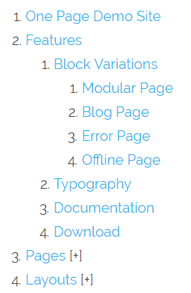

# Общие рецепты

На этой странице собраны задачи и их решения, связанные с Grav в целом.

## Смена версии PHP CLI

Иногда в терминале версия PHP отличается от версии PHP, которую использует веб-сервер.

Проверить версию PHP в CLI можно командой `php -v`.
Если версия PHP ниже 5.5.9, Grav не запустится: ему нужен как минимум PHP 5.5.9.

Как это исправить?

Нужно добавить настройки в `.bashrc` или `.bash_profile` в вашей домашней папке пользователя. Создайте эти файлы, если их там ещё нет. Это скрытые файлы, поэтому, возможно, придётся выполнить `ls -al`, чтобы их увидеть. После добавления настроек нужно открыть новый сеанс терминала, чтобы они применились.

Пример конфигурации:

```bash
alias php="/usr/local/bin/php53"
export PHP_PATH = /usr/local/bin/php53
```

Альтернативный способ — добавить:

```bash linenums="1"
# .bash_profile

# Получаем псевдонимы и функции
if [ -f ~/.bashrc ]; then
        . ~/.bashrc
fi

# Переменные окружения и программы, запускаемые при старте для пользователя

PATH=/usr/local/lib/php-5.5/bin:$PATH:$HOME/bin

export PATH
```

Точный путь, конечно, зависит от того, как устроена ваша система и где хранятся бинарники более новой версии PHP. Это может быть описано в документации хостинга, или спросите у своего хостинг-провайдера, если нигде не нашли.

Можно также поискать файлы или папки `php-something` в `/usr/local/bin` или `/usr/local/lib` командой `ls -la /usr/local/lib/ |grep -i php`.

## Создание простой галереи

<h5 id="problem">Проблема:</h5>

Одно из типовых требований веб-дизайна — вывести на странице галерею. Это могут быть фотографии нового домашнего питомца, портфолио прошлых работ или даже простой каталог товаров, которые вы хотите показать и продать пользователям. В этом примере предположим, что вам нужно просто вывести несколько фотографий с подписью под каждой. Конечно, это можно адаптировать и для других целей.

<h5 id="solution">Решение:</h5>

Проще всего решить эту задачу с помощью [работы с медиафайлами](../../content/media/index.md) Grav, которая позволяет странице знать об изображениях в её папке.

Предположим, у вас есть страница `gallery.md` и несколько изображений в той же папке. Имена файлов не важны, потому что мы просто переберём все изображения. Поскольку мы хотим хранить дополнительные данные о каждом изображении, добавим для каждого файл `meta.yaml`. Например, у нас есть несколько изображений:

```yaml linenums="1"
- fido-playing.jpg
- fido-playing.jpg.meta.yaml
- fido-sleeping.jpg
- fido-sleeping.jpg.meta.yaml
- fido-eating.jpg
- fido-eating.jpg.meta.yaml
- fido-growling.jpg
- fido-growling.jpg.meta.yaml
```

Каждый файл `.jpg` достаточно хорошего размера для полноразмерной версии — 1280px x 720px. В каждом файле `meta.yaml` есть несколько ключевых записей; посмотрим на `fido-playing.jpg.meta.yaml`:

```yaml linenums="1"
title: Fido Playing with his Bone
description: The other day, Fido got a new bone, and he became really captivated by it.
```

Вы **полностью контролируете**, что кладёте в эти метафайлы: там может быть что угодно, что вам нужно.

Теперь нужно вывести эти изображения в обратном хронологическом порядке, чтобы новые были первыми. Поскольку наша страница называется `gallery.md`, создадим подходящий шаблон `templates/gallery.html.twig` с нужной логикой рендеринга:

```twig linenums="1"



    {{ page.content|raw }}

    <ul>
    
    <li>
        <div class="image-surround">
            {{ image.cropResize(300,200).html|raw }}
        </div>
        <div class="image-info">
            <h2>{{ image.meta.title }}</h2>
            <p>{{ image.meta.description }}</p>
        </div>
    </li>
    
    </ul>


```

Чтобы модульная галерея отображалась внутри другой страницы, удалите из файла Twig следующий код:

```twig linenums="1"



    {{ page.content|raw }}
```

и

```twig

```

По сути, шаблон расширяет стандартный `partials/base.html.twig` (при условии, что такой файл есть в вашей теме), затем определяет блок `content` и задаёт его содержимое. Сначала мы выводим `page.content`. Это содержимое файла `gallery.md`, поэтому там может быть заголовок и описание страницы.

Следующий фрагмент просто перебирает все медиафайлы страницы, которые являются **изображениями**. Мы выводим их неупорядоченным списком, чтобы разметка была семантичной и её было легко стилизовать через CSS. Каждому изображению присваивается переменная `image`, после чего можно применить простой метод `cropResize()`, чтобы изменить размер изображения до подходящего, а ниже выводится блок с `title` и `description`.

Можно сделать более продвинутую галерею, создав фильтры для данных камеры с помощью функции [EXIF](../../themes/twig-tags-filters-functions/filters/index.md).

## Вывод содержимого в колонках

<h5 id="problem-1">Проблема:</h5>

Вопрос, который возникает не раз: как быстро вывести одну страницу в несколько колонок.

<h5 id="solution-1">Решение:</h5>

Вариантов много, но простое решение — разбить содержимое на логические разделы с помощью разделителя, например HTML-тега `<hr />` или *тематического разрыва*. В Markdown он обозначается тремя и более дефисами или `---`. Мы просто создаём содержимое и разделяем его части этими дефисами:

**columns.md**

```markdown linenums="1"
---
title: 'Columns Page Test'
---

Lorem ipsum dolor sit amet, consectetur adipiscing elit. Maecenas arcu leo, hendrerit ut rhoncus eu, dictum vitae ligula. Suspendisse interdum at purus eget congue. Aliquam erat volutpat. Proin ultrices ligula vitae nisi congue sagittis. Nulla mollis, libero id maximus elementum, ante dolor auctor sem, sed volutpat mauris nisl non quam.

---
Phasellus id eleifend risus. In dui tellus, dignissim id viverra non, convallis sed ante. Suspendisse dignissim, felis vitae faucibus dictum, dui mi tempor lectus, non porta elit libero quis orci. Morbi porta neque quis magna imperdiet hendrerit.

---
Praesent eleifend commodo purus, sit amet viverra nunc dictum nec. Mauris vehicula, purus sed convallis blandit, massa sem egestas ex, a congue odio lacus non quam. Donec vitae metus vitae enim imperdiet tempus vitae sit amet quam. Nam sed aliquam justo, in semper eros. Suspendisse magna turpis, mollis quis dictum sit amet, luctus id tellus. Vestibulum ante ipsum primis in faucibus orci luctus et ultrices posuere cubilia Curae; Aenean eu rutrum mi.
```

> [!CAUTION] Внимание
> Примечание: обратите внимание на дополнительную строку после колонки и перед `---`. Это нужно потому, что три дефиса сразу под текстом интерпретируются как заголовок.

Затем достаточно вывести это содержимое шаблоном `columns.html.twig` (поскольку файл страницы назывался `columns.md`):

```twig linenums="1"



    <table>
        <tr>
            
            <td>{{ column|raw }}</td>
            
        </tr>
    </table>

```

Как видите, содержимое **разбивается** по тегу `<hr />` и превращается в массив из 3 колонок, который мы перебираем и выводим. В примере используется простой HTML-тег table, но можно взять что угодно.

> [!CAUTION] Внимание
> Примечание: при использовании плагина page-toc нужно писать `|split('<hr>')`, потому что плагин page-toc очищает HTML-код.

## Очень простой слайдер изображений на CSS

<h5 id="problem-2">Проблема:</h5>

Нужен слайдер изображений без лишних накладных расходов.

<h5 id="solution-2">Решение:</h5>

Этот рецепт рассчитан на 4 изображения и страницу `slider.md`! Просто положите изображения туда, где лежит .md-файл. Затем создайте новый шаблон Twig и расширьте `base.html.twig`.

```twig linenums="1"




    <div id="slider">
        <figure>
        
            {{ image.html|raw }}
        
        </figure>
    </div>

    {{ page.content|raw }}

```

Для модульного слайдера удалите

```twig linenums="1"



```

и

```twig

```

из предыдущего файла Twig.

Теперь займёмся CSS. Добавьте это в свой _custom.scss

```scss linenums="1"
@keyframes slidy {
    0% { left: 0%; }
    20% { left: 0%; }
    25% { left: -100%; }
    45% { left: -100%; }
    50% { left: -200%; }
    70% { left: -200%; }
    75% { left: -300%; }
    95% { left: -300%; }
    100% { left: -400%; }
}
body { margin: 0; }
div#slider {
    overflow: hidden;
    margin-top: -3rem;
    max-height: 30rem;
}
div#slider figure img { width: 20%; float: left; }
div#slider figure {
    position: relative;
    width: 500%;
    margin: 0;
    left: 0;
    animation: 30s slidy infinite;
}
```

Вот и всё.

## Оборачивание Markdown в HTML

На некоторых страницах нужно обернуть части Markdown-содержимого в собственный HTML-код, а не создавать новый шаблон Twig.

Для этого выполните следующие шаги:

в файле системной конфигурации `user/config/system.yaml` включите опцию markdown extra:

```yaml linenums="1"
pages:
  markdown:
    extra: true
```

в оборачивающем теге добавьте параметр `markdown="1"`, чтобы включить обработку Markdown-содержимого:

```markdown linenums="1"
<div class="myWrapper" markdown="1">
# my markdown content

this content is wrapped into a div with class "myWrapper"
</div>
```

готово.

## Добавление виджета последних записей в боковую панель

<h4 id="problem-3">Проблема:</h4>

Вы хотите создать в боковой панели виджет с последними записями.

<h4 id="solution-3">Решение:</h4>

Всегда можно создать фрагмент шаблона, расширяющий `partials/base.html.twig` (см. другие решения на этой странице), но здесь мы сделаем полноценный шаблон. Итоговый код шаблона Twig приведён ниже:

```twig linenums="1"
<div class="sidebar-content recent-posts">
    <h3>Recent Posts</h3>
    
        
        <div class="recent-post">
            
                <div class="recent-post-image">{{ bannerimage.cropZoom(60,60).quality(60) }}</div>
            
                <div class="recent-post-image"></div>
            
            <div class="recent-post-text">
                <h4><a href="{{p.url}}">{{ p.title }}</a></h4>
                <p>{{ p.date|date("M j, Y")}}</p>
            </div>
        </div>
    
</div>
```

Всё, что делает этот код, — сортирует дочерние страницы (записи блога) страницы `/blog` по убыванию даты. Затем берёт первые пять записей блога фильтром Twig `slice`. Кстати, `slice(n,m)` берёт элементы с `n` по `m-1`. В этом примере записи блога с баннером названы `banner.jpg`. Это значение сохраняется в переменной `bannerimage`. Если `bannerimage` существует, оно уменьшается до блока `60px x 60px` и появляется слева от заголовка записи и даты. Если нет, вместо него слева от заголовка и даты ставится уменьшенный до `60px x 60px` логотип сайта.

CSS для этого виджета приведён ниже:

```css linenums="1"
.sidebar-content .recent-post {
    margin-bottom: 25px;
    padding-bottom: 25px;
    border-bottom: 1px solid #F0F0F0;
    float: left;
    clear: both;
    width: 100%;
}

.sidebar-content [class~='recent-post']:last-of-type {
    border-bottom: none;
}

.sidebar-content .recent-post .recent-post-image,
.sidebar-content .recent-post .recent-post-text {
    float: left;
}

.sidebar-content .recent-post .recent-post-image {
    margin-right: 10px;
}

.sidebar-content .recent-post .recent-post-text h4 {
    font-family: serif;
    margin-bottom: 10px;
}

.sidebar-content .recent-post .recent-post-text h4 a {
    color: #193441;
}

.sidebar-content .recent-post .recent-post-text p {
    font-family: Arial, sans-serif;
    font-size: 1.5rem;
    color: #737373;
    margin: 0;
}
```

Отрегулируйте по вкусу отступы между элементами последних записей, семейство шрифтов, размер шрифта и насыщенность.

## Создание закрытой области

Grav очень упрощает создание закрытой области на сайте.
Всё работает благодаря плагину Login.

## Требование входа для доступа к части сайта {: #require-users-to-login-prior-to-access-a-part-of-t }

Если плагин ещё не установлен, установите его через админку или утилиту командной строки GPM.

Затем откройте страницу в админке, переключитесь в режим эксперта и в разделе FrontMatter добавьте

```yaml linenums="1"
access:
    site.login: true
```

Пользователям, открывающим страницу, придётся войти, чтобы увидеть её содержимое.

Учтите, что по умолчанию разрешение не распространяется на дочерние страницы. Чтобы это изменить, включите в конфигурации плагина Login параметр «Use parent access rules».

Этот параметр позволяет создавать расширенные закрытые области, не заботясь дальше об уровне доступа. Просто положите всё под страницу, у которой есть ограничение доступа.

## Требование особых разрешений для просмотра одной или нескольких страниц {: #require-special-permissions-to-view-one-or-more-pa }

Аналогично описанному выше можно назначить странице любое разрешение. Можно даже придумать собственные имена разрешений.

Например:

```yaml linenums="1"
access:
    site.onlybob: true
```

Затем добавьте разрешение `site.onlybob` пользователю Bob в его файле `bob.yaml` в папке `user/accounts`:

```yaml linenums="1"
access:
    site.onlybob: true
```

## Использование разрешений на основе групп

Можно также объединять пользователей в группу и назначать разрешения группе, а не отдельным пользователям. Пользователи наследуют разрешения группы.

Добавьте файл `user/config/groups.yaml`, например с таким содержимым:

```yaml linenums="1"
registered:
  readableName: 'Registered Users'
  description: 'The group of registered users'
  access:
    site:
      login: true
premium:
  readableName: 'Premium Members'
  description: 'The group of premium members'
  access:
    site:
      login: true
      paid: true
```

Теперь назначьте пользователей в группу, добавив

```yaml linenums="1"
groups:
      - premium
```

в их yaml-файл пользователя в `user/accounts`

Теперь пользователям из группы `premium` будет разрешён доступ к страницам с разрешением `site.paid`.

## Добавление JavaScript в подвал страницы

Часто нужно добавить «какой-нибудь» JavaScript в подвал, а не в заголовок страницы, чтобы он загружался после рендеринга содержимого.

Хороший пример — тема Antimatter.

В `templates/partials/base.html.twig` Antimatter определён нижний блок для js через вызов `{{ assets.js('bottom') }}`

```twig linenums="1"

    {{ assets.js('bottom') }}

```

Добавить ресурсы в этот блок в Twig можно, например, так:

``

или в PHP так:

`$this->grav['assets']->addJs($this->grav['base_url'] . '/user/plugins/yourplugin/js/somefile.js', ['group' => 'bottom']);`

## Переопределение расположения папки журналов по умолчанию

По умолчанию журналы Grav пишутся в папку `logs/`. К сожалению, бывает, что папка `logs/` уже используется или недоступна. Гибкая система потоков Grav позволяет задать другое расположение этих папок.

Сначала создайте новую папку. В этом примере мы создадим в корне установки Grav папку `grav-logs/`. Затем создайте в корне новый файл `setup.php` и вставьте в него такой код:

```php linenums="1"
<?php
use Grav\Common\Utils;


return [
    'streams' => [
        'schemes' => [
            'log' => [
               'type' => 'ReadOnlyStream',
               'prefixes' => [
                   '' => ["grav-logs"],
               ]
            ]
        ]
    ]
];
```

По сути, это переопределяет поток `log` на папку `grav-logs/` вместо стандартной `logs/`, заданной в `system/src/Grav/Common/Config/Setup.php`.

## Вертикальное меню с раскрывающимися пунктами

Чтобы создать вертикальное иерархическое меню страниц с раскрывающимися пунктами, нужен цикл Twig, немного CSS и немного JavaScript. В теме Antimatter результат будет выглядеть так:



Начнём с Twig:

```twig linenums="1"
<ol class="tree">
    
        
            <li class="item">
            <a href="{{ page.url }}">{{ page.title }}</a>
        
            <li class="parent">
            <a href="javascript:void(0);">{{ page.title }}</a>
            <ol>
                
                    
                        <li class="item">
                        <a href="{{ child.url }}">{{ child.title }}</a>
                    
                        <li class="parent">
                        <a href="javascript:void(0);">{{ child.title }}</a>
                        <ol>
                            
                                <li><a href="{{ subchild.url }}">{{ subchild.title }}</a></li>
                            
                        </ol>
                    
                    </li>
                
            </ol>
        
        </li>
    
</ol>
```

Получается упорядоченный список, который перебирает все видимые страницы Grav, уходя на три уровня вглубь и создавая структуру для каждого уровня. Список, охватывающий всю структуру, имеет класс *tree*, а каждый элемент списка — класс *parent*, если у него есть дочерние, или *item*, если нет.

Нажатие на родительский пункт раскрывает список, а обычные пункты ведут на саму страницу. Это можно добавить практически в любой шаблон Twig темы Grav, при условии, что Grav имеет доступ к видимым страницам.

Добавим немного стиля — CSS:

```css linenums="1"
<style>
ol.tree li {
    position: relative;
}
ol.tree li ol {
    display: none;
}
ol.tree li.open > ol {
    display: block;
}
ol.tree li.parent:after {
    content: '[+]';
}
ol.tree li.parent.open:after {
    content: '';
}
</style>
```

Обычно это размещают перед структурой Twig, а в идеале — подключают через [менеджер ресурсов](../../themes/asset-manager/index.md) в вашей теме. Эффект: после каждого родительского пункта добавляется **[+]**, показывая, что его можно раскрыть; при раскрытии он исчезает.

Наконец, добавим немного JavaScript, чтобы [обрабатывать переключение](https://stackoverflow.com/a/36297446/603387) класса *open*:

```javascript linenums="1"
<script type="text/javascript">
var tree = document.querySelectorAll('ol.tree a:not(:last-child)');
for(var i = 0; i < tree.length; i++){
    tree[i].addEventListener('click', function(e) {
        var parent = e.target.parentElement;
        var classList = parent.classList;
        if(classList.contains("open")) {
            classList.remove('open');
            var opensubs = parent.querySelectorAll(':scope .open');
            for(var i = 0; i < opensubs.length; i++){
                opensubs[i].classList.remove('open');
            }
        } else {
            classList.add('open');
        }
    });
}
</script>
```

Это всегда нужно размещать **после** структуры Twig, тоже в идеале в [менеджере ресурсов](../../themes/asset-manager/index.md).

## Динамическая стилизация одной или нескольких страниц
Вы можете динамически стилизовать разные страницы и записи на сайте Grav (независимо от назначенного файла шаблона), настроив файл Twig темы так, чтобы он применял CSS-класс, переданный переменной в метаданных страницы.

Стилизовать разные записи и страницы можно двумя способами:

1. Если вы используете тему Antimatter, можно задействовать существующее свойство заголовка `body_classes`, чтобы задать собственный CSS-класс для этой страницы.
2. Если вы используете тему не на основе Antimatter (или в ней не реализовано `body_classes`, как там), можно настроить файл Twig темы так, чтобы он применял CSS-класс, переданный переменной в свойстве заголовка страницы.

Например, в файле `base.html.twig` вашей темы или в более конкретном шаблоне, например `page.html.twig`, можно добавить класс к выводимому содержимому страницы:

```html linenums="1"
<div class="{{ page.header.body_classes }}">
...
</div>
```

Затем для каждой страницы, которой нужен уникальный стиль, добавьте такое свойство заголовка (при условии, что вы определили CSS-класс для `featurepost`):

```yaml linenums="1"
body_classes: featurepost
```

Примечание: именно так тема Antimatter применяет классы для отдельных страниц, и это хороший стандарт, которому стоит следовать.

## Перенос HTML-темы в Grav

Перенос HTML-темы в Grav — типичная задача. Вот пошаговый практический процесс, который помогает её решить.

Скорее всего, вы уже скачали тему, и она состоит из нескольких HTML-файлов. Начнём с того, чтобы Grav просто загружал домашнюю страницу. Без собственного контента — просто повторим HTML-тему, но в структуре Grav.

Сначала [воспользуйтесь плагином Grav Devtools](../../themes/theme-tutorial/index.md), чтобы создать пустую тему, и включите её в системных настройках Grav.

Создайте шаблон Twig `templates/home.html.twig` в папке шаблонов темы. Он будет шаблоном специально для домашней страницы. Обычно домашняя страница на сайте одна, поэтому ей, вероятно, стоит посвятить отдельный файл Twig.

Скопируйте HTML-код домашней страницы шаблона, начиная с `<html>` и заканчивая `</html>`, в новый файл `home.html.twig`.

Теперь перенесите все ресурсы HTML-темы (изображения, CSS, JS) в папку темы. Структуру папок темы можно сохранить или изменить.

Создайте пустой файл `pages/01.home/home.md`. Теперь откройте в браузере my-site.example/home: содержимое должно появиться, но CSS, JS и изображения не загрузятся, вероятно, потому что в теме они жёстко прописаны как ссылки `/img/*` или `/css/*`.

#### Добавление правильных ссылок на ресурсы

В Grav ссылки не работают, потому что указывают на маршрут домашней страницы: вместо `/user/themes/mytheme/img` они ведут на `/img` в корне Grav. Так как все ресурсы темы лучше держать внутри темы, нужно указать Grav правильное расположение.

Найдите на странице ресурсы и замените ссылки на изображения с `img/*.*` на ``.

С таблицами стилей чуть сложнее: есть сборка ресурсов, которую рано или поздно захочется включить, поэтому перенесём их в блок stylesheets внутри тега `<head>`.

Пример:

```twig linenums="1"

    

{{ assets.css()|raw }}
```

То же самое касается файлов JavaScript, с той разницей, что часть JS загружается в подвале.

Пример:

```twig linenums="1"

    
    

{{ assets.js()|raw }}
```

Теперь изменения страницы должны отображаться в браузере. Если нет, убедитесь, что в системной конфигурации Grav отключены кэш страниц и кэш Twig.

Это только начало. Дальше, возможно, понадобится добавить другие страницы и придумать, как лучше выводить содержимое страниц с помощью метаданных и собственного Twig, который обрабатывает обычные строительные блоки: отзывы на домашней странице, обзоры, особенности продукта и т. д.

#### Добавление ещё одной страницы

Добавить ещё одну страницу можно аналогично. Например, допустим, вы хотите создать страницу блога.
Повторите процесс: добавьте файл `templates/blog.html.twig`, вставьте HTML-исходник и создайте страницу `pages/02.blog/blog.md`.

Теперь, хотя ссылки на изображения внутри страниц всё ещё нужно переводить на синтаксис ресурсов Grav (или просто менять путь), повторять работу с CSS и JS не нужно. Их стоит переиспользовать по всему сайту.

#### Общие элементы

Определите общие части страниц (заголовок и подвал) и перенесите их в файл `templates/partials/base.html.twig`.

Затем каждый шаблон страницы должен расширять `partials/base.html.twig` (https://github.com/getgrav/grav-theme-antimatter/blob/develop/templates/default.html.twig#L1) и добавлять только своё уникальное содержимое.

## Добавление ресурса на конкретную страницу

<h4 id="problem-4">Проблема:</h4>

Вам нужно добавить ресурс в конкретный шаблон темы.

<h4 id="solution-4">Решение:</h4>

Чаще всего ресурсы добавляются в блоке Twig базового шаблона, как ниже.

```twig linenums="1"

    

{{ assets.js()|raw }}
```

Чтобы добавить свой ресурс, нужно расширить этот блок в шаблоне и вызвать `{{ parent() }}`, который получит ресурсы, уже добавленные в базовом шаблоне.
Допустим, вы хотите добавить файл «gallery.js» на страницу «Portfolio Gallery».
Отредактируйте шаблон и добавьте ресурс с `{{ parent() }}`.

```twig linenums="1"

  
  {{ parent() }}

```

## Повторное использование содержимого страницы или модуля на другой странице

<h4 id="problem-5">Проблема:</h4>
У вас много страниц или модулей, и вы хотите использовать один и тот же блок содержимого более чем на одной странице, не поддерживая несколько отдельных копий одного текста.

<h4 id="solution-5">Решение:</h4>

Это очень простой и понятный способ, который не требует плагина и работает в админке.

**Примечание:** для этой функциональности есть также плагин [Grav Page Inject](https://github.com/getgrav/grav-plugin-page-inject), который может подойти для более сложных сценариев.

Сначала создайте новый файл шаблона, который будет заглушкой для содержимого. Имя может быть любым; в этом примере он называется «modular_reuse» и будет храниться в папке `templates/modular_` вашей темы, но его можно положить в любое место папки templates.

`modular_reuse.html.twig` содержит только одну строку:

```twig linenums="1"
{{ page.content|raw }}
```

Затем создайте в админке новую модульную страницу, где это содержимое должно отображаться, используя новый шаблон «modular reuse». Имя новой страницы может быть любым — оно не будет отображаться, выведется заголовок исходной страницы.

Содержимое страницы — всего одна строка:
Страница:

```twig linenums="1"

```

Модуль:

```twig linenums="1"

```

То, что идёт после «include», — это место, где хранится шаблон из первого шага: вероятно, в папке `templates` для страниц и в папке `templates/modular` для модулей.

После page.find должен идти фактический путь к исходному содержимому, которое вы хотите использовать повторно. Содержимое модулей начинается с _, а страниц — нет. Проще всего найти правильный путь, открыв страницу в админке и скопировав URL после слова admin.

Итоговая страница должна выглядеть так:

```twig linenums="1"
---
title: 'Modular Reuse Example'
---


```

Теперь «amazing offers» можно выводить в нескольких местах, но обновлять только один раз.

## Своё поле для защиты от спама в контактной форме {: #make-a-custom-anti-spam-field-for-your-contact-for }

<h4 id="problem-6">Проблема:</h4>

Обычные методы защиты от спама, например поле-ловушка, обходят некоторые спам-боты.

<h4 id="solution-6">Решение:</h4>

Усложните боту задачу угадать, что можно и что нельзя заполнять в контактной форме. Проще говоря, задайте вопрос, на который пользователь точно ответит, но значимость ответа для бота будет непонятной. В Markdown-файл с [данными формы](https://learn.getgrav.org/forms/forms/example-form) добавьте такое поле:

```yaml linenums="1"
- name: personality
  type: radio
  label: What is five times eight?
  options:
    alaska: 32
    oklahoma: 40
    california: 48
  validate:
    required: true
    pattern: "^oklahoma$"
    message: Not quite, try that math again.
```

Вопрос должен быть простым, но с несколькими простыми неверными вариантами. Важен порядок ответов. Правильный ответ никогда не должен быть первым — стремитесь к середине. Важно самостоятельно перемешать значения, стоящие за ответами (метками), чтобы база связанных значений и ответов не помогала ответить.

Боты умнеют постоянно, но обычно не пытаются ответить на один и тот же вопрос несколько раз, если первая попытка не удалась. Кроме того, даже самые умные из них полагаются на словари известных данных при угадывании ответа. Мы задаём простой вопрос: «What is five times eight?» — и даём три варианта: «32», «40» и «48». Правильный ответ, очевидно, «40», но вместо проверки математических способностей бота мы назначаем этим числам значения «alaska», «oklahoma» и «california» соответственно. Поскольку боты смотрят на возможные значения, а не на метки, ответы никак не связаны с вопросом. Можно даже добавить ответ «Pineapple» со значением «mississippi» и проверять его, а пользователям просто сказать, что выбрать. Смысл в том, чтобы сделать перемешивание данных индивидуальным.

## Разное содержимое robots.txt для разных окружений {: #display-different-robots-txt-contents-for-differen }

<h4 id="problem-7">Проблема:</h4>

Вы настроили поддомен `dev.my-site.example` как сайт для разработки, чтобы просматривать изменения перед публикацией на `my-site.example`, и хотите запретить поисковым роботам обходить его, сохранив действующий сайт видимым в результатах поиска.

<h4 id="solution-7">Решение:</h4>

Хотя сайт для разработки стоит защитить паролем, чтобы он действительно был закрытым, иногда достаточно — и практичнее — просто запретить поисковым роботам обходить сайт. К счастью, Grav умеет обрабатывать страницы в формате txt так же, как html, поэтому можно использовать [конфигурацию окружения](../../advanced/environment-config/index.md) и шаблоны Twig.

Сначала создадим файл конфигурации `site.yaml`, который сообщит шаблону, что `dev.my-site.example` — окружение разработки.

`/user/[dev.my-site.example]/config/site.yaml`:

    environment: dev

Затем создадим шаблон страницы `robots.txt.twig`, который проверяет, работает ли Grav сейчас на сайте разработки, и выводит разное содержимое в зависимости от этого.

`/user/themes/[yourtheme]/templates/robots.txt.twig`:

```twig linenums="1"


{{ rule }}



{{ page.content|raw }}


```

Наконец, создайте страницу с маршрутом `/robots.txt`, в содержимом которой будут правила `robots.txt` по умолчанию, а в метаданных — правила альтернативной версии для разработки. Чтобы содержимое выводилось как обычный текст, а не html, отключим обработку Markdown.

`/user/pages/robots/robots.md`:

```markdown linenums="1"
---
routes:
  default: /robots.txt
process:
  markdown: false

dev:
  - 'User-agent: *'
  - 'Disallow: /'
---

User-agent: *
Disallow: /backup/
Disallow: /bin/
Disallow: /cache/
Disallow: /grav/
Disallow: /logs/
Disallow: /system/
Disallow: /vendor/
Disallow: /user/
Allow: /user/pages/
Allow: /user/themes/
Allow: /user/images/
Allow: /user/plugins/*.css$
Allow: /user/plugins/*.js$
```

Теперь у вас в корне сайта есть файл `robots.txt` с динамическим содержимым, который к тому же можно редактировать через плагин Admin.

Примечание: убедитесь, что рабочая версия сайта не выводит `Disallow: /`, иначе вы полностью уничтожите свою видимость в поисковых системах.
