# Справочник: поля форм в схемах

## Доступные поля форм для использования в админке

Формы в админке можно создавать из множества полей. Этот документ содержит полный справочник свойств каждого поля и примеры использования.

Помимо перечисленных ниже полей, можно также использовать все поля, доступные во фронтенд-формах и описанные в [справочнике полей форм на сайте](../../forms/fields-available/index.md).

> [!NOTE] Примечание
> Этот справочник перенесён из документации Grav 1.7 и описывает поведение полей в обеих админках, если для поля не указано иное. [Поле Media](#media-field) появилось в Grav 2.0 и отображается только в Admin Next.

### Специальные поля форм, доступные в админке

> [!NOTE] Примечание
> Большинство полей в этой таблице доступны только в админке, но некоторые из них также предоставляет плагин Form для форм на сайте: **Array**, **Columns**, **Column**, **Datetime**, **Fieldset**, **File**, **Range** и **Section**. Admin поставляет собственные версии этих полей, поэтому описанные здесь атрибуты относятся к формам админки. Об их поведении во фронтенде см. [справочник полей форм на сайте](../../forms/fields-available/index.md).

| Поле                                              | Описание |
| :-----                                            | :----- |
| **[Array](#array-field)**                         | используется для создания массивов ключ-значение |
| **BackupHistory**                                 | |
| **Blueprint**                                     | |
| **[Colorpicker](#colorpicker-field)**             | показывает выбор цвета |
| **[Columns](#columns-column-fields)**             | используется, чтобы разбить форму на несколько колонок |
| **[Column](#columns-column-fields)**              | используется для показа одной колонки (вместе с полем `Columns`) |
| **Cron**                                          | |
| **CronStatus**                                    | |
| **[Dateformat](#dateformat-field)**               | особый список, выводящий текущую дату и время в переданных форматах |
| **[Datetime](#datetime-field)**                   | поле выбора даты и времени |
| **[Editor](#editor-field)**                       | показывает редактор markdown |
| **[Elements](#elements-field)**                   | условное и организационное поле, показывающее или скрывающее дочерние элементы в зависимости от выбранного значения «триггера». Очень полезно, чтобы не загромождать интерфейс при большом числе параметров |
| **[Fieldset](#fieldset-field)**                   | группирует набор полей в раскрывающийся аккордеон |
| **[File](#file-field)**                           | в админке **File** специализировано для использования в конфигурациях плагинов и тем (схемах). Обрабатывает загрузку файла в указанное место, его удаление и удаление из конфигурации темы или плагина |
| **[Filepicker](#filepicker-field)**               | **Filepicker** позволяет выбирать файлы из расположения в файловой системе веб-сервера |
| **[Frontmatter](#frontmatter-field)**             | обычный редактор кода в режиме YAML, содержимое которого хранится как необработанная строка под собственным именем поля |
| **[IconPicker](#iconpicker-field)**               | выбор иконки Font Awesome из визуального списка. Выбранная иконка хранится как имя её класса |
| **[List](#list-field)**                           | используется для создания коллекций полей |
| **[Markdown](#markdown-field)**                   | редактор Markdown с панелью форматирования и предпросмотром — тот же, что используется в поле Content страницы |
| **[Media](#media-field)**                         | выбор изображения или файла из медиа самой страницы, медиатеки сайта или внешнего URL. Только Grav 2.0 и Admin Next |
| **MediaPicker**                                   | |
| **Multilevel**                                    | |
| **Order**                                         | |
| **PageMedia**                                     | |
| **[PageMediaSelect](#pagemediaselect-field)**     | псевдоним **Filepicker**, названный так для использования в схемах страниц: показывает список всех медиа страницы, чтобы пользователь мог назначить один из них полю |
| **[Pages](#pages-field)**                         | показывает список страниц сайта |
| **[Parents](#parents-field)**                     | выбор страницы для указания родительской страницы, с отображением иерархии страниц сайта |
| **Permissions**                                   | |
| **Range**                                         | |
| **[Section](#section-field)**                     | используется, чтобы разделить страницу настроек на разделы; каждый раздел имеет заголовок |
| **[Selectize](#selectize-field)**                 | гибрид текстового поля и выпадающего списка. В основном полезен для тегов и других полей выбора элементов |
| **SelectUnique**                                  | |
| **[Taxonomy](#taxonomy-field)**                   | особый список, предварительно настроенный для выбора одной или нескольких таксономий |
| **ThemeSelect**                                   | |
| **UserInfo**                                      | |
| **Xss**                                           | |

### Общие атрибуты полей {: #common-fields-attributes }

Каждое поле принимает список атрибутов. Эти общие атрибуты могут использоваться разными полями, но конкретные поля могут их игнорировать. Лучший способ узнать, какие атрибуты допустимы для поля, — посмотреть описание поля на этой странице и проверить, какие атрибуты упомянуты.

Этот список служит общей основой, чтобы не повторять описание общих полей.

| Атрибут             | Описание |
| :-----              | :----- |
| `autocomplete`      | принимает `on` или `off` |
| `autofocus`         | если включено, автоматически ставит фокус на это поле |
| `classes`           | принимает строку с одним или несколькими CSS-классами для добавления |
| `default`           | задаёт значение поля по умолчанию. Так вы всегда получите либо значение, указанное пользователем, _либо_ это значение по умолчанию. См. также `placeholder`. |
| `disabled`          | задаёт отключённое состояние поля |
| `help`              | добавляет всплывающую подсказку к полю |
| `id`                | задаёт id поля, а также атрибут `for` у метки |
| `label`             | задаёт метку поля |
| `name`              | задаёт имя поля |
| `novalidate`        | задаёт состояние novalidate поля |
| `placeholder`       | задаёт значение-подсказку поля. Оно показывает пользователю подсказку для ввода собственного значения, но не влияет на то, какое значение в итоге запишется. См. также `default`. |
| `readonly`          | задаёт состояние «только для чтения» |
| `size`              | задаёт размер поля, что, в свою очередь, добавляет класс его контейнеру. Допустимые значения: `large`, `x-small`, `medium`, `long`, `small`. При использовании во фронтенде в шаблоне, разумеется, можно добавить и другие |
| `style`             | задаёт стиль поля. Если указано `vertical`, поле может занимать всю ширину. Это простой способ сделать форму аккуратнее |
| `title`             | задаёт значение заголовка поля |
| `toggleable`        | добавляет флажок, переключающий атрибут enabled/disabled поля |
| `validate.required` | если задано положительное значение, поле становится обязательным |
| `validate.pattern`  | задаёт шаблон валидации |
| `validate.message`  | задаёт сообщение, показываемое при неудачной валидации |
| `validate.type`     | задаёт тип поля, используемый при валидации |

### Подробнее о полях

Как устроены поля, можно прочитать в исходном коде: [поля, добавленные плагином Form](https://github.com/getgrav/grav-plugin-form/tree/master/templates/forms) и [компоненты полей, которые отрисовывает Admin Next](https://github.com/getgrav/grav-admin-next/tree/main/src/lib/components/blueprint/fields).

### Валидация

Большинство полей поддерживают валидацию.

```yaml linenums="1"
validate:
    required: true
```

помечает поле как обязательное.

```yaml linenums="1"
validate:
    message: 'Some message'
```

показывает заданное сообщение, если поле заполнено неправильно.

```yaml linenums="1"
validate:
    pattern: 'Some pattern'
```

проверяет значение поля по переданному regex-шаблону. Примеры: `pattern: "[1-9][0-9]*"`, `pattern: '[A-Za-z0-9-]+'`, `pattern: '[a-z0-9-]+'`, ` pattern: '^[a-z0-9_-]{3,16}$'`, `pattern: '(?=.*\d)(?=.*[a-z])(?=.*[A-Z]).{8,}'`

#### validate.type {: #validate-type }

`validate.type` указывает, по какому типу проверять значение.

Несколько примеров:

Редактор будет проверяться как `textarea`:

```yaml linenums="1"
content:
    type: editor
    validate:
      type: textarea
```

Selectize будет проверяться как `commalist`:

```yaml linenums="1"
taxonomies:
    type: selectize
    size: large
    label: PLUGIN_ADMIN.TAXONOMY_TYPES
    classes: fancy
    help: PLUGIN_ADMIN.TAXONOMY_TYPES_HELP
    validate:
        type: commalist

filters.category:
  type: selectize
  label: Category filter
  help: Comma separated list of category names
  validate:
    type: commalist
```

Проверка адреса email:

```yaml linenums="1"
author.email:
    type: text
    size: large
    label: PLUGIN_ADMIN.DEFAULT_EMAIL
    help: PLUGIN_ADMIN.DEFAULT_EMAIL_HELP
    validate:
        type: email
```

Проверка, что значение — bool:

```yaml linenums="1"
summary.enabled:
    type: toggle
    label: PLUGIN_ADMIN.ENABLED
    highlight: 1
    help: PLUGIN_ADMIN.ENABLED_HELP
    options:
        1: PLUGIN_ADMIN.YES
        0: PLUGIN_ADMIN.NO
    validate:
        type: bool
```

Проверка, что значение — целое число от 0 до 65536:

```yaml linenums="1"
summary.size:
    type: text
    size: x-small
    label: PLUGIN_ADMIN.SUMMARY_SIZE
    help: PLUGIN_ADMIN.SUMMARY_SIZE_HELP
    validate:
        type: int
        min: 0
        max: 65536
```

Проверка, что значение — число > 1:

```yaml linenums="1"
pages.list.count:
    type: text
    size: x-small
    label: PLUGIN_ADMIN.DEFAULT_PAGE_COUNT
    help: PLUGIN_ADMIN.DEFAULT_PAGE_COUNT_HELP
    validate:
        type: number
        min: 1
```

Проверка типа таксономии как массива:

```yaml linenums="1"
header.taxonomy:
  type: taxonomy
  label: PLUGIN_ADMIN.TAXONOMY
  multiple: true
  validate:
    type: array
```

Проверка текстового поля как slug:

```yaml linenums="1"
folder:
  type: text
  label: PLUGIN_ADMIN.FOLDER_NAME
  validate:
    type: slug
```

### Поле Array {: #array-field }

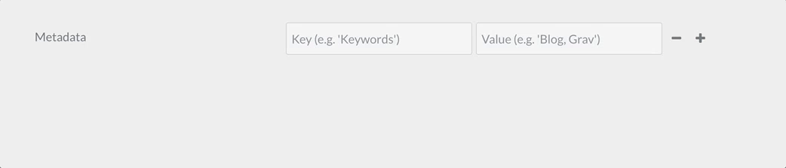

Тип поля `array` используется для создания простого списка объектов «ключ — значение» или просто списка значений, если использовать параметр `value_only`.

Пример:

```yaml linenums="1"
metadata:
   type: array
   label: PLUGIN_ADMIN.METADATA
   help: PLUGIN_ADMIN.METADATA_HELP
   placeholder_key: PLUGIN_ADMIN.METADATA_KEY
   placeholder_value: PLUGIN_ADMIN.METADATA_VALUE
   required: true
```

| Атрибут             | Описание |
| :-----              | :----- |
| `placeholder_key`   | |
| `placeholder_value` | |
| `value_only`        | Не требовать и не хранить ключи массива, хранить просто массив значений. |
| `value_type`        | Установите `textarea`, чтобы вместо меньшего [текстового поля](../../forms/fields-available/index.md#text-field) для ввода значений массива отображалось [поле textarea](../../forms/fields-available/index.md#textarea-field). |

| Разрешённые общие атрибуты |
| :----- |
| [default](#common-fields-attributes) |
| [help](#common-fields-attributes) |
| [label](#common-fields-attributes) |
| [name](#common-fields-attributes) |
| [style](#common-fields-attributes) |
| [toggleable](#common-fields-attributes) |
| [validate.required](#common-fields-attributes) |
| [validate.type](#common-fields-attributes) |

### Поле Colorpicker {: #colorpicker-field }

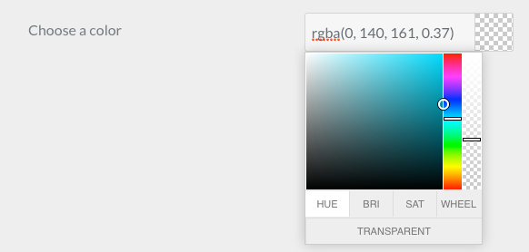

Тип поля `colorpicker` используется для отображения поля выбора цвета.

Пример:

```yaml linenums="1"
color:
   type: colorpicker
   label: Choose a color
   default: '#FFFFFF'
```

| Разрешённые общие атрибуты |
| :----- |
| [autocomplete](#common-fields-attributes) |
| [autofocus](#common-fields-attributes) |
| [classes](#common-fields-attributes) |
| [default](#common-fields-attributes) |
| [disabled](#common-fields-attributes) |
| [help](#common-fields-attributes) |
| [id](#common-fields-attributes) |
| [label](#common-fields-attributes) |
| [name](#common-fields-attributes) |
| [placeholder](#common-fields-attributes) |
| [style](#common-fields-attributes) |
| [title](#common-fields-attributes) |
| [toggleable](#common-fields-attributes) |
| [validate.message](#common-fields-attributes) |
| [validate.required](#common-fields-attributes) |
| [validate.type](#common-fields-attributes) |

### Поля Columns / column {: #columns-column-fields }

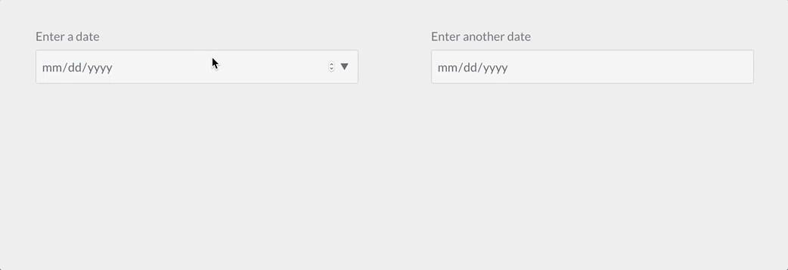

Типы полей `columns` и `column` используются, чтобы разделить вложенные поля формы на колонки.

Пример:

```yaml linenums="1"
columns:
  type: columns
  fields:
    column1:
      type: column
      fields:

        # .... подполя

    column2:
      type: column
      fields:

        # .... другие подполя
```

| Атрибут   | Описание |
| :-----    | :----- |
| `fields`  | Подполя columns / column |

### Поле Dateformat {: #dateformat-field }


Тип поля `dateformat` используется для

Пример:

```yaml linenums="1"
pages.dateformat.short:
    type: dateformat
    size: medium
    classes: fancy
    label: PLUGIN_ADMIN.SHORT_DATE_FORMAT
    help: PLUGIN_ADMIN.SHORT_DATE_FORMAT_HELP
    default: "jS M Y"
    options:
        "F jS \\a\\t g:ia": Date1
        "l jS \\of F g:i A": Date2
        "D, d M Y G:i:s": Date3
        "d-m-y G:i": Date4
        "jS M Y": Date5
```

| Атрибут     | Описание |
| :-----      | :----- |
| `options`   | Доступные варианты «ключ — значение» поля |
| `multiple`  | boolean. Если положительное, поле принимает несколько значений |
| `selectize` | |

| Разрешённые общие атрибуты |
| :----- |
| [autofocus](#common-fields-attributes) |
| [classes](#common-fields-attributes) |
| [default](#common-fields-attributes) |
| [disabled](#common-fields-attributes) |
| [help](#common-fields-attributes) |
| [label](#common-fields-attributes) |
| [name](#common-fields-attributes) |
| [novalidate](#common-fields-attributes) |
| [size](#common-fields-attributes) |
| [style](#common-fields-attributes) |
| [toggleable](#common-fields-attributes) |
| [validate.required](#common-fields-attributes) |
| [validate.type](#common-fields-attributes) |

### Поле Datetime {: #datetime-field }

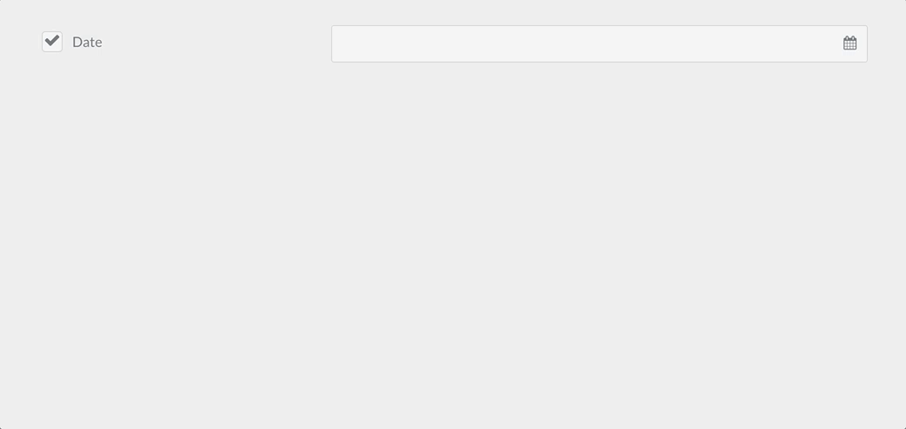

Тип поля `datetime` используется для хранения и отображения даты и времени.

Пример:

```yaml linenums="1"
header.date:
  type: datetime
  label: PLUGIN_ADMIN.DATE
  toggleable: true
  help: PLUGIN_ADMIN.DATE_HELP
```

| Атрибут        | Описание |
| :-----         | :----- |
| `format`       | Значение формата даты и времени; можно использовать любой из доступных [форматов даты и времени PHP](https://www.php.net/manual/en/datetime.format.php). |
| `validate.min` | Минимальное допустимое значение |
| `validate.max` | Максимальное допустимое значение |

| Разрешённые общие атрибуты |
| :----- |
| [default](#common-fields-attributes) |
| [help](#common-fields-attributes) |
| [label](#common-fields-attributes) |
| [name](#common-fields-attributes) |
| [size](#common-fields-attributes) |
| [style](#common-fields-attributes) |
| [toggleable](#common-fields-attributes) |
| [validate.required](#common-fields-attributes) |
| [validate.type](#common-fields-attributes) |

### Поле Editor {: #editor-field }

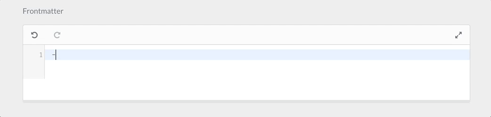

Тип поля `editor` используется для отображения редактора Codemirror.

Пример:

```yaml linenums="1"
frontmatter:
  classes: frontmatter
  type: editor
  label: PLUGIN_ADMIN.FRONTMATTER
  autofocus: true
  codemirror:
    mode: 'yaml'
    indentUnit: 4
    autofocus: true
    indentWithTabs: false
    lineNumbers: true
    styleActiveLine: true
    gutters: ['CodeMirror-lint-markers']
    lint: true
```

| Атрибут      | Описание |
| :-----       | :----- |
| `codemirror` | Набор значений для [редактора codemirror](https://codemirror.net/doc/manual.html#config). По умолчанию используется mode: gfm (github flavored markdown) |
| `resizer`    | Если положительное, включает изменение размера. Иначе редактор фиксирован |

| Разрешённые общие атрибуты |
| :----- |
| [default](#common-fields-attributes) |
| [help](#common-fields-attributes) |
| [label](#common-fields-attributes) |
| [name](#common-fields-attributes) |
| [style](#common-fields-attributes) |
| [validate.required](#common-fields-attributes) |
| [validate.type](#common-fields-attributes) |
| [autofocus](#common-fields-attributes) |
| [classes](#common-fields-attributes) |
| [disabled](#common-fields-attributes) |
| [id](#common-fields-attributes) |
| [novalidate](#common-fields-attributes) |
| [placeholder](#common-fields-attributes) |
| [readonly](#common-fields-attributes) |

### Поле Elements {: #elements-field }

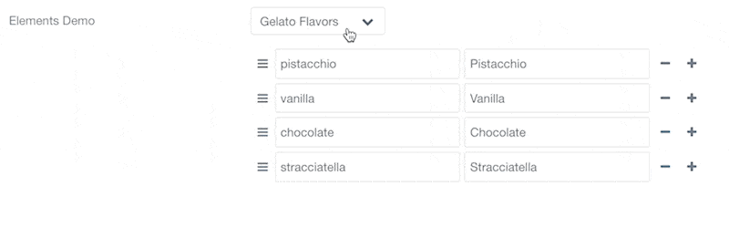

Это поле только организационное: оно позволяет группировать элементы в именованную группу, которая показывается, только если выбранное значение элемента совпадает с группой.

Пример:

```yaml linenums="1"
header.elements-demo.type:
  type: elements
  label: 'Elements Demo'
  size: small
  default: gelato
  options:
    gelato: Gelato Flavors
    color: Color
    planets: Planets
  fields:
    gelato:
      type: element
      fields:
        .flavours:
          type: array
          default:
            pistacchio: Pistacchio
            vanilla: Vanilla
            chocolate: Chocolate
            stracciatella: Stracciatella
    color:
      type: element
      fields:
        .description:
          type: textarea
          rows: 10
          default: Color (American English) or colour (Commonwealth English) is the visual perceptual property corresponding in humans to the categories called blue, green, red, etc. Color derives from the spectrum of light (distribution of light power versus wavelength) interacting in the eye with the spectral sensitivities of the light receptors. Color categories and physical specifications of color are also associated with objects or materials based on their physical properties such as light absorption, reflection, or emission spectra. By defining a color space colors can be identified numerically by their coordinates.
    planets:
      type: element
      fields:
        .favorites:
          type: text
          placeholder: What are your favorite planets?
          markdown: true
          description: 'Find a list of planets from [Wikipedia](https://en.wikipedia.org/wiki/Planet)'
```

### Поле Fieldset {: #fieldset-field }

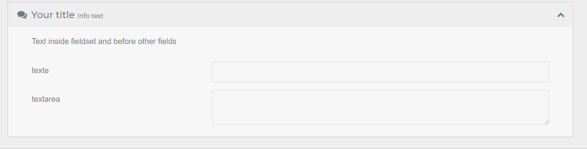
`fieldset` группирует набор полей в раскрывающемся блоке.

Пример:

```yaml linenums="1"
header.fieldset:
  type: fieldset
  title: Your title
  help: Help text
  info: Info text
  text: Text inside fieldset and before other fields
  icon: comments       # Система иконок Fork Awesome (см. forkaweso.me).
  collapsed: true      # Начальное состояние fieldset (см. параметр collapsible)
  collapsible: true    # Можно ли разворачивать fieldset
  fields:
    header.fieldset.an_example_text:
      type: text
      label: text
    header.fieldset.an_example_textarea:
      type: textarea
      label: textarea
```

!Наборы полей тоже нужно сохранять во frontmatter с `header.`, чтобы состояния их подполей корректно запоминались!

> [!CAUTION] Внимание
> **Известная проблема.** Если поля в наборе полей используют `toggleable:`, их состояние не будет запоминаться, если имя набора не начинается с `header.`. Вот пример правильной структуры с изменением параметра *pagination*:

```yaml linenums="1"
header.fieldset:
  type: fieldset
  ... etc...
  fields:
    header.content.pagination:
      type: toggle
      toggleable: true
      label: "Activate Pagination ?"
      highlight: 1
      default: 0
      options:
        1: Yes
        0: No
      validate:
        type: bool
```

#### Иконка набора полей

В заголовке набора полей можно разместить иконку. Используется система иконок [Fork Awesome](https://forkaweso.me).

| Атрибут       | Описание |
| :-----        | :----- |
| `icon`        | Иконка для блока |
| `collapsed`   | Если `true`, список открывается свёрнутым. По умолчанию развёрнут |
| `collapsible` | Можно ли разворачивать набор полей |

| Разрешённые общие атрибуты |
| :----- |
| [disabled](#common-fields-attributes) |
| [help](#common-fields-attributes) |
| [label](#common-fields-attributes) |
| [name](#common-fields-attributes) |
| [size](#common-fields-attributes) |
| [style](#common-fields-attributes) |
| [toggleable](#common-fields-attributes) |

### Поле File {: #file-field }

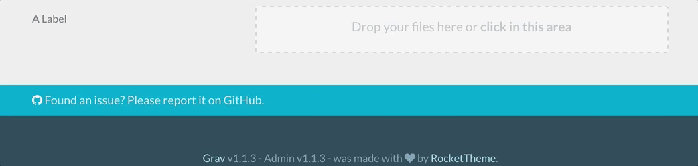

> [!CAUTION] Внимание
> Поле `file` предназначено для использования в схемах **конфигурации**, **тем** и **плагинов**, но **не** в схемах страниц. Для страниц следует использовать существующее поле `pagemedia`, а затем [поле filepicker](#filepicker-field) для выбора файлов.

> [!CAUTION] Внимание
> Поле `file` сейчас не работает должным образом внутри поля list. Используйте отдельное поле `pagemedia` вне списка и одно или несколько полей `filepicker` внутри списка.

> [!WARNING] Предупреждение
> Подробности можно найти в специальном разделе [«Как добавить загрузку файла»](../how-to-add-file-upload/index.md). Учтите также, что вывод изображения, загруженного через поле file, делается не так, как с полем filepicker. Подробности о доступе к изображениям, загруженным через поле file, есть в этой [записи рецептов](https://learn.getgrav.org/cookbook/twig-recipes#displaying-an-image-uploaded-in-a-file-field).

Пример:

```yaml linenums="1"
custom_logo_login_screen:
  type: file
  label: Custom Logo Login Screen
  destination: 'plugins://admin/assets'
  accept:
    - image/*
```

```yaml linenums="1"
custom_file:
  type: file
  label: A Label
  destination: 'theme://assets'
  multiple: true
  limit: 5
  filesize: 1
  accept:
    - image/*
```

| Атрибут             | Описание |
| :-----              | :----- |
| `destination`       | Папка, в которой будут храниться файлы, заданная через поток или относительно корня Grav. Например, `plugins://my-plugin/assets` |
| `multiple`          | Разрешать ли больше одного файла на поле |
| `limit`             | Когда `multiple` включён, позволяет ограничить количество файлов, разрешённых к загрузке |
| `filesize`          | Размер в МБ, допустимый для каждого файла |
| `accept`            | Список допустимых MIME-типов страниц и расширений. Например, `["image/*", '.mp3']` |
| `random_name`       | Использует случайное имя файла для каждого файла |
| `avoid_overwriting` | Добавит отметку времени перед именем каждого файла при конфликте |
| `allow_extensions`  | Позволяет этому полю загружать содержимое страниц или таблицы стилей через API Admin2, который по умолчанию их запрещает. Разрешить можно только `md`, `markdown`, `css`, `scss`, `sass` и `less`. Например, `[css]`. См. [«Как добавить загрузку файла»](../how-to-add-file-upload/index.md) |

| Разрешённые общие атрибуты |
| :----- |
| [default](#common-fields-attributes) |
| [disabled](#common-fields-attributes) |
| [help](#common-fields-attributes) |
| [label](#common-fields-attributes) |
| [name](#common-fields-attributes) |
| [size](#common-fields-attributes) |
| [style](#common-fields-attributes) |
| [toggleable](#common-fields-attributes) |
| [validate.required](#common-fields-attributes) |
| [validate.type](#common-fields-attributes) |

### Поле Filepicker {: #filepicker-field }

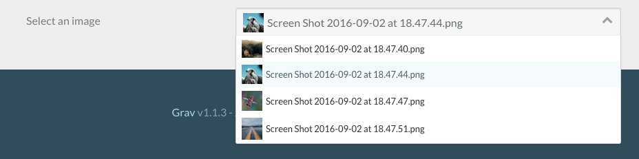

Тип поля `filepicker` можно использовать на страницах, в конфигурациях плагинов и тем (схемах). Обрабатывает выбор файла из расположения и сохранение его в заголовках страницы или конфигурации темы или плагина.

> [!NOTE] Примечание
> В Grav 2.0 [поле Media](#media-field) делает то же, что `filepicker`, и добавляет в качестве источников медиатеку сайта и внешние URL. `filepicker` по-прежнему работает точно так, как описано здесь, и остаётся полем для случая, когда схема также должна отрисовываться в классической админке.
>
> [PageMediaSelect](#pagemediaselect-field) — псевдоним этого поля: тот же компонент, те же атрибуты, но имя лучше читается в схемах страниц.

Пример:

```yaml linenums="1"
picked_image:
  type: filepicker
  folder: 'theme://images/pages'
  label: Select a file
  preview_images: true
  accept:
    - .png
    - .jpg
```

```yaml linenums="1"
header.a_file:
  type: filepicker
  folder: 'self@'
  preview_images: true
  label: Select a file
```

| Атрибут          | Описание |
| :-----           | :----- |
| `folder`         | Папка, в которой будут искаться файлы, заданная через поток или относительно корня Grav. Принимает любое значение в [формате destination поля file](../how-to-add-file-upload/index.md#destination). |
| `accept`         | Список допустимых расширений файлов |
| `preview_images` | Если включено, у файлов изображений будет небольшой предпросмотр |
| `on_demand`      | Если включено, файлы и изображения будут загружаться только при фокусе на filepicker. Это полезно для сокращения времени загрузки страницы редактирования в админке при большом объёме медиа или множестве полей filepicker |

| Разрешённые общие атрибуты |
| :----- |
| [default](#common-fields-attributes) |
| [disabled](#common-fields-attributes) |
| [help](#common-fields-attributes) |
| [label](#common-fields-attributes) |
| [name](#common-fields-attributes) |
| [size](#common-fields-attributes) |
| [style](#common-fields-attributes) |
| [toggleable](#common-fields-attributes) |
| [validate.required](#common-fields-attributes) |

### Поле Frontmatter {: #frontmatter-field }

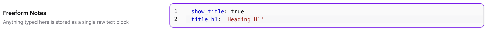

Тип поля `frontmatter` показывает обычный редактор кода YAML без панели форматирования. Любой введённый текст хранится **дословно, как необработанная строка** (переводы строк представляются escape-последовательностями) под собственным именем поля — он не разбирается и не объединяется с реальными ключами заголовка страницы.

> [!NOTE] Примечание
> Несмотря на название, это поле **не** редактирует настоящий frontmatter страницы и не превращает введённый текст в отдельные поля заголовка. Например, если назвать его `frontmatter_field` и ввести:
>
> ```yaml linenums="1"
> show_title: true
> title_h1: 'Heading H1'
> ```
>
> в заголовке страницы это сохранится как одно необработанное строковое значение:
>
> ```yaml linenums="1"
> frontmatter_field: "show_title: true\ntitle_h1: 'Heading H1'"
> ```
>
> Поэтому поле полезно для сохранения произвольного текстового блока (например, фрагмента, который позже будет разобран в Twig фильтром YAML, или произвольных заметок о конфигурации), а не для прямого редактирования frontmatter самой страницы.
>
> Это другой механизм, чем встроенный в Admin **экспертный режим**, который редактирует настоящий заголовок страницы напрямую. Экспертный режим реализован через [поле Editor](#editor-field) с `type: editor` и `classes: frontmatter` в `blueprints/admin/pages/raw.yaml`. Он использует режим YAML в `codemirror` и обрабатывает содержимое как настоящие ключи заголовка — см. этот раздел, если нужен переиспользуемый редактор необработанного YAML, чьё содержимое соответствует ключам заголовка.

Пример:

```yaml linenums="1"
header.notes:
  type: frontmatter
  label: Freeform Notes
  help: Anything typed here is stored as a single raw text block
```

> [!NOTE] Примечание
> **Admin Next / Admin2.** Поле `frontmatter` оборачивает обычный редактор кода YAML с максимальной высотой `600px` и прокруткой при переполнении. Оно принимает атрибуты `label`, `help`, `disabled` и `readonly` из конфигурации поля. Значение всегда считается обычной строкой, что подтверждает поведение хранения необработанного текста.
>
> **Классическая админка.** Это поле устарело с 2016 года. Оно реализовано как псевдоним поля `editor` с режимом YAML в `codemirror`. Для новых схем используйте `type: editor` — он принимает все те же параметры и активно поддерживается. Оно принимает все атрибуты, которые принимает поле `editor`, включая параметры `codemirror`.
>
> **Поведение необработанного заголовка.** Когда поле `frontmatter` используется в одной схеме с полем `content`, оно автоматически включает переключатель редактирования необработанного заголовка в редакторе страниц. Это поведение зависит именно от того, что поле называется `frontmatter` и соседствует с полем `content` (см. `AdminController.php:2930`).

| Разрешённые общие атрибуты |
| :----- |
| [default](#common-fields-attributes) |
| [help](#common-fields-attributes) |
| [label](#common-fields-attributes) |
| [name](#common-fields-attributes) |
| [style](#common-fields-attributes) |
| [validate.required](#common-fields-attributes) |
| [disabled](#common-fields-attributes) |
| [readonly](#common-fields-attributes) |

### Поле Honeypot

Тип поля `honeypot` создаёт скрытое поле, которое при заполнении возвращает ошибку. Это полезный способ не дать ботам заполнять и отправлять форму.

Пример:

```yaml linenums="1"
fields:
    - name: honeypot
      type: honeypot
```

Это простое текстовое поле, которое не отображается во фронтенде. Боты, которые находят поля в коде и заполняют их автоматически, скорее всего, заполнят и его. Ошибка не даёт отправить форму должным образом. Ошибка возвращается рядом с элементом формы, а не сверху в блоке сообщений.

Поле honeypot — популярная альтернатива полям captcha.

### Поле IconPicker {: #iconpicker-field }

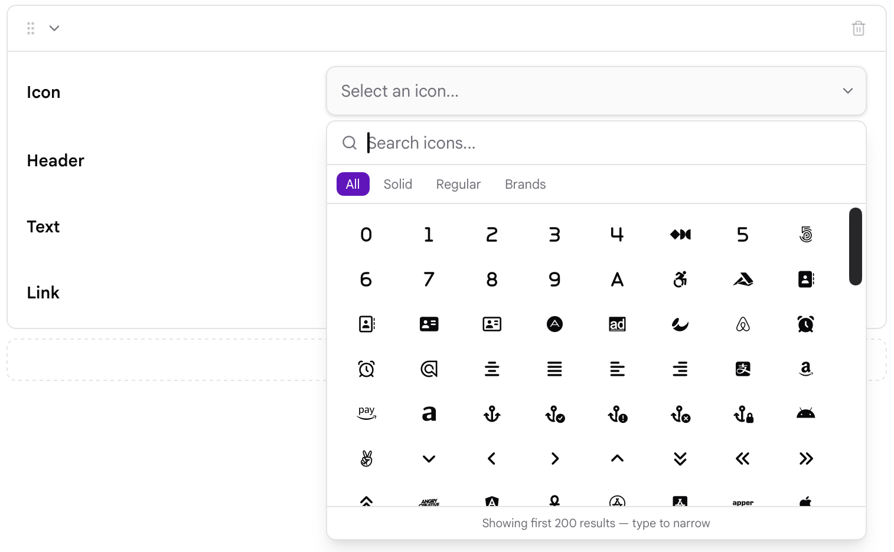

Тип поля `iconpicker` предоставляет визуальный выбор иконки Font Awesome. Выбранная иконка хранится как строка с именем её класса Font Awesome.

Поле доступно и в классической админке, и в Admin Next. Admin Next предоставляет дополнительные семейства иконок Font Awesome и выбор с поиском, а классическая админка использует набор иконок Font Awesome, поставляемый с плагином Admin.

Пример:

```yaml linenums="1"
icon:
    type: iconpicker
    label: Choose an icon
```

Выбранную иконку затем можно использовать в шаблоне, например:

```twig linenums="1"
 <i class="{{ page.header.icon }}"></i>

```

В Admin Next выбор предоставляет отдельные семейства **Solid**, **Regular** и **Brands**. Иконки можно искать по имени или связанным условиям поиска, и одновременно показывается до 200 подходящих иконок.

Например, выбор иконки Solid `house` сохраняет:

```text
fa-house
```

Иконка Regular или Brands включает семейство в сохраняемое значение:

```text
fa-regular fa-address-book
fa-brands fa-github
```

Это позволяет использовать выбранное значение напрямую как класс Font Awesome в теме сайта.

#### Формат

Классическая админка поддерживает атрибут `format`:

```yaml linenums="1"
icon:
    type: iconpicker
    format: short
```

`short` сохраняет короткий формат класса иконки. Любое другое значение или отсутствие атрибута `format` использует длинный формат.

> [!NOTE] Примечание
> Атрибут `format` — параметр классической админки. Admin Next использует собственный формат значений Font Awesome и не применяет этот атрибут при отрисовке выбора.

| Атрибут   | Описание |
| :-----    | :----- |
| `format`  | Управляет форматом значения иконки в классической админке. Установите `short` для короткого формата; если не указан, используется длинный формат. |

Выбор иконок основан на Font Awesome. Классическая админка загружает определения иконок из данных Font Awesome, поставляемых с плагином Admin, а Admin Next ведёт собственный каталог иконок и поддерживает семейства Solid, Regular и Brands.

| Разрешённые общие атрибуты |
| :----- |
| [autocomplete](#common-fields-attributes) |
| [autofocus](#common-fields-attributes) |
| [classes](#common-fields-attributes) |
| [default](#common-fields-attributes) |
| [disabled](#common-fields-attributes) |
| [help](#common-fields-attributes) |
| [id](#common-fields-attributes) |
| [label](#common-fields-attributes) |
| [name](#common-fields-attributes) |
| [novalidate](#common-fields-attributes) |
| [placeholder](#common-fields-attributes) |
| [readonly](#common-fields-attributes) |
| [size](#common-fields-attributes) |
| [style](#common-fields-attributes) |
| [toggleable](#common-fields-attributes) |
| [validate.required](#common-fields-attributes) |
| [validate.type](#common-fields-attributes) |

### Поле List {: #list-field }

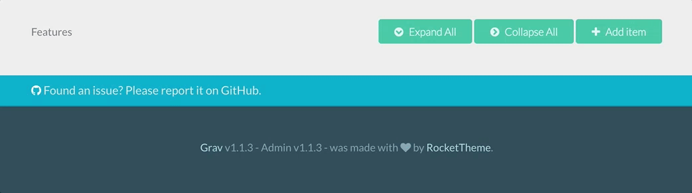

Тип поля `list` используется для создания коллекций полей. Поле принимает атрибут `fields` с подполями и показывает кнопку «Добавить элемент», чтобы пользователь мог добавлять элементы в коллекцию.

Пример:

```yaml linenums="1"
header.buttons:
  name: buttons
  type: list
  style: vertical
  label: Buttons
  fields:
    .text:
      type: text
      label: Text
    .url:
      type: text
      label: URL
    .primary:
      type: toggle
      label: Primary
      highlight: 1
      default: 1
      options:
          1: 'Yes'
          0: 'No'
      validate:
          type: bool
```

Этот пример создаёт такой интерфейс админки:

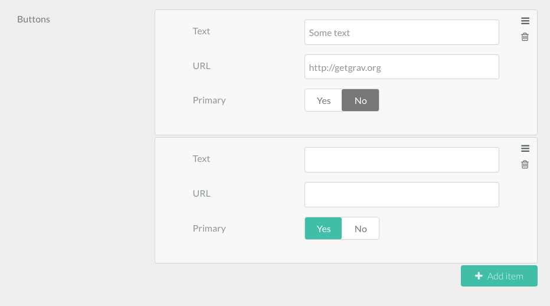

При сохранении страницы во frontmatter добавится такой YAML:

```yaml linenums="1"
buttons:
    -
        text: 'Some text'
        url: 'https://getgrav.org'
        primary: false
    -
        text: 'Another text'
        url: 'https://another-url.com'
        primary: true
```

Он будет использоваться в Twig темы, чтобы красиво вывести список.

Ещё один пример определения этого поля — список Features, используемый модульной дочерней страницей Features в Antimatter. У каждой фичи есть иконка, заголовок и текст:

```yaml linenums="1"
header.features:
  name: features
  type: list
  label: Features

  fields:
    .icon:
      type: text
      label: Icon
    .header:
      type: text
      label: Header
    .text:
      type: text
      label: Text
```

Доступ к данным поля `list` и их вывод выполняются простым циклом for в Twig, как в примере ниже:

```twig linenums="1"

    {{ feature.icon }}
    {{ feature.header }}
    {{ feature.text }}

```

| Атрибут     | Описание |
| :-----      | :----- |
| `fields`    | Подполя |
| `collapsed` | Если `true`, список открывается свёрнутым. По умолчанию развёрнут |
| `style`     | Можно установить `vertical`, чтобы сэкономить горизонтальное пространство |
| `btnLabel`  | Текст метки кнопки «добавить новый элемент» |
| `sort`      | Boolean. Если отрицательное, отключает возможность сортировки элементов |
| `controls`  | Определяет, где будет размещена кнопка «Add Item». Может быть `[top|bottom|both]`. По умолчанию `bottom`. |
| `placement` | Определяет, куда будет добавлен элемент. Может быть `[top|bottom|position]`. По умолчанию `bottom`. Если `placement` равно `top` или `bottom`, обе кнопки добавляют элемент соответственно в начало или в конец. Если `placement` равно `position`, элемент добавляется в зависимости от положения нажатой кнопки: при нажатии верхней кнопки элемент добавляется в начало, нижней — в конец. |
| `min`       | Минимальное число элементов в списке. |
| `max`       | Максимальное число элементов в списке. Кнопка «Add item» не работает после достижения этого числа |

| Разрешённые общие атрибуты |
| :----- |
| [default](#common-fields-attributes) |
| [help](#common-fields-attributes) |
| [label](#common-fields-attributes) |
| [name](#common-fields-attributes) |
| [validate.required](#common-fields-attributes) |
| [validate.type](#common-fields-attributes) |
| [size](#common-fields-attributes) |

### Поле Markdown {: #markdown-field }

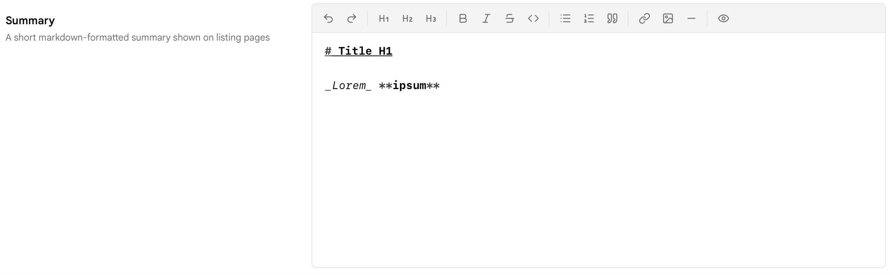

Тип поля `markdown` показывает редактор Markdown, используемый полем **Content** страницы: панель форматирования, переключатель предпросмотра и вставку изображений. Это тип поля, который `system/blueprints/pages/default.yaml` использует для `content`; его можно добавить в любом другом месте схемы, чтобы дать странице вторую область Markdown.

Пример:

```yaml linenums="1"
header.summary:
  type: markdown
  label: Summary
  help: A short Markdown summary shown on listing pages
```

Значение хранится как необработанный Markdown, поэтому при выводе в шаблоне пропускайте его через фильтр `markdown`:

```twig linenums="1"
{{ page.header.summary|markdown }}
```

> [!NOTE] Примечание
> В **Admin Next** на панели есть Undo, Redo, Heading 1–3, Bold, Italic, Strikethrough, Inline Code, Bullet List, Ordered List, Blockquote, Link, Image, Horizontal Rule и Preview. Preview заменяет редактор отрисованным предпросмотром до повторного нажатия. Кнопка Image открывает выбор с медиа страницы, медиатекой сайта и вариантом URL; изображения также можно перетаскивать или вставлять прямо в редактор. Если пользователь выбрал Editor Pro в качестве **Content Editor**, все поля `markdown` показываются с Editor Pro. Совместное редактирование в реальном времени применяется только к основному полю `content` страницы.

> [!NOTE] Примечание
> В **классической админке** `markdown` — это [поле Editor](#editor-field) с полностью включённой панелью (заголовки H1–H6 и переключатель Code/Preview), в режиме GitHub Flavored Markdown с включённой проверкой орфографии.

| Атрибут      | Описание |
| :-----       | :----- |
| `rows`       | Только Admin Next. Минимальная высота редактора как `rows × 24px`. По умолчанию `300px`. Редактор растёт вместе с содержимым, если пользователь не задал фиксированную высоту редактора в настройках. |
| `codemirror` | Только классическая админка. Параметры, объединяемые с конфигурацией [редактора CodeMirror](https://codemirror.net/doc/manual.html#config) (по умолчанию: `mode: gfm`, `spellcheck: true`). Admin Next их игнорирует. |
| `resizer`    | Только классическая админка. Установите `false`, чтобы скрыть маркер изменения размера редактора. |

| Разрешённые общие атрибуты |
| :----- |
| [default](#common-fields-attributes) |
| [help](#common-fields-attributes) |
| [label](#common-fields-attributes) |
| [name](#common-fields-attributes) |
| [style](#common-fields-attributes) |
| [validate.required](#common-fields-attributes) |
| [validate.type](#common-fields-attributes) |
| [autofocus](#common-fields-attributes) |
| [classes](#common-fields-attributes) |
| [disabled](#common-fields-attributes) |
| [id](#common-fields-attributes) |
| [novalidate](#common-fields-attributes) |
| [placeholder](#common-fields-attributes) |
| [readonly](#common-fields-attributes) |

### Поле Media {: #media-field }

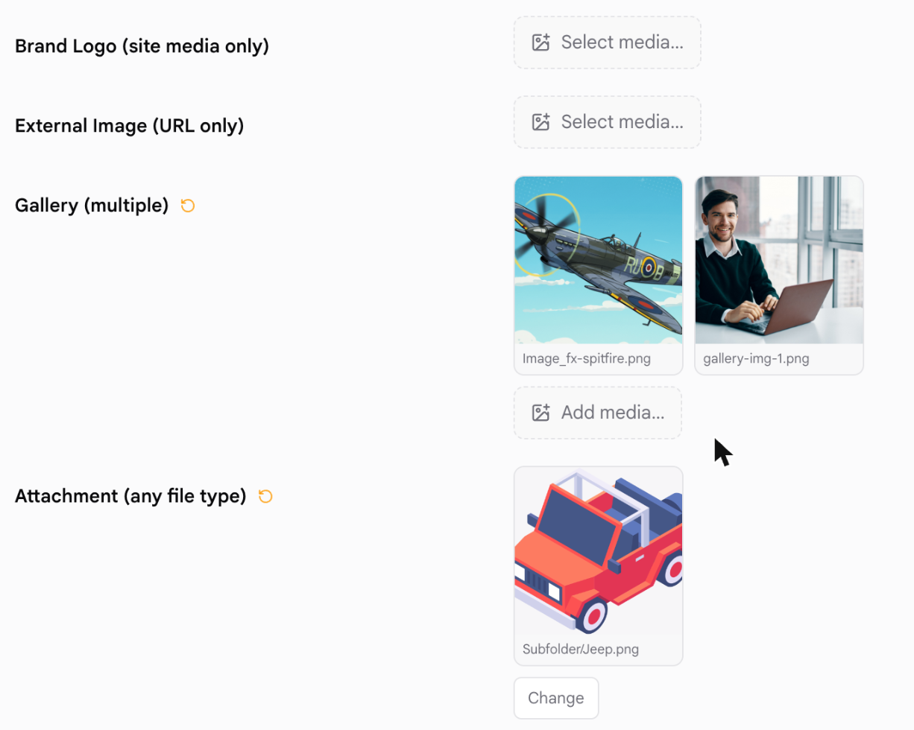

> [!NOTE] Примечание
> Поле `media` появилось в **Grav 2.0** и отображается **только в Admin Next**. В классической админке для него нет шаблона, поэтому схема с `media` ничего там не покажет. Используйте `filepicker`, если одна и та же схема должна работать в обеих админках.

Тип поля `media` позволяет автору выбрать изображение или файл из трёх мест в одном элементе управления:

- **Медиа страницы** — файлы, прикреплённые к редактируемой странице;
- **Медиа сайта** — медиатека сайта (поток `media://`, обычно `user/media`) с просмотром по папкам;
- **URL** — адрес, введённый вручную.

Какие из них предлагать, задаётся через `sources`. Если включён только один источник, поле сразу показывает соответствующий выбор без вкладок.


Это охватывает возможности `filepicker` и добавляет медиатеку сайта и источник URL. `filepicker` не изменился и по-прежнему поддерживается, поэтому существующие схемы менять не нужно.

Пример — изображение hero, которое автор может взять откуда угодно:

```yaml linenums="1"
header.hero:
  type: media
  label: Hero Image
  accept:
    - image/*
```

Пример — логотип, ограниченный одной папкой медиатеки:

```yaml linenums="1"
header.logo:
  type: media
  label: Brand Logo
  sources:
    - site
  folder: 'media://logos'
  accept:
    - image/*
```

Пример — упорядоченная галерея из медиатеки или внешних URL:

```yaml linenums="1"
header.gallery:
  type: media
  label: Gallery
  multiple: true
  sources:
    - site
    - url
  accept:
    - image/*
```

| Атрибут    | Описание |
| :-----     | :----- |
| `sources`  | Какие средства выбора предлагать и в каком порядке: `page`, `site`, `url`. Если отсутствует или пусто — все три. Один элемент показывает соответствующий выбор без полосы вкладок. |
| `accept`   | Список допустимых типов файлов. Принимает glob-шаблоны MIME (`image/*`), точные MIME-типы (`image/png`) и расширения (`.pdf`) в любом сочетании. Если отсутствует — любой тип файла. |
| `folder`   | Ограничивает выбор **site** папкой внутри медиатеки, так что автор не может подняться выше. Принимает `media://logos`, `user://media/logos` или просто `logos`. Другие потоки здесь не поддерживаются — используйте `filepicker`. |
| `multiple` | Хранить упорядоченный список значений вместо одного. Поле тогда показывает каждый выбор плиткой с элементами удаления и изменения порядка, а выбор остаётся открытым, чтобы можно было выбрать несколько файлов подряд. |

| Разрешённые общие атрибуты |
| :----- |
| [default](#common-fields-attributes) |
| [help](#common-fields-attributes) |
| [label](#common-fields-attributes) |
| [name](#common-fields-attributes) |
| [placeholder](#common-fields-attributes) |
| [toggleable](#common-fields-attributes) |
| [validate.required](#common-fields-attributes) |

#### Что сохраняется

Значение всегда обычная строка или список строк, если установлен `multiple`. Источник, из которого оно получено, записывается в самом значении:

| Источник    | Сохраняемое значение | Пример |
| :-----      | :-----               | :----- |
| Медиа страницы | просто имя файла | `hero.jpg` |
| Медиа сайта | путь потока `media://` | `media://logos/brand.svg` |
| URL | адрес точно как введён | `https://example.com/hero.jpg` |

Значение медиа страницы намеренно представляет собой просто имя файла — именно это всегда сохранял `filepicker` и чего ожидает `page.media[...]`, поэтому поле, переключённое с `filepicker` на `media`, продолжает читать существующие значения.

При `multiple: true` значение — список YAML в выбранном автором порядке:

```yaml linenums="1"
gallery:
  - 'media://gallery-img-1.png'
  - 'media://Subfolder/Jeep.png'
```

#### Использование значения в Twig

Каждый источник требует немного разной обработки. Медиа страницы проходит через собственный объект [Media](../../../content/media/index.md) страницы, поэтому работает обработка изображений Grav; путь `media://` — это поток, который разрешает `url()`; внешний URL используется как есть.

```twig linenums="1"



    

    

    {{ page.media[hero].cropZoom(1200, 600).html|raw }}

```

Если поле ограничено одним источником, достаточно соответствующей ветки. Для поля `sources: [site]`, например, это просто ``.

> [!NOTE] Примечание
> `url('media://logos/brand.svg')` разрешается в публичный путь файла (`/user/media/logos/brand.svg` в стандартной установке). Если папка `user/` закрыта и не отдаётся напрямую, значения медиа сайта не будут разрешаться во фронтенде — оставьте такие поля на медиа страницы или отдавайте файлы из места, доступного веб-серверу.

### Поле PageMediaSelect {: #pagemediaselect-field }

Тип поля `pagemediaselect` позволяет пользователям выбрать медиа из уже загруженных медиа страницы через FTP или менеджер медиа страницы.

> [!NOTE] Примечание
> `pagemediaselect` — **псевдоним [Filepicker](#filepicker-field)**, а не отдельное поле. Обе админки разрешают его в один и тот же компонент: шаблон `pagemediaselect` классической админки — одна строка `` шаблона filepicker, а Admin Next направляет оба имени типа в одно поле. Поэтому здесь работают все атрибуты, описанные в разделе [Filepicker](#filepicker-field), и оба поля ведут себя одинаково. Название сохранилось, потому что лучше читается в схемах страниц, где смысл именно «выбрать один из медиафайлов этой страницы».

`filepicker` без `folder` уже по умолчанию использует медиа текущей страницы, поэтому эти два объявления эквивалентны:

```yaml linenums="1"
header.img_link:
  label: Choose media
  type: pagemediaselect

header.img_link:
  label: Choose media
  type: filepicker
```

| Атрибут    | Описание |
| :-----     | :----- |
| `multiple` | Выбрать несколько файлов |
| *(другие)* | См. [Filepicker](#filepicker-field) — применимы `folder`, `accept`, `preview_images` и `on_demand` |

| Разрешённые общие атрибуты |
| :----- |
| [default](#common-fields-attributes) |
| [help](#common-fields-attributes) |
| [label](#common-fields-attributes) |
| [name](#common-fields-attributes) |
| [style](#common-fields-attributes) |
| [toggleable](#common-fields-attributes) |
| [validate.required](#common-fields-attributes) |
| [validate.type](#common-fields-attributes) |
| [autofocus](#common-fields-attributes) |
| [classes](#common-fields-attributes) |
| [disabled](#common-fields-attributes) |
| [id](#common-fields-attributes) |
| [novalidate](#common-fields-attributes) |
| [size](#common-fields-attributes) |

### Поле Pages {: #pages-field }


Тип поля `pages` показывает список страниц сайта.

Пример

```yaml linenums="1"
home.alias:
    type: pages
    size: medium
    classes: fancy
    label: PLUGIN_ADMIN.HOME_PAGE
    start_route: '/some_page'
    show_all: false
    show_modular: false
    show_root: false
    help: PLUGIN_ADMIN.HOME_PAGE_HELP
```

| Атрибут         | Описание |
| :-----          | :----- |
| `start_route`   | Выбрать корневой маршрут для списка |
| `show_fullpath` | Показывать путь страницы вместо заголовка |
| `show_slug`     | Показывать slug |
| `show_all`      | Показывает все страницы |
| `show_modular`  | Показывает модульные страницы |
| `show_root`     | Показывает корневую страницу |
| `options`       | Необязательный список дополнительных вариантов |
| `multiple`      | Выбрать несколько страниц |
| `limit_levels`  | Сколько уровней показывать |
| `selectize`     | |

Если установить `multiple` в true, нужно добавить `validate.type: array`. Иначе массив выбранных страниц не сохранится корректно.

| Разрешённые общие атрибуты |
| :----- |
| [default](#common-fields-attributes) |
| [help](#common-fields-attributes) |
| [label](#common-fields-attributes) |
| [name](#common-fields-attributes) |
| [style](#common-fields-attributes) |
| [toggleable](#common-fields-attributes) |
| [validate.required](#common-fields-attributes) |
| [validate.type](#common-fields-attributes) |
| [autofocus](#common-fields-attributes) |
| [classes](#common-fields-attributes) |
| [disabled](#common-fields-attributes) |
| [novalidate](#common-fields-attributes) |
| [size](#common-fields-attributes) |

### Поле Parents {: #parents-field }

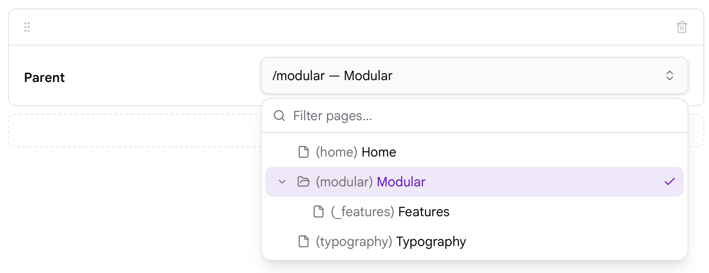

Тип поля `parents` предоставляет выбор страницы для указания родительской страницы. Оно показывает иерархию страниц сайта и позволяет выбрать страницу в качестве родителя.

Поле сохраняет структурный маршрут выбранной страницы, который не всегда совпадает с её публичным URL. На сайте, где у главной страницы есть псевдоним, публичный маршрут главной — `/`, а здесь сохраняется её настоящий маршрут, поэтому родитель всё равно определяется правильно.

```yaml linenums="1"
parent:
    type: parents
    label: Parent
```

В Admin Next (Admin2) поле `parents` использует тот же выбор страницы, что и поле [Pages](#pages-field), но с другим поведением по умолчанию. Поддерживаются следующие свойства:

```yaml linenums="1"
parent:
    type: parents
    show_root: true
    show_slug: true
    show_modular: false
```

#### `show_root` {: #show-root }

Управляет тем, можно ли выбрать корень сайта (`/`) в качестве родителя.

В Admin Next для поля `parents` параметр `show_root` по умолчанию равен `true`. Установите `false`, чтобы запретить выбор корня.

```yaml linenums="1"
parent:
    type: parents
    show_root: false
```

#### `show_slug` {: #show-slug }

Управляет тем, показывается ли slug страницы рядом с заголовком в списке выбора.

В Admin Next `show_slug` по умолчанию `true`.

```yaml linenums="1"
parent:
    type: parents
    show_slug: false
```

Это влияет только на отображение страниц в списке выбора и не меняет сохраняемое значение поля.

#### `show_modular` {: #show-modular }

Управляет тем, можно ли выбирать модульные страницы в качестве родителей.

В Admin Next `show_modular` по умолчанию `false`.

```yaml linenums="1"
parent:
    type: parents
    show_modular: true
```

Установите `true`, если модульные страницы должны включаться в список выбора страниц.

> [!NOTE] Примечание
> `show_root`, `show_slug` и `show_modular` поддерживаются Admin Next (Admin2). Текущая классическая реализация Admin их не поддерживает.

> [!NOTE] Примечание
> В старых примерах Grav могут встречаться свойства `show_all`, `show_fullpath`, `start_route` или `limit_levels`. Ни одна из текущих реализаций поля `parents` их не поддерживает, и использовать их не следует.

| Атрибут        | Описание |
| :-----         | :----- |
| `show_root`    | Только Admin Next. Можно ли выбрать корень сайта (`/`) в качестве родителя. Для этого типа поля по умолчанию `true`. |
| `show_slug`    | Только Admin Next. Показывать ли slug страницы рядом с заголовком в списке. По умолчанию `true`. Только отображение; сохраняемое значение не меняется. |
| `show_modular` | Только Admin Next. Можно ли выбирать модульные страницы в качестве родителей. По умолчанию `false`. |

| Разрешённые общие атрибуты |
| :----- |
| [default](#common-fields-attributes) |
| [help](#common-fields-attributes) |
| [label](#common-fields-attributes) |
| [name](#common-fields-attributes) |
| [size](#common-fields-attributes) |
| [style](#common-fields-attributes) |
| [toggleable](#common-fields-attributes) |
| [validate.required](#common-fields-attributes) |
| [validate.type](#common-fields-attributes) |

### Поле Section {: #section-field }

Тип поля `Section` используется, чтобы разделить страницу настроек на разделы.

Пример:

```yaml linenums="1"
content:
    type: section
    title: PLUGIN_ADMIN.DEFAULTS
    underline: true

    fields:

        #..... подполя
```

| Атрибут       | Описание |
| :-----        | :----- |
| `title`       | Заголовок раздела |
| `underline`   | Добавить подчёркивание после заголовка |
| `text`        | Текст, отображаемый ниже |
| `security`    | Массив учётных данных, необходимых пользователю для просмотра этого раздела |

### Поле Selectize {: #selectize-field }

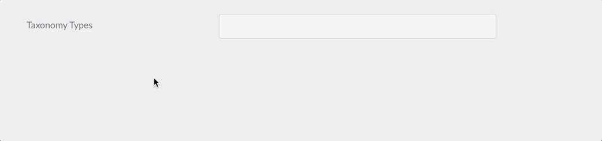

Тип поля `selectize` показывает гибрид текстового поля и выпадающего списка. В основном полезен для тегов и других полей выбора элементов.

Пример:

```yaml linenums="1"
taxonomies:
    type: selectize
    selectize:
        options:
            - text: "test"
              value: "real value 1"
            - text: "test-2"
              value: "real value 2"
            - text: "test-3"
              value: "real value 3"
    size: large
    label: PLUGIN_ADMIN.TAXONOMY_TYPES
    classes: fancy
    help: PLUGIN_ADMIN.TAXONOMY_TYPES_HELP
    validate:
        type: commalist
```

| Разрешённые общие атрибуты |
| :----- |
| [default](#common-fields-attributes) |
| [help](#common-fields-attributes) |
| [label](#common-fields-attributes) |
| [name](#common-fields-attributes) |
| [style](#common-fields-attributes) |
| [toggleable](#common-fields-attributes) |
| [validate.required](#common-fields-attributes) |
| [validate.type](#common-fields-attributes) |

| Общие атрибуты В БЛОКЕ ВВОДА |
| :----- |
| [autocomplete](#common-fields-attributes) |
| [autofocus](#common-fields-attributes) |
| [classes](#common-fields-attributes) |
| [disabled](#common-fields-attributes) |
| [id](#common-fields-attributes) |
| [novalidate](#common-fields-attributes) |
| [placeholder](#common-fields-attributes) |
| [readonly](#common-fields-attributes) |
| [size](#common-fields-attributes) |
| [title](#common-fields-attributes) |
| [validate.pattern](#common-fields-attributes) |
| [validate.message](#common-fields-attributes) |

### Поле Taxonomy {: #taxonomy-field }

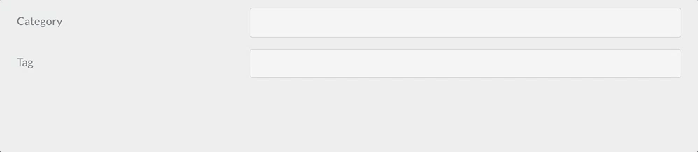

Тип поля `taxonomy` — особый список, предварительно настроенный для выбора одного или нескольких значений таксономии.

Пример:

```yaml linenums="1"
header.taxonomy:
  type: taxonomy
  label: PLUGIN_ADMIN.TAXONOMY
  multiple: true
  validate:
    type: array
```

| Атрибут    | Описание |
| :-----     | :----- |
| `multiple` | boolean. Если положительное, поле принимает несколько значений |

| Разрешённые общие атрибуты |
| :----- |
| [autofocus](#common-fields-attributes) |
| [classes](#common-fields-attributes) |
| [default](#common-fields-attributes) |
| [disabled](#common-fields-attributes) |
| [help](#common-fields-attributes) |
| [id](#common-fields-attributes) |
| [label](#common-fields-attributes) |
| [name](#common-fields-attributes) |
| [novalidate](#common-fields-attributes) |
| [outerclasses](#common-fields-attributes) |
| [size](#common-fields-attributes) |
| [style](#common-fields-attributes) |
| [validate.required](#common-fields-attributes) |
| [validate.pattern](#common-fields-attributes) |
| [validate.message](#common-fields-attributes) |
