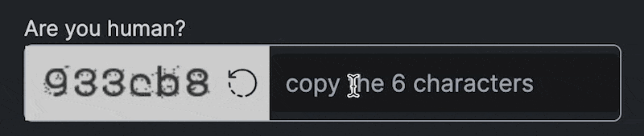
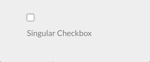
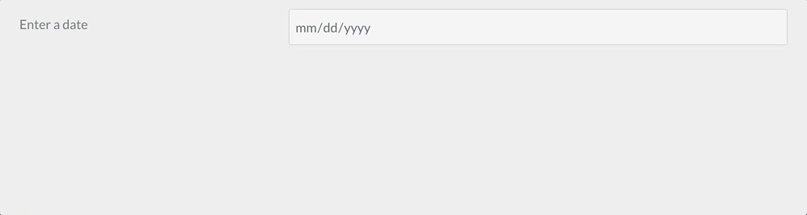
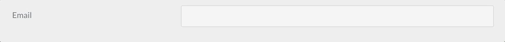
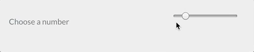
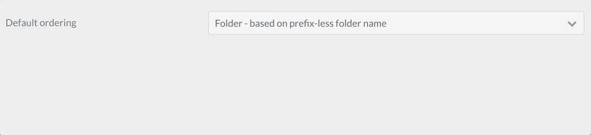
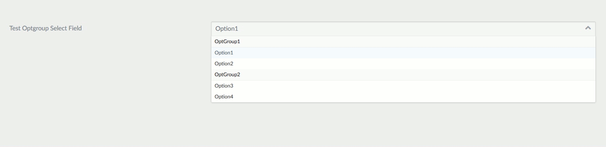
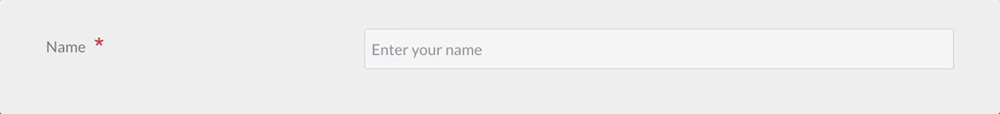
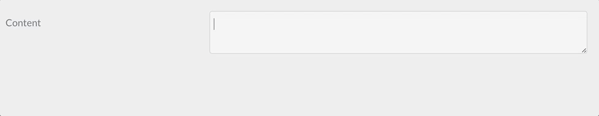

# Ссылка: указатель полей формы

## Общие атрибуты полей

Каждое поле принимает список атрибутов, которые вы можете использовать. Каждое поле может иметь общие атрибуты, но отдельные поля могут их игнорировать. Лучший способ проверить, какие атрибуты разрешены в поле - это проверить описание поля на этой странице и увидеть, какие атрибуты упоминаются.

Этот список обеспечивает общую основу, поэтому нет необходимости повторять описание общего поля.

| Атрибут             | Описание                                                                                                                                                                                                                                                      |
| :------------------ | :------------------------------------------------------------------------------------------------------------------------------------------------------------------------------------------------------------------------------------------------------------ |
| `autocomplete`      | принимает `on` или `off`                                                                                                                                                                                                                                      |
| `autofocus`         | если включено, автофокус на этом поле                                                                                                                                                                                                                         |
| `classes`           | принимает строку с одним или несколькими классами CSS для добавления                                                                                                                                                                                          |
| `default`           | устанавливает значение поля по умолчанию                                                                                                                                                                                                                      |
| `disabled`          | устанавливает отключенное состояние поля                                                                                                                                                                                                                      |
| `help`              | добавляет всплывающую подсказку к полю                                                                                                                                                                                                                        |
| `id`                | устанавливает идентификатор поля. Также устанавливает атрибут `for` для тега `label`                                                                                                                                                                          |
| `label`             | устанавливает метку поля                                                                                                                                                                                                                                      |
| `display_label`     | принимает `true` или `false`                                                                                                                                                                                                                                  |
| `labelclasses`      | принимает строку с одним или несколькими классами CSS для добавления                                                                                                                                                                                          |
| `sublabel`          | устанавливает текст поля под меткой                                                                                                                                                                                                                           |
| `sublabelclasses`   | принимает строку с одним или несколькими классами CSS для добавления                                                                                                                                                                                          |
| `name`              | устанавливает имя поля                                                                                                                                                                                                                                        |
| `novalidate`        | устанавливает состояние novalidate поля                                                                                                                                                                                                                       |
| `outerclasses`      | классы, добавленные в div, включающий тег `label` и поле                                                                                                                                                                                                      |
| `wrapper_classes`   | Классы, добавленные в оболочку, которая включает описание и поле                                                                                                                                                                                              |
| `placeholder`       | устанавливает значение заполнителя поля                                                                                                                                                                                                                       |
| `readonly`          | устанавливает состояние поля только для чтения                                                                                                                                                                                                                |
| `size`              | устанавливает размер поля, которое, в свою очередь, добавляет класс в свой контейнер. Допустимые значения: `large`, `x-small`, `medium`, `long`, `small`. Вы, конечно, можете добавить больше в шаблон, который вы видите, когда он используется во фронтенде |
| `style`             | устанавливает стиль поля                                                                                                                                                                                                                                      |
| `title`             | устанавливает значение заголовка поля                                                                                                                                                                                                                         |
| `type`              | устанавливает тип поля                                                                                                                                                                                                                                        |
| `validate.required` | если установлено положительное значение, устанавливает поле как обязательное                                                                                                                                                                                  |
| `validate.pattern`  | устанавливает шаблон валидации                                                                                                                                                                                                                                |
| `validate.message`  | устанавливает сообщение, отображаемое в случае сбоя валидации                                                                                                                                                                                                 |

Чтобы добавить пользовательские атрибуты, вы можете использовать:

```
attributes:
  key: value
```

Чтобы добавить пользовательские значения data-\*, вы можете использовать:

```
datasets:
  key: value
```

Указанные выше определения `атрибутов` и `наборов данных` приводят к следующему определению поля:

```
<input name="data[name]" value="" type="text" class="form-input " key="value" data-key="value">
```

!!! note ""

    Положительные значения можно установить несколькими способами: `'on'`, `true`, `1`. Остальные значения интерпретируются как отрицательные..

---

## Доступные поля

### Поле Array

Тип поля `array` позволяет создавать список пар ключ-значение, которые можно динамически добавлять, удалять или менять местами. Каждая строка в массиве может быть либо обычным полем ввода, либо текстовой областью, в зависимости от конфигурации.

Примеры:

Простой массив пар ключ-значение:

```yaml
my_array:
  type: array
  label: Массив пар ключ-значение
  placeholder_key: Key
  placeholder_value: Value
  value_type: text # Также может быть 'textarea' для многострочного ввода
```

В режиме `value_only` массив принимает только значения без ключей:

```yaml
my_array_values:
  type: array
  label: Только значения
  value_only: true
  placeholder_value: Введите значение
```

| Атрибут             | Описание                                                             |
| :------------------ | :------------------------------------------------------------------- |
| `placeholder_key`   | Текст-заполнитель для поля ввода ключа.                              |
| `placeholder_value` | Текст-заполнитель для поля ввода значения.                           |
| `value_type`        | Определяет тип поля ввода для значений (`text` или `textarea`).      |
| `value_only`        | Если `true`, отображаются только поля для ввода значений без ключей. |

| Общие допустимые атрибуты            |
| :----------------------------------- |
| [disabled](#obshchie-atributy-polei) |
| [readonly](#obshchie-atributy-polei) |
| [name](#obshchie-atributy-polei)     |
| [label](#obshchie-atributy-polei)    |
| [classes](#obshchie-atributy-polei)  |
| [size](#obshchie-atributy-polei)     |

---

### Поле Avatar

Тип поля `avatar` отображает доступное только для чтения изображение аватара. Это поле предназначено только для отображения: оно выводит изображение, но ничего не отправляет.

Это поле игнорирует собственные имя и значение. Оно всегда получает два фиксированных значения непосредственно из формы: отображает первое найденное изображение из значения `avatar` формы, а если оно пустое, использует [Gravatar](https://gravatar.com), сгенерированный на основе значения `email` формы. Поэтому оно полезно только в форме, которая уже содержит поля `avatar` и/или `email`, например в форме профиля пользователя.

Примеры:

```yaml
avatar_preview:
  type: avatar
  classes: "avatar-label"
  img_classes: "avatar-img"
```

!!! note ""

    Если назвать поле иначе (например, `user_avatar`), это не изменит отображаемое содержимое. Изображение по-прежнему берётся из значений `avatar` и `email` формы.

| Атрибут       | Описание                                                               |
| :------------ | :--------------------------------------------------------------------- |
| `classes`     | CSS-классы, применяемые к элементу `label`, оборачивающему изображение |
| `img_classes` | CSS-классы, применяемые непосредственно к изображению аватара          |


| Общие допустимые атрибуты            |
| :----------------------------------- |
| [classes](#obshchie-atributy-polei)  |

---

### Поле Basic-Captcha

Добавлено в Forms `7.0.0` в качестве локальной альтернативы полю Google ReCaptcha. Это поле особенно удобно при работе со СПАМом в контактных формах, когда вы не хотите иметь дело с хлопотами или, возможно, ограничениями GPDR, которые приходят с предложением Google. В нем используются **OCR-устойчивые** шрифты для предотвращения атак, и его можно настроить с помощью кодов для копирования или простых математических вопросов.



Тип поля `basic-captcha` полностью настраивается как глобально, так и на уровне отдельного поля. Глобальная конфигурация задаётся в файле конфигурации форм (обычно `user/config/plugins/form.yaml`), а конфигурация на уровне поля позволяет настраивать отдельные CAPTCHA-поля в ваших формах.

#### Глобальная конфигурация

Глобальные параметры по умолчанию:

```yaml
basic_captcha:
  type: characters            # варианты: [characters | math | dotcount | position]
  debug: false                # включить отладочное логирование
  image:
    width: 135                # ширина изображения по умолчанию (для типов math/dotcount/position)
    height: 40                # высота изображения по умолчанию (для типов math/dotcount/position)
    bg: '#ffffff'             # цвет фона по умолчанию
  chars:
    length: 6                 # количество выводимых символов
    font: zxx-xed.ttf         # варианты: [zxx-xed.ttf | zxx-sans.ttf | zxx-camo.ttf | zxx-noise.ttf]
    size: 24                  # размер шрифта в px
    box_width: 200             # ширина изображения для капч с символами (переопределяет image.width)
    box_height: 70             # высота изображения для капч с символами (переопределяет image.height)
    start_x: 10               # начальная позиция по оси x в px
    start_y: 40                # начальная позиция по оси y в px
    bg: '#ffffff'              # цвет фона для капч с символами
    text: '#000000'            # цвет текста (в шестнадцатеричном формате)
  math:
    min: 1                     # наименьшее число
    max: 12                    # наибольшее число
    operators: ['+','-','\*']  # операторы, которые можно использовать в математическом выражении
```

#### Конфигурация на уровне отдельного поля

Начиная с версии Forms `7.1.0` вы можете переопределять глобальные настройки индивидуально для каждого поля. Это позволяет разным формам использовать разные стили, шрифты, цвета и типы капчи.

!!! warning "Важно"

    В конфигурации поля используйте параметр `captcha_type` (а не `type`), чтобы не возникло конфликта с обязательным объявлением `type: basic-captcha`.

**Простой пример:**

```yaml
basic-captcha:
  type: basic-captcha
  placeholder: введите символы
  label: Вы человек?
```

**Расширенный пример с конфигурацией на уровне поля:**

```yaml
basic-captcha:
    type: basic-captcha
    placeholder: введите символы
    label: Вы человек?
    # Field-level configuration overrides global defaults
    captcha_type: characters        # use 'captcha_type' not 'type'
    chars:
        font: zxx-sans.ttf          # cleaner font
        size: 32                    # larger text
        length: 6                   # 6 characters
        box_width: 200              # wider image
        box_height: 70              # taller image
        bg: '#f0f8ff'             # light blue background
        text: '#0066cc'           # dark blue text
        start_x: 20                 # custom X position
        start_y: 50                 # custom Y position
```

**Пример математической капчи:**

```yaml
basic-captcha:
    type: basic-captcha
    placeholder: введите ответ
    label: Решите математическую задачку
    captcha_type: math              # math problem instead of characters
    math:
        min: 1                      # use small numbers
        max: 10
        operators: ['+','-']        # only addition and subtraction
```

#### Доступные типы капчи

При конфигурации на уровне поля тип капчи задаётся параметром `captcha_type`:

- **`characters`** — случайная строка символов (по умолчанию)
- **`math`** — простая математическая задачка (например, «3 + 5 = ?»)
- **`dotcount`** — посчитать точки определённого цвета
- **`position`** — определить положение символа

#### Доступные шрифты

Поле Basic-Captcha содержит четыре устойчивых к OCR шрифта:

- **`zxx-xed.ttf`** — по умолчанию, сбалансированная читаемость и безопасность
- **`zxx-sans.ttf`** — чистый без засечек, легче читается
- **`zxx-camo.ttf`** — стиль «камуфляж», сложнее
- **`zxx-noise.ttf`** — стиль с шумом, максимальная защита

#### Справочник параметров конфигурации

| Параметр          | Тип    | По умолчанию    | Описание                                                   |
|-------------------|--------|-----------------|------------------------------------------------------------|
| `captcha_type`    | string | `characters`    | Тип капчи: `characters`, `math`, `dotcount` или `position` |
| `chars.font`      | string | `zxx-xed.ttf`   | Файл шрифта для символьной капчи                           |
| `chars.size`      | int    | `24`            | Размер шрифта в пикселях                                   |
| `chars.length`    | int    | `6`             | Количество генерируемых символов                           |
| `chars.box_width` | int    | `200`           | Ширина изображения для символьной капчи                    |
| `chars.box_height`| int    | `70`            | Высота изображения для символьной капчи                    |
| `chars.bg`        | string | `#ffffff`     | Цвет фона (hex) для символьной капчи                       |
| `chars.text`      | string | `#000000`     | Цвет текста (hex)                                          |
| `chars.start_x`   | int    | `10`            | Начальная X-позиция текста                                 |
| `chars.start_y`   | int    | `40`            | Начальная Y-позиция текста                                 |
| `math.min`        | int    | `1`             | Минимальное число в математических примерах                |
| `math.max`        | int    | `12`            | Максимальное число в математических примерах               |
| `math.operators`  | array  | `['+','-','*']` | Доступные операторы                                        |
| `image.width`     | int    | `135`           | Ширина изображения по умолчанию (для несимвольных типов)   |
| `image.height`    | int    | `40`            | Высота изображения по умолчанию (для несимвольных типов)   |
| `image.bg`        | string | `#ffffff`     | Цвет фона по умолчанию                                     |

#### Обработка формы

Для этого также требуется соответствующий элемент `process:`, чтобы обеспечить правильную проверку формы.

!!! info ""

    Это должна быть первая запись в разделе `process:` формы, чтобы гарантировать, что форма не будет обработана, если проверка каптчи не прошла.

Пример:

```yaml
process:
  basic-captcha: true
```

Чтобы настроить сообщение, отображаемое при неудачной проверке, укажите параметр `captcha_not_validated` непосредственно в описании поля (если он не задан, будет использовано сообщение по умолчанию из плагина Form):

```yaml
fields:
  basic-captcha:
    type: basic-captcha
    label: Вы человек?
    captcha_not_validated: Проверка на человечность не прошла, попробуйте ещё раз...
```

### Поле Turnstile Captcha (Cloudflare)

Начиная с версии Form `v7.1.0`, Grav добавляет поддержку нового поля Cloudflare Turnstile. Это поле — новый способ предотвращения СПАМа в формах, и это отличная альтернатива полю Google ReCaptcha и ограничениям **GPDR**, предлагаемым Google. Это поле особенно удобно при работе со СПАМом в контактных формах. [Подробнее о Turnstile](https://blog.cloudflare.com/turnstile-private-captcha-alternative/?target=_blank).

#### Преимущества по сравнению с Google ReCaptcha

1. Соответствие требованиям GDPR и ориентация на защиту частной жизни пользователей
2. Чрезвычайно быстрая проверка вызовов
3. Очень простая реализация как в Cloudflare, так и в Grav, никаких сложных пользовательских интерфейсов или параметров для настройки.
4. Никаких причудливых обходных путей для асинхронной отправки форм (ajax), это просто работает!
5. Исключительный пользовательский опыт по сравнению с ReCaptcha, больше никаких подсчётов машин, светофоров и прочей ерунды
6. Построен на основе машинного обучения, со временем становится лучше и адаптируется к новым векторам атак.
7. Исчерпывающая аналитика эффективности задачи, [см. скриншот](https://blog.cloudflare.com/content/images/2022/09/image1-64.png?target=_blank)

#### Интеграция

Прежде чем интегрировать Grav Forms с Turnstile, вы должны сначала [создать новый сайт Turnstile](https://dash.cloudflare.com/?to=/:account/turnstile?target=_blank), к примеру, с помощью [официальной инструкции "get started"](https://developers.cloudflare.com/turnstile/get-started/?target=_blank).
Здесь вы также можете выбрать тип виджета, который вы хотите использовать, это может быть `управляемый`, `неинтерактивный` или `невидимый`. Важно отметить, что тип виджета можно изменить только в Cloudflare, вы не сможете настроить его через Grav. Однако, если вас не устраивает один из вариантов, вы сможете изменить его позже, если возникнет необходимость. [Подробнее о различных типах виджетов](https://developers.cloudflare.com/turnstile/reference/widget-types/?target=_blank).

!!! info ""

    Убедитесь, что вы добавили все домены, на которых вам может понадобиться использовать поле Turnstile Captcha, включая вашу локальную среду.

После создания сайта вам будут предоставлены `site_key` и `site_secret`, которые нужно будет задать в файле конфигурации формы (обычно `user/config/plugins/form.yaml`). Вы можете игнорировать предложенный тег сценария, так как Grav позаботится об этом за вас.

По умолчанию установлены следующие параметры:

```yaml
turnstile:
  theme: light
  site_key: <Your Turnstile Site Key>
  secret_key: <Your Turnstile Secret Key>
```

Наконец, вам также потребуется соответствующий элемент `process:` для обеспечения правильной проверки формы.

!!! info ""

    Это должна быть первая запись в разделе `process:` формы, чтобы гарантировать, что форма не будет обработана, если проверка captcha не прошла.

#### Пример

Типичный пример контактной формы выглядит следующим образом.

```yaml
form:
  name: contact
  fields:
    name:
      label: Имя
      type: text
      validate:
        required: true
    email:
      label: Имейл
      type: email
      validate:
        required: true
    message:
      label: Сообщение
      type: textarea
      validate:
        required: true
    captcha:
      type: turnstile
      theme: light
  buttons:
    submit:
      type: submit
      value: Отправить
  process:
    turnstile: true
    email:
      subject: '[Acme] {{ form.value.name|e }}'
      reply_to: '{{ form.value.name|e }} <{{ form.value.email }}>'
    message: Спасибо, что обратились к нам!
    reset: true
    display: '/'
```

### Поле Google Captcha (ReCaptcha)

Тип поля `captcha` используется для добавления элемента Google reCAPTCHA в вашу форму. В отличие от других элементов, его можно использовать в форме только один раз.

!!! info ""

    Вы должны настроить конфигурации Google reCAPTCHA в [консоли администратора reCAPTCHA](https://www.google.com/recaptcha/admin)

Начиная с версии `3.0`, поле поддерживает 3 варианта reCAPTCHA. Общая конфигурация reCAPTCHA лучше всего задается в глобальном файле конфигурации формы (обычно `user/config/plugins/form.yaml`). По умолчанию установлены следующие параметры:

```yaml
recaptcha:
  version: 2-checkbox
  theme: light
  site_key:
  secret_key:
```

Эти параметры должны быть установлены на основе следующего:

| Ключ       | Значения                                                                                              |
| ---------- | ----------------------------------------------------------------------------------------------------- |
| version    | По умолчанию `2-checkbox`, но также может быть `2-invisible` или `3`                                  |
| theme      | По умолчанию `light`, но также может быть `dark` (в настоящее время работает только для версии `2-x`) |
| site_key   | Ваш ключ сайта Google                                                                                 |
| secret_key | Ваш секретный ключ Google                                                                             |

!!! warning ""

    Убедитесь, что домен сайта указан в конфигурации Google reCAPTCHA.

В определении формы атрибут `name` поля `captcha` должен быть `g-recaptcha-response'. Причина в том, что Google reCAPTCHA хранит код подтверждения Captcha в поле с именем `g-recaptcha-response`.

Пример:

```yaml
g-recaptcha-response:
  type: captcha
  label: Капча
```

Вы также можете предоставить настраиваемое сообщение об ошибке `captcha_not_validated`, но если вы этого не сделаете, сообщение по умолчанию предоставляется подключаемым модулем формы. Если вы хотите установить специфичный для формы ключ `recaptcha_site_key`, а не устанавливать его глобально в конфигурации формы, вы также можете установить это.

```yaml
g-recaptcha-response:
  type: captcha
  label: Капча
  recaptcha_site_key: ENTER_YOUR_CAPTCHA_PUBLIC_KEY
  captcha_not_validated: 'Капча не действительна!'
```

| Атрибут                 | Описание                                           |
| :---------------------- | :------------------------------------------------- |
| `recaptcha_site_key`    | Ключ сайта Google reCAPTCHA (необязательно)        |
| `captcha_not_validated` | Сообщение, показывающее, что капча недействительна |

| Общие допустимые атрибуты                     |
| :-------------------------------------------- |
| [help](#obshchie-atributy-polei)              |
| [label](#obshchie-atributy-polei)             |
| [name](#obshchie-atributy-polei)              |
| [outerclasses](#obshchie-atributy-polei)      |
| [validate.required](#obshchie-atributy-polei) |

Для этого также требуется соответствующий элемент `process:`, чтобы обеспечить правильную проверку формы.

!!! info ""

    Это должна быть первая запись в разделе `process:` формы, чтобы гарантировать, что форма не будет обработана, если проверка каптчи не прошла.

Пример:

```yaml
process:
  captcha: true
```

##### Проверка Captcha на стороне сервера

Приведённый выше код проверит Captcha во внешнем интерфейсе и предотвратит отправку формы, если она неверна. Чтобы также проверить правильность ввода капчи на стороне сервера, добавьте действие процесса ввода капчи в свои формы:

```yaml
process:
  captcha: true
```

Вы также можете указать необязательное `message` об успешном выполнении, но если вы этого не сделаете, при успешном выполнении не будет отображаться никакого конкретного сообщения. Если вы хотите установить специфичный для формы `recaptcha_secret`, а не устанавливать его глобально в конфигурации формы, вы также можете установить это.

```yaml
process:
  captcha:
    recaptcha_secret: ENTER_YOUR_CAPTCHA_SECRET_KEY
    message: 'Successfully passed reCAPTCHA!'
```

См. [пример контактной формы](/forms/forms/example-form), чтобы увидеть его в действии.

---

### Поле флажка



Тип поля `checkbox` используется для добавления одного флажка в вашу форму.

Пример:

```yaml
agree_to_terms:
  type: checkbox
  label: 'Согласитесь с положениями и условиями'
  validate:
    required: true
```

| Общие допустимые атрибуты                     |
| :-------------------------------------------- |
| [autofocus](#obshchie-atributy-polei)         |
| [classes](#obshchie-atributy-polei)           |
| [default](#obshchie-atributy-polei)           |
| [disabled](#obshchie-atributy-polei)          |
| [id](#obshchie-atributy-polei)                |
| [label](#obshchie-atributy-polei)             |
| [name](#obshchie-atributy-polei)              |
| [novalidate](#obshchie-atributy-polei)        |
| [outerclasses](#obshchie-atributy-polei)      |
| [size](#obshchie-atributy-polei)              |
| [style](#obshchie-atributy-polei)             |
| [validate.required](#obshchie-atributy-polei) |
| [validate.pattern](#obshchie-atributy-polei)  |
| [validate.message](#obshchie-atributy-polei)  |

---

### Поле флажков


Тип поля `checkboxes` используется для добавления группы флажков в вашу форму.

Примеры:

```yaml
pages.process:
  type: checkboxes
  label: PLUGIN_ADMIN.PROCESS
  help: PLUGIN_ADMIN.PROCESS_HELP
  default:
    markdown: true
    twig: true
  options:
    markdown: Markdown
    twig: Twig
  use: keys
```

```yaml
my_field:
  type: checkboxes
  label: Несколько флажков с подсказкой по каждому варианту и отключенным option1
  default:
    - option1
    - option2
  options:
    option1: Вариант 1
    option2: Вариант 2
    help_options:
        option1: Подсказка для варианта 1
        option2: Подсказка для варианта 2
    disabled_options:
        - option1
```

| Атрибут            | Описание                                                                                                                                                         |
| :----------------- | :--------------------------------------------------------------------------------------------------------------------------------------------------------------- |
| `use`              | Если установлено значение `keys`, флажок будет сохранять значение ключа элемента при отправке формы. В противном случае он будет использовать значение элемента. |
| `options`          | Массив разрешённых параметров «ключ-значение».                                                                                                                   |
| `help_options`     | Массив ключей-значений с подсказкой для каждого варианта, определённого в `options`.                                                                             |
| `disabled_options` | Список вариантов, которые будут отображаться в отключенном состоянии.                                                                                            |

| Общие допустимые атрибуты                     |
| :-------------------------------------------- |
| [autofocus](#obshchie-atributy-polei)         |
| [classes](#obshchie-atributy-polei)           |
| [default](#obshchie-atributy-polei)           |
| [disabled](#obshchie-atributy-polei)          |
| [help](#obshchie-atributy-polei)              |
| [id](#obshchie-atributy-polei)                |
| [label](#obshchie-atributy-polei)             |
| [name](#obshchie-atributy-polei)              |
| [outerclasses](#obshchie-atributy-polei)      |
| [size](#obshchie-atributy-polei)              |
| [style](#obshchie-atributy-polei)             |
| [validate.required](#obshchie-atributy-polei) |
| [validate.pattern](#obshchie-atributy-polei)  |
| [validate.message](#obshchie-atributy-polei)  |

!!! note ""

    Поле флажков не поддерживает действие процесса `remember`.

---

### Поле Color

Тип поля `color` позволяет пользователю выбрать цвет с помощью палитры. Оно отображается как HTML-элемент `input` с типом `color`.

Примеры:

```yaml
background_color:
  type: color
  label: Цвет фона
  default: "#ffffff"
  classes: "color-picker"
```

| Атрибут   | Описание                        |
| :-------- | :------------------------------ |
| `default` | Устанавливает цвет по умолчанию |

| Общие допустимые атрибуты                     |
| :-------------------------------------------- |
| [autocomplete](#obshchie-atributy-polei)      |
| [autofocus](#obshchie-atributy-polei)         |
| [classes](#obshchie-atributy-polei)           |
| [default](#obshchie-atributy-polei)           |
| [disabled](#obshchie-atributy-polei)          |
| [help](#obshchie-atributy-polei)              |
| [id](#obshchie-atributy-polei)                |
| [label](#obshchie-atributy-polei)             |
| [display_label](#obshchie-atributy-polei)     |
| [labelclasses](#obshchie-atributy-polei)      |
| [sublabel](#obshchie-atributy-polei)          |
| [sublabelclasses](#obshchie-atributy-polei)   |
| [name](#obshchie-atributy-polei)              |
| [novalidate](#obshchie-atributy-polei)        |
| [outerclasses](#obshchie-atributy-polei)      |
| [wrapper_classes](#obshchie-atributy-polei)   |
| [placeholder](#obshchie-atributy-polei)       |
| [readonly](#obshchie-atributy-polei)          |
| [size](#obshchie-atributy-polei)              |
| [style](#obshchie-atributy-polei)             |
| [title](#obshchie-atributy-polei)             |
| [type](#obshchie-atributy-polei)              |
| [validate.required](#obshchie-atributy-polei) |
| [validate.pattern](#obshchie-atributy-polei)  |
| [validate.message](#obshchie-atributy-polei)  |

---

### Поле Columns

Тип поля `columns` используется для группировки нескольких полей в многоколоночный макет.
Каждое поле `columns` содержит одно или несколько полей `column`, которые определяют, как содержимое располагается по горизонтали.

Это поле **не** отображает собственные элементы ввода. Оно лишь организует вложенные поля в структурированный адаптивный макет.

Примеры:

```yaml
my_columns:
  type: columns
  fields:
    column1:
      type: column
      fields:
        header.title:
          type: text
          label: Заголовок

    column2:
      type: column
      fields:
        header.subtitle:
          type: text
          label: Подзаголовок
```

| Атрибут  | Описание                        |
| :------- | :------------------------------ |
| `fields` | Определяет список полей столбца |

| Общие допустимые атрибуты            |
| :----------------------------------- |
| [classes](#obshchie-atributy-polei)  |
| [name](#obshchie-atributy-polei)     |

---

### Поле Column

Тип поля `column` представляет один столбец внутри поля `columns`.
Он оборачивает набор полей в контейнер `<div class="form-column">`, позволяя отображать их рядом друг с другом.

Это поле само по себе не принимает ввод; оно только группирует и структурирует другие поля.

Примеры:

```yaml
my_column:
  type: column
  classes: "one-half"
  fields:
    header.description:
      type: textarea
      label: Описание
```

| Атрибут   | Описание                                      |
| :-------- | :-------------------------------------------- |
| `fields`  | Определяет поля внутри столбца                |
| `classes` | CSS-классы, применяемые к обёртке столбца     |

| Общие допустимые атрибуты            |
| :----------------------------------- |
| [classes](#obshchie-atributy-polei)  |
| [name](#obshchie-atributy-polei)     |

---

### Условное поле

Тип поля `conditional` используется для отображения некоторых других полей в зависимости от заданного условия.

Примеры:

Если ваше условное выражение уже возвращает `true` или `false`, вы можете просто использовать этот упрощённый формат:

```yaml
my_conditional:
  type: conditional
  condition: config.plugins.yourplugin.enabled
  fields: # The field(s) below will be displayed only if the plugin named yourplugin is enabled
    header.mytextfield:
      type: text
      label: Текстовое поле
```

Однако, если вам требуются более сложные условия, вы можете выполнить некоторую логику, которая возвращает `true` или `false` в виде строк, и поле это тоже поймет.

```yaml
my_conditional:
  type: conditional
  condition: "config.site.something == 'custom'"
  fields: # The field(s) below will be displayed only if the `site` configuration option `something` equals `custom`
    header.mytextfield:
      type: text
      label: Текстовое поле
```

| Атрибут     | Описание                                                                                   |
| :---------- | :----------------------------------------------------------------------------------------- |
| `condition` | Состояние оценивается twig. Любая переменная, доступная с помощью twig, может быть оценена |

| Общие допустимые атрибуты            |
| :----------------------------------- |
| [disabled](#obshchie-atributy-polei) |
| [id](#obshchie-atributy-polei)       |
| [label](#obshchie-atributy-polei)    |
| [name](#obshchie-atributy-polei)     |

---

### Поле даты



Тип поля `date` используется для добавления поля ввода HTML5 `date`.

Пример:

```yaml
- type: date
  label: Введите дату
  validate.min: '2014-01-01'
  validate.max: '2018-12-31'
```

| Атрибут        | Описание                                                                                                                                                                                                                                                                  |
| :------------- | :------------------------------------------------------------------------------------------------------------------------------------------------------------------------------------------------------------------------------------------------------------------------ |
| `validate.min` | Устанавливает атрибут `min` поля (см. [Дополнительные атрибуты](https://developer.mozilla.org/ru/docs/Web/HTML/Element/input/date#%D0%B4%D0%BE%D0%BF%D0%BE%D0%BB%D0%BD%D0%B8%D1%82%D0%B5%D0%BB%D1%8C%D0%BD%D1%8B%D0%B5_%D0%B0%D1%82%D1%80%D0%B8%D0%B1%D1%83%D1%82%D1%8B)) |
| `validate.max` | Устанавливает атрибут `max` поля (см. [Дополнительные атрибуты](https://developer.mozilla.org/ru/docs/Web/HTML/Element/input/date#%D0%B4%D0%BE%D0%BF%D0%BE%D0%BB%D0%BD%D0%B8%D1%82%D0%B5%D0%BB%D1%8C%D0%BD%D1%8B%D0%B5_%D0%B0%D1%82%D1%80%D0%B8%D0%B1%D1%83%D1%82%D1%8B)) |

| Общие допустимые атрибуты                     |
| :-------------------------------------------- |
| [autofocus](#obshchie-atributy-polei)         |
| [classes](#obshchie-atributy-polei)           |
| [default](#obshchie-atributy-polei)           |
| [disabled](#obshchie-atributy-polei)          |
| [help](#obshchie-atributy-polei)              |
| [id](#obshchie-atributy-polei)                |
| [label](#obshchie-atributy-polei)             |
| [name](#obshchie-atributy-polei)              |
| [novalidate](#obshchie-atributy-polei)        |
| [outerclasses](#obshchie-atributy-polei)      |
| [readonly](#obshchie-atributy-polei)          |
| [size](#obshchie-atributy-polei)              |
| [style](#obshchie-atributy-polei)             |
| [title](#obshchie-atributy-polei)             |
| [validate.required](#obshchie-atributy-polei) |
| [validate.pattern](#obshchie-atributy-polei)  |
| [validate.message](#obshchie-atributy-polei)  |

---

### Поле отображения


Тип поля `display` используется для отображения текста или инструкций внутри формы. Может принимать Markdown-контент.

Пример:

```yaml
test:
  type: display
  size: large
  label: Instructions
  markdown: true
  content: "This is a test of **bold** and _italic_ in a text/display field\n\nanother paragraph...."
```

| Атрибут    | Описание                                                                    |
| :--------- | :-------------------------------------------------------------------------- |
| `markdown` | логическое значение, которое включает обработку Markdown в поле содержимого |
| `content`  | текстовое содержимое для отображения                                        |

| Общие допустимые атрибуты                |
| :--------------------------------------- |
| [help](#obshchie-atributy-polei)         |
| [id](#obshchie-atributy-polei)           |
| [label](#obshchie-atributy-polei)        |
| [name](#obshchie-atributy-polei)         |
| [id](#obshchie-atributy-polei)           |
| [outerclasses](#obshchie-atributy-polei) |
| [size](#obshchie-atributy-polei)         |
| [style](#obshchie-atributy-polei)        |

---

### Поле электронной почты



Тип поля `email` используется для представления текстового поля ввода, которое принимает электронную почту, используя элемент input типа [email](https://developer.mozilla.org/en-US/docs/Web/HTML/Element/input/email).

!!! warning ""

    В электронных письмах не учитывается регистр символов. Убедитесь, что логика вашего приложения правильно обрабатывает электронные письма в верхнем, нижнем или смешанном регистре.

Пример:

```yaml
header.email:
  type: email
  autofocus: true
  label: Email
```

| Атрибут        | Описание                        |
| :------------- | :------------------------------ |
| `minlength`    | минимальная длина текста        |
| `maxlength`    | максимальная длина текста       |
| `validate.min` | то же, что и минимальная длина  |
| `validate.max` | то же, что и максимальная длина |

| Общие допустимые атрибуты                     |
| :-------------------------------------------- |
| [autofocus](#obshchie-atributy-polei)         |
| [classes](#obshchie-atributy-polei)           |
| [default](#obshchie-atributy-polei)           |
| [disabled](#obshchie-atributy-polei)          |
| [help](#obshchie-atributy-polei)              |
| [id](#obshchie-atributy-polei)                |
| [label](#obshchie-atributy-polei)             |
| [name](#obshchie-atributy-polei)              |
| [novalidate](#obshchie-atributy-polei)        |
| [outerclasses](#obshchie-atributy-polei)      |
| [readonly](#obshchie-atributy-polei)          |
| [size](#obshchie-atributy-polei)              |
| [style](#obshchie-atributy-polei)             |
| [title](#obshchie-atributy-polei)             |
| [validate.required](#obshchie-atributy-polei) |
| [validate.pattern](#obshchie-atributy-polei)  |
| [validate.message](#obshchie-atributy-polei)  |

---

### Поле Fieldset

Тип поля `fieldset` позволяет группировать несколько полей внутри HTML-элемента `<fieldset>`.

При необходимости в качестве заголовка группы полей может отображаться `<legend>`.

Это поле само по себе не хранит значение — оно лишь визуально и семантически организует другие поля.

Пример:

```yaml
user_info:
  type: fieldset
  id: user-info
  legend: Сведения о пользователе
  classes: "group-box"
  fields:
    name:
      type: text
      label: Имя

    email:
      type: email
      label: Имейл
```

| Атрибут   | Описание                                            |
| :-------- | :-------------------------------------------------- |
| `legend`  | Заголовок, отображаемый над сгруппированными полями |
| `fields`  | Список полей, содержащихся внутри fieldset          |
| `id`      | Устанавливает ID элемента `<fieldset>`              |
| `classes` | Добавляет CSS-классы к `<fieldset>`                 |

| Общие допустимые атрибуты                                  |
| :--------------------------------------------------------- |
| [id](#common-fields-attributes)                            |
| [classes](#common-fields-attributes)                       |
| [name](#common-fields-attributes)                          |
| **(Большинство других общих атрибутов полей неприменимы)** |

---

### Поле File

С типом поля `file` вы можете позволить пользователям загружать файлы через форму. Поле по умолчанию позволяет **только один файл** типа **изображение** и будет загружено на **текущую** страницу, где была объявлена ​​форма.

```yaml
# Настройки по умолчанию
my_files:
  type: file
  multiple: false
  destination: 'self@'
  accept:
    - image/*
```

| Атрибут       | Описание                                                                                                                                                                                                                                                                                                                                                                                                                                                                                                                                                                                                                                                                                                                          |
| :------------ | :-------------------------------------------------------------------------------------------------------------------------------------------------------------------------------------------------------------------------------------------------------------------------------------------------------------------------------------------------------------------------------------------------------------------------------------------------------------------------------------------------------------------------------------------------------------------------------------------------------------------------------------------------------------------------------------------------------------------------------- |
| `multiple`    | Может быть `true` или `false`, если установлено значение **true**, можно выбрать несколько файлов одновременно time                                                                                                                                                                                                                                                                                                                                                                                                                                                                                                                                                                                                               |
| `destination` | Может быть **@self**, **@page:/route**, **local/rel/path/**, или поток PHP.<br> Если установлено **@self**, файлы будут загружены туда, где была объявлена ​​форма (current .md).<br> При использовании **@page:/route** файлы будут загружаться по указанному маршруту страницы, если существует (например, **@page:/blog/a-blog-post**).<br> Если установлено **'local/rel/path'**, файлы будут загружены в указанное местоположение. Например, `user/images/uploads`. Если путь не существует, он будет создан, поэтому убедитесь, что он доступен для записи.<br> Вы также можете установить в качестве значения любой допустимый поток PHP, распознаваемый Grav, например `user-data://my-form` или `theme://media/uploads`. |
| `accept`      | Принимает массив разрешённых типов MIME. Например, чтобы разрешить только файлы gif и mp4: `accept: ['image/gif', 'video/mp4']`                                                                                                                                                                                                                                                                                                                                                                                                                                                                                                                                                                                                   |

!!! info ""

    Поле `file` в админке немного отличается, что позволяет также удалить файл, загруженный в форму, потому что в админке вариант использования заключается в том, чтобы загрузить, а затем связать файл с полем.

| Общие допустимые атрибуты                |
| :--------------------------------------- |
| [help](#obshchie-atributy-polei)         |
| [label](#obshchie-atributy-polei)        |
| [name](#obshchie-atributy-polei)         |
| [outerclasses](#obshchie-atributy-polei) |

По умолчанию в админке поле типа `file` будет перезаписывать загруженный файл с тем же именем, что и более новый, содержащийся в той же папке, в которую вы хотите его загрузить, если только вы не установите для параметра `avoid_overwriting` значение `true` в определении поля.

---

### Поле FilePond

Добавлено в Forms `7.0.0`. Поле типа `filepond` — современная альтернатива обычному полю File, работает на базе [JavaScript-библиотеки FilePond](https://pqina.nl/filepond/). Обеспечивает значительно лучший пользовательский опыт: drag-and-drop загрузку, предпросмотр изображений, встроенный редактор изображений (обрезка, изменение размера, поворот) и плавные анимации.

**Когда использовать FilePond:**
- Формы с большим количеством изображений, где нужны предпросмотр и редактирование
- Современные интерфейсы с поддержкой drag-and-drop
- Формы, где требуется оптимизация изображений на стороне клиента перед загрузкой
- Проекты, в которых приоритет — удобство пользователя, а не поддержка старых браузеров

**Когда использовать обычное поле File (Dropzone):**
- Загрузка любых файлов (не только изображений)
- Простая реализация без необходимости редактирования изображений
- Требуется совместимость со старыми браузерами

#### Базовое использование

```yaml
my_images:
    type: filepond
    label: Загрузка изображений
    destination: user/media/uploads
    multiple: true
    limit: 5
    filesize: 10
    accept:
        - image/*
```

#### Параметры конфигурации

| Параметр              | Тип | Описание |
|-----------------------|-----|----------|
| `multiple`            | boolean | Если `true` — разрешает выбор нескольких файлов одновременно (по умолчанию: `false`) |
| `limit`               | integer | Максимальное количество файлов в одном поле (по умолчанию: `10`) |
| `destination`         | string | Путь загрузки. Варианты:<br>• `@self` — загрузка в текущую страницу<br>• `@page:/route` — загрузка в указанную страницу<br>• `user/path/to/folder` — относительный путь от корня Grav<br>• PHP-потоки, например `user-data://uploads` |
| `filesize`            | integer | Максимальный размер файла в МБ. `0` = без ограничений (подчиняется лимитам сервера) (по умолчанию: `0`) |
| `accept`              | array | Массив разрешённых MIME-типов/расширений. Примеры:<br>• `['image/*']` — все изображения<br>• `['image/jpeg', 'image/png']` — только JPEG и PNG<br>• `['application/pdf']` — только PDF |
| `avoid_overwriting`   | boolean | Если `true` — добавляет префикс с датой, чтобы избежать перезаписи файлов (по умолчанию: `false`) |
| `random_name`         | boolean | Если `true` — генерирует случайное имя файла при загрузке (по умолчанию: `false`) |
| `validate.required`   | boolean | Делает поле обязательным для заполнения (по умолчанию: `false`) |

#### Опции трансформации и изменения размера изображений

FilePond предоставляет мощные возможности обработки изображений через ключ конфигурации `filepond`:

```yaml
my_images:
    type: filepond
    label: Загрузка и редактирование изображений
    destination: user/media/uploads
    multiple: true
    filesize: 10
    accept:
        - image/jpeg
        - image/png
        - image/webp
    filepond:
        # Output Format
        allowImageTransform: true
        imageTransformOutputMimeType: 'image/jpeg'
        imageTransformOutputQuality: 85
        imageTransformOutputStripImageHead: true

        # Resize Settings
        allowImageResize: true
        imageResizeTargetWidth: 1024
        imageResizeTargetHeight: 768
        imageResizeMode: 'contain'
        imageResizeUpscale: false

        # Crop Settings
        allowImageCrop: true
        imageCropAspectRatio: '16:9'

        # Preview Settings
        allowImagePreview: true
        imagePreviewHeight: 256

        # UI Customization
        stylePanelLayout: 'compact'
        labelIdle: '<span class="filepond--label-action">Выберите файлы</span> или перетащите их сюда'
```

#### Справочник специфических опций FilePond

| Опция                                 | Тип     | По умолчанию         | Описание                                                                 |
|---------------------------------------|---------|----------------------|--------------------------------------------------------------------------|
| **Трансформация изображений**         |         |                      |                                                                          |
| `allowImageTransform`                 | boolean | `true`               | Включить преобразование изображений перед загрузкой                     |
| `imageTransformOutputMimeType`        | string  | `image/jpeg`         | Формат вывода: `image/jpeg`, `image/png`, `image/webp`                  |
| `imageTransformOutputQuality`         | int     | `90`                 | Качество (0–100) — только для JPEG/WebP                                  |
| `imageTransformOutputStripImageHead`  | boolean | `true`               | Удалять EXIF-метаданные из изображений                                   |
| **Изменение размера**                 |         |                      |                                                                          |
| `allowImageResize`                    | boolean | `true`               | Включить автоматическое изменение размера изображений                   |
| `imageResizeTargetWidth`              | int     | `null`               | Целевая ширина в пикселях (`null` — без изменения)                       |
| `imageResizeTargetHeight`             | int     | `null`               | Целевая высота в пикселях (`null` — без изменения)                       |
| `imageResizeMode`                     | string  | `cover`              | Режим: `cover` (обрезать под размер), `contain` (вписать), `force` (точно)|
| `imageResizeUpscale`                  | boolean | `false`              | Разрешить увеличение изображений меньше целевого размера                 |
| **Обрезка**                           |         |                      |                                                                          |
| `allowImageCrop`                      | boolean | `true`               | Включить инструмент обрезки в предпросмотре                              |
| `imageCropAspectRatio`                | string  | `null`               | Соотношение сторон, например `16:9`, `1:1` или `null` (свободная обрезка) |
| **Предпросмотр**                      |         |                      |                                                                          |
| `allowImagePreview`                   | boolean | `true`               | Показывать предпросмотр изображений с инструментами редактирования       |
| `imagePreviewHeight`                  | int     | `256`                | Высота панели предпросмотра в пикселях                                   |
| **Интерфейс и стиль**                 |         |                      |                                                                          |
| `stylePanelLayout`                    | string  | `compact`            | Стиль панели                                                             |
| `styleLoadIndicatorPosition`          | string  | `center bottom`      | Положение индикатора загрузки                                            |
| `styleProgressIndicatorPosition`      | string  | `center bottom`      | Положение полосы прогресса                                               |
| `styleButtonRemoveItemPosition`       | string  | `right`              | Положение кнопки удаления файла                                          |
| **Подписи (можно использовать HTML)** |         |                      |                                                                          |
| `labelIdle`                           | string  | `Browse or drop files` | Основной текст зоны перетаскивания                              |
| `labelFileTypeNotAllowed`             | string  | `Invalid file type`  | Сообщение «Недопустимый тип файла»                                       |
| `labelFileSizeNotAllowed`             | string  | `File is too large`  | Сообщение «Файл слишком большой»                                         |

#### Полный пример формы

```yaml

---
title: 'Форма загрузки фотографий'
form:
    id: photo-upload
    xhr_submit: true
    fields:
        photos:
            type: filepond
            label: Загрузите ваши фотографии
            help: Можно загрузить до 5 фотографий. Они будут автоматически изменены до размера 1920×1080.
            destination: user/media/galleries
            multiple: true
            limit: 5
            filesize: 15
            accept:
                - image/jpeg
                - image/png
                - image/webp
            validate:
                required: true
            filepond:
                # Optimize images for web
                imageTransformOutputMimeType: 'image/jpeg'
                imageTransformOutputQuality: 85
                imageTransformOutputStripImageHead: true

                # Resize to HD
                allowImageResize: true
                imageResizeTargetWidth: 1920
                imageResizeTargetHeight: 1080
                imageResizeMode: 'contain'

                # Force 16:9 crop
                allowImageCrop: true
                imageCropAspectRatio: '16:9'

                # Custom label
                labelIdle: '<span class="filepond--label-action">Выберите файлы</span> или перетащите их сюда'

    buttons:
        submit:
            type: submit
            value: Загрузка фотографий

    process:
        upload: true
        message: 'Спасибо! Ваши фотографии успешно загружены.'
        reset: true
---

# Загрузка фотографий в галерею

Загружайте свои фотографии — они будут автоматически оптимизированы и изменены до нужного размера.
```

#### Обработка формы

Поле FilePond требует действия `upload` для сохранения загруженных файлов:

```yaml
process:
    upload: true
    message: 'Файлы успешно загружены!'
```

Файлы загружаются через AJAX и сохраняются в указанную папку `destination`. Все трансформации изображений (изменение размера, обрезка, конвертация формата) происходят прямо в браузере до отправки — это снижает нагрузку на сервер и ускоряет загрузку.

#### Интеграция с AJAX-отправкой форм

FilePond идеально работает с AJAX-отправкой форм (`xhr_submit: true`). Поле автоматически:
- блокирует отправку формы, пока файлы загружаются
- корректно переинициализируется после обновления формы
- сохраняет уже загруженные файлы при ошибках валидации
- удаляет временные файлы после успешной отправки формы

#### Краткое описание возможностей

* ✅ **Современный drag-and-drop интерфейс** — плавные анимации и визуальная обратная связь
* ✅ **Предпросмотр изображений** — просмотр с зумом и панорамированием до загрузки
* ✅ **Встроенный редактор изображений** — обрезка, изменение размера, поворот прямо в браузере
* ✅ **Оптимизация на стороне клиента** — уменьшение размера файлов перед отправкой
* ✅ **Конвертация форматов** — преобразование в JPEG, PNG или WebP
* ✅ **Мгновенная валидация** — проверка типа и размера файлов с моментальной обратной связью
* ✅ **Индикаторы прогресса** — полоски загрузки для каждого файла
* ✅ **Поддержка множественной загрузки** — несколько файлов в одном поле
* ✅ **Адаптивный дизайн** — отлично работает на десктопах, планшетах и смартфонах
* ✅ **Доступность** — поддержка клавиатуры и экранных читалок

#### Сравнение с обычным полем File

| Возможность                  | FilePond                         | File (Dropzone)               |
|------------------------------|----------------------------------|-------------------------------|
| Предпросмотр изображений     | ✅ С зумом и панорамированием    | ✅ Только миниатюры           |
| Редактирование изображений   | ✅ Обрезка, ресайз, поворот      | ❌ Отсутствует                |
| Оптимизация изображений      | ✅ На стороне клиента            | ❌ Только на сервере          |
| Конвертация форматов         | ✅ JPEG / PNG / WebP             | ❌ Отсутствует                |
| Drag & Drop                  | ✅ Современный интерфейс         | ✅ Классический интерфейс     |
| Проверка типа файлов         | ✅ В реальном времени            | ✅ При загрузке               |
| Множественная загрузка       | ✅ Да                            | ✅ Да                         |
| Поддержка XHR-отправки форм  | ✅ Автоматическая                | ✅ Требует настройки          |
| Лучше всего подходит для     | Изображений и UX                 | Обычных файлов                |

| Общие допустимые атрибуты |
|---------------------------|
| [help](#obshchie-atributy-polei) |
| [label](#obshchie-atributy-polei) |
| [name](#obshchie-atributy-polei) |
| [outerclasses](#obshchie-atributy-polei) |
| [validate](#obshchie-atributy-polei) |

---

### Поле Formname

Тип поля `formname` добавляет скрытое поле `input`, в котором хранится имя текущей формы.
Оно используется формами внутри системы, чтобы отслеживать, какая форма была отправлена, особенно когда на одной странице присутствует несколько форм.

Это поле не принимает пользовательский ввод и не допускает настройки, за исключением возможностей, явно поддерживаемых Twig-шаблоном.

!!! note ""

    Шаблон формы по умолчанию уже выводит это скрытое поле `input`, поэтому обычно нет необходимости добавлять поле `formname` вручную. Оно нужно только при создании собственного шаблона формы, в котором это поле отсутствует.

Пример:

```yaml
form_identifier:
  type: formname
```

Сгенерированный HTML:

```html
<input type="hidden" name="__form-name__" value="my-form-name" />
```

| Атрибут | Описание |
| :------ | :------- |
| **(нет)** | Это поле **не имеет настраиваемых атрибутов** |

| Общие допустимые атрибуты |
| :------------------------ |
| **(нет — все общие атрибуты игнорируются)** |

---

### Поле Hidden

Тип поля `hidden` используется для добавления скрытого элемента в форму.

Пример:

```yaml
header.some_field:
  type: hidden
  default: my-value
```

| Атрибут | Описание                                                                                                                    |
| :------ | :-------------------------------------------------------------------------------------------------------------------------- |
| `name`  | Имя поля. Если отсутствует, имя поля берется из элемента определения поля (в приведённом выше примере: `header.some_field`) |
| `evaluate` | Чтобы иметь возможность использовать переменные вроде `page.title` в качестве значения, нужно установить это в `true` |

| Общие допустимые атрибуты           |
| :---------------------------------- |
| [default](#obshchie-atributy-polei) |

---

### Поле Honeypot

Тип поля `honeypot` создает скрытое поле, которое при заполнении возвращается с ошибкой. Это полезный способ предотвратить заполнение и отправку формы ботами.

Пример:

```yaml
fields:
  honeypot:
    type: honeypot
```

Это простое текстовое поле, которое не отображается в интерфейсе пользователя. Боты, которые обнаруживают поля в коде и заполняют их автоматически, скорее всего, заполнят это поле. Ошибка не позволяет правильно отправить эту форму. Ошибка возвращается рядом с элементом формы, а не вверху блока сообщения.

Поле приманки - популярная альтернатива полям капчи.

---

### Поле Ignore

Тип поля `ignore` можно использовать для удаления неиспользуемых полей при расширении из другого чертежа

Пример:

```yaml
header.process:
  type: ignore
content:
  type: ignore
```

---

### Поле Key

Тип поля `key` предоставляет текстовое поле ввода, которое также содержит наблюдаемый атрибут (`data-key-observe`), используемый внутри JavaScript для отслеживания изменений значения поля.
Оно работает аналогично стандартному текстовому полю, но предназначено специально для случаев, когда значение поля должно динамически обновлять другие элементы формы.

Если значение является массивом, оно автоматически преобразуется в строку, разделённую запятыми.

!!! warning ""

    Отображаемое поле ввода не имеет атрибута `name`, поэтому поле `key` никогда не отправляет значение вместе с формой. Оно предназначено исключительно для управления другими полями через свой атрибут `data-key-observe` и в основном используется для столбца ключей в строке списка.

Пример:

```yaml
my_key:
  type: key
  label: Identifier
  placeholder: Введите внутренний ключ
```

Сгенерированный HTML (упрощённый):

```html
<input type="text"
       value="myvalue"
       data-key-observe="data[header][my_key]"
       placeholder="Введите внутренний ключ" />
```

| Атрибут | Описание |
| :------ | :------- |
| `placeholder` | Текст-заполнитель, отображаемый, когда поле пустое |
| `autocomplete` | Принимает `on` или `off` |
| `autofocus` | Автоматически устанавливает фокус на поле при загрузке формы |
| `classes` | Добавляет пользовательские CSS-классы к полю ввода |
| `disabled` | Отключает поле |
| `id` | Устанавливает HTML-атрибут `id` |
| `novalidate` | Отключает встроенную HTML-валидацию |
| `readonly` | Делает поле доступным только для чтения |
| `size` | Устанавливает размер контейнера поля ввода |
| `style` | Встроенные CSS-стили |
| `tabindex` | Устанавливает порядок перехода по полям с помощью клавиши Tab |
| `title` | Устанавливает всплывающую подсказку или сообщение валидации |
| `validate.required` | Требует указать значение перед отправкой |
| `validate.pattern` | Шаблон валидации с использованием регулярного выражения |
| `validate.message` | Сообщение, отображаемое при ошибке валидации |

| Общие допустимые атрибуты |
| :------------------------ |
| autocomplete |
| autofocus |
| classes |
| disabled |
| help |
| id |
| label |
| display_label |
| labelclasses |
| sublabel |
| sublabelclasses |
| name |
| novalidate |
| outerclasses |
| wrapper_classes |
| placeholder |
| readonly |
| size |
| style |
| title |
| type |
| validate.required |
| validate.pattern |
| validate.message |

---

### Поле Month

Тип поля **`month`** позволяет пользователям выбирать **месяц и год**. Оно хранит значение в формате `YYYY-MM`. Чтобы отобразить его в удобном для чтения виде, можно добавить `-01`, чтобы получить полную дату (`YYYY-MM-DD`), и отформатировать её с помощью Twig-фильтра `date`.

Примеры:

```yaml
header.billing_month:
type: month
label: Месяц оплаты
placeholder: Выберите месяц
default: 2025-11
```

Отображение в Twig:

```twig

 <p>{{ month_value|date("F Y") }}</p>

```

Это отобразит на сайте `2025-11` как **ноябрь 2025 года**.

| Атрибут | Описание |
| :------ | :------- |
| type | Определяет тип поля как `month` |
| label | Метка, отображаемая над полем |
| placeholder | Необязательный текст, отображаемый, когда значение не выбрано |
| default | Необязательное значение по умолчанию в формате `YYYY-MM` |

| Общие допустимые атрибуты |
| :------------------------------------ |
| [disabled](#common-fields-attributes) |
| [id](#common-fields-attributes) |
| [label](#common-fields-attributes) |
| [name](#common-fields-attributes) |
| [required](#common-fields-attributes) |

---

### Числовое поле

Тип поля `number` используется для представления поля ввода текста, которое принимает только числа, с использованием поля [HTML5 number](https://developer.mozilla.org/ru/docs/Web/HTML/Element/Input/number).

Пример:

```yaml
header.count:
  type: number
  label: 'Сколько?'
  validate:
    min: 10
    max: 360
    step: 10
```

| Атрибут         | Описание                       |
| :-------------- | :----------------------------- |
| `validate.min`  | минимальное значение           |
| `validate.max`  | максимальное значение          |
| `validate.step` | который увеличивает шаг вперед |

| Общие допустимые атрибуты                     |
| :-------------------------------------------- |
| [autofocus](#obshchie-atributy-polei)         |
| [classes](#obshchie-atributy-polei)           |
| [default](#obshchie-atributy-polei)           |
| [disabled](#obshchie-atributy-polei)          |
| [help](#obshchie-atributy-polei)              |
| [id](#obshchie-atributy-polei)                |
| [label](#obshchie-atributy-polei)             |
| [name](#obshchie-atributy-polei)              |
| [novalidate](#obshchie-atributy-polei)        |
| [outerclasses](#obshchie-atributy-polei)      |
| [readonly](#obshchie-atributy-polei)          |
| [size](#obshchie-atributy-polei)              |
| [style](#obshchie-atributy-polei)             |
| [title](#obshchie-atributy-polei)             |
| [validate.required](#obshchie-atributy-polei) |
| [validate.pattern](#obshchie-atributy-polei)  |
| [validate.message](#obshchie-atributy-polei)  |

---

### Поле пароля

Тип поля `password` используется для представления поля ввода текста пароля.

Пример:

```yaml
password:
  type: password
  label: Пароль
```

| Общие допустимые атрибуты                     |
| :-------------------------------------------- |
| [autofocus](#obshchie-atributy-polei)         |
| [classes](#obshchie-atributy-polei)           |
| [default](#obshchie-atributy-polei)           |
| [disabled](#obshchie-atributy-polei)          |
| [help](#obshchie-atributy-polei)              |
| [id](#obshchie-atributy-polei)                |
| [label](#obshchie-atributy-polei)             |
| [name](#obshchie-atributy-polei)              |
| [novalidate](#obshchie-atributy-polei)        |
| [outerclasses](#obshchie-atributy-polei)      |
| [readonly](#obshchie-atributy-polei)          |
| [size](#obshchie-atributy-polei)              |
| [style](#obshchie-atributy-polei)             |
| [title](#obshchie-atributy-polei)             |
| [validate.required](#obshchie-atributy-polei) |
| [validate.pattern](#obshchie-atributy-polei)  |
| [validate.message](#obshchie-atributy-polei)  |

---

### Поле Radio


Тип поля `radio` используется для представления набора радиополей.

Пример:

```yaml
my_choice:
  type: radio
  label: Выбор
  default: markdown
  options:
    markdown: Markdown
    twig: Twig
```

| Атрибут   | Описание                                       |
| :-------- | :--------------------------------------------- |
| `options` | Массив разрешённых параметров «ключ-значение». |

| Общие допустимые атрибуты                     |
| :-------------------------------------------- |
| [default](#obshchie-atributy-polei)           |
| [disabled](#obshchie-atributy-polei)          |
| [help](#obshchie-atributy-polei)              |
| [id](#obshchie-atributy-polei)                |
| [label](#obshchie-atributy-polei)             |
| [name](#obshchie-atributy-polei)              |
| [outerclasses](#obshchie-atributy-polei)      |
| [validate.required](#obshchie-atributy-polei) |
| [validate.pattern](#obshchie-atributy-polei)  |
| [validate.message](#obshchie-atributy-polei)  |

---

### Поле диапазона



Поле `range` используется для представления [поля диапазона](https://developer.mozilla.org/ru/docs/Web/HTML/Element/Input/range).

Пример:

```yaml
header.choose_a_number_in_range:
  type: range
  label: Выберите число
  validate:
    min: 1
    max: 10
```

| Общие допустимые атрибуты                     |
| :-------------------------------------------- |
| [autofocus](#obshchie-atributy-polei)         |
| [classes](#obshchie-atributy-polei)           |
| [default](#obshchie-atributy-polei)           |
| [disabled](#obshchie-atributy-polei)          |
| [help](#obshchie-atributy-polei)              |
| [id](#obshchie-atributy-polei)                |
| [label](#obshchie-atributy-polei)             |
| [name](#obshchie-atributy-polei)              |
| [novalidate](#obshchie-atributy-polei)        |
| [outerclasses](#obshchie-atributy-polei)      |
| [readonly](#obshchie-atributy-polei)          |
| [size](#obshchie-atributy-polei)              |
| [style](#obshchie-atributy-polei)             |
| [title](#obshchie-atributy-polei)             |
| [validate.required](#obshchie-atributy-polei) |
| [validate.pattern](#obshchie-atributy-polei)  |
| [validate.message](#obshchie-atributy-polei)  |

---

### Поле Section

Тип поля `Section` используется для разделения страницы настроек на разделы.

Пример:

```yaml
content:
  type: section
  title: PLUGIN_ADMIN.DEFAULTS
  underline: true

  fields:

    #..... subfields
```

| Атрибут       | Описание                                                                       |
| :------------ | :----------------------------------------------------------------------------- |
| `title`       | Заголовок                                                                      |
| `text`        | Текст для отображения внизу                                                    |
| `security`    | Массив учётных данных, необходимых пользователю для визуализации этого раздела |
| `title_level` | Установить собственный тег заголовка. По умолчанию: `h3`                       |

---

### Поле выбора



Тип поля `select` используется для представления поля выбора.

Пример 1:

```yaml
pages.order.by:
  type: select
  size: long
  classes: fancy
  label: 'Порядок по умолчанию'
  help: 'Страницы в списке будут отображаться в этом порядке, если он не переопределен'
  options:
    default: 'По умолчанию - на основе имени папки'
    folder: 'Папка - на основе имени папки без префикса'
    title: 'Заголовок - на основе поля Title в заголовке'
    date: 'Дата - на основе поля Date в заголовке'
```

Пример 2 - Отключение отдельных опций:

```yaml
my_element:
  type: select
  size: long
  classes: fancy
  label: 'Мой элемент Select'
  help: 'Используйте ключ:значение disabled для отображения, с отключением определённой опции'
  options:
    option1:
      value: 'Вариант 1'
    option2:
      value: 'Вариант 2'
    option3:
      disabled: true
      value: 'Вариант 3'
```

| Атрибут    | Описание                                                                    |
| :--------- | :-------------------------------------------------------------------------- |
| `options`  | Массив разрешённых параметров «ключ-значение». Ключ будет отправлен формой. |
| `multiple` | Разрешить форме принимать несколько значений.                               |

Если вы установите для `multiple` значение true, вам нужно добавить

```yaml
pages.order.by:
  validate:
    type: array
```

В противном случае массив выбранных значений не будет сохранен корректно.

| Общие допустимые атрибуты                     |
| :-------------------------------------------- |
| [autofocus](#obshchie-atributy-polei)         |
| [classes](#obshchie-atributy-polei)           |
| [default](#obshchie-atributy-polei)           |
| [disabled](#obshchie-atributy-polei)          |
| [help](#obshchie-atributy-polei)              |
| [id](#obshchie-atributy-polei)                |
| [label](#obshchie-atributy-polei)             |
| [name](#obshchie-atributy-polei)              |
| [novalidate](#obshchie-atributy-polei)        |
| [outerclasses](#obshchie-atributy-polei)      |
| [size](#obshchie-atributy-polei)              |
| [style](#obshchie-atributy-polei)             |
| [validate.required](#obshchie-atributy-polei) |
| [validate.pattern](#obshchie-atributy-polei)  |
| [validate.message](#obshchie-atributy-polei)  |

---

### Поле Select Optgroup



Тип поля `select_optgroup` используется для представления поля выбора с группировками.

Пример:

```yaml
header.newField:
  type: select_optgroup
  label: Test Optgroup Select Field
  options:
    - OptGroup1:
        - Option1
        - Option2
    - OptGroup2:
        - Option3
        - Option4
```

| Атрибут    | Описание                                       |
| :--------- | :--------------------------------------------- |
| `options`  | Массив разрешённых параметров «ключ-значение». |
| `multiple` | Разрешить форме принимать несколько значений.  |

| Общие допустимые атрибуты                     |
| :-------------------------------------------- |
| [autofocus](#obshchie-atributy-polei)         |
| [classes](#obshchie-atributy-polei)           |
| [default](#obshchie-atributy-polei)           |
| [disabled](#obshchie-atributy-polei)          |
| [help](#obshchie-atributy-polei)              |
| [id](#obshchie-atributy-polei)                |
| [label](#obshchie-atributy-polei)             |
| [name](#obshchie-atributy-polei)              |
| [novalidate](#obshchie-atributy-polei)        |
| [outerclasses](#obshchie-atributy-polei)      |
| [size](#obshchie-atributy-polei)              |
| [style](#obshchie-atributy-polei)             |
| [validate.required](#obshchie-atributy-polei) |
| [validate.pattern](#obshchie-atributy-polei)  |
| [validate.message](#obshchie-atributy-polei)  |

---

### Промежуточное поле

Тип поля `spacer` используется для добавления текста, заголовка или тега hr

Пример:

```yaml
test:
  type: spacer
  title: A title
  title_type: h2
  text: Some text
  underline: true
```

| Атрибут     | Описание                                                       |
| :---------- | :------------------------------------------------------------- |
| `title`     | заголовок для формы                                         |
| `title_type` | HTML-тег заголовка (например: `h1`, `h2`, `h3` и т. д.). По умолчанию `h3`. |
| `text`      | текст. Если установлен заголовок, добавьте его после заголовка |
| `underline` | логический, добавлять или нет тег `<hr>`                       |

---

### Поле Switch

Тип поля **`switch`** предоставляет переключатель ВКЛ/ВЫКЛ, используя ту же логику, что и checkbox.

Функционально он идентичен checkbox, но имеет более понятную семантику и современный интерфейс в виде переключателя.

Пример:

```yaml
header.enable_feature:
  type: switch
  label: Включить функцию
  default: 1
  highlight: 1
  options:
    1: ВКЛ
    0: ВЫКЛ
```

Это создаёт переключатель ВКЛ/ВЫКЛ, где:
- `1` = ВКЛ
- `0` = ВЫКЛ

Специфические атрибуты:

| Атрибут | Описание |
| :----- | :----- |
| type | Определяет тип поля как `switch` |
| default | Начальное значение (`1` или `0`) |
| highlight | Подсвечивает предварительно выбранное значение в интерфейсе администратора |
| options | Текстовые метки для значений ВКЛ/ВЫКЛ |

Общие допустимые атрибуты:

Поле Switch поддерживает **все те же общие атрибуты, что и Checkbox**, включая валидацию:

| Общие допустимые атрибуты |
| :----- |
| autofocus |
| classes |
| default |
| disabled |
| id |
| label |
| name |
| novalidate |
| outerclasses |
| size |
| style |
| validate.required |
| validate.pattern |
| validate.message |

---

### Поля Tabs / Tab

Типы полей `tabs` и `tab` используются для разделения содержащихся полей формы на вкладки.

Пример:

```yaml
tabs:
  type: tabs
  active: 1

  fields:
    content:
      type: tab
      title: PLUGIN_ADMIN.CONTENT

      fields:

        # .... другие вложенные поля

    options:
      type: tab
      title: PLUGIN_ADMIN.OPTIONS

      fields:

        # .... другие вложенные поля
```

| Атрибут  | Описание               |
| :------- | :--------------------- |
| `active` | Номер активной вкладки |

---

### Поле телефона

Тип поля `tel` используется для представления поля ввода текста, которое принимает число, используя [элемент input типа `tel`](https://developer.mozilla.org/ru/docs/Web/HTML/Element/Input/tel).

Пример:

```yaml
header.phone:
  type: tel
  label: 'Ваш номер телефона'
```

| Атрибут        | Описание                        |
| :------------- | :------------------------------ |
| `minlength`    | минимальная длина текста        |
| `maxlength`    | максимальная длина текста       |
| `validate.min` | то же, что и минимальная длина  |
| `validate.max` | то же, что и максимальная длина |

| Общие допустимые атрибуты                     |
| :-------------------------------------------- |
| [autofocus](#obshchie-atributy-polei)         |
| [classes](#obshchie-atributy-polei)           |
| [default](#obshchie-atributy-polei)           |
| [disabled](#obshchie-atributy-polei)          |
| [help](#obshchie-atributy-polei)              |
| [id](#obshchie-atributy-polei)                |
| [label](#obshchie-atributy-polei)             |
| [name](#obshchie-atributy-polei)              |
| [novalidate](#obshchie-atributy-polei)        |
| [outerclasses](#obshchie-atributy-polei)      |
| [readonly](#obshchie-atributy-polei)          |
| [size](#obshchie-atributy-polei)              |
| [style](#obshchie-atributy-polei)             |
| [title](#obshchie-atributy-polei)             |
| [validate.required](#obshchie-atributy-polei) |
| [validate.pattern](#obshchie-atributy-polei)  |
| [validate.message](#obshchie-atributy-polei)  |

---

### Текстовое поле



Поле `text` используется для представления поля ввода текста.

Пример:

```yaml
header.title:
  type: text
  autofocus: true
  label: PLUGIN_ADMIN.TITLE
  minlength: 10
  maxlength: 255
```

| Атрибут        | Описание                              |
| :------------- | :------------------------------------ |
| `prepend`      | добавить текст или HTML в начало поля |
| `append`       | добавить текст или HTML в конец поля  |
| `minlength`    | минимальная длина текста              |
| `maxlength`    | максимальная длина текста             |
| `validate.min` | то же, что и минимальная длина        |
| `validate.max` | то же, что и максимальная длина       |

| Общие допустимые атрибуты                     |
| :-------------------------------------------- |
| [autofocus](#obshchie-atributy-polei)         |
| [classes](#obshchie-atributy-polei)           |
| [default](#obshchie-atributy-polei)           |
| [disabled](#obshchie-atributy-polei)          |
| [help](#obshchie-atributy-polei)              |
| [id](#obshchie-atributy-polei)                |
| [label](#obshchie-atributy-polei)             |
| [name](#obshchie-atributy-polei)              |
| [novalidate](#obshchie-atributy-polei)        |
| [outerclasses](#obshchie-atributy-polei)      |
| [readonly](#obshchie-atributy-polei)          |
| [size](#obshchie-atributy-polei)              |
| [style](#obshchie-atributy-polei)             |
| [title](#obshchie-atributy-polei)             |
| [validate.required](#obshchie-atributy-polei) |
| [validate.pattern](#obshchie-atributy-polei)  |
| [validate.message](#obshchie-atributy-polei)  |

---

### Поле Textarea



Поле `textarea` используется для представления поля ввода текстового поля.

Пример:

```yaml
header.content:
  type: textarea
  autofocus: true
  label: PLUGIN_ADMIN.CONTENT
  minlength: 10
  maxlength: 255
```

| Атрибут        | Описание                               |
| :------------- | :------------------------------------- |
| `rows`         | Добавляет заданное количество строк    |
| `cols`         | Добавляет заданное количество столбцов |
| `minlength`    | минимальная длина текста               |
| `maxlength`    | максимальная длина текста              |
| `validate.min` | то же, что и минимальная длина         |
| `validate.max` | то же, что и максимальная длина        |

| Общие допустимые атрибуты                     |
| :-------------------------------------------- |
| [autofocus](#obshchie-atributy-polei)         |
| [classes](#obshchie-atributy-polei)           |
| [default](#obshchie-atributy-polei)           |
| [disabled](#obshchie-atributy-polei)          |
| [help](#obshchie-atributy-polei)              |
| [id](#obshchie-atributy-polei)                |
| [label](#obshchie-atributy-polei)             |
| [name](#obshchie-atributy-polei)              |
| [novalidate](#obshchie-atributy-polei)        |
| [outerclasses](#obshchie-atributy-polei)      |
| [readonly](#obshchie-atributy-polei)          |
| [size](#obshchie-atributy-polei)              |
| [style](#obshchie-atributy-polei)             |
| [title](#obshchie-atributy-polei)             |
| [validate.required](#obshchie-atributy-polei) |
| [validate.pattern](#obshchie-atributy-polei)  |
| [validate.message](#obshchie-atributy-polei)  |

---

### Поле Time

Тип поля **`time`** позволяет пользователям выбирать время с помощью нативного HTML5-элемента `<input type="time">`.

Это поле идеально подходит для событий, планирования или любых сценариев, требующих формата времени `HH:MM`.

Этот шаблон используется, когда значение отображается в **списках или сводных представлениях** (например, в панели администратора), форматируя время как `3:45 PM` вместо `15:45`.

Пример:

```yaml
header.event_time:
  type: time
  label: Время события
  default: "14:30"
  placeholder: "HH:MM"
  help: "Выберите время события"
  step: 60   # Интервал в минутах (опционально)
  validate:
    required: true
```

Специфические атрибуты:

| Атрибут | Описание |
| :----- | :----- |
| type | Определяет тип поля как `time` |
| default | Начальное значение в формате `HH:MM` |
| placeholder | Текст-подсказка, отображаемый, когда поле пустое |
| step | Интервал времени в секундах (например, `60` = 1 минута) |

Общие допустимые атрибуты:

Поле Time поддерживает те же общие атрибуты, что и поле Checkbox:

| Общие допустимые атрибуты |
| :----- |
| autofocus |
| classes |
| default |
| disabled |
| id |
| label |
| name |
| novalidate |
| outerclasses |
| size |
| style |
| validate.required |
| validate.pattern |
| validate.message |

---

### Поле переключателя

Тип поля `toggle` - это тип ввода вкл/выкл с настраиваемыми метками.

Пример:

```yaml
summary.enabled:
  type: toggle
  label: PLUGIN_ADMIN.ENABLED
  highlight: 1
  help: PLUGIN_ADMIN.ENABLED_HELP
  options:
    1: PLUGIN_ADMIN.YES
    0: PLUGIN_ADMIN.NO
  validate:
    type: bool
```

| Атрибут     | Описание                                                    |
| :---------- | :---------------------------------------------------------- |
| `highlight` | Клавиша опции для выделения (при выборе становится зеленым) |
| `options`   | Список параметров «ключ-значение»                           |

| Общие допустимые атрибуты                     |
| :-------------------------------------------- |
| [default](#obshchie-atributy-polei)           |
| [help](#obshchie-atributy-polei)              |
| [label](#obshchie-atributy-polei)             |
| [name](#obshchie-atributy-polei)              |
| [style](#obshchie-atributy-polei)             |
| [toggleable](#obshchie-atributy-polei)        |
| [validate.required](#obshchie-atributy-polei) |
| [validate.type](#obshchie-atributy-polei)     |
| [disabled](#obshchie-atributy-polei)          |

---

### Поле Unique Id

Тип поля **`uniqueid`** генерирует уникальный идентификатор для формы.
Оно отображается как скрытое поле `input` и в основном используется внутри системы для различения отправок формы.

!!! note ""

    Шаблон формы по умолчанию уже выводит это скрытое поле `input`, поэтому обычно нет необходимости добавлять поле `uniqueid` вручную. Оно нужно только при создании собственного шаблона формы, в котором это поле отсутствует.

Пример:

```yaml
header.unique_form_id:
  type: uniqueid
```

!!! note ""

    Обычно для этого поля не требуется задавать метку или значение по умолчанию; они генерируются автоматически, а само поле скрыто.

Специфические атрибуты:

| Атрибут | Описание |
| :----- | :----- |
| type | Определяет тип поля как `uniqueid` |
| name | Имя поля ввода (по умолчанию `__unique_form_id__`) |
| value | Автоматически сгенерированное уникальное значение |

Общие допустимые атрибуты:

Поскольку это скрытое/служебное поле, набор общих атрибутов минимален:

| Общие допустимые атрибуты |
| :----- |
| id |
| name |
| classes |
| disabled |
| outerclasses |
| style |

---

### Поле URL-адреса

Тип поля `url` используется для представления поля ввода текста, которое принимает URL-адрес, используя элемент input типа [url](https://developer.mozilla.org/en-US/docs/Web/HTML/Element/input/url).

Пример:

```yaml
header.url:
  type: url
  label: 'Ваш сайт'
```

| Атрибут        | Описание                        |
| :------------- | :------------------------------ |
| `minlength`    | минимальная длина текста        |
| `maxlength`    | максимальная длина текста       |
| `validate.min` | то же, что и минимальная длина  |
| `validate.max` | то же, что и максимальная длина |

| Общие допустимые атрибуты                     |
| :-------------------------------------------- |
| [autofocus](#obshchie-atributy-polei)         |
| [classes](#obshchie-atributy-polei)           |
| [default](#obshchie-atributy-polei)           |
| [disabled](#obshchie-atributy-polei)          |
| [help](#obshchie-atributy-polei)              |
| [id](#obshchie-atributy-polei)                |
| [label](#obshchie-atributy-polei)             |
| [name](#obshchie-atributy-polei)              |
| [novalidate](#obshchie-atributy-polei)        |
| [outerclasses](#obshchie-atributy-polei)      |
| [readonly](#obshchie-atributy-polei)          |
| [size](#obshchie-atributy-polei)              |
| [style](#obshchie-atributy-polei)             |
| [title](#obshchie-atributy-polei)             |
| [validate.required](#obshchie-atributy-polei) |
| [validate.pattern](#obshchie-atributy-polei)  |
| [validate.message](#obshchie-atributy-polei)  |

### Поле Value

Тип поля **`value`** используется для отображения нередактируемого значения в форме.
Оно не отображает поле ввода, в которое пользователь может что-либо вводить; вместо этого оно выводит значение в соответствии с необязательными правилами форматирования.

Пример:

```yaml
header.display_name:
  type: value
  label: Отображаемое имя
  default: "Гость"
  filter: raw
```

Необязательный пример с использованием `date`:

```yaml
header.submission_date:
  type: value
  label: Отправлено
  default: "2025-11-25"
  filter: date
```

Специфические атрибуты:

| Атрибут | Описание |
| :----- | :----- |
| type | Определяет тип поля как `value` |
| default | Значение по умолчанию для отображения, если значение не задано |
| options | Необязательное сопоставление сохранённых значений с отображаемыми метками |
| filter | Необязательный фильтр форматирования: `'date'`, `'raw'` или обычный текст по умолчанию |

Общие допустимые атрибуты:

| Общие допустимые атрибуты |
| :----- |
| id |
| classes |
| label |
| name |
| style |
| outerclasses |

---

### Поле Week

Тип поля **`week`** позволяет пользователям выбирать номер недели в определённом году.
Оно отображается как HTML-элемент `<input type="week">`, благодаря чему браузеры, поддерживающие этот тип, могут отображать средство выбора недели.

Пример:

```yaml
header.billing_week:
  type: week
  label: Неделя оплаты
  placeholder: "Выберите неделю"
  default: "2025-W48"
```

Человекочитаемый вывод (с указанием первого дня недели):

```twig

    {# Добавляем '-1', чтобы получить понедельник этой недели #}
    
    <p>Неделя начинается: {{ week_start|date("F j, Y") }}</p>

```

!!! info "Пример"

    Если `billing_week` имеет значение `2025-W48`, результатом будет `Неделя начинается: November 24, 2025`.*

Специфические атрибуты:

| Атрибут | Описание |
| :----- | :----- |
| type | Определяет тип поля как `week` |
| default | Необязательное значение по умолчанию в формате `YYYY-Www` |
| placeholder | Необязательный текст, отображаемый, когда поле пустое |

Общие допустимые атрибуты:

| Общие допустимые атрибуты |
| :----- |
| autofocus |
| classes |
| default |
| disabled |
| id |
| label |
| name |
| novalidate |
| outerclasses |
| size |
| style |
| validate.required |
| validate.pattern |
| validate.message |

## Недокументированные в настоящее время поля

| Поле          | Описание |
| :------------ | :------- |
| **Datetime**  |          |
| **Signature** |          |
