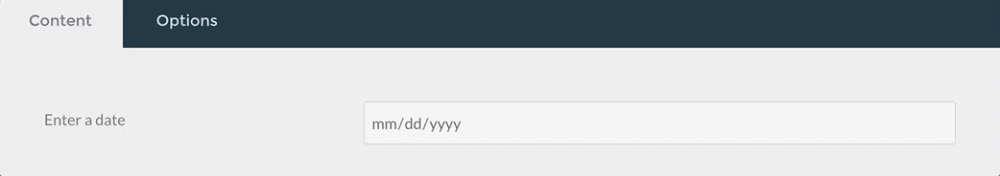
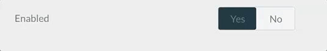

# Справочник: индекс полей формы

## Общие атрибуты полей {: #common-field-attributes }

Каждое поле принимает список атрибутов, которые можно использовать. Эти общие атрибуты могут использоваться разными полями, но конкретные поля могут их игнорировать. Лучший способ узнать, какие атрибуты допустимы для поля, — посмотреть описание поля на этой странице и проверить, какие атрибуты упомянуты.

Этот список служит общей основой, чтобы не повторять описание общих полей.

| Атрибут | Описание |
| :----- | :----- |
| `autocomplete` | Принимает `on` или `off` |
| `autofocus` | если включено, автоматически ставит фокус на это поле |
| `classes` | принимает строку с одним или несколькими CSS-классами для добавления |
| `default` | задаёт значение поля по умолчанию |
| `disabled` | задаёт отключённое состояние поля |
| `help` | добавляет всплывающую подсказку к полю |
| `id` | задаёт id поля. Также задаёт атрибут `for` у метки |
| `label` | задаёт метку поля |
| `display_label` | Принимает `true` или `false` |
| `labelclasses` | принимает строку с одним или несколькими CSS-классами для добавления |
| `sublabel` | задаёт подпись поля |
| `sublabelclasses` | принимает строку с одним или несколькими CSS-классами для добавления |
| `name` | задаёт имя поля |
| `novalidate` | задаёт состояние novalidate поля |
| `outerclasses` | классы, добавляемые к div, который содержит метку и поле |
| `wrapper_classes` | классы, добавляемые к обёртке, которая содержит описание и поле |
| `placeholder` | задаёт значение-подсказку поля |
| `readonly` | задаёт состояние «только для чтения» |
| `size` | задаёт размер поля, что, в свою очередь, добавляет класс его контейнеру. Допустимые значения: `large`, `x-small`, `medium`, `long`, `small`. Разумеется, при использовании во фронтенде в шаблоне можно добавить и другие |
| `style` | задаёт стиль поля |
| `title` | задаёт значение заголовка поля |
| `type` | задаёт тип поля |
| `validate.required` | если задано положительное значение, поле становится обязательным. |
| `validate.pattern` | задаёт шаблон валидации |
| `validate.message` | задаёт сообщение, показываемое при неудачной валидации |

Чтобы добавить собственные атрибуты, можно использовать:
```
attributes:
  key: value
```

Чтобы добавить собственные значения data-*, можно использовать:
```
datasets:
  key: value
```

Приведённые выше определения `attributes` и `datasets` дают такое определение поля:
```
<input name="data[name]" value="" type="text" class="form-input " key="value" data-key="value">
```

> [!NOTE] Примечание
> ПРИМЕЧАНИЕ. Положительные значения можно задавать несколькими способами: `'on'`, `true`, `1`. Другие значения интерпретируются как отрицательные.

---

## Доступные поля

### Поле Array

Тип поля `array` позволяет создавать список пар «ключ — значение», которые можно динамически добавлять, удалять и переупорядочивать. Каждая строка массива может быть простым полем ввода или textarea — в зависимости от конфигурации.

Примеры:

Простой массив пар «ключ — значение»:

```yaml linenums="1"
my_array:
  type: array
  label: My Array Field
  placeholder_key: Key
  placeholder_value: Value
  value_type: text # Can also be 'textarea' for multi-line input
```

В режиме `value_only` массив принимает только значения без ключей:

```yaml linenums="1"
my_array_values:
  type: array
  label: Values Only
  value_only: true
  placeholder_value: Enter a value
```

| Атрибут | Описание |
| :------------------  | :-------------------------------------------------------------------------------------------|
| `placeholder_key` | Текст-подсказка для поля ключа. |
| `placeholder_value` | Текст-подсказка для поля значения. |
| `value_type` | Определяет тип ввода для значений (`text` или `textarea`). |
| `value_only` | Если `true`, показываются только поля значений без ключей. |

| Разрешённые общие атрибуты |
| :----- |
| [disabled](#common-field-attributes) |
| [readonly](#common-field-attributes) |
| [name](#common-field-attributes) |
| [label](#common-field-attributes) |
| [classes](#common-field-attributes) |
| [size](#common-field-attributes) |

---

### Поле Avatar

Тип поля `avatar` показывает изображение аватара только для чтения. Это поле только для отображения: оно выводит изображение, но ничего не отправляет.

Поле игнорирует собственные имя и значение. Оно всегда читает два фиксированных значения из самой формы: показывает первое изображение, найденное в значении `avatar` формы, а если оно пустое — использует [Gravatar](https://gravatar.com), сгенерированный из значения `email` формы. Поэтому оно полезно только в форме, где уже есть поля `avatar` и/или `email`, например в форме профиля пользователя.

Примеры:

```yaml linenums="1"
avatar_preview:
  type: avatar
  classes: "avatar-label"
  img_classes: "avatar-img"
```

> [!NOTE] Примечание
> Если назвать поле иначе (например, `user_avatar`), отображаемое не изменится. Изображение по-прежнему берётся из значений `avatar` и `email` формы.

| Атрибут | Описание |
| :----- | :----- |
| `classes` | CSS-классы, применяемые к метке, обёртывающей изображение |
| `img_classes` | CSS-классы, применяемые непосредственно к изображению аватара |

| Разрешённые общие атрибуты |
| :----- |
| [classes](#common-field-attributes) |

---

### Поле Basic-Captcha

Добавлено в Forms `7.0.0` как локальная альтернатива полю Google ReCaptcha. Это поле особенно удобно для борьбы со спамом в контактных формах, когда не хочется связываться с хлопотами или ограничениями GPDR, которые накладывает решение Google. Оно использует **устойчивые к OCR** шрифты для защиты от атак и может быть настроено на копирование кодов или простые математические вопросы.


Тип поля `basic-captcha` полностью настраивается как глобально, так и для отдельного поля. Глобальная конфигурация задаётся в файле конфигурации форм (обычно `user/config/plugins/form.yaml`), а конфигурация на уровне поля позволяет настраивать отдельные поля captcha в формах.

#### Глобальная конфигурация

Глобальные параметры по умолчанию:

```yaml linenums="1"
basic_captcha:
  type: characters            # варианты: [characters | math | dotcount | position]
  debug: false                # включить журналирование отладки
  image:
    width: 135                # ширина изображения по умолчанию (для типов math/dotcount/position)
    height: 40                # высота изображения по умолчанию (для типов math/dotcount/position)
    bg: '#ffffff'             # цвет фона по умолчанию
  chars:
    length: 6                 # количество выводимых символов
    font: zxx-xed.ttf         # варианты: [zxx-xed.ttf | zxx-sans.ttf | zxx-camo.ttf | zxx-noise.ttf]
    size: 24                  # размер шрифта в px
    box_width: 200            # ширина изображения для символьных captcha (переопределяет image.width)
    box_height: 70            # высота изображения для символьных captcha (переопределяет image.height)
    start_x: 10               # начальная позиция по x в px
    start_y: 40               # начальная позиция по y в px
    bg: '#ffffff'             # цвет фона для символьных captcha
    text: '#000000'           # цвет текста (в hex-формате)
  math:
    min: 1                    # наименьшая цифра
    max: 12                   # наибольшая цифра
    operators: ['+','-','*']  # операторы, которые можно использовать в математике
```

#### Конфигурация на уровне поля

Начиная с Forms `7.1.0` глобальную конфигурацию можно переопределять для каждого поля. Это позволяет разным формам иметь разные стили, шрифты, цвета и типы captcha.

> [!WARNING] Предупреждение
> **Важно**: в конфигурации на уровне поля используйте `captcha_type` (а не `type`) для типа captcha, чтобы избежать конфликта с обязательным объявлением типа поля `type: basic-captcha`.

**Простой пример:**

```yaml linenums="1"
basic-captcha:
    type: basic-captcha
    placeholder: enter the characters
    label: Are you human?
```

**Расширенный пример с конфигурацией на уровне поля:**

```yaml linenums="1"
basic-captcha:
    type: basic-captcha
    placeholder: enter the characters
    label: Are you human?
    # конфигурация на уровне поля переопределяет глобальные значения по умолчанию
    captcha_type: characters        # используйте 'captcha_type', а не 'type'
    chars:
        font: zxx-sans.ttf          # более чистый шрифт
        size: 32                    # более крупный текст
        length: 6                   # 6 символов
        box_width: 200              # более широкое изображение
        box_height: 70              # более высокое изображение
        bg: '#f0f8ff'               # светло-голубой фон
        text: '#0066cc'             # тёмно-синий текст
        start_x: 20                 # собственная позиция X
        start_y: 50                 # собственная позиция Y
```

**Пример математической captcha:**

```yaml linenums="1"
basic-captcha:
    type: basic-captcha
    placeholder: enter the answer
    label: Solve this math problem
    captcha_type: math              # математический пример вместо символов
    math:
        min: 1                      # используйте небольшие числа
        max: 10
        operators: ['+','-']        # только сложение и вычитание
```

#### Доступные типы captcha

При использовании конфигурации на уровне поля задавайте тип captcha через `captcha_type`:

- **`characters`** — случайная строка символов (по умолчанию)
- **`math`** — простой математический пример (например, «3 + 5 = ?»)
- **`dotcount`** — подсчёт точек определённого цвета
- **`position`** — определение положения символа

#### Доступные шрифты

Поле Basic-Captcha включает четыре устойчивых к OCR шрифта:

- **`zxx-xed.ttf`** — по умолчанию, сбалансированные читаемость и защита
- **`zxx-sans.ttf`** — чистый sans-serif, легче читается
- **`zxx-camo.ttf`** — камуфляжный стиль, сложнее
- **`zxx-noise.ttf`** — шумный стиль, максимальная защита

#### Справочник параметров конфигурации

| Параметр | Тип | По умолчанию | Описание |
|--------|------|---------|-------------|
| `captcha_type` | string | `characters` | Тип captcha: `characters`, `math`, `dotcount` или `position` |
| `chars.font` | string | `zxx-xed.ttf` | Файл шрифта для символьных captcha |
| `chars.size` | int | `24` | Размер шрифта в пикселях |
| `chars.length` | int | `6` | Количество генерируемых символов |
| `chars.box_width` | int | `200` | Ширина изображения для символьных captcha |
| `chars.box_height` | int | `70` | Высота изображения для символьных captcha |
| `chars.bg` | string | `#ffffff` | Цвет фона (hex) для символьных captcha |
| `chars.text` | string | `#000000` | Цвет текста (hex) |
| `chars.start_x` | int | `10` | Начальная позиция X для текста |
| `chars.start_y` | int | `40` | Начальная позиция Y для текста |
| `math.min` | int | `1` | Минимальное число в математических примерах |
| `math.max` | int | `12` | Максимальное число в математических примерах |
| `math.operators` | array | `['+','-','*']` | Доступные операторы |
| `image.width` | int | `135` | Ширина изображения по умолчанию (несимвольные типы) |
| `image.height` | int | `40` | Высота изображения по умолчанию (несимвольные типы) |
| `image.bg` | string | `#ffffff` | Цвет фона по умолчанию |

#### Обработка формы

Также требуется соответствующий элемент `process:`, чтобы форма корректно валидировалась.

> [!WARNING] Предупреждение
> Он должен быть первым элементом в разделе `process:` формы, чтобы форма не обрабатывалась, если валидация captcha не пройдена.

Пример:

```yaml linenums="1"
process:
    basic-captcha: true
```

Чтобы настроить сообщение, показываемое при неудачной валидации, задайте `captcha_not_validated` в самом поле (если параметр не указан, плагин Form использует значение по умолчанию):

```yaml linenums="1"
fields:
    basic-captcha:
        type: basic-captcha
        label: Are you human?
        captcha_not_validated: Humanity verification failed, please try again...
```

### Поле Turnstile Captcha (Cloudflare)

Начиная с Form `v7.1.0` Grav поддерживает новое поле Cloudflare Turnstile. Это новый способ борьбы со спамом в формах и отличная альтернатива полю Google ReCaptcha и **GPDR**-ограничениям, которые накладывает решение Google. Поле особенно удобно для борьбы со спамом в контактных формах. [Подробнее о Turnstile](https://blog.cloudflare.com/turnstile-private-captcha-alternative/?target=_blank).

##### Преимущества перед Google ReCaptcha

1. Соответствует GDPR и ориентировано на приватность пользователей
2. Очень быстрая проверка испытания
3. Очень простая реализация как в Cloudflare, так и в Grav — без сложных интерфейсов и параметров
4. Не нужны хитрые обходные пути для асинхронной отправки форм (ajax) — всё просто работает!
4. Исключительный пользовательский опыт по сравнению с ReCaptcha — больше никаких подсчётов машин, светофоров и прочей ерунды
5. Основано на машинном обучении: со временем становится лучше и адаптируется к новым векторам атак
6. Подробная аналитика эффективности испытания, [см. скриншот](https://blog.cloudflare.com/content/images/2022/09/image1-64.png?target=_blank)

##### Интеграция
Прежде чем интегрировать Grav Forms с Turnstile, нужно [создать новый сайт Turnstile](https://dash.cloudflare.com/?to=/:account/turnstile?target=_blank); также можно воспользоваться [официальным руководством «get started»](https://developers.cloudflare.com/turnstile/get-started/?target=_blank).
Там же можно выбрать тип виджета: `managed`, `non-interactive` или `invisible`. Важно: тип виджета можно изменить только в Cloudflare, через Grav это не настраивается. Впрочем, если выбор не понравится, позже его можно поменять. [Подробнее о разных типах виджетов](https://developers.cloudflare.com/turnstile/reference/widget-types/?target=_blank).

> [!WARNING] Предупреждение
> Убедитесь, что добавили все домены, где может использоваться поле Turnstile; это может включать и локальное окружение.

После создания сайта вы получите `site_key` и `site_secret`, которые нужно указать в файле конфигурации форм (обычно `user/config/plugins/form.yaml`). Предлагаемый тег script можно игнорировать — Grav добавит его сам.

Параметры по умолчанию:

```yaml linenums="1"
turnstile:
  theme: light
  site_key: <Your Turnstile Site Key>
  secret_key: <Your Turnstile Secret Key>
```

Наконец, также требуется соответствующий элемент `process:`, чтобы форма корректно валидировалась.

> [!WARNING] Предупреждение
> Он должен быть первым элементом в разделе `process:` формы, чтобы форма не обрабатывалась, если валидация captcha не пройдена.

##### Пример
Типичный пример для контактной формы выглядит так.

```yaml linenums="1"
form:
  name: contact
  fields:
    name:
      label: Name
      type: text
      validate:
        required: true
    email:
      label: Email
      type: email
      validate:
        required: true
    message:
      label: Message
      type: textarea
      validate:
        required: true
    captcha:
        type: turnstile
        theme: light
  buttons:
    submit:
      type: submit
      value: Submit
  process:
    turnstile: true
    email:
      subject: "[Acme] {{ form.value.name|e }}"
      reply_to: "{{ form.value.name|e }} <{{ form.value.email }}>"
    message: Thanks for contacting us!
    reset: true
    display: '/'
```

### Поле Google Captcha (ReCaptcha)

Тип поля `captcha` добавляет в форму элемент Google reCAPTCHA. В отличие от других элементов, его можно использовать в форме только один раз.

> [!WARNING] Предупреждение
> Настройки Google reCAPTCHA следует задавать в [консоли администратора reCAPTCHA](https://www.google.com/recaptcha/admin?target=_blank)

Начиная с версии `3.0` поле поддерживает 3 варианта reCAPTCHA. Общую конфигурацию reCAPTCHA лучше задавать в глобальном файле конфигурации форм (обычно `user/config/plugins/form.yaml`). Параметры по умолчанию:

```yaml linenums="1"
recaptcha:
  version: 2-checkbox
  theme: light
  site_key:
  secret_key:
```

Эти параметры следует задавать с учётом следующего:

| Ключ | Значения |
|-----|--------|
| version | По умолчанию `2-checkbox`, но также может быть `2-invisible` или `3` |
| theme | По умолчанию `light`, но также может быть `dark` (сейчас работает только для версий `2-x`) |
| site_key | Ваш Google Site Key |
| secret_key | Ваш Google Secret Key |

> [!CAUTION] Внимание
> Убедитесь, что домен сайта указан в конфигурации Google reCAPTCHA.

В определении формы атрибут `name` поля captcha должен быть `g-recaptcha-response`. Причина в том, что Google reCAPTCHA сохраняет код подтверждения captcha в поле с именем `g-recaptcha-response`.

Пример:

```yaml linenums="1"
g-recaptcha-response:
  type: captcha
  label: Captcha
```

Можно также задать собственное сообщение об ошибке `captcha_not_validated`; если не задать, плагин Form использует сообщение по умолчанию. Если нужно задать `recaptcha_site_key` для конкретной формы, а не глобально в конфигурации форм, это тоже можно сделать.

```yaml linenums="1"
g-recaptcha-response:
  type: captcha
  label: Captcha
  recaptcha_site_key: ENTER_YOUR_CAPTCHA_PUBLIC_KEY
  captcha_not_validated: 'Captcha not valid!'
```

| Атрибут | Описание |
| :----- | :----- |
| `recaptcha_site_key` | Ключ сайта Google reCAPTCHA (необязательно) |
| `captcha_not_validated` | Сообщение, показываемое, если captcha не прошла проверку |

| Разрешённые общие атрибуты |
| :----- |
| [help](#common-field-attributes) |
| [label](#common-field-attributes) |
| [name](#common-field-attributes) |
| [outerclasses](#common-field-attributes) |
| [validate.required](#common-field-attributes) |

Также требуется соответствующий элемент `process:`, чтобы форма корректно валидировалась.

> [!WARNING] Предупреждение
> Он должен быть первым элементом в разделе `process:` формы, чтобы форма не обрабатывалась, если валидация ReCaptcha не пройдена.

Пример:

```yaml linenums="1"
process:
    captcha: true
```

##### Серверная валидация captcha

Приведённый код валидирует captcha во фронтенде и предотвращает отправку формы, если она неверна. Чтобы также валидировать captcha на сервере, добавьте в формы действие процесса captcha:

```yaml linenums="1"
process:
  captcha: true
```

Можно также задать необязательное сообщение об успехе `message`; если не задать, при успехе никакого специального сообщения не будет. Если нужно задать `recaptcha_secret` для конкретной формы, а не глобально в конфигурации форм, это тоже можно сделать.

```yaml linenums="1"
process:
  captcha:
    recaptcha_secret: ENTER_YOUR_CAPTCHA_SECRET_KEY
    message: 'Successfully passed reCAPTCHA!'
```

[Пример контактной формы](../example-form/index.md) показывает это в действии.

---

### Поле Checkbox


Тип поля `checkbox` добавляет в форму один флажок.

Пример:

```yaml linenums="1"
agree_to_terms:
  type: checkbox
  label: "Agree to the terms and conditions"
  validate:
      required: true
```

| Разрешённые общие атрибуты |
| :----- |
| [autofocus](#common-field-attributes) |
| [classes](#common-field-attributes) |
| [default](#common-field-attributes) |
| [disabled](#common-field-attributes) |
| [id](#common-field-attributes) |
| [label](#common-field-attributes) |
| [name](#common-field-attributes) |
| [novalidate](#common-field-attributes) |
| [outerclasses](#common-field-attributes) |
| [size](#common-field-attributes) |
| [style](#common-field-attributes) |
| [validate.required](#common-field-attributes) |
| [validate.pattern](#common-field-attributes) |
| [validate.message](#common-field-attributes) |

---

### Поле Checkboxes


Тип поля `checkboxes` добавляет в форму группу флажков.

Примеры:

```yaml linenums="1"
pages.process:
    type: checkboxes
    label: PLUGIN_ADMIN.PROCESS
    help: PLUGIN_ADMIN.PROCESS_HELP
    default:
        markdown: true
        twig: true
    options:
        markdown: Markdown
        twig: Twig
    use: keys
```

```yaml linenums="1"
my_field:
    type: checkboxes
    label: A couple of checkboxes with help for each option and option1 disabled
    default:
        - option1
        - option2
    options:
        option1: Option 1
        option2: Option 2
    help_options:
        option1: Help for Option 1
        option2: Help for Option 2
    disabled_options:
        - option1
```

| Атрибут | Описание |
| :----- | :----- |
| `use` | Если задано `keys`, при отправке формы флажок сохранит значение ключа элемента. Иначе используется значение элемента. |
| `options` | Массив допустимых вариантов «ключ — значение». |
| `help_options` | Массив «ключ — значение» с подсказкой для каждого варианта из `options`. |
| `disabled_options` | Список вариантов, которые будут показаны отключёнными. |
| `markdown` | Если `true`, метки вариантов обрабатываются как markdown и могут содержать HTML. Иначе они экранируются и выводятся как текст. |

| Разрешённые общие атрибуты |
| :----- |
| [autofocus](#common-field-attributes) |
| [classes](#common-field-attributes) |
| [default](#common-field-attributes) |
| [disabled](#common-field-attributes) |
| [help](#common-field-attributes) |
| [id](#common-field-attributes) |
| [label](#common-field-attributes) |
| [name](#common-field-attributes) |
| [outerclasses](#common-field-attributes) |
| [size](#common-field-attributes) |
| [style](#common-field-attributes) |
| [validate.required](#common-field-attributes) |
| [validate.pattern](#common-field-attributes) |
| [validate.message](#common-field-attributes) |

> [!CAUTION] Внимание
> ПРИМЕЧАНИЕ. Поле checkboxes не поддерживает действие процесса `remember`.

---

### Поле Color

Тип поля `color` позволяет пользователю выбрать цвет с помощью палитры. Оно выводится как HTML `input` с типом `color`.

Примеры:

```yaml linenums="1"
background_color:
  type: color
  label: Background Color
  default: "#ffffff"
  classes: "color-picker"
```

| Атрибут | Описание |
| :----- | :----- |
| `default` | Задаёт цвет по умолчанию |

| Разрешённые общие атрибуты |
| :----- |
| [autocomplete](#common-field-attributes) |
| [autofocus](#common-field-attributes) |
| [classes](#common-field-attributes) |
| [default](#common-field-attributes) |
| [disabled](#common-field-attributes) |
| [help](#common-field-attributes) |
| [id](#common-field-attributes) |
| [label](#common-field-attributes) |
| [display_label](#common-field-attributes)|
| [labelclasses](#common-field-attributes) |
| [sublabel](#common-field-attributes) |
| [sublabelclasses](#common-field-attributes)|
| [name](#common-field-attributes) |
| [novalidate](#common-field-attributes) |
| [outerclasses](#common-field-attributes) |
| [wrapper_classes](#common-field-attributes)|
| [placeholder](#common-field-attributes) |
| [readonly](#common-field-attributes) |
| [size](#common-field-attributes) |
| [style](#common-field-attributes) |
| [title](#common-field-attributes) |
| [type](#common-field-attributes) |
| [validate.required](#common-field-attributes) |
| [validate.pattern](#common-field-attributes) |
| [validate.message](#common-field-attributes) |

---

### Поле Columns

Тип поля `columns` группирует несколько полей в многоколоночный макет.
Каждое поле `columns` содержит одно или несколько полей `column`, которые определяют горизонтальное расположение содержимого.

Само это поле **не** выводит элементы ввода — оно лишь организует подполя в структурированный адаптивный макет.

Примеры:

```yaml linenums="1"
my_columns:
  type: columns
  fields:
    column1:
      type: column
      fields:
        header.title:
          type: text
          label: Title

    column2:
      type: column
      fields:
        header.subtitle:
          type: text
          label: Subtitle
```

| Атрибут | Описание |
| :----- | :----------------------------------- |
| `fields` | Определяет список полей-колонок |

| Разрешённые общие атрибуты |
| :----- |
| [classes](#common-field-attributes) |
| [name](#common-field-attributes) |

---

### Поле Column

Тип поля `column` представляет одну колонку внутри поля `columns`.
Оно оборачивает набор полей в контейнер `<div class="form-column">`, позволяя показывать их рядом.

Само поле не принимает ввод — оно только группирует и структурирует другие поля.

Примеры:

```yaml linenums="1"
my_column:
  type: column
  classes: "one-half"
  fields:
    header.description:
      type: textarea
      label: Description
```

| Атрибут | Описание |
| :----- | :-------------------------------- |
| `fields` | Определяет поля внутри колонки |
| `classes` | CSS-классы, применяемые к обёртке колонки |

| Разрешённые общие атрибуты |
| :----- |
| [classes](#common-field-attributes) |
| [name](#common-field-attributes) |

---

### Поле Conditional

Тип поля `conditional` используется, чтобы условно показывать другие поля в зависимости от условия.

Примеры:

Если ваше условие уже возвращает `true` или `false`, можно использовать упрощённый формат:

```yaml linenums="1"
my_conditional:
  type: conditional
  condition: config.plugins.yourplugin.enabled
  fields: # поля ниже будут показаны, только если плагин yourplugin включён
    header.mytextfield:
      type: text
      label: A text field
```

Однако если нужны более сложные условия, можно выполнить логику, возвращающую строки `'true'` или `'false'`, — поле это тоже поймёт.

```yaml linenums="1"
my_conditional:
  type: conditional
  condition: "config.site.something == 'custom'"
  fields: # поля ниже будут показаны, только если параметр конфигурации сайта равен custom
    header.mytextfield:
        type: text
        label: A text field
```

| Атрибут | Описание |
| :----- | :----- |
| `condition` | Условие, вычисляемое Twig. Можно вычислить любую переменную, доступную в Twig |

| Разрешённые общие атрибуты |
| :----- |
| [disabled](#common-field-attributes) |
| [id](#common-field-attributes) |
| [label](#common-field-attributes) |
| [name](#common-field-attributes) |

---

### Поле Date


Тип поля `date` добавляет поле ввода HTML5 `date`.

Пример:

```yaml linenums="1"
-
  type: date
  label: Enter a date
  validate.min: "2014-01-01"
  validate.max: "2018-12-31"
```

| Атрибут | Описание |
| :----- | :----- |
| `validate.min` | Задаёт атрибут `min` поля (см. [http://html5doctor.com/the-woes-of-date-input/#feature-min-max-attributes](http://html5doctor.com/the-woes-of-date-input/#feature-min-max-attributes)) |
| `validate.max` | Задаёт атрибут `max` поля (см. [http://html5doctor.com/the-woes-of-date-input/#feature-min-max-attributes](http://html5doctor.com/the-woes-of-date-input/#feature-min-max-attributes)) |

| Разрешённые общие атрибуты |
| :----- |
| [autofocus](#common-field-attributes) |
| [classes](#common-field-attributes) |
| [default](#common-field-attributes) |
| [disabled](#common-field-attributes) |
| [help](#common-field-attributes) |
| [id](#common-field-attributes) |
| [label](#common-field-attributes) |
| [name](#common-field-attributes) |
| [novalidate](#common-field-attributes) |
| [outerclasses](#common-field-attributes) |
| [readonly](#common-field-attributes) |
| [size](#common-field-attributes) |
| [style](#common-field-attributes) |
| [title](#common-field-attributes) |
| [validate.required](#common-field-attributes) |
| [validate.pattern](#common-field-attributes) |
| [validate.message](#common-field-attributes) |

---

### Поле Display


Тип поля `display` показывает в форме текст или инструкции. Может принимать содержимое в markdown.

Пример:

```yaml linenums="1"
test:
    type: display
    size: large
    label: Instructions
    markdown: true
    content: "This is a test of **bold** and _italic_ in a text/display field\n\nanother paragraph...."
```

| Атрибут | Описание |
| :----- | :----- |
| `markdown` | логическое значение, включающее обработку markdown для поля content |
| `content` | текстовое содержимое для показа |

| Разрешённые общие атрибуты |
| :----- |
| [help](#common-field-attributes) |
| [id](#common-field-attributes) |
| [label](#common-field-attributes) |
| [name](#common-field-attributes) |
| [outerclasses](#common-field-attributes) |
| [size](#common-field-attributes) |
| [style](#common-field-attributes) |

---

### Поле Email


Тип поля `email` показывает текстовое поле ввода, принимающее email, с использованием [HTML5-поля email](http://html5doctor.com/html5-forms-input-types/#input-email).

> [!CAUTION] Внимание
> Адреса email по своей природе нечувствительны к регистру. Убедитесь, что логика приложения корректно обрабатывает email в верхнем, нижнем и смешанном регистре.

Пример:

```yaml linenums="1"
header.email:
  type: email
  autofocus: true
  label: Email
```

| Атрибут | Описание |
| :----- | :----- |
| `minlength` | минимальная длина текста |
| `maxlength` | максимальная длина текста |
| `validate.min` | то же, что `minlength`; работает любое написание |
| `validate.max` | то же, что `maxlength`; работает любое написание |
| `validate.trim` | удаляет пробелы в начале и конце значения перед измерением длины |

| Разрешённые общие атрибуты |
| :----- |
| [autofocus](#common-field-attributes) |
| [classes](#common-field-attributes) |
| [default](#common-field-attributes) |
| [disabled](#common-field-attributes) |
| [help](#common-field-attributes) |
| [id](#common-field-attributes) |
| [label](#common-field-attributes) |
| [name](#common-field-attributes) |
| [novalidate](#common-field-attributes) |
| [outerclasses](#common-field-attributes) |
| [readonly](#common-field-attributes) |
| [size](#common-field-attributes) |
| [style](#common-field-attributes) |
| [title](#common-field-attributes) |
| [validate.required](#common-field-attributes) |
| [validate.pattern](#common-field-attributes) |
| [validate.message](#common-field-attributes) |

---

### Поле Fieldset

Тип поля `fieldset` позволяет группировать несколько полей внутри HTML-элемента `<fieldset>`.
При необходимости он может показывать `<legend>` как заголовок группы полей.

Само поле не хранит значение — оно лишь организует другие поля визуально и семантически.

Пример:

```yaml linenums="1"
user_info:
  type: fieldset
  id: user-info
  legend: User Information
  classes: "group-box"
  fields:
    name:
      type: text
      label: Name

    email:
      type: email
      label: Email Address
```

| Атрибут | Описание |
| :---------- | :----------------------------------------------- |
| `legend` | Заголовок, отображаемый над сгруппированными полями |
| `fields` | Список полей внутри набора |
| `id` | Задаёт ID элемента `<fieldset>` |
| `classes` | Добавляет CSS-классы к `<fieldset>` |

| Разрешённые общие атрибуты |
| :------------------------------------ |
| [id](#common-field-attributes) |
| [classes](#common-field-attributes) |
| [name](#common-field-attributes) |
| *(Большинство других общих атрибутов полей неприменимы)* |

---

### Поле File

С типом поля `file` можно разрешить пользователям загружать файлы через форму. По умолчанию поле допускает только **один файл** типа **image**, и он загружается на **текущую** страницу, где объявлена форма.

```yaml linenums="1"
# Настройки по умолчанию
my_files:
  type: file
  multiple: false
  destination: 'self@'
  accept:
    - image/*
```

| Атрибут | Описание |
| :----- | :----- |
| `multiple` | Может быть `true` или `false`; при значении **true** можно выбрать несколько файлов одновременно |
| `destination` | Может быть **@self**, **@page:/route**, **local/rel/path/** или PHP-потоком.<br> При **@self** файлы загружаются туда, где объявлена форма (текущий .md). <br>Использование **@page:/route** загрузит в указанный маршрут страницы, если он существует (например, **@page:/blog/a-blog-post**).<br> При **'local/rel/path'**: может быть любым путём относительно экземпляра Grav. Например, `user/images/uploads`. Если путь не существует, он будет создан, поэтому убедитесь, что он доступен для записи.<br> Также можно задать любое допустимое значение PHP-потока, распознаваемое Grav, например `user-data://my-form` или `theme://media/uploads`. |
| `accept` | Принимает массив разрешённых MIME-типов. Например, чтобы разрешить только gif и mp4: `accept: ['image/gif', 'video/mp4']` |

> [!NOTE] Примечание
> Поле File в админке немного отличается: оно также позволяет удалять файл, загруженный в форму, поскольку в админке сценарий использования — загрузить файл и затем связать его с полем.

| Разрешённые общие атрибуты |
| :----- |
| [help](#common-field-attributes) |
| [label](#common-field-attributes) |
| [name](#common-field-attributes) |
| [outerclasses](#common-field-attributes) |

По умолчанию в админке поле `file` перезаписывает загруженный файл с тем же именем, что у нового файла в той же папке, куда идёт загрузка, если в определении поля не задано `avoid_overwriting: true`.

---

### Поле FilePond

Добавленный в Forms `7.0.0` тип поля `filepond` — современная альтернатива полю File на основе [библиотеки FilePond JavaScript](https://pqina.nl/filepond/). Он даёт более удобный пользовательский опыт: загрузку перетаскиванием, предпросмотр изображений, встроенное редактирование изображений (обрезка, изменение размера, поворот) и плавные анимации.

**Когда использовать FilePond:**
- Формы с большим количеством изображений, где нужны предпросмотр и редактирование
- Современные интерфейсы с поддержкой перетаскивания
- Формы, где нужна оптимизация изображений на клиенте перед загрузкой
- Проекты, где удобство важнее поддержки устаревших браузеров

**Когда использовать поле File (Dropzone):**
- Обычная загрузка файлов (не изображений)
- Более простая реализация без редактирования изображений
- Требования совместимости с устаревшими браузерами

#### Базовое использование

```yaml linenums="1"
my_images:
    type: filepond
    label: Upload Images
    destination: user/media/uploads
    multiple: true
    limit: 5
    filesize: 10
    accept:
        - image/*
```

#### Параметры конфигурации

| Атрибут | Описание |
| :-------- | :---------- |
| `multiple` | Boolean. Если `true`, можно выбрать несколько файлов одновременно (по умолчанию: `false`) |
| `limit` | Integer. Максимальное число файлов для поля (по умолчанию: `10`) |
| `destination` | Куда загружать файлы. Варианты:<br>• `@self` — загрузка на текущую страницу<br>• `@page:/route` — загрузка в указанный маршрут страницы<br>• `user/path/to/folder` — путь относительно корня Grav<br>• PHP-потоки вроде `user-data://uploads` |
| `filesize` | Integer. Максимальный размер файла в МБ. `0` = без ограничений, в пределах лимитов сервера (по умолчанию: `0`) |
| `accept` | Массив разрешённых MIME-типов/расширений. Примеры:<br>• `['image/*']` — все изображения<br>• `['image/jpeg', 'image/png']` — конкретные типы<br>• `['application/pdf']` — PDF |
| `avoid_overwriting` | Boolean. Если `true`, добавляет префикс с датой, чтобы не перезаписывать файл (по умолчанию: `false`) |
| `random_name` | Boolean. Если `true`, при загрузке генерируется случайное имя файла (по умолчанию: `false`) |
| `validate.required` | Boolean. Делает поле обязательным (по умолчанию: `false`) |

#### Параметры преобразования и изменения размера изображений

FilePond включает мощные возможности обработки изображений через ключ конфигурации `filepond`:

```yaml linenums="1"
my_images:
    type: filepond
    label: Upload and Edit Images
    destination: user/media/uploads
    multiple: true
    filesize: 10
    accept:
        - image/jpeg
        - image/png
        - image/webp
    filepond:
        # Формат вывода
        allowImageTransform: true
        imageTransformOutputMimeType: 'image/jpeg'
        imageTransformOutputQuality: 85
        imageTransformOutputStripImageHead: true

        # Настройки изменения размера
        allowImageResize: true
        imageResizeTargetWidth: 1024
        imageResizeTargetHeight: 768
        imageResizeMode: 'contain'
        imageResizeUpscale: false

        # Настройки обрезки
        allowImageCrop: true
        imageCropAspectRatio: '16:9'

        # Настройки предпросмотра
        allowImagePreview: true
        imagePreviewHeight: 256

        # Настройка интерфейса
        stylePanelLayout: 'compact'
        labelIdle: '<span class="filepond--label-action">Browse</span> or drop images'
```

#### Справочник параметров FilePond

| Параметр | Тип | По умолчанию | Описание |
| :----- | :--- | :------ | :---------- |
| **Преобразование изображений** | | | |
| `allowImageTransform` | boolean | `true` | Включает преобразование изображения перед загрузкой |
| `imageTransformOutputMimeType` | string | `image/jpeg` | Формат вывода: `image/jpeg`, `image/png`, `image/webp` |
| `imageTransformOutputQuality` | int | `90` | Качество вывода 0–100 (только JPEG/WebP) |
| `imageTransformOutputStripImageHead` | boolean | `true` | Удаляет метаданные EXIF из изображений |
| **Изменение размера изображений** | | | |
| `allowImageResize` | boolean | `true` | Включает автоматическое изменение размера |
| `imageResizeTargetWidth` | int | `null` | Целевая ширина в пикселях (null = не менять размер) |
| `imageResizeTargetHeight` | int | `null` | Целевая высота в пикселях (null = не менять размер) |
| `imageResizeMode` | string | `cover` | Режим: `cover` (обрезать по размеру), `contain` (вписать), `force` (точный размер) |
| `imageResizeUpscale` | boolean | `false` | Разрешать увеличение маленьких изображений до целевого размера |
| **Обрезка изображений** | | | |
| `allowImageCrop` | boolean | `true` | Включает инструмент обрезки в предпросмотре |
| `imageCropAspectRatio` | string | `null` | Соотношение сторон вроде `16:9`, `4:3`, `1:1` или `null` для свободной обрезки |
| **Предпросмотр** | | | |
| `allowImagePreview` | boolean | `true` | Показывать предпросмотр с инструментами редактирования |
| `imagePreviewHeight` | int | `256` | Высота панели предпросмотра в пикселях |
| **Интерфейс и стиль** | | | |
| `stylePanelLayout` | string | `compact` | Стиль макета панели |
| `styleLoadIndicatorPosition` | string | `center bottom` | Положение индикатора загрузки |
| `styleProgressIndicatorPosition` | string | `center bottom` | Положение полосы прогресса |
| `styleButtonRemoveItemPosition` | string | `right` | Положение кнопки удаления |
| **Метки** | | | |
| `labelIdle` | string | `Browse or drop files` | Метка основной зоны перетаскивания (поддерживает HTML) |
| `labelFileTypeNotAllowed` | string | `Invalid file type` | Сообщение об ошибке для неподходящего типа файла |
| `labelFileSizeNotAllowed` | string | `File is too large` | Сообщение об ошибке для слишком большого файла |

#### Полный пример формы

```yaml linenums="1"
---
title: 'Photo Upload Form'
form:
    id: photo-upload
    xhr_submit: true
    fields:
        photos:
            type: filepond
            label: Upload Your Photos
            help: Upload up to 5 photos. They will be automatically resized to 1920x1080.
            destination: user/media/galleries
            multiple: true
            limit: 5
            filesize: 15
            accept:
                - image/jpeg
                - image/png
                - image/webp
            validate:
                required: true
            filepond:
                # Оптимизация изображений для веба
                imageTransformOutputMimeType: 'image/jpeg'
                imageTransformOutputQuality: 85
                imageTransformOutputStripImageHead: true

                # Изменение размера до HD
                allowImageResize: true
                imageResizeTargetWidth: 1920
                imageResizeTargetHeight: 1080
                imageResizeMode: 'contain'

                # Принудительная обрезка 16:9
                allowImageCrop: true
                imageCropAspectRatio: '16:9'

                # Собственная метка
                labelIdle: '<span class="filepond--label-action">Click to browse</span> or drag photos here'

    buttons:
        submit:
            type: submit
            value: Upload Photos

    process:
        upload: true
        message: 'Thank you! Your photos have been uploaded successfully.'
        reset: true
---

# Photo Gallery Upload

Upload your photos and they will be automatically optimized and resized.
```

#### Обработка формы {: #form-processing-1 }

Полю FilePond для сохранения загруженных файлов требуется действие процесса `upload`:

```yaml linenums="1"
process:
    upload: true
    message: 'Files uploaded successfully!'
```

Файлы обрабатываются через AJAX и сохраняются в указанную папку `destination`. Преобразования изображений (изменение размера, обрезка, конвертация формата) выполняются в браузере до загрузки, снижая нагрузку на сервер и время загрузки.

#### Интеграция с XHR-формами

FilePond без проблем работает с отправкой форм через AJAX (`xhr_submit: true`). Поле автоматически:
- Не даёт отправить форму, пока файлы загружаются
- Повторно инициализируется после обновления формы
- Сохраняет загруженные файлы при ошибках валидации
- Очищает временные файлы после успешной отправки

#### Краткий обзор фич

✅ **Современный интерфейс перетаскивания** — плавные анимации и визуальная обратная связь
✅ **Предпросмотр изображений** — просмотр до загрузки с масштабированием и панорамированием
✅ **Встроенное редактирование изображений** — обрезка, изменение размера и поворот в браузере
✅ **Оптимизация на клиенте** — уменьшение размера файла до загрузки
✅ **Конвертация форматов** — преобразование изображений в JPEG/PNG/WebP
✅ **Валидация в реальном времени** — проверка типа и размера файла с мгновенной обратной связью
✅ **Индикация прогресса** — полосы прогресса загрузки для каждого файла
✅ **Поддержка нескольких файлов** — загрузка нескольких файлов одним полем
✅ **Адаптивный дизайн** — работает на настольных компьютерах, планшетах и мобильных устройствах
✅ **Доступность** — навигация с клавиатуры и поддержка экранных дикторов

#### Сравнение с полем File

| Фича | FilePond | File (Dropzone) |
| :------ | :------- | :-------------- |
| Предпросмотр изображений | ✅ С масштабированием и панорамированием | ✅ Только миниатюра |
| Редактирование изображений | ✅ Обрезка, изменение размера, поворот | ❌ Нет |
| Оптимизация изображений | ✅ На клиенте | ❌ Только на сервере |
| Конвертация форматов | ✅ JPEG/PNG/WebP | ❌ Нет |
| Перетаскивание | ✅ Современный интерфейс | ✅ Классический интерфейс |
| Валидация типа файла | ✅ В реальном времени | ✅ При загрузке |
| Несколько файлов | ✅ Да | ✅ Да |
| Поддержка XHR-форм | ✅ Автоматически | ✅ Требует настройки |
| Лучше всего подходит для | Изображений и UX | Обычных файлов |

| Разрешённые общие атрибуты |
| :----- |
| [help](#common-field-attributes) |
| [label](#common-field-attributes) |
| [name](#common-field-attributes) |
| [outerclasses](#common-field-attributes) |
| [validate](#common-field-attributes) |

---

### Поле Formname

Тип поля `formname` вставляет скрытое поле ввода, в котором хранится имя текущей формы.
Оно используется формами внутренне, чтобы отслеживать, какая форма была отправлена, особенно когда на одной странице несколько форм.

Поле не принимает пользовательский ввод и не допускает настройки сверх того, что явно поддерживает Twig.

> [!NOTE] Примечание
> Стандартный шаблон формы уже выводит это скрытое поле, поэтому добавлять поле `formname` вручную почти никогда не нужно. Оно полезно только при создании собственного шаблона формы, где его нет.

Пример:

```yaml linenums="1"
form_identifier:
  type: formname
```

Сгенерированный HTML:

```html linenums="1"
<input type="hidden" name="__form-name__" value="my-form-name" />
```

| Атрибут | Описание |
| :--------| :-----------|
| *(нет)* | У этого поля **нет настраиваемых атрибутов** |

| Разрешённые общие атрибуты |
| :------------------------ |
| *(нет — все общие атрибуты игнорируются)* |

---

### Поле Hidden

Тип поля `hidden` добавляет в форму скрытый элемент.

Пример:

```yaml linenums="1"
header.some_field:
  type: hidden
  default: my-value
```

| Атрибут | Описание |
| :----- | :----- |
| `name` | Имя поля. Если отсутствует, имя берётся из элемента определения поля (в примере выше: `header.some_field`) |
| `evaluate` | Чтобы использовать в значении переменные вроде `page.title`, нужно установить `true` |

| Разрешённые общие атрибуты |
| :----- |
| [default](#common-field-attributes) |

---

### Поле Honeypot

Тип поля `honeypot` создаёт скрытое поле, которое при заполнении возвращает ошибку. Это полезный способ не дать ботам заполнять и отправлять форму.

Пример:

```yaml linenums="1"
fields:
    honeypot:
      type: honeypot
```

Это простое текстовое поле, которое не отображается во фронтенде. Боты, которые находят поля в коде и заполняют их автоматически, скорее всего, заполнят и его. Ошибка не даёт отправить форму должным образом. Ошибка возвращается рядом с элементом формы, а не сверху в блоке сообщений.

Поле honeypot — популярная альтернатива полям captcha.

---

### Поле Ignore

Тип поля `ignore` можно использовать, чтобы удалить неиспользуемые поля при расширении другой схемы.

Пример:

```yaml linenums="1"
header.process:
  type: ignore
content:
  type: ignore
```

---

### Поле Key

Тип поля `key` предоставляет текстовое поле ввода, которое также открывает наблюдаемый атрибут (`data-key-observe`), используемый JavaScript внутренне для отслеживания изменений значения поля.
Оно работает похоже на стандартное текстовое поле, но предназначено для случаев, когда значение поля должно динамически обновлять другие элементы формы.

Если значение — массив, оно автоматически преобразуется в строку, разделённую запятыми.

> [!IMPORTANT] Важно
> У выводимого поля ввода нет атрибута `name`, поэтому поле `key` никогда не отправляет значение вместе с формой. Оно существует исключительно для управления другими полями через атрибут `data-key-observe` и чаще всего используется для колонки ключей в строке списка.

Пример:

```yaml linenums="1"
my_key:
  type: key
  label: Identifier
  placeholder: Enter an internal key
```

Сгенерированный HTML (упрощённо):

```html linenums="1"
<input type="text"
       value="myvalue"
       data-key-observe="data[header][my_key]"
       placeholder="Enter an internal key" />
```

| Атрибут | Описание |
| :--------| :-----------|
| `placeholder` | Текст-подсказка, показываемый, когда поле пустое |
| `autocomplete` | Принимает `on` или `off` |
| `autofocus` | Автоматически ставит фокус на поле при загрузке формы |
| `classes` | Добавляет собственные CSS-классы к полю ввода |
| `disabled` | Отключает поле |
| `id` | Задаёт HTML-атрибут `id` |
| `novalidate` | Отключает встроенную HTML-валидацию |
| `readonly` | Делает поле только для чтения |
| `size` | Задаёт размер контейнера поля ввода |
| `style` | Встроенные CSS-стили |
| `tabindex` | Задаёт порядок перехода по Tab |
| `title` | Задаёт всплывающую подсказку или сообщение валидации |
| `validate.required` | Требует значение перед отправкой |
| `validate.pattern` | Regex-шаблон валидации |
| `validate.message` | Сообщение, показываемое при неудачной валидации |

| Разрешённые общие атрибуты |
| :------------------------ |
| autocomplete |
| autofocus |
| classes |
| disabled |
| help |
| id |
| label |
| display_label |
| labelclasses |
| sublabel |
| sublabelclasses |
| name |
| novalidate |
| outerclasses |
| wrapper_classes |
| placeholder |
| readonly |
| size |
| style |
| title |
| type |
| validate.required |
| validate.pattern |
| validate.message |

---

### Поле Month

Тип поля **month** позволяет пользователю выбрать **месяц и год**. Значение хранится в формате `YYYY-MM`. Чтобы показать его как читаемую дату, можно добавить `-01`, получив полную дату (`YYYY-MM-DD`), и отформатировать её фильтром `date` в Twig.

Примеры:

```yaml linenums="1"
header.billing_month:
type: month
label: Billing Month
placeholder: Select month
default: 2025-11
```

Вывод в Twig:

```twig linenums="1"

 <p>{{ month_value|date("F Y") }}</p>

```

На сайте `2025-11` отобразится как **November 2025**.

| Атрибут | Описание |
| :---------- | :------------------------------------------------ |
| type | Определяет тип поля как `month` |
| label | Метка, отображаемая над полем |
| placeholder | Необязательный текст, показываемый, когда значение не выбрано |
| default | Необязательное значение по умолчанию в формате `YYYY-MM` |

| Разрешённые общие атрибуты |
| :------------------------------------ |
| [disabled](#common-field-attributes) |
| [id](#common-field-attributes) |
| [label](#common-field-attributes) |
| [name](#common-field-attributes) |
| [required](#common-field-attributes) |

---

### Поле Number

Тип поля `number` показывает текстовое поле ввода, принимающее только числа, с использованием [HTML5-поля number](http://html5doctor.com/html5-forms-input-types/#input-number).

Пример:

```yaml linenums="1"
header.count:
  type: number
  label: 'How Much?'
  validate:
    min: 10
    max: 360
    step: 10
```

| Атрибут | Описание |
| :----- | :----- |
| `validate.min` | минимальное значение |
| `validate.max` | максимальное значение |
| `validate.step` | шаг увеличения |

| Разрешённые общие атрибуты |
| :----- |
| [autofocus](#common-field-attributes) |
| [classes](#common-field-attributes) |
| [default](#common-field-attributes) |
| [disabled](#common-field-attributes) |
| [help](#common-field-attributes) |
| [id](#common-field-attributes) |
| [label](#common-field-attributes) |
| [name](#common-field-attributes) |
| [novalidate](#common-field-attributes) |
| [outerclasses](#common-field-attributes) |
| [readonly](#common-field-attributes) |
| [size](#common-field-attributes) |
| [style](#common-field-attributes) |
| [title](#common-field-attributes) |
| [validate.required](#common-field-attributes) |
| [validate.pattern](#common-field-attributes) |
| [validate.message](#common-field-attributes) |

---

### Поле Password

Тип поля `password` показывает текстовое поле ввода пароля.

Пример:

```yaml linenums="1"
password:
  type: password
  label: Password
```

| Разрешённые общие атрибуты |
| :----- |
| [autofocus](#common-field-attributes) |
| [classes](#common-field-attributes) |
| [default](#common-field-attributes) |
| [disabled](#common-field-attributes) |
| [help](#common-field-attributes) |
| [id](#common-field-attributes) |
| [label](#common-field-attributes) |
| [name](#common-field-attributes) |
| [novalidate](#common-field-attributes) |
| [outerclasses](#common-field-attributes) |
| [readonly](#common-field-attributes) |
| [size](#common-field-attributes) |
| [style](#common-field-attributes) |
| [title](#common-field-attributes) |
| [validate.required](#common-field-attributes) |
| [validate.pattern](#common-field-attributes) |
| [validate.message](#common-field-attributes) |

---

### Поле Radio


Тип поля `radio` показывает набор переключателей.

Пример:

```yaml linenums="1"
my_choice:
  type: radio
  label: Choice
  default: markdown
  options:
      markdown: Markdown
      twig: Twig
```

| Атрибут | Описание |
| :----- | :----- |
| `options` | Массив допустимых вариантов «ключ — значение». |
| `markdown` | Если `true`, метки вариантов обрабатываются как markdown и могут содержать HTML. Иначе они экранируются и выводятся как текст. |

| Разрешённые общие атрибуты |
| :----- |
| [default](#common-field-attributes) |
| [disabled](#common-field-attributes) |
| [help](#common-field-attributes) |
| [id](#common-field-attributes) |
| [label](#common-field-attributes) |
| [name](#common-field-attributes) |
| [outerclasses](#common-field-attributes) |
| [validate.required](#common-field-attributes) |
| [validate.pattern](#common-field-attributes) |
| [validate.message](#common-field-attributes) |

---

### Поле Range


Поле `range` показывает [поле ввода диапазона](http://html5doctor.com/html5-forms-input-types/#input-range).

Пример:

```yaml linenums="1"
header.choose_a_number_in_range:
  type: range
  label: Choose a number
  validate:
    min: 1
    max: 10
```

| Разрешённые общие атрибуты |
| :----- |
| [autofocus](#common-field-attributes) |
| [classes](#common-field-attributes) |
| [default](#common-field-attributes) |
| [disabled](#common-field-attributes) |
| [help](#common-field-attributes) |
| [id](#common-field-attributes) |
| [label](#common-field-attributes) |
| [name](#common-field-attributes) |
| [novalidate](#common-field-attributes) |
| [outerclasses](#common-field-attributes) |
| [readonly](#common-field-attributes) |
| [size](#common-field-attributes) |
| [style](#common-field-attributes) |
| [title](#common-field-attributes) |
| [validate.required](#common-field-attributes) |
| [validate.pattern](#common-field-attributes) |
| [validate.message](#common-field-attributes) |

---

### Поле Section

Тип поля `Section` используется, чтобы разделить страницу настроек на разделы.

Пример:

```yaml linenums="1"
content:
    type: section
    title: PLUGIN_ADMIN.DEFAULTS
    underline: true

    fields:

        #..... подполя
```

| Атрибут | Описание |
| :----- | :----- |
| `title` | Заголовок раздела |
| `text` | Текст, отображаемый ниже |
| `security` | Массив учётных данных, необходимых пользователю для просмотра этого раздела |
| `title_level` | Задаёт собственный тег заголовка. По умолчанию: `h3` |

---

### Поле Select


Тип поля `select` показывает выпадающий список.

Пример 1:

```yaml linenums="1"
pages.order.by:
    type: select
    size: long
    classes: fancy
    label: 'Default Ordering'
    help: 'Pages in a list will render using this order unless it is overridden'
    options:
        default: 'Default - based on folder name'
        folder: 'Folder - based on prefix-less folder name'
        title: 'Title - based on title field in header'
        date: 'Date - based on date field in header'
```

Пример 2 — отключение отдельных вариантов:

```yaml linenums="1"
my_element:
    type: select
    size: long
    classes: fancy
    label: 'My Select Element'
    help: 'Use the disabled key:value to display but disable a particular option'
    options:
        option1:
          value: 'Option 1'
        option2:
          value: 'Option 2'
        option3:
          disabled: true
          value: 'Option 3'
```

| Атрибут | Описание |
| :----- | :----- |
| `options` | Массив допустимых вариантов «ключ — значение». Форма отправит ключ. |
| `multiple` | Разрешает форме принимать несколько значений. |

Если задать `multiple: true`, нужно добавить
```
pages.order.by:
  validate:
    type: array
```
Иначе массив выбранных значений не сохранится корректно.

| Разрешённые общие атрибуты |
| :----- |
| [autofocus](#common-field-attributes) |
| [classes](#common-field-attributes) |
| [default](#common-field-attributes) |
| [disabled](#common-field-attributes) |
| [help](#common-field-attributes) |
| [id](#common-field-attributes) |
| [label](#common-field-attributes) |
| [name](#common-field-attributes) |
| [novalidate](#common-field-attributes) |
| [outerclasses](#common-field-attributes) |
| [size](#common-field-attributes) |
| [style](#common-field-attributes) |
| [validate.required](#common-field-attributes) |
| [validate.pattern](#common-field-attributes) |
| [validate.message](#common-field-attributes) |

---

### Поле Select Optgroup


Тип поля `select_optgroup` показывает выпадающий список с группировкой.

Пример:

```yaml linenums="1"
header.newField:
    type: select_optgroup
    label: Test Optgroup Select Field
    options:
      - OptGroup1:
        - Option1
        - Option2
      - OptGroup2:
        - Option3
        - Option4
```

| Атрибут | Описание |
| :----- | :----- |
| `options` | Массив допустимых вариантов «ключ — значение». |
| `multiple` | Разрешает форме принимать несколько значений. |

| Разрешённые общие атрибуты |
| :----- |
| [autofocus](#common-field-attributes) |
| [classes](#common-field-attributes) |
| [default](#common-field-attributes) |
| [disabled](#common-field-attributes) |
| [help](#common-field-attributes) |
| [id](#common-field-attributes) |
| [label](#common-field-attributes) |
| [name](#common-field-attributes) |
| [novalidate](#common-field-attributes) |
| [outerclasses](#common-field-attributes) |
| [size](#common-field-attributes) |
| [style](#common-field-attributes) |
| [validate.required](#common-field-attributes) |
| [validate.pattern](#common-field-attributes) |
| [validate.message](#common-field-attributes) |

---

### Поле Spacer

Тип поля `spacer` добавляет текст, заголовок или тег hr.

Пример:

```yaml linenums="1"
test:
    type: spacer
    title: A title
    title_type: h2
    text: Some text
    underline: true
```

| Атрибут | Описание |
| :----- | :----- |
| `title` | добавляет заголовок в форму |
| `title_type` | Определяет HTML-тег для заголовка (например, `h1`, `h2`, `h3` и т. д.). По умолчанию `h3`, если не указано. |
| `text` | Добавляет текст. Если задан заголовок, добавляется после него |
| `underline` | boolean, если положительное, добавляет тег `<hr>` |

---

### Поле Switch

Тип поля **switch** предоставляет переключатель ВКЛ/ВЫКЛ, использующий ту же логику, что и флажок.
Функционально он идентичен флажку, но даёт более ясную семантику и современный интерфейс в виде переключателя.

#### Пример {: #example-1 }

```yaml linenums="1"
header.enable_feature:
  type: switch
  label: Enable Feature
  default: 1
  highlight: 1
  options:
    1: Enabled
    0: Disabled
```

Так создаётся переключатель ВКЛ/ВЫКЛ, где:
- `1` = ВКЛ
- `0` = ВЫКЛ

#### Специфические атрибуты

| Атрибут | Описание |
| :----- | :----- |
| type | Определяет тип поля как `switch` |
| default | Начальное значение (`1` или `0`) |
| highlight | Предварительно выбранное значение, подсвечиваемое в интерфейсе админки |
| options | Текстовые метки для значений ВКЛ/ВЫКЛ |

#### Разрешённые общие атрибуты

Поле Switch поддерживает **все те же общие атрибуты, что и Checkbox**, включая валидацию:

| Разрешённые общие атрибуты |
| :----- |
| autofocus |
| classes |
| default |
| disabled |
| id |
| label |
| name |
| novalidate |
| outerclasses |
| size |
| style |
| validate.required |
| validate.pattern |
| validate.message |

---

### Поля Tabs / Tab



Типы полей `tabs` и `tab` используются, чтобы разделить содержащиеся поля формы по вкладкам.

Пример:

```yaml linenums="1"
tabs:
  type: tabs
  active: 1

  fields:
    content:
      type: tab
      title: PLUGIN_ADMIN.CONTENT

      fields:

        # .... other subfields

    options:
      type: tab
      title: PLUGIN_ADMIN.OPTIONS

      fields:

        # .... other subfields
```

| Атрибут | Описание |
| :----- | :----- |
| `active` | Номер активной вкладки |

---

### Поле Tel

Тип поля `tel` показывает текстовое поле ввода, принимающее номер, с использованием [HTML5-поля tel](http://html5doctor.com/html5-forms-input-types/#input-tel).

Пример:

```yaml linenums="1"
header.phone:
  type: tel
  label: 'Your Phone Number'
```

| Атрибут | Описание |
| :----- | :----- |
| `minlength` | минимальная длина текста |
| `maxlength` | максимальная длина текста |
| `validate.min` | то же, что `minlength`; работает любое написание |
| `validate.max` | то же, что `maxlength`; работает любое написание |
| `validate.trim` | удаляет пробелы в начале и конце значения перед измерением длины |

| Разрешённые общие атрибуты |
| :----- |
| [autofocus](#common-field-attributes) |
| [classes](#common-field-attributes) |
| [default](#common-field-attributes) |
| [disabled](#common-field-attributes) |
| [help](#common-field-attributes) |
| [id](#common-field-attributes) |
| [label](#common-field-attributes) |
| [name](#common-field-attributes) |
| [novalidate](#common-field-attributes) |
| [outerclasses](#common-field-attributes) |
| [readonly](#common-field-attributes) |
| [size](#common-field-attributes) |
| [style](#common-field-attributes) |
| [title](#common-field-attributes) |
| [validate.required](#common-field-attributes) |
| [validate.pattern](#common-field-attributes) |
| [validate.message](#common-field-attributes) |

---

### Поле Text {: #text-field }


Поле `text` показывает текстовое поле ввода.

Пример:

```yaml linenums="1"
header.title:
  type: text
  autofocus: true
  label: PLUGIN_ADMIN.TITLE
  minlength: 10
  maxlength: 255
```

| Атрибут | Описание |
| :----- | :----- |
| `prepend` | добавляет текст или HTML в начало поля |
| `append` | добавляет текст или HTML в конец поля |
| `minlength` | минимальная длина текста |
| `maxlength` | максимальная длина текста |
| `validate.min` | то же, что `minlength`; работает любое написание |
| `validate.max` | то же, что `maxlength`; работает любое написание |
| `validate.trim` | удаляет пробелы в начале и конце значения перед измерением длины |

| Разрешённые общие атрибуты |
| :----- |
| [autofocus](#common-field-attributes) |
| [classes](#common-field-attributes) |
| [default](#common-field-attributes) |
| [disabled](#common-field-attributes) |
| [help](#common-field-attributes) |
| [id](#common-field-attributes) |
| [label](#common-field-attributes) |
| [name](#common-field-attributes) |
| [novalidate](#common-field-attributes) |
| [outerclasses](#common-field-attributes) |
| [readonly](#common-field-attributes) |
| [size](#common-field-attributes) |
| [style](#common-field-attributes) |
| [title](#common-field-attributes) |
| [validate.required](#common-field-attributes) |
| [validate.pattern](#common-field-attributes) |
| [validate.message](#common-field-attributes) |

---

### Поле Textarea {: #textarea-field }


Поле `textarea` показывает многострочное поле ввода.

Пример:

```yaml linenums="1"
header.content:
  type: textarea
  autofocus: true
  label: PLUGIN_ADMIN.CONTENT
  minlength: 10
  maxlength: 255
```

| Атрибут | Описание |
| :----- | :----- |
| `rows` | Добавляет атрибут rows со значением, связанным с этим свойством |
| `cols` | Добавляет атрибут cols со значением, связанным с этим свойством |
| `minlength` | минимальная длина текста |
| `maxlength` | максимальная длина текста |
| `validate.min` | то же, что `minlength`; работает любое написание |
| `validate.max` | то же, что `maxlength`; работает любое написание |
| `validate.trim` | удаляет пробелы в начале и конце значения перед измерением длины |

| Разрешённые общие атрибуты |
| :----- |
| [autofocus](#common-field-attributes) |
| [classes](#common-field-attributes) |
| [default](#common-field-attributes) |
| [disabled](#common-field-attributes) |
| [help](#common-field-attributes) |
| [id](#common-field-attributes) |
| [label](#common-field-attributes) |
| [name](#common-field-attributes) |
| [novalidate](#common-field-attributes) |
| [outerclasses](#common-field-attributes) |
| [readonly](#common-field-attributes) |
| [size](#common-field-attributes) |
| [style](#common-field-attributes) |
| [title](#common-field-attributes) |
| [validate.required](#common-field-attributes) |
| [validate.pattern](#common-field-attributes) |
| [validate.message](#common-field-attributes) |

---

### Поле Time

Тип поля **time** позволяет пользователю выбрать время с помощью нативного HTML5-элемента `<input type="time">`.
Это поле идеально подходит для событий, расписаний и любых сценариев, где нужен формат времени `HH:MM`.

Этот шаблон используется, когда значение отображается в **списках или сводных представлениях** (например, в админке), форматируя время как `3:45 PM` вместо `15:45`.

#### Пример {: #example-2 }

```yaml linenums="1"
header.event_time:
  type: time
  label: Event Time
  default: "14:30"
  placeholder: "HH:MM"
  help: "Select the event time"
  step: 60   # интервал в минутах (необязательно)
  validate:
    required: true
```

#### Специфические атрибуты {: #specific-attributes-1 }

| Атрибут | Описание |
| :----- | :----- |
| type | Определяет тип поля как `time` |
| default | Начальное значение в формате `HH:MM` |
| placeholder | Подсказывающий текст, показываемый, когда поле пустое |
| step | Интервал времени в секундах (например, `60` = 1 минута) |

#### Разрешённые общие атрибуты {: #common-attributes-allowed-1 }

Поле Time поддерживает те же общие атрибуты, что и поле Checkbox:

| Разрешённые общие атрибуты |
| :----- |
| autofocus |
| classes |
| default |
| disabled |
| id |
| label |
| name |
| novalidate |
| outerclasses |
| size |
| style |
| validate.required |
| validate.pattern |
| validate.message |

---

### Поле Toggle



Тип поля `toggle` — это переключатель вкл/выкл с настраиваемыми метками.

Пример:

```yaml linenums="1"
summary.enabled:
    type: toggle
    label: PLUGIN_ADMIN.ENABLED
    highlight: 1
    help: PLUGIN_ADMIN.ENABLED_HELP
    options:
        1: PLUGIN_ADMIN.YES
        0: PLUGIN_ADMIN.NO
    validate:
        type: bool
```

| Атрибут | Описание |
| :----- | :----- |
| `highlight` | Ключ варианта для подсветки (зелёный при выборе) |
| `options` | Список вариантов «ключ — значение» |
| `markdown` | Если `true`, метки вариантов обрабатываются как markdown и могут содержать HTML. Иначе они экранируются и выводятся как текст. |

| Разрешённые общие атрибуты |
| :----- |
| [default](#common-field-attributes) |
| [help](#common-field-attributes) |
| [label](#common-field-attributes) |
| [name](#common-field-attributes) |
| [style](#common-field-attributes) |
| [toggleable](#common-field-attributes) |
| [validate.required](#common-field-attributes) |
| [validate.type](#common-field-attributes) |
| [disabled](#common-field-attributes) |

---

### Поле Unique Id

Тип поля **uniqueid** генерирует уникальный идентификатор формы.
Оно выводится как скрытое поле ввода и в основном используется внутренне, чтобы различать отправки форм.

> [!NOTE] Примечание
> Стандартный шаблон формы уже выводит это скрытое поле, поэтому добавлять поле `uniqueid` вручную почти никогда не нужно. Оно полезно только при создании собственного шаблона формы, где его нет.

#### Пример {: #example-3 }

```yaml linenums="1"
header.unique_form_id:
  type: uniqueid
```

> [!NOTE] Примечание
> Обычно не нужно задавать метку или значение по умолчанию для этого поля; оно генерируется и скрывается автоматически.

#### Специфические атрибуты {: #specific-attributes-2 }

| Атрибут | Описание |
| :----- | :----- |
| type | Определяет тип поля как `uniqueid` |
| name | Имя поля ввода (по умолчанию `__unique_form_id__`) |
| value | Автоматически генерируемое уникальное значение |

#### Разрешённые общие атрибуты {: #common-attributes-allowed-2 }

Поскольку это скрытое/внутреннее поле, общих атрибутов минимум:

| Разрешённые общие атрибуты |
| :----- |
| id |
| name |
| classes |
| disabled |
| outerclasses |
| style |

---

### Поле Url

Тип поля `url` показывает текстовое поле ввода, принимающее URL, с использованием [HTML5-поля url](http://html5doctor.com/html5-forms-input-types/#input-url).

Пример:

```yaml linenums="1"
header.url:
  type: url
  label: 'Your Website Url'
```

| Атрибут | Описание |
| :----- | :----- |
| `minlength` | минимальная длина текста |
| `maxlength` | максимальная длина текста |
| `validate.min` | то же, что `minlength`; работает любое написание |
| `validate.max` | то же, что `maxlength`; работает любое написание |
| `validate.trim` | удаляет пробелы в начале и конце значения перед измерением длины |

| Разрешённые общие атрибуты |
| :----- |
| [autofocus](#common-field-attributes) |
| [classes](#common-field-attributes) |
| [default](#common-field-attributes) |
| [disabled](#common-field-attributes) |
| [help](#common-field-attributes) |
| [id](#common-field-attributes) |
| [label](#common-field-attributes) |
| [name](#common-field-attributes) |
| [novalidate](#common-field-attributes) |
| [outerclasses](#common-field-attributes) |
| [readonly](#common-field-attributes) |
| [size](#common-field-attributes) |
| [style](#common-field-attributes) |
| [title](#common-field-attributes) |
| [validate.required](#common-field-attributes) |
| [validate.pattern](#common-field-attributes) |
| [validate.message](#common-field-attributes) |

### Поле Value

Тип поля **value** используется, чтобы показать в форме значение, недоступное для редактирования.
Он не выводит поле ввода для пользователя; вместо этого выводит значение согласно необязательным правилам форматирования.

#### Пример {: #example-4 }

```yaml linenums="1"
header.display_name:
  type: value
  label: Display Name
  default: "Guest"
  filter: raw
```

Необязательный пример с `date`:

```yaml linenums="1"
header.submission_date:
  type: value
  label: Submitted On
  default: "2025-11-25"
  filter: date
```

#### Специфические атрибуты {: #specific-attributes-3 }

| Атрибут | Описание |
| :----- | :----- |
| type | Определяет тип поля как `value` |
| default | Значение по умолчанию для показа, если ничего не передано |
| options | Необязательное сопоставление сохранённых значений с отображаемыми метками |
| filter | Необязательный фильтр форматирования: `'date'`, `'raw'` или обычный текст по умолчанию |

#### Разрешённые общие атрибуты {: #common-attributes-allowed-3 }

| Разрешённые общие атрибуты |
| :----- |
| id |
| classes |
| label |
| name |
| style |
| outerclasses |

---

### Поле Week

Тип поля **week** позволяет пользователю выбрать номер недели в конкретном году.
Оно выводится как HTML `<input type="week">`, и браузеры с поддержкой показывают выбор недели.

#### Пример {: #example-5 }

```yaml linenums="1"
header.billing_week:
  type: week
  label: Billing Week
  placeholder: "Select week"
  default: "2025-W48"
```

Читаемый вывод (с первым днём недели):

```twig linenums="1"

    {# Добавляем '-1', чтобы получить понедельник недели #}
    
    <p>Week starts on: {{ week_start|date("F j, Y") }}</p>

```

> Пример: если `billing_week` равно `2025-W48`, вывод будет `Week starts on: November 24, 2025`.

#### Специфические атрибуты {: #specific-attributes-4 }

| Атрибут | Описание |
| :----- | :----- |
| type | Определяет тип поля как `week` |
| default | Необязательное значение по умолчанию в формате `YYYY-Www` |
| placeholder | Необязательный текст, показываемый, когда поле пустое |

#### Разрешённые общие атрибуты {: #common-attributes-allowed-4 }

| Разрешённые общие атрибуты |
| :----- |
| autofocus |
| classes |
| default |
| disabled |
| id |
| label |
| name |
| novalidate |
| outerclasses |
| size |
| style |
| validate.required |
| validate.pattern |
| validate.message |

## Поля без документации

| Поле | Описание |
| :----- | :----- |
| **Datetime** | |
| **Signature** | |
