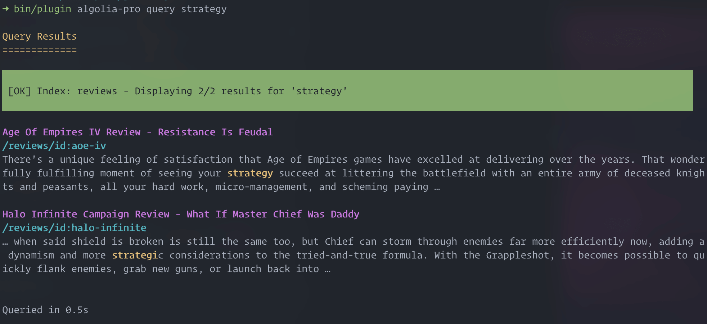

# Бэкенд Algolia Pro {: #algolia-pro-backend }

## Настройка бэкенда {: #backend-configuration }

После настройки **Plugin Options** и ввода обязательных `Application ID`, `Search only API key` и `Admin API Key` можно настраивать индексы. В Algolia Pro всё построено на индексах, поэтому критически важно настроить их как нужно. Чтобы посмотреть настройку по умолчанию, нажмите верхнюю вкладку **Algolia Indexes**. Здесь виден список доступных индексов.

По умолчанию включены два индекса, но вы можете создать сколько нужно.

``

Для каждого индекса доступно много параметров. Это позволяет полностью по-разному настроить разные индексы. Можно иметь несколько индексов одного типа, но с разной настройкой. Algolia Pro в этом смысле предельно гибок.

``

#### Параметры индекса {: #index-options }

* **Enabled** → Включает или выключает индекс. Полезно, если вы разрабатываете индекс и не хотите его использовать, но хотите сохранить настройки.

* **Index Name** → Имя этого индекса, которое должно быть уникальным и используется вместе с **Base Index Name**, чтобы образовать полное имя индекса на стороне Algolia.

* **Index Type** → `Grav Page Search` перебирает все опубликованные страницы и индексирует содержимое напрямую. Он также может индексировать заголовки страниц, таксономию и так далее. Это самый быстрый подход и самый простой для начала. Он подходит для большинства ситуаций. Также доступен `Crawl Pages Search`: вместо индексации страниц сайта он использует плагин **Sitemap**, чтобы получить список всех доступных страниц сайта, делает HTTP-запросы к каждой странице и обходит её, используя CSS-селекторы, чтобы выделить части страницы, которые нужно индексировать.

#### Индекс страниц Grav {: #grav-pages-index }

``

Первый тип индекса использует тип `algolia-grav-pages`. Он работает напрямую со страницами сайта Grav. Это предпочтительный вариант индексации для 99% задач на Grav, потому что большая часть содержимого, важного для поиска, находится в содержимом страницы, и он предварительно настроен работать **из коробки**.

* **Pages Filters** → Единственный параметр здесь — фильтр Pages, который определяет конфигурацию коллекции для индексации. По умолчанию используется `root@.descendants`, но можно взять любое допустимое определение коллекции Grav. См. [Коллекции страниц](https://learn.getgrav.org/17/content/collections#page-collections).

#### Поиск по обходу страниц {: #crawl-pages-search }

``

Тип поиска `algolia-crawl-pages` — запасной подход, когда содержимое не ясно определено в содержимом страницы или, возможно, приходит из внешнего API. Другая причина использовать его — если страница построена на активном использовании собственных заголовков страниц, но **не** использует модульные страницы.

> [!NOTE] Примечание
> Если вы используете модульные страницы, даже когда содержимое приходит из собственных заголовков страниц, обычная индексация страниц обычно лучше, потому что итоговое содержимое страницы будет нарисовано через шаблон Twig модульной страницы.

* **Body Selectors** → Эти CSS-селекторы тела обозначают HTML-элементы, которые должен индексировать обходчик. Важно настроить их правильно для вашего сайта и темы, потому что каждый сайт разный. Кроме того, не стоит индексировать весь элемент `<body>`, так как он часто содержит навигацию или подвалы, одинаковые для большинства страниц сайта. Это негативно повлияет на результаты поиска. Поэтому важно добавить в вывод темы новый ID или класс, чтобы **выделить только область содержимого**.

#### Основные параметры {: #core-options }

``

Этот раздел и все последующие общие для обоих типов индекса.

* **Search Class** → PHP-класс, который должен использовать этот индекс. По умолчанию это `Grav\Plugin\AlgoliaPro\GravPageSearch` или `Grav\Plugin\AlgoliaPro\CrawlPageSearch`. Но это настраивается, если вы изменили Search Class.

* **Distinct Field** → Поле, по которому Algolia определяет уникальность или различимость индексируемой записи. Обычно лучше всего подходит `url`. Не меняйте это, если не знаете, что делаете.

* **Searchable Fields** → Поля, которые должна индексировать Algolia. Порядок тоже важен: поля вверху списка Algolia оценивает выше, чем поля внизу.

> [!NOTE] Примечание
> Поля поиска использует **только Algolia**. Если вы хотите индексировать другое поле заголовка в содержимом, прочитайте раздел [Настройка через событие Grav](#customization-via-grav-event-basic) ниже.

#### Параметры поиска {: #search-parameters }

``

* **Hits per Page** → Число результатов по умолчанию для любого поиска. С интерфейсом Algolia Pro можно включить постраничный вывод, чтобы получить больше результатов. По умолчанию он возвращает ещё по `20` страниц за раз.

* **Distinct** → Используется Algolia, чтобы решить, возвращать ли один (различный) результат для конкретной страницы. Если хотите вернуть несколько результатов для одной страницы, выключите этот параметр.

* **Snippet Ellipsis Text** → Символы, показывающие, что есть ещё содержимое.

* **Attributes to Snippet** → Поля, которые должны возвращаться как фрагмент. Особенно полезно для больших полей вроде `content`; формат — `<field_name>:<num_of_chars>`.

#### Параметры содержимого {: #content-parameters }

``

* **Valid Headers** → HTML-заголовки, которые нужно индексировать и считать целями якорей. По умолчанию заданы `h1`, `h2` и `h3`, так как это самые значимые заголовки. Они служат целями якорей (например, `/your-page#some-internal-section`), чтобы ссылаться напрямую, если рядом с этими заголовками найдено важное содержимое. Особенно полезно в документации, где хочется ссылаться прямо на нужный раздел страницы, а не просто на страницу.

* **Chunk Size** → У Algolia есть жёсткий лимит на размер записи.
  ```
  For Standard and Premium plans:
    100 KB for any individual record
    and 10 KB average record size across all records
  ```
  Поэтому **Algolia Pro** для Grav должен **разбивать** одну страницу на несколько записей. Это также позволяет возвращать более точные результаты по запросу. По умолчанию `1000` символов, но если при индексации возникают ошибки из-за слишком большой записи, попробуйте уменьшить это число. Учтите: чем меньше число, тем больше записей создаётся, и тем быстрее вы достигнете лимитов аккаунта Algolia.

> [!NOTE] Примечание
> Заголовки также индексируются как часть содержимого, но обрабатываются как обычный текст, если не настроены здесь.

#### Параметры интерфейса {: #user-interface-options }

Этот и последующие разделы настройки описаны в [документации интерфейса](../frontend/index.md).

[{ .image-shadow .subdocs }](../frontend)

## Базовое руководство {: #basic-usage-tutorial }

Чтобы проверить поведение по умолчанию, мы установили плагин «algolia-pro», а также плагин «page-toc», который поддерживает якоря заголовков страниц. Algolia Pro использует любые найденные якоря заголовков и даже ссылается прямо на них, если находит CSS `id` у заголовка страницы. Эту возможность даёт плагин [Page TOC](https://github.com/trilbymedia/grav-plugin-page-toc?target=_blank), который по умолчанию добавляет якоря к заголовкам содержимого страницы от H1 до H6. Это можно полностью настроить в параметрах плагина [Page TOC](https://github.com/trilbymedia/grav-plugin-page-toc?target=_blank) или даже на уровне страницы, если нужны уникальные настройки якорей для каждой страницы.

Для первого примера мы создали простую страницу с частью содержимого из документации Grav Learn. Наша страница выглядит так:

```markdown
---
title: Home
body_classes: title-center title-h1h2
---

# What is Grav?
## and why you will love using it...

Grav is a **Fast**, **Simple**, and **Flexible** file-based Web-platform. There is **Zero** installation required.  Just extract the ZIP archive, and you are already up and running.  Although Grav follows principles similar to other flat-file CMS platforms, it has a different design philosophy than most.

The name **Grav** is just a shortened version of the word **Gravity**. The shared namespace of our platform and a movie starring Sandra Bullock is pure coincidence! More importantly, gravity is also a fundamental physical principle that describes the forces of attraction between objects. Frankly, the name was chosen as a temporary "codename" for the project, and it just stuck.

The underlying architecture of Grav is built using well established and _best-in-class_ technologies. This is to ensure that Grav is simple to use and easy to extend. Some of these key technologies include:

* [Twig Templating](https://twig.symfony.com/): for powerful control of the user interface
* [Markdown](https://en.wikipedia.org/wiki/Markdown): for easy content creation
* [YAML](https://yaml.org): for simple configuration
* [Parsedown](https://parsedown.org/): for fast Markdown and Markdown Extra support
* [Doctrine Cache](https://www.doctrine-project.org/projects/doctrine-orm/en/2.6/reference/caching.html): for performance
* [Pimple Dependency Injection Container](https://pimple.symfony.com/): for extensibility and maintainability
* [Symfony Event Dispatcher](https://symfony.com/doc/current/components/event_dispatcher.html): for plugin event handling
* [Symfony Console](https://symfony.com/doc/current/components/console.html): for CLI interface
* [Gregwar Image Library](https://github.com/Gregwar/Image): for dynamic image manipulation

## Grav's Place in the Universe

There are many powerful open source CMS solutions for building complex websites.  Some of the more commonly used ones are [Joomla](https://joomla.org), [WordPress](https://wordpress.org), and [Drupal](https://drupal.org). The downside of these platforms is that they have a steep learning curve associated with them. This requires a significant amount of your time - and this may be the time that you do not have.

These platforms provide a wealth of features and functionality that you can extend with a wide variety of open source and proprietary plug-ins and themes.  These extensions and themes are themselves often feature-packed, requiring more knowledge and time on the part of the developer yet.

In the end, you often find yourself creating a website that requires many plugins and extensions from many different vendors. This can make your design overly complicated and difficult to maintain over the long term.

## Grav is Different

Grav tackles the problem differently.  It focuses primarily on your content and turns your content structure into a navigable site.  The underpinnings of Grav are simple, yet via extensive **events**, you have complete control over every step in the Grav workflow.

This solution allows simple plugins to quickly and easily add powerful functionality. Using **Grav** also leads to a rapid development environment with an installation process that takes seconds, including a straightforward content creation method with a minimal learning curve. All of this contributes to making Grav friendly to the designer, the developer, and the end user.

To get a basic site up-and-running requires minimal Web development experience. If you dig a little deeper, you will discover that there is very little Grav cannot accomplish.

## Grav Logos and Press Information

You can find a summary about Grav, including **Grav logos** and **press information**, on our [media page](https://getgrav.org/media).

!!! The simplest way to navigate the documentation is to use the **Previous** and **Next** arrows (<i class="fa fa-angle-left"></i> | <i class="fa fa-angle-right"></i>) at the top of each page. You can see your progress represented by the check marks (<i class="fa fa-check-circle"></i>) in the sidebar.
```

### Индексация через CLI {: #indexing-with-the-cli }

Как видите, это простая страница Grav с `title` и собственным заголовком для установки `body_classes`. Содержимое — обычный Markdown со смесью заголовков и текста. После ввода **данных API Algolia** в настройках плагина оставим остальные значения по умолчанию. Используем тип **Grav Page Search** с настройками по умолчанию. Чтобы проиндексировать эту страницу из CLI, просто введите:

``

### Запросы через CLI {: #querying-with-the-cli }

Теперь эта страница проиндексирована. Мы можем проверить, что получаем результаты, выполнив простой запрос из CLI:

``

Как видите, он нашёл один результат, чего мы и ожидали. Также видно, что он нашёл конкретную запись и действительно указал заголовок страницы («Home»), ближайший заголовок со ссылкой («Grav is Different») и ссылку на якорь этого заголовка: `/#grav-is-different`. Думаю, вы согласитесь, что это очень точный и полезный результат, как мы и ожидали.

Попробуем другой, менее точный запрос:

``

На этот раз мы ищем «tack» и нашлось два результата. Первый тот же, что мы видели, но теперь нашёлся результат, где похожее слово «pack» встречается в «feature-packed». Очевидно, это не такое хорошее совпадение, как первый результат, но умный поиск Algolia на основе ИИ возвращает результат с меньшей оценкой, который может быть полезен пользователю.

## Настройка через событие Grav (базово) {: #customization-via-grav-event-basic }

Бывают ситуации, когда в заголовке страницы есть собственный frontmatter, который затем используется в шаблоне Twig для создания содержимого. Часто так бывает, когда у вас есть массив вещей, которыми нужно управлять в админке через собственные blueprints. Простой пример — страница со списком **авторов** и их **биографий**. Их можно определить на странице `authors.md` так:

**authors.md**
```markdown
---
title: Authors

authors:
    - name: Chantal Zoe Blunder
      bio: Chantal Zoe Blunder is a ...
    - name: Mark Kevin Chen
      bio: Mark Kevin Chen is a ...
    - name: Maud Stanley Gloop
      bio: Maud Stanley Gloop is a ...
    - name: Reginald Tony DeVito
      bio: Reginald Tony DeVito is a ...
---

# Author Biographies
```

> [!IMPORTANT] Важно
> Здесь я убрал биографии для краткости, но видно, что `authors` — массив, где у каждого есть только `name` и `bio`. Это может выводиться в шаблоне Twig `authors.html.twig` так:

**authors.html.twig**
```twig



    {{ page.content|raw }}
    
        <div class="author-detail">
            <h2>{{ author.name }}</h2>
            {{ author.bio|markdown }}
            <hr />
        </div>
    

```

Остальное содержимое страницы, нарисованное шаблоном `authors.html.twig`, задаётся frontmatter через `headers.authors`; мы перебираем его и выводим простой HTML для каждого автора. Результат примерно такой:

``

Проблема в том, что стандартный **Grav Page Search** Algolia не найдёт ничего из содержимого авторов в содержимом страницы, только содержимое «Author Biographies» из файла `authors.md`:

```markdown
# Author Biographies
```

По умолчанию индекс настроен искать в этих полях:

**algolia-pro.yaml**
```yaml
...
searchable_fields:
    - title
    - subtitle
    - url
    - taxonomy
    - headers.h1
    - headers.h2
    - headers.h3
    - headers.h4
    - content
...    
```

Их задаёт PHP-код, но мы можем использовать одно из собственных событий Algolia Pro, чтобы вмешаться в логику индексации и добавить поля авторов, чтобы по ним можно было искать. Чтобы использовать это событие, поместите его в собственный плагин или в PHP-файл темы. Обычно лучший вариант — создать собственный плагин для любой нужной логики через плагин `devtools`. Но если вы не предвидите много собственной функциональности, можно просто добавить событие в тему.

В этом примере у нас собственная тема на основе стандартной **Quark**, и сначала нужно сказать ей слушать событие. В PHP-файле темы, а именно в методе `getSubscribedEvents()`, добавьте запись для события `onAlgoliaProIndexData`:

**my-theme.php**
```php
...
public static function getSubscribedEvents()
{
    return [
        'onThemeInitialized'    => ['onThemeInitialized', 0],
        'onTwigLoader'          => ['onTwigLoader', 0],
        'onTwigInitialized'     => ['onTwigInitialized', 0],
        'onAlgoliaProIndexData' => ['onAlgoliaProIndexData', -10]
    ];
}
```

> [!IMPORTANT] Важно
> Мы используем приоритет `-10`, чтобы наше событие выполнялось после стандартного, которым Algolia Pro также задаёт стандартные поля.

Теперь нужно определить функцию-обработчик события и использовать её для своей логики:

#### Подход 1 (нормальное решение) {: #approach-1-o-k-solution }

**my-theme.php**
```php
...
public function onAlgoliaProIndexData($e)
{
    // получить данные из события
    $data = $e['data'];
    $page = $e['object'];

    // если это допустимая страница 'authors' с заданными авторами, выполнить собственную обработку
    if ($page instanceof PageInterface && $page->template() == 'authors' && isset($page->header()->authors)) {
        // получить текущие данные страницы
        $content = $data->content ?? '';
        // перебрать авторов и построить HTML, повторяющий собственный Twig
        foreach ($page->header()->authors as $author) {
            $content .= "\n<h2>{$author['name']}</h2>\n".Parsedown::instance()->parse($author['bio']);
        }
        // записать обработанное содержимое обратно в объект данных
        $data->content = $content;
    }
}
```

Это не слишком сложно, но должен быть лучший способ, верно? Конечно. Я бы рекомендовал вынести логику Twig, которая рисует авторов, из `authors.html.twig` в `partials/authors.html.twig` и использовать тот же Twig для отрисовки HTML в событии `onAlgoliaProIndexData()`. Быстрый пример, как это может выглядеть:

#### Подход 2 (лучшее решение) {: #approach-2-better-solution }

**authors.html.twig**
```twig



    

```

**partials/authors.html.twig**
```twig
{{ page.content|raw }}


    <div class="author-detail">
        <h2>{{ author.name }}</h2>
        {{ author.bio|markdown }}
        <hr />
    </div>

```

**my-theme.php**
```php
...
public function onAlgoliaProIndexData($e)
{
    // получить данные из события
    $data = $e['data'];
    $page = $e['object'];

    // если это допустимая страница 'authors' с заданными авторами, выполнить собственную обработку
    if ($page instanceof PageInterface && $page->template() == 'authors' && isset($page->header()->authors)) {
        $data->content  = $this->grav['twig']->processTemplate('partials/authors.html.twig', ['page' => $page, 'header' => $page->header()]);
    }
}
```

Повторное использование кода — прекрасная вещь! Оба решения работают похоже. Второй подход использует тот же шаблон Twig, которым фронтенд рисует содержимое, поэтому он надёжнее. Если вы добавите автору больше атрибутов, например `location`, и измените шаблон Twig, чтобы их показывать, второй подход автоматически «просто заработает» и проиндексирует новый атрибут без изменений.

С нашими текущими данными оба дают одинаковый результат для простого запроса `zoe`:

``

### Плагин Page TOC для лучших результатов {: #page-toc-plugin-for-better-results }

Плагин [Page TOC](https://github.com/trilbymedia/grav-plugin-page-toc?target=_blank) добавляет якоря страниц только к заголовкам, найденным в содержимом. В этом примере, поскольку мы используем frontmatter и собственный Twig для отрисовки авторов, к блокам авторов якоря не добавляются. Мы можем это исправить и заодно улучшить результаты поиска, изменив Twig так, чтобы содержимое выводилось через функцию Twig `add_anchors()`, которую даёт Page TOC.

**partials/authors.html.twig**
```twig
{{ page.content|raw }}


    
        <div class="author-detail">
            <h2>{{ author.name }}</h2>
            {{ author.bio|markdown }}
            <hr />
        </div>
    


{{ add_anchors(authors_content) }}
```

Поскольку мы уже используем этот `partials/authors.html.twig` в событии, индексация Algolia Pro тоже учтёт их и использует для более умных ссылок. Если переиндексировать и повторить тот же запрос `zoe`:

``

Теперь видно, как **URL** изменился с простого `/authors` на `/authors#chantal-zoe-blunder`, то есть нажатие на этот результат сразу перенесёт вас к записи **Chantal Zoe Blunder** в списке авторов. Разве не здорово?

## Поиск по обходу страниц (средний уровень) {: #crawl-page-search-intermediate }

Хотя это не самый частый сценарий, бывают ситуации, когда стандартной возможности **GravPageSearch** недостаточно или она не может правильно проиндексировать содержимое. Чаще всего так бывает, когда на сайте используется собственное решение на **FlexObjects**, где содержимого не существует как настоящих страниц Grav. Один из подходов — **CrawlPageSearch**, который использует HTTP-обходчик вместе с плагином `sitemap`, чтобы обойти сайт и найти определённые CSS-селекторы. Найдя подходящий селектор, он индексирует содержимое внутри него. Класс **CrawlPageSearch** может работать и со страницами, но также может индексировать всё, что находит плагин sitemap.

Самый частый сценарий, где нужен этот подход, — динамически генерируемые страницы. Типичный пример — собственный плагин на **Flex Objects**. В этом примере мы используем простой плагин **Reviews**, который применяет Flex Objects для обзоров игр. Настройка реализации на Flex выходит за рамки этой документации, но можно [скачать пример кода](reviews-plugin.zip) всего плагина Reviews.

Первый шаг к работе **CrawlPageSearch** с плагином reviews — добавить слушатель события `onSitemapProcessed`, чтобы добавить наши подстраницы на Flex в sitemap, а обходчик, в свою очередь, мог их запросить и проиндексировать.

> [!IMPORTANT] Важно
> Включать внутренние страницы на Flex в sitemap — хорошая практика SEO, и это не что-то уникальное для Algolia Pro.

**reviews.php**
```php
...
public function onPluginsInitialized()
{
    $this->enable([
        'onTwigTemplatePaths'       => ['onTwigTemplatePaths', 0],
        'onAssetsInitialized'       => ['onAssetsInitialized', 0],
        'onSitemapProcessed'        => ['onSitemapProcessed', 0],
    ]);
}
...
public function onSitemapProcessed(Event $e)
{
    $sitemap = $e['sitemap'];
    $directory = $this->grav['flex']->getDirectory('reviews');
    foreach ($directory->getCollection()->filterBy(['published' => true]) as $review) {
        $route = "reviews/id:{$review->review_route}";
        $entry = new SitemapEntry(
            Utils::url($route, true),
            date('Y-m-d', $review->getTimestamp()),
            'daily',
            '1.0'
        );
        $sitemap[Utils::url($route)] = $entry;
    }
    $e['sitemap'] = $sitemap;
}
```

В событии `onPluginsInitialized()` мы регистрируем метод `onSitemapProcesed()`. В нём сначала получаем существующий **sitemap**, загружаем коллекцию `reviews` и перебираем её. Для каждого опубликованного элемента определяем `$route`, затем добавляем новый объект `SitemapEntry()` с полным URL, датой и частотой обновления.

После этого можно проверить sitemap, открыв `http://my-site.example/sitemap.json`. Вы должны увидеть все страницы, а также новые динамические страницы на Flex.

> [!NOTE] Примечание
> Не нужно ограничивать sitemap только страницами Flex: мы можем использовать CSS-селекторы из параметров, чтобы индексировать только данные обзоров.

Теперь нужно изменить индекс `algolia-crawl-pages`: сначала убедиться, что он **включён**, а также задать **Body Selectors** как `#reviews`.

``

Если ваш плагин (Reviews в нашем примере) оборачивает содержимое в HTML-элемент с `id="reviews"`, обходчик подхватит их и проиндексирует. На странице коллекции, где перечислены все обзоры, шаблон Twig делает именно это:

**templates/flex/reviews/collection/default.html.twig**
```twig



<div id="reviews">
    <h1>Reviews</h1>
    <div class="columns">
    
      <div class="column col-6">
        
      </div>
    
    </div>
</div>
```

## Собственные классы поиска (продвинутый уровень) {: #custom-search-classes-advanced }

Хотя **CrawlPageSearch** относительно быстр и прост и работает со многими типами страниц, бывают случаи, когда нужна очень собственная реализация, которую не покрывают ни **GravPageSearch**, ни **CrawlPageSearch**. В таких ситуациях можно создать полностью собственный класс поиска, точно соответствующий вашим задачам. Продолжим на том же плагине **Reviews**, который использует Flex Objects.

Нам нужно сделать несколько вещей:

1. Создать собственный класс поиска. (**FlexReviewsSearch**)
1. Определить собственный blueprint, который админка будет использовать для настройки класса. (**flex-reviews-search.yaml**)
1. Зарегистрировать класс **FlexReviewsSearch** в Algolia, чтобы его можно было выбрать как допустимый тип поиска.
1. и другое…

### Шаг 1 — создать собственный класс поиска {: #step-1-create-a-custom-search-class }

Первый шаг — создать новый класс для логики поиска. Нужно создать заготовку класса и запись в `composer.json`, чтобы класс автоматически загружался:

**classes/algolia-pro/FlexReviewsSearch.php**
```php
<?php declare(strict_types=1);

namespace Grav\Plugin\AlgoliaPro;

use Grav\Framework\Flex\Interfaces\FlexCollectionInterface;
use Grav\Framework\Flex\Interfaces\FlexObjectInterface;

class FlexReviewsSearch extends FlexSearch implements AlgoliaProClassInterface
{
    /**
     * Вернуть коллекцию объектов для индексации. Обязательно отфильтруйте недоступные объекты.
     *
     * @return FlexCollectionInterface
     */
    protected function getFilteredCollection(): FlexCollectionInterface 
    {
    }
    
    /**
     * Вернуть true, если объект может быть обработан этим классом.
     * 
     * @param FlexObjectInterface $object
     * @return bool
     */
    protected function checkObject(FlexObjectInterface $object): bool 
    {
    }
    
    /**
     * Каждый объект может иметь несколько записей, поэтому верните массив записей.
     *
     * @param FlexObjectInterface $object
     * @return array
     */
    protected function getRecord(FlexObjectInterface $object): array 
    {
    }
    
    /**
     * Получить URL объекта.
     *
     * @param FlexObjectInterface $object
     * @return string|null
     */
    protected function getUrl(FlexObjectInterface $object): ?string 
    {
    }
}
```

**composer.json**
```json
...
"autoload": {
"psr-4": {
    "Grav\\Plugin\\Reviews\\": "classes/",
    "Grav\\Plugin\\AlgoliaPro\\": "classes/algolia-pro"
},
"classmap":  ["reviews.php"]
},
```

### Шаг 2 — зарегистрировать тип поиска {: #step-2-register-search-type }

Теперь можно добавить событие `onAlgoliaRegisterSearch()` и зарегистрировать тип поиска:

**reviews.php**
```php
...
public function onPluginsInitialized()
{
    $this->enable([
        ...
        'onAlgoliaProRegisterSearch' => ['onAlgoliaProRegisterSearch', 0]
    ]);
}

...

public function onAlgoliaProRegisterSearch(Event $e): void
{
    /** @var Data $register */
    $register = $e['register'];
    $register->merge([
        'flex-reviews-search' => 'Flex Reviews Search',
    ]);
}
```

Затем нужно создать blueprint, который позволит определить и заполнить данные поиска. Можно взять файл **GravPagesSearch**, который лежит в `user/plugins/algolia-pro/blueprints/flex/search/algolia-grav-pages.yaml`, и создать свой в плагине reviews:

**blueprints/flex/search/flex-reviews-search.yaml**
```yaml
title: Flex Reviews Search

form:
  fields:
    crawl_section:
      ordering@: 4
      type: section
      title: Flex Reviews Options
      underline: true
      fields:
        common_section:
          type: section
          import@:
            type: search/common-config
            context: blueprints://
```

Сейчас нет способа автоматически задать значения по умолчанию, поэтому задайте следующие значения в админке:

* **Search Class**: `Grav\Plugin\AlgoliaPro\FlexReviewsSearch`
* **Distinct Field**: `url`
* **Searchable Fields**:
    * `title`
    * `name`
    * `url`
    * `headers`
    * `good`
    * `bad`
    * `content`

### Шаг 3 — наполнить методы класса {: #step-3-flesh-out-the-class-methods }

Эта часть немного утомительна и зависит от вашей логики, но для плагина Reviews наш класс поиска в итоге выглядит так:

**classes/algolia-pro/FlexReviewsSearch.php**

```php
<?php declare(strict_types=1);

namespace Grav\Plugin\AlgoliaPro;

use Grav\Common\Grav;
use Grav\Framework\Flex\Flex;
use Grav\Framework\Flex\FlexDirectory;
use Grav\Framework\Flex\Interfaces\FlexCollectionInterface;
use Grav\Framework\Flex\Interfaces\FlexObjectInterface;
use Grav\Plugin\Reviews\ReviewCollection;
use Grav\Plugin\Reviews\ReviewObject;

class FlexReviewsSearch extends FlexSearch
{
    /**
     * Вернуть коллекцию объектов для индексации. Обязательно отфильтруйте недоступные объекты.
     *
     * @return ReviewCollection
     */
    protected function getFilteredCollection(): FlexCollectionInterface
    {
        $grav = Grav::instance();

        /** @var Flex $flex */
        $flex = $grav['flex'];

        /** @var FlexDirectory $directory */
        $directory = $flex->getDirectory('reviews');

        /** @var ReviewCollection $collection */
        $collection = $directory->getCollection()->filterBy(['published' => true]);

        return $collection;
    }

    /**
     * Вернуть true, если объект может быть обработан этим классом.
     * 
     * @param FlexObjectInterface $object
     * @return bool
     */
    protected function checkObject(FlexObjectInterface $object): bool
    {
        return $object instanceof ReviewObject;
    }

    /**
     * Каждый объект может иметь несколько записей, поэтому верните массив записей.
     *
     * @param ReviewObject $object
     * @return array
     */
    protected function getRecord(FlexObjectInterface $object): array
    {
        $records = [];
        $record = new \stdClass();
        $counter = 0;

        // стандартные поля
        $record->id = $object->getFlexKey();
        $record->title = $object->review_title;
        $record->name = $object->product_name;
        $record->url = $this->getUrl($object);

        // сохранить запись для каждого раздела
        foreach ($object->sections as $section) {
            $record->header = $section['intro'];
            $content_chunks = $this->splitHTMLContent($section['content']);

            foreach ($content_chunks as $content_chunk) {
                $record->content = $content_chunk['content'];
                $record->objectID = $record->id . '-' . $counter++;
                $records[] = (array) $record;
            }
        }

        // сохранить запись с оценками good/bad
        $record->content = "score: {$object->score}\ngood: {$object->good}\nbad: {$object->bad}";
        $record->objectID = $record->id . '-score';
        $records[] = (array) $record;

        return $records;
    }
    
    /**
     * Получить URL объекта.
     *
     * @param ReviewObject $object
     * @return string|null
     */
    protected function getUrl(FlexObjectInterface $object): ?string
    {
        // вернуть URL объекта. Если у объекта нет метода, сгенерируйте маршрут здесь, например /reviews/id:[KEY].
        return $object->url();
    }
}
```

### Шаг 4 — проверка результатов {: #step-4-validating-the-results }

Понимаю, это довольно объёмно! Когда вы начнёте разбираться и сравните с классом **GravPageSearch**, станет понятнее. Чтобы проверить, просто отключите другие индексы поиска, чтобы активным был только ваш.

В нашем тестовом плагине было всего 3 обзора, поэтому мы проиндексировали их:

``

а быстрый запрос даёт:



Как и ожидалось… 😉

## Добавление собственных параметров CLI для индекса (продвинутый уровень) {: #adding-custom-cli-index-options-advanced }

Если вы создали собственный класс поиска, может понадобиться иметь собственные параметры во время индексации. Для этого можно использовать события `onAlgoliaProCliConfiguration` и `onAlgoliaProCliServe`. Algolia Pro сам использует их, чтобы добавить собственные параметры и передать их внутренним методам класса.

Как это работает, видно по коду:

```php
public function onAlgoliaProCliConfiguration(Event $e): void
    {
        /** @var ConsoleCommand $command */
        $command = $e['command'];

        if ($command instanceof AlgoliaIndexerCommand) {
            $command->addOption(
                'url',
                'u',
                InputOption::VALUE_REQUIRED,
                'Optional URL of JSON sitemap (CrawlPageSearch only)'
            );
            $command->addOption(
                'route',
                null,
                InputOption::VALUE_REQUIRED,
                'Optional route of a single specific page to index (GravPageSearch only)'
            );
        }

        $command->addOption(
            'indexes',
            'x',
            InputOption::VALUE_REQUIRED,
            'Optional comma-separated list of enabled index configurations to use'
        );
    }

    public function onAlgoliaProCliServe(Event $e): void
    {
        /** @var ConsoleCommand $command */
        $command = $e['command'];
        /** @var \stdClass $options */
        $options = $e['options'];

        if ($command instanceof AlgoliaIndexerCommand) {
            if ($url = $command->getInput()->getOption('url')) {
                $options->url = $url;
            }
            if ($route = $command->getInput()->getOption('route')) {
                $options->route = $route;
            }
        }

        $indexes = $command->getInput()->getOption('indexes');
        if (is_string($indexes)) {
            $indexes_list = array_map('trim', explode(',', $indexes));
            $options->indexes = $indexes_list;
        }

        if ($lang_code = $command->getInput()->getOption('lang')) {
            $options->lang = $lang_code;
        }
    }
```
