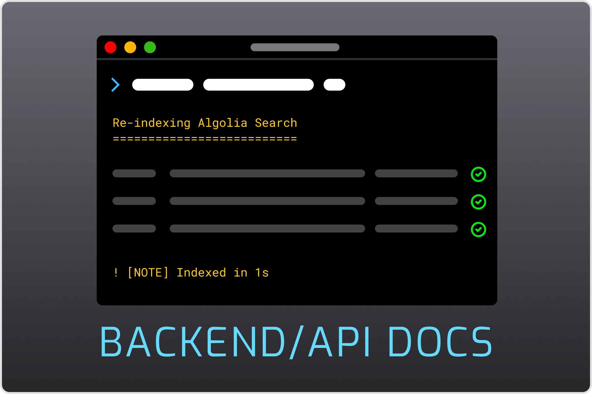

# Algolia Pro {: #algolia-pro }

> [!IMPORTANT] Важно
> Продуктам Premium нужен бесплатный плагин [License Manager](../license-manager/index.md). Установите его и добавьте лицензию продукта перед установкой этого продукта.

## Установка {: #installation }

Сначала убедитесь, что у вас последняя версия **Grav 1.7** (`-f` принудительно обновляет индекс GPM).

```
$ bin/gpm selfupgrade -f
```

Плагин Algolia Pro использует плагин **sitemap** для правильной работы. Они доступны через GPM, а поскольку у плагина есть зависимости, просто установите плагин Algolia Pro и подтвердите установку остальных, когда вас спросят:

```
$ bin/gpm install algolia-pro
```

Плагин также можно установить через раздел **Plugins** в плагине админки.

## Конфигурация {: #configuration }

У **Algolia Pro** много параметров настройки для разных возможностей: [плагин](#plugin-configuration), [интерфейс](frontend/index.md), [бэкенд и индексация](backend/index.md).

Чтобы документация была лучше организована, мы разделили эти области на отдельные страницы, чтобы вы могли сосредоточиться на том, что ищете.

| [{ .image-shadow .subdocs }](frontend) | [{ .image-shadow .subdocs }](backend) |
|----------------------------------------------------------------------------|-------------------------------------------------------------------------|

### Настройка плагина {: #plugin-configuration }

``
Обычно плагины настраиваются в разделе «Plugins» админки, но из-за природы Algolia Pro и разных областей настройки мы собрали всё в одном пункте меню админки.

До этих настроек можно добраться из бокового меню, а если вы находитесь в настройках плагина, примечание со ссылкой укажет правильное место.

#### Параметры плагина {: #plugin-options }

``

- **Plugin status** → Включает или выключает весь плагин.

- **Production Mode** → Когда выключен, останавливает любое общение с API сервиса Algolia. Полезно для разработки и пробных запросов `dry run`.

- **Admin Index Events** → Когда включено, запускает переиндексацию объекта или страницы при срабатывании событий `onAdminAfterSave` или `onAdminAfterDelete`.

- **Site Index Events** → Похоже на **Admin Index Events**: включение переиндексирует объект или страницу при срабатывании событий `onFlexObjectAfterSave` или `onFlexObjectAfterDelete`.

- **Algolia Pro Actions**
  - `Reindex Now` → Кнопка быстрого доступа для ручной переиндексации. Та же кнопка есть в Admin Quick Tray.
  - `Reset Index` → Сначала сбрасывает все данные **Smart Indexing**, затем полностью очищает удалённые данные индексации и заново всё индексирует.

#### Algolia API {: #algolia-api }

``

- **Application ID** → ID приложения, которому разрешено выполнять действия через API. Создайте его по руководству [Algolia: создание приложения](#algolia-create-application) ниже.

- **Search only API Key** → «Search-Only API Key», связанный с указанным выше ID приложения. Создайте его по руководству [Algolia: создание приложения](#algolia-create-application) ниже.

- **Admin API Key** → «Admin API key», связанный с указанным выше ID приложения. Создайте его по руководству [Algolia: создание приложения](#algolia-create-application) ниже.

#### Основные параметры {: #core-options }

``

- **Base Index Name** → Имя индекса по умолчанию. Используется как префикс индексов в Algolia. Каждый индекс Algolia Pro может задать собственное имя. Обычно это что-то, что определяет конкретный сайт, если у вас несколько сайтов или индексов в одном аккаунте Algolia.

- **User Agent** (дополнительно) → User Agent, которым подписываются запросы к Algolia при вызовах API и индексации Page Crawler.

- **Controller Class** (дополнительно) → Класс по умолчанию для индексации и запросов. Если вам нужно создать собственный класс контроллера, укажите его здесь…

#### Расписание индексации {: #index-schedule }

``

Algolia Pro интегрируется с [планировщиком Grav](https://learn.getgrav.org/17/advanced/scheduler?target=_blank), чтобы автоматизировать периодическую индексацию содержимого.

- **Add AlgoliaPro to Scheduler** → Когда включено, AlgoliaPro добавляется в список заданий планировщика.

- **Run Indexing at** → Периодичность, с которой выполняется задание. Использует формат cron.

## Algolia: создание приложения {: #algolia-create-application }
Чтобы Algolia Pro мог общаться с сервисом Algolia для поиска и индексации, сначала нужно создать приложение. Если у вас ещё нет аккаунта, первым делом [создайте его](https://www.algolia.com/users/sign_up?target=_blank).

У Algolia очень щедрый бесплатный тариф, которого должно хватить в большинстве случаев. Бесплатный аккаунт позволяет иметь только одно приложение. Если вы покупаете Algolia Pro для клиентов, создайте аккаунт от их имени.

Когда вы завершите регистрацию, выполните эти шаги на панели управления:

1. Нажмите на **название приложения** (оно может выглядеть как «Unnamed application») вверху слева на панели управления и выберите **«Create Application»**.
1. Выберите **имя** и **тариф**. В этом руководстве мы назовём приложение **«Algolia Pro Docs»** и выберем тариф **«Free»**.
1. Нажмите **«Next Step: Data Center»** на правой панели и выберите центр данных, который лучше всего подходит вашему сайту. Algolia автоматически оценивает задержку по вашему местоположению. Учтите, что эта оценка — между Algolia и вами, а не сервером, на котором будет работать Algolia Pro.
1. Нажмите **«Review Application Details»**.
1. Примите условия и нажмите **«Create Application»**.

Если всё прошло правильно, вы вернётесь на панель управления и увидите название приложения вверху, в этом случае **«Algolia Pro Docs»**. Под названием также находится место, где наконец можно получить ключи API.

``

Нажатие на API Keys ведёт на страницу, где можно получить ключи, нужные Algolia Pro.

``

> [!NOTE] Примечание
> Нажмите на значок замка, чтобы показать или скрыть Admin API Key. Значок справа копирует ключ в буфер обмена.

## Обновление до Algolia Pro 1.1.0 (Algolia API v3 → v4) {: #upgrading-to-1-1 }
> [!NOTE] Примечание
> **Критическое изменение**: Algolia Pro 1.1.0 обновляет базовый PHP-клиент Algolia с **v3** до **v4**. Если у вас есть собственные классы, расширяющие `BaseSearch`, `GravPageSearch`, `FlexSearch` или `CrawlPageSearch`, вы **должны** их обновить.

### Зачем это изменение? {: #why-this-change }

Algolia прекратила поддержку PHP-клиента v3 и выпустила v4 с переработанным API. Самое значительное изменение: объект `SearchIndex` больше не существует. Вместо этого все операции с индексом выполняются напрямую на `SearchClient`, а имя индекса передаётся строковым параметром.

### Что изменилось {: #what-changed }

Тип возврата метода `BaseSearch::getIndexer()` изменился с `SearchIndex` на `string`:

**Было (v3):**

```php
use Algolia\AlgoliaSearch\SearchIndex;

protected function getIndexer(?string $index): SearchIndex
{
    $index_name = $this->getIndexName($index);
    $search_index = $this->search_client->initIndex($index_name);

    if ($this->production_mode === true) {
        $search_index->setSettings($settings);
    }

    return $search_index;  // объект SearchIndex
}
```

**Стало (v4):**

```php
protected function getIndexer(?string $index): string
{
    $index_name = $this->getIndexName($index);

    if ($this->production_mode === true) {
        $this->search_client->setSettings($index_name, $settings);
    }

    return $index_name;  // строка
}
```

### Как обновить собственные классы {: #how-to-update-custom-classes }

Если у вас есть собственный класс, расширяющий любой из классов поиска Algolia Pro, нужно сделать два изменения:

#### 1. Обновите тип возврата `getIndexer()` {: #1-update-the-getindexer-return-type }

Если вы переопределяете `getIndexer()`, измените тип возврата с `SearchIndex` на `string` и возвращайте имя индекса вместо объекта `SearchIndex`:

```php
// до (v3)
use Algolia\AlgoliaSearch\SearchIndex;

class MyCustomSearch extends BaseSearch
{
    protected function getIndexer(?string $index): SearchIndex
    {
        $search_index = $this->search_client->initIndex($index_name);
        $search_index->setSettings($settings);
        return $search_index;
    }
}

// после (v4)
class MyCustomSearch extends BaseSearch
{
    protected function getIndexer(?string $index): string
    {
        $index_name = $this->getIndexName($index);
        $this->search_client->setSettings($index_name, $settings);
        return $index_name;
    }
}
```

#### 2. Обновите все операции с индексом {: #2-update-all-index-operations }

Любой код, вызывавший методы объекта `SearchIndex`, теперь должен вызывать эквивалентный метод на `$this->search_client`, передавая имя индекса первым аргументом:

```php
// до (v3) — методы вызываются у объекта SearchIndex
$index = $this->getIndexer($name);
$index->setSettings($settings);
$index->saveObjects($records);
$index->deleteObjects($objectIDs);
$index->clearObjects();
$results = $index->search($query, $params);

// после (v4) — методы вызываются у SearchClient с именем индекса
$index_name = $this->getIndexer($name);
$this->search_client->setSettings($index_name, $settings);
$this->search_client->saveObjects($index_name, $records);
$this->search_client->deleteObjects($index_name, $objectIDs);
$this->search_client->clearObjects($index_name);
$results = $this->search_client->searchSingleIndex($index_name, ['query' => $query] + $params);
```

> [!NOTE] Примечание
> Примечание: метод `search()` в v4 переименован в `searchSingleIndex()`, а строка запроса теперь передаётся внутри массива параметров.

### Краткий справочник: изменения методов v3 → v4 {: #quick-reference-v3-v4-method-changes }

| v3 (`SearchIndex`)            | v4 (`SearchClient`)                              |
|-------------------------------|---------------------------------------------------|
| `initIndex($name)`           | _(удалён — используйте строку имени индекса напрямую)_ |
| `$index->setSettings($s)`   | `setSettings($indexName, $s)`                      |
| `$index->getSettings()`     | `getSettings($indexName)`                          |
| `$index->saveObjects($r)`   | `saveObjects($indexName, $r)`                      |
| `$index->deleteObjects($ids)`| `deleteObjects($indexName, $ids)`                 |
| `$index->clearObjects()`    | `clearObjects($indexName)`                         |
| `$index->search($q, $p)`    | `searchSingleIndex($indexName, ['query'=>$q]+$p)` |
| `$index->partialUpdateObjects($r)` | `partialUpdateObjects($indexName, $r)`     |
| `$index->getIndexName()`    | _(просто используйте строку напрямую)_             |

| [{ .image-shadow .subdocs }](frontend) | [{ .image-shadow .subdocs }](backend) |
|----------------------------------------------------------------------------|-------------------------------------------------------------------------|
