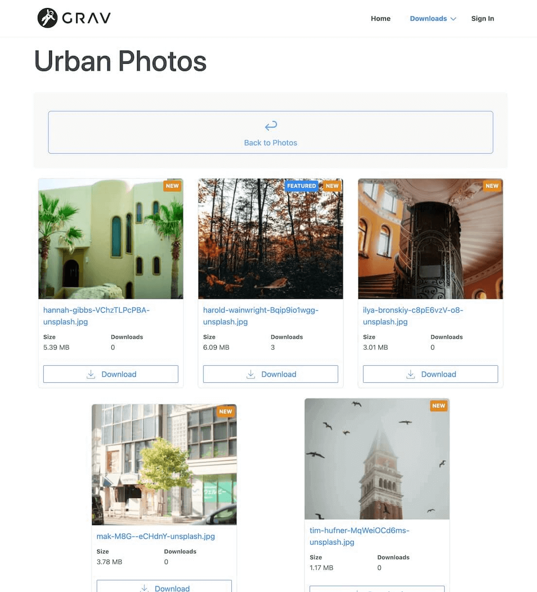
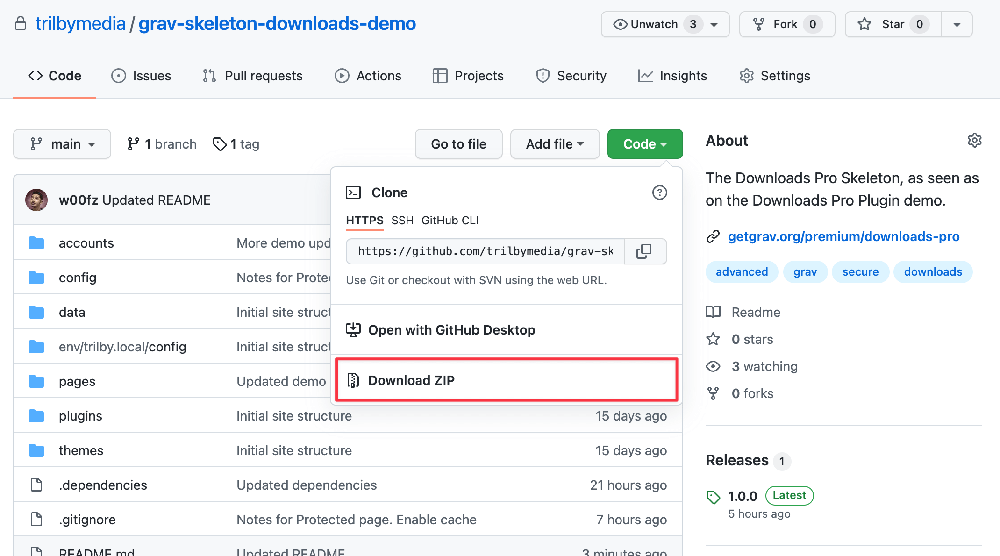

# Downloads Pro

> [!IMPORTANT] Важно
> Продукты Premium требуют бесплатного плагина [License Manager](../license-manager/index.md). Установите его и добавьте лицензию продукта перед установкой этого продукта.

## Установка

Сначала убедитесь, что у вас последняя версия **Grav 1.7** (`-f` принудительно обновляет индекс GPM).

```
$ bin/gpm selfupgrade -f
```

У плагина Downloads Pro нет зависимостей, поэтому установка сводится к выполнению команды:

```
$ bin/gpm install downloads-pro
```

Вы также можете установить плагин через раздел **Плагины** в плагине админки.

## Пакет-скелет
Ищете пакет-скелет Downloads Pro, чтобы быстро начать? Вы можете [скачать](https://github.com/trilbymedia/grav-skeleton-downloads-demo?target=_blank) [демо](https://demo.getgrav.org/downloads-pro?target=_blank)-скелет прямо с GitHub и следовать инструкциям в файле `README.md`.

[](https://github.com/trilbymedia/grav-skeleton-downloads-demo?target=_blank)

*Демо-скелет Downloads Pro*

Самый быстрый способ скачать файлы — нажать зелёную кнопку **Code**, а затем — **Download ZIP**.



## Конфигурация {: #configuration }

Downloads Pro настраивается в настройках плагина. Эти настройки служат глобальными значениями по умолчанию для любой страницы загрузок и позже могут быть [переопределены](#file-overrides) для дальнейшей настройки.

``

* **Статус плагина** → включает или отключает плагин целиком.

* **Использовать встроенный CSS** → Downloads Pro поставляется с минимальным стилем, который должен подходить для большинства случаев. Однако, скорее всего, вы захотите использовать собственный стиль. Этот параметр позволяет отключить встроенный CSS, чтобы вы могли оформить всё сами.

``

* **Макет** → список макетов для рендеринга загрузок. Downloads Pro поставляется с [разнообразием](#downloads-layout-types) макетов, но вы также можете создать свой. Именно в этом параметре он и указывается.
* **Включать все медиафайлы** → включать все ресурсы, доступные на странице, или ограничиться только её переопределениями. [Подробнее о переопределениях](#file-overrides)
* **Путь к файлам** → базовый путь для файлов загрузок. Можно использовать обычные относительные пути, нотацию `@` или даже потоки. Этот параметр подразумевает, что вы можете создать один источник загрузок для всех своих файлов и при этом создать несколько страниц загрузок. [Подробнее о «едином источнике загрузок»](./).
* **Сортировать по** → свойство по умолчанию для сортировки в макетах, где она поддерживается, например в `list`. Это может быть один из вариантов: _Overrides_ (для пользовательского порядка перетаскиванием), _Modified Time_, _File Size_, _Downloads Count_, _Featured_, _Filename_, _File Type_, _File Mime Type_, _File Extension_, _File Version_.
* **Inherit Parent** → наследовать ли конфигурацию родителя. Этот параметр становится особенно полезным в сочетании с поддержкой вложенных папок загрузок, которая есть в Downloads Pro.
* **Hot downloads** → число загрузок файла, после которого срабатывает тег `HOT`.
* **New days** → количество прошедших дней с момента последнего изменения файла, после которого скрывается тег `NEW`.
* **Направление сортировки** → в сочетании с `Order by` задаёт направление сортировки.

``

* **Показывать иконку** → показывать ли иконку/миниатюру файла. Значение может трактоваться по-разному в зависимости от макета. Создавая свой макет, учитывайте этот параметр и соответственно показывайте или скрывайте миниатюру/изображение/иконку.
* **Показывать версию** → показывать ли версию файла
* **Показывать размер файла** → показывать ли размер файла
* **Показывать дату изменения** → показывать ли дату последнего изменения
* **Показывать число загрузок** → показывать ли число загрузок
* **Показывать кнопку загрузки** → показывать ли кнопку загрузки
* **Показывать метку HOT** → показывать ли метку `HOT`
* **Показывать метку NEW** → показывать ли метку `NEW`
* **Показывать метку Featured** → показывать ли метку Featured

> [!TIP] Совет
> Поскольку эти настройки глобально наследуются любой страницей загрузок, их изменение впоследствии может привести к неожиданным побочным эффектам. Всегда будьте внимательны при изменении настроек и помните, что каждую глобальную настройку можно переопределить отдельно для страницы.

## Переопределения файлов {: #file-overrides }

При каждом создании страницы типа `downloads` она наследует настройки [конфигурации](#configuration) по умолчанию. Однако часто это не совсем то, что нужно, поэтому вам будет предложена возможность переопределить любое поле из [конфигурации](#configuration).

Кроме того, вам будет доступен раздел **File Overrides**, где можно настроить параметры для каждого отдельного файла.

``

* **Медиафайл** → файл из списка загруженных ресурсов, параметры которого будут переопределены. Его можно выбрать только один раз
* **Отображаемое имя** → имя, которое будет отображаться; по умолчанию берётся имя файла.
* **Имя при загрузке** → имя файла, которое пользователь получит при скачивании. Этот параметр полезен, если вы хотите сохранить исходное имя файла в тайне. Настроив и отображаемое имя, и имя при загрузке, вы не дадите пользователям узнать, как назывался исходный файл.
* **Версия** → некоторым типам ресурсов для загрузки может требоваться связанный номер версии. Этот параметр позволяет его указать
* **Включено** → если отключено, все настройки сохраняются, но файл будет недоступен для просмотра или скачивания
* **Featured** → помечать ли ресурс как Featured. Это обрабатывается в макетах и обычно отображается меткой Featured
* **Доступ** → уровень доступа, который требуется пользователю, чтобы скачать ресурс

> [!NOTE] Примечание
> Если параметр **Include all media** отключён, на сайте будут отображаться только файлы, настроенные в этом разделе.
> Если параметр **Order by** установлен в `Overrides`, порядок будет соответствовать разделу File Overrides, который можно менять перетаскиванием.

## Использование
Создать страницу загрузок можно двумя способами: как **тип страницы Download** и как **встраивание в другие типы страниц**.

#### Как тип страницы Download
Создать страницу типа `downloads` так же просто, как создать новый файл `downloads.md` в папке страницы, или, если вы используете админку, нажать `+ Add`, дать новой странице заголовок и выбрать `Downloads` в качестве _Page Template_.

``

После создания страницы можно начать с загрузки всех файлов для скачивания и при необходимости настроить любое [переопределение](#file-overrides). Важно понимать, что отображать ресурсы можно двумя способами: через определение File Overrides, где вы выбираете каждый отдельный файл, доступный для скачивания, или включив все медиафайлы.

По умолчанию отображаются только переопределения, и если вы их не настроили, список будет пустым. Если вы хотите отображать все загруженные файлы как есть, установите параметр **Include all media** в **Yes**.

#### Как встраивание в другие типы страниц

Чтобы встроить загрузки в любой другой тип страницы, сначала нужно **включить загрузки**. Сделать это можно через админку на вкладке Content созданной вами страницы — внизу вы найдёте параметр:

``

Это то же самое, что сделать вручную в метаданных страницы. Ваш файл `md` будет выглядеть примерно так:

```yaml
title: Your Page
downloads:
    enabled: true
    include_all: true # если вы хотите отображать все загруженные файлы
```

Кроме того, для рендеринга загрузок на странице вам понадобится шорткод.

#### Свои миниатюры
Downloads Pro полностью совместим с [поиском миниатюр по расположению](https://learn.getgrav.org/17/content/media?target=_blank#thumbnail-location) в Grav. Вы можете задать свои миниатюры для любых ресурсов, создав собственное изображение и назвав его полным именем файла плюс `.thumb.jpg`.

Например, если вы хотите задать свою миниатюру для файла `my_app.zip`, создайте миниатюру и назовите её `my_app.zip.thumb.jpg`. После загрузки на тот же уровень, что и файл ресурса, Downloads Pro и Grav правильно отобразят эту миниатюру.

Посмотрите живой пример в нашем [демо](https://demo.getgrav.org/downloads-pro/downloads/software?target=_blank).

### Шорткоды
В Downloads Pro есть интеграция с Shortcodes, которая делает рендеринг загрузок в любом месте сайта максимально простым. Также есть множество макетов, которые можно использовать для рендеринга, и возможность создать свой.

> [!NOTE] Примечание
> Если вы ещё не сделали этого, сейчас самое время установить плагин `shortcode-core` — через админку или в CLI командой `bin/gpm install shortcode-core`

Поддерживаются два типа шорткодов: множественный `[downloads /]` и единственный `[download /]`, которые, как подсказывают их имена, отображают либо один файл, либо список файлов.

#### Рендеринг таблицы загрузок

``

Шорткод `[downloads /]` может принимать разные атрибуты:

* `route`: атрибут по умолчанию. Маршрут типа страницы загрузок (например, `/downloads`)
* `layout`: макет, используемый при рендеринге шорткода (по умолчанию: `list`) [Подробнее](#downloads-layout-types)
* `access`: права доступа (по умолчанию: `site.download`). [Подробнее](#override-acl).
* _`other attributes`_: вы также можете передавать шорткодам свои атрибуты. Они будут доступны в шаблоне макета Twig. [Подробнее](#create-custom-layout)

Все атрибуты можно опустить, если нужно поведение по умолчанию.

> [!NOTE] Примечание
> Кроме того, вы можете выбрать свой макет — такие макеты определяются в папке `templates/downloads/`. Для примера изучите файлы `templates/downloads.html.twig` и `templates/downloads/*.html.twig`.

##### Типы макетов загрузок {: #downloads-layout-types }

По умолчанию используется `list`, но есть и другие варианты макетов, а также возможность создать свой [собственный макет](#create-custom-layout) через шаблон Twig:

* `list`: представление с папками и списком файлов
* `list-files`: только список файлов
* `list-folders`: только представление папок
* `grid`: представление с папками и сеткой файлов
* `grid-files`: только сетка файлов

Примеры использования:

```bbcode
[downloads/]
[downloads="/downloads"/]
[downloads route="/downloads" layout="grid"/]
```

### Скачивание одного файла

Для одиночных загрузок есть два типа по умолчанию (или создайте свой [собственный макет](#create-custom-layout)):

* `button`: только кнопка загрузки
* `card`: карточное представление одной загрузки

#### Рендеринг кнопки загрузки {: #render-a-download-button }

``

Шорткод `[download /]` может принимать разные атрибуты:

* `filename`: атрибут по умолчанию, _обязательный_. Файл для скачивания. Может также включать маршрут — тогда атрибут `route` не нужен (например, `file.zip` или `/downloads/archives/file.zip`)
* `route`: маршрут типа страницы загрузок (например, `/downloads`)
* `layout`: макет, используемый при рендеринге шорткода (по умолчанию: `button`).
* `access`: права доступа (по умолчанию: `site.download`). [Подробнее](#override-acl).
* _`other attributes`_: вы также можете передавать шорткодам свои атрибуты. Они будут доступны в шаблоне макета Twig. [Подробнее](#create-custom-layout)

Пример использования:

```bbcode
[download="/downloads/photos/nature.jpg" title="Download Nature Photo" /]
[download filename="urban.jpg" route="/downloads/photos/" title="Download Urban Photo" /]
[download filename="/downloads/photos/people.jpg" title="Download People Photo" layout="card" /]
```

#### Рендеринг карточки загрузки

``

Макет карточки можно использовать с шорткодом `[download layout="card" /]`. Он показывает карточное представление файла для скачивания, которое можно разместить прямо в содержимом.

Используя [**пользовательские атрибуты**](#create-custom-layout), макет карточки поддерживает атрибуты `width` и `height`, задающие размеры миниатюр (по умолчанию `250x250`).

```html
[download filename="image1.png" layout="card" width="300" height="150" /]
```

#### Ручной рендеринг таблицы

Вы можете комбинировать шорткоды, чтобы получить собственный HTML-вывод. Например, если вам нужен полный контроль над обёртками элементов таблицы — ради классов и тому подобного, — можно либо [создать свой собственный макет](#create-custom-layout), либо подогнать markdown так:

```md
<table class="table">
    <thead>
		  [download layout="table-head"/]
    </thead>
    <tbody>
		  [download filename="image1.png" layout="table-row"/]
		  [download filename="image2.png" layout="table-row"/]
    </tbody>
</table>
```

#### Переопределение ACL {: #override-acl }

Оба шорткода позволяют переопределить ACL для более тонкого контроля доступа к конкретным спискам или файлам. ACL задаётся через атрибут `access`.

Например, чтобы таблица загрузок или файл для скачивания были видны и доступны только вошедшим пользователям, вы написали бы:
```bbcode
[downloads="/downloads" access="site.login" /]
[download="/downloads/file.zip" access="site.login" /]
```

> [!NOTE] Примечание
> Учтите, что переопределить ACL загрузки из шорткода нельзя. Эта фича позволяет лишь не рендерить шорткод на текущей странице, если у пользователя нет доступа.

### Создание своего макета {: #create-custom-layout }

Создать свой макет так же просто, как добавить новый файл twig в папку шаблонов вашей темы `user/themes/<your-theme>/templates/downloads/my-layout.html.twig`. С этого момента вы сможете ссылаться на свой макет как **my-layout** (`[download="file.zip" layout="my-layout" /]`).

Вы также можете передавать шорткодам **пользовательские атрибуты**, которые затем станут доступны в вашем файле twig. Например, шаблон [«Кнопка загрузки»](#render-a-download-button) позволяет пользователю настроить `title`.

Лучший способ научиться создавать свой макет — посмотреть на макеты, которые поставляются с Downloads Pro. Однако в twig доступен набор полезных объектов и методов, которые мы рассмотрим ниже.

##### Шаблон загрузок по умолчанию
Шаблон загрузок по умолчанию, используемый шорткодом `[downloads /]` и для рендеринга типа страницы **downloads**, выглядит так:

```twig




  {{ content|raw }}

  
  
    
  


```

Этот небольшой фрагмент умеет автоматически определять, используете ли вы на странице шорткоды загрузок. Если нет, он переходит к рендерингу макета `list` по умолчанию.

В этом фрагменте можно заметить два полезных метода:

1. `downloads.getPage()`: получает объект загрузок для конкретной страницы или маршрута
   ```twig
   
   
   
   ```
2. `downloads.isRenderedIn(content)`: определяет, был ли `downloads` уже отрендерен внутри `content`; если нет, вы можете выполнить свой резервный код. Например, отрендерить макет `list` с пользовательскими параметрами.
   ```twig
   
     
   
   ```

##### Интеграция с ACL и советы

Загрузки защищены ACL. Важно проверять эти права доступа в своём макете и решать, что именно должен увидеть пользователь.

Вот хорошая отправная точка для обработки всех случаев:
```twig

  
  
    
      Download link to media
    
  
    User cannot see any downloads
  
    Page has no downloads
  

  User has no access

```

Как вариант, вы можете показывать пользователю всё, но **блокировать** ему скачивание, если у него нет прав:

```twig

  
    
        
        
          Download link to media
        
          User has no access
        
          Login required
        
    
  
    Page has no downloads
  

  Page is not a download page (or has been disabled)

```

##### Работа с вложенными папками загрузок
Downloads Pro из коробки поддерживает вложенные папки загрузок, а с параметром «Inherit Parent» вы можете легко настроить загрузки один раз на уровне родителя, и дочерние папки унаследуют те же настройки.

На уровне twig вот минимальный пример того, как можно обрабатывать вложенные папки:

```twig


  
  

  <ul>
    
    
      <li>
        <a href="{{ pages.url(folder.page.route) }}">
          Go Back
        </a>
      </li>
    
    
      <li>
        <a href="{{ pages.url(folder.page.route) }}">
          {{ folder.page.menu ?? folder.page.title }}
        </a>
      </li>
  
  </ul>


```

##### Другие полезные методы
Наконец, вот список полезных методов для навигации по объекту `downloads`.

```twig
# URL маршрута объекта загрузок


# Объект Page, связанный с объектом загрузок


# Строка хеша, связанная с файлом


# Разные способы получить объект загрузки






# Разные способы получить защищённый URL для конкретного файла



{# это также работает, если `downloads` был определён в шаблоне twig #}


```
