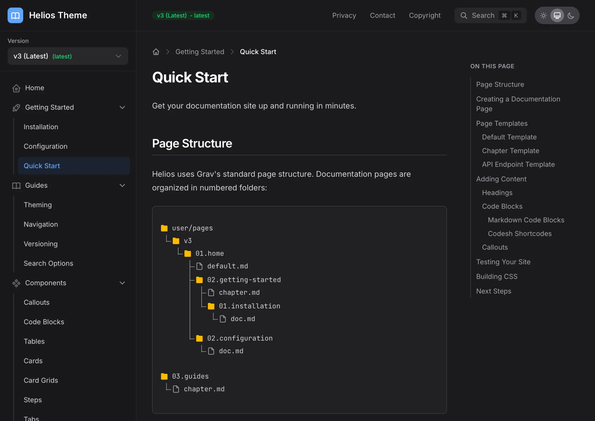

# Helios

``

> [!IMPORTANT] Важно
> Продукты Grav Premium требуют бесплатный плагин [License Manager](../license-manager/index.md). Установите его и добавьте лицензию продукта, прежде чем устанавливать этот продукт.

## Установка

Сначала убедитесь, что у вас установлена последняя версия **Grav 1.7** (`-f` принудительно обновляет индекс GPM).

```
$ bin/gpm selfupgrade -f
```

У темы Helios есть несколько зависимостей, расширяющих её возможности. Установите тему через GPM и подтвердите установку зависимостей, когда появится запрос:

```
$ bin/gpm install helios
```

Также тему можно установить в разделе **Темы** плагина админки.

### Обязательные и рекомендуемые плагины

Helios лучше всего работает со следующими плагинами:

| Плагин | Обязателен | Описание |
|--------|----------|-------------|
| SimpleSearch | Да | Обеспечивает базовый поиск с поддержкой сочетаний клавиш |
| SVG Icons | Да | Требуется для элементов интерфейса темы и поддержки иконок повсюду |
| Github Markdown Alerts | Рекомендуется | Требуется для поддержки врезок |
| Shortcode Core | Рекомендуется | Включает синтаксис шорткодов для врезок, вкладок и других компонентов |
| Codesh | Рекомендуется | Серверная подсветка синтаксиса: более 200 языков и более 70 тем VS Code |
| Page TOC | Рекомендуется | Создаёт оглавление по заголовкам |
| API Doc Import | Необязателен | Импортирует спецификации OpenAPI/Swagger как страницы документации API |

Установите обязательные и рекомендуемые плагины через GPM:

```
$ bin/gpm install simplesearch svg-icons github-markdown-alerts shortcode-core codesh page-toc
```

Для фич документации API дополнительно установите:

```
$ bin/gpm install api-doc-import
```

## Пакеты-скелеты

Ищете демонстрационные пакеты-скелеты Helios, чтобы быстро начать? Вы можете [скачать их напрямую с GitHub](https://github.com/trilbymedia/grav-skeleton-helios-site?target=_blank) и следовать инструкциям в файле [README.md](https://github.com/trilbymedia/grav-skeleton-helios-site/blob/develop/README.md) репозитория.

<div class="premium__skeletons">
    <a href="https://github.com/trilbymedia/grav-skeleton-helios-site" target="_blank">
        <figure>
            
            <figcaption>Демо-скелет Helios</figcaption>
        </figure>
    </a>
</div>

Самый быстрый способ скачать файлы — нажать зелёную кнопку **Code**, а затем **Download ZIP**.

``

## Конфигурация

Helios гибко настраивается через админку или редактированием `user/config/themes/helios.yaml`. Множество параметров организовано в логические разделы.

### Конфигурация на уровне темы

#### Параметры оформления

Helios полностью поддерживает светлую и тёмную темы с автоматическим определением системных предпочтений.

* **Тема** → Настройте Helios на использование текущего параметра `System` (следует предпочтению ОС), `Light` или `Dark`.

* **Переключатель для пользователя** → Включает или отключает кнопку переключения темы в шапке.

* **Запоминать выбор** → Если включено, выбор темы пользователем сохраняется в localStorage между визитами.

* **Режим cookie** → Использовать cookie вместо localStorage для хранения предпочтения темы.

#### Настройка цветов

Helios предоставляет CSS-переменные цветов, которые можно настроить под свой бренд. Настройте цвета в параметрах темы:

```yaml
colors:
  # Светлая тема
  primary: '#3B82F6'           # Основной цвет бренда (светлая тема)
  primary_hover: '#2563EB'     # Состояние наведения для основного цвета
  primary_text: '#FFFFFF'      # Цвет текста на основном фоне (например, кнопки)
  accent: '#8B5CF6'            # Акцентный цвет для выделений
  # Тёмная тема
  primary_dark: '#60A5FA'      # Основной цвет для тёмной темы
  primary_dark_hover: '#93C5FD'  # Состояние наведения в тёмной теме
  primary_dark_text: '#111827' # Текст на основном фоне в тёмной теме
  accent_dark: '#A78BFA'       # Акцентный цвет в тёмной теме
```

Параметры `primary_text` и `primary_dark_text` управляют цветом текста на фоне основного цвета (например, на залитых кнопках). Меняйте их, если основному цвету нужен другой контраст: используйте светлый текст на тёмном основном цвете и тёмный текст на светлом основном цвете.

Они соответствуют CSS-переменным, которые можно переопределить напрямую в своём CSS:

```css
:root {
    --helios-color-primary: #3B82F6;
    --helios-color-primary-hover: #2563EB;
    --helios-color-primary-text: #FFFFFF;
    --helios-color-primary-dark: #60A5FA;
    --helios-color-primary-dark-hover: #93C5FD;
    --helios-color-primary-dark-text: #111827;
}
```

#### Настройка шрифтов

Настройте шрифты основного текста и кода:

```yaml
fonts:
  body: inter           # inter, open-sans, nunito-sans, work-sans, public-sans, quicksand
  code: jetbrains-mono  # Моноширинный шрифт для блоков кода
```

Доступные варианты шрифтов: Inter, Open Sans, Nunito Sans, Work Sans, Public Sans и Quicksand.

#### Размер шрифта

Helios поддерживает три пресета размера шрифта:

| Размер | Описание |
|------|-------------|
| `small` | Компактный размер для плотной документации |
| `medium` | По умолчанию, сбалансированный размер |
| `large` | Увеличенный текст для лучшей читаемости |

#### Логотип и брендирование

```yaml
logo:
  image: 'user://assets/logo.svg'  # Путь к изображению логотипа (рекомендуется SVG)
  text: 'My Docs'                  # Резервный текст, если нет изображения
  height: h-8                      # Класс высоты Tailwind

custom_favicon: 'user://assets/favicon.png'  # Свой favicon
```

#### Параметры навигации

Настройте боковую панель, область содержимого и оглавление:

```yaml
navigation:
  sidebar_width: 280    # Ширина боковой панели в пикселях
  content_width: 768    # Максимальная ширина содержимого в пикселях
  toc_width: 240        # Ширина оглавления в пикселях
  toc_position: right   # right, left или hidden
  toc_start: 2          # Начальный уровень заголовков (1=h1, 2=h2)
  toc_depth: 3          # Сколько уровней заголовков включать
  breadcrumbs: true     # Показывать хлебные крошки
  prev_next: true       # Показывать ссылки «назад/далее» внизу
  scroll_spy: true      # Подсвечивать текущий раздел в оглавлении
```

##### Навигация в боковой панели

Боковая панель автоматически отражает структуру страниц. Страницы упорядочиваются по префиксу папки:

```text
user/pages/
├── 01.getting-started/    # Отображается первой
├── 02.guides/             # Отображается второй
└── 03.api/                # Отображается третьей
```

##### Управление видимостью страниц

Скройте страницу из навигации с помощью метаданных страницы:

```yaml
---
title: Hidden Page
visible: false
---
```

Или используйте `routable: false`, чтобы страница не была доступна по маршруту, но оставалась видимой в боковой панели.

##### Свои подписи в меню

Переопределите заголовок, отображаемый в навигации, с помощью `menu` в метаданных страницы:

```yaml
---
title: Getting Started with Helios Documentation Theme
menu: Getting Started
---
```

#### Меню в шапке

Добавьте ссылки навигации в шапку:

```yaml
header:
  menu:
    - route: '/changelog'
      label: 'Changelog'
    - route: 'https://github.com/your/repo'
      label: 'GitHub'
      external: true
```

#### Настройка поиска

Helios по умолчанию интегрируется с SimpleSearch и поддерживает сочетания клавиш:

```yaml
search:
  enabled: true
  provider: simplesearch    # simplesearch или yetisearch
  keyboard_shortcut: true   # Включить Cmd+K / Ctrl+K
  placeholder: 'Search documentation...'
  min_chars: 2              # Минимум символов до начала поиска
```

Для больших сайтов документации перейдите на YetiSearch Pro с расширенным нечётким поиском:

```yaml
search:
  provider: yetisearch
```

#### Настройка версионирования

Включите версионирование документации на основе папок:

```yaml
versioning:
  enabled: true
  mode: explicit           # explicit (все с префиксом) или implicit (текущая без префикса)
  auto_detect: true        # Автоопределение папок версий
  root: ''                 # Корневая папка с версиями (пусто = корень сайта)
  default_version: v3      # Версия по умолчанию / последняя
  current_version: v3      # Текущая версия для режима implicit
  version_pattern: '/^v?\d+(\.\d+)*$/'  # Регулярное выражение для определения версии
  show_badge: true         # Показывать значок версии в шапке
  show_dropdown: true      # Показывать выпадающий список версий в боковой панели
  labels:                  # Свои подписи
    v1: 'v1 (Legacy)'
    v2: 'v2 (Stable)'
    v3: 'v3 (Latest)'
```

##### Структура папок

Организуйте документацию по версиям:

```text
user/pages/
├── v1/
│   ├── getting-started/
│   ├── guides/
│   └── api/
├── v2/
│   ├── getting-started/
│   ├── guides/
│   └── api/
└── v3/
    ├── getting-started/
    ├── guides/
    └── api/
```

##### Переключатель версий

Когда версионирование включено, в боковой панели появляется выпадающий список для переключения версий. Helios старается сохранить путь URL при переключении: если вы на `/v2/guides/theming`, переключение на v3 приведёт на `/v3/guides/theming`, если такая страница существует.

#### Интеграция с GitHub

Свяжите документацию с репозиторием GitHub:

```yaml
github:
  enabled: true
  repo: 'your-org/your-repo'
  branch: main
  edit_link: true           # Показывать ссылки «Редактировать эту страницу»
  edit_text: 'Edit this page'
```

#### Навигация HTMX (экспериментально)

Включите навигацию в стиле SPA, загружающую контент через XHR:

```yaml
htmx:
  enabled: true
```

Когда она включена, переходы между страницами происходят без полной перезагрузки, что делает работу удобнее.

### Полный пример конфигурации

Вот полный файл конфигурации:

```yaml
enabled: true

appearance:
  theme: system
  selector: true
  storage: true

colors:
  primary: '#3B82F6'
  primary_hover: '#2563EB'
  primary_text: '#FFFFFF'
  accent: '#8B5CF6'
  primary_dark: '#60A5FA'
  primary_dark_hover: '#93C5FD'
  primary_dark_text: '#111827'
  accent_dark: '#A78BFA'

fonts:
  body: inter
  code: jetbrains-mono

logo:
  text: 'My Documentation'
  height: h-8

header:
  menu:
    - route: '/changelog'
      label: 'Changelog'

navigation:
  sidebar_width: 280
  content_width: 768
  toc_position: right
  toc_depth: 3
  breadcrumbs: true
  prev_next: true
  scroll_spy: true

search:
  enabled: true
  provider: simplesearch
  keyboard_shortcut: true

versioning:
  enabled: false

github:
  enabled: false

api:
  enabled: true

htmx:
  enabled: false
```

## Компоненты

Helios включает богатый набор компонентов для технической документации. Большинство компонентов используют синтаксис шорткодов, предоставляемый плагином Shortcode Core.

### Врезки

Врезки (оповещения и примечания) используют синтаксис Markdown в стиле GitHub:

```markdown
> [!NOTE]
> Useful information that users should know.

> [!TIP]
> Helpful advice for doing things better.

> [!IMPORTANT]
> Key information users need to know.

> [!WARNING]
> Urgent info that needs immediate attention.

> [!CAUTION]
> Advises about risks or negative outcomes.
```

Внутри врезок поддерживается полноценный Markdown, включая форматирование, списки и блоки кода.

### Блоки кода

Helios использует [плагин Codesh](https://github.com/trilbymedia/grav-plugin-codesh) для серверной подсветки синтаксиса. Codesh предоставляет:

* **Более 200 языков** благодаря грамматикам TextMate
* **Более 70 тем VS Code**, включая GitHub, Dracula, Nord, One Dark Pro
* **Номера строк** с настраиваемым начальным номером
* **Подсветка строк** и режим фокуса
* **Визуализация diff** для показа изменений
* **Группы кода** с синхронизированными вкладками

#### Базовая подсветка синтаксиса

Используйте стандартные блоки кода Markdown или шорткод `[codesh]`:

````markdown
```javascript
function greet(name) {
    return `Hello, ${name}!`;
}
```
````

#### Подсветка строк

Подсветите нужные строки, чтобы привлечь внимание:

```text
[codesh lang="javascript" line-numbers="true" highlight="2,4-6"]
function processData(data) {
    const filtered = data.filter(item => item.active);

    const mapped = filtered.map(item => ({
        id: item.id,
        name: item.name.toUpperCase()
    }));

    return mapped;
}
[/codesh]
```

#### Группы кода

Покажите несколько примеров кода в интерфейсе с вкладками:

```text
[codesh-group]
[codesh lang="javascript" title="JavaScript"]
const greeting = 'Hello, World!';
[/codesh]
[codesh lang="python" title="Python"]
greeting = "Hello, World!"
[/codesh]
[codesh lang="php" title="PHP"]
$greeting = "Hello, World!";
[/codesh]
[/codesh-group]
```

Используйте атрибут `sync`, чтобы синхронизировать выбор вкладки между несколькими группами кода на странице.

### Вкладки

Вкладки организуют контент в переключаемые панели:

```text
[doc-tabs]
[doc-tab title="Preview"]
This is the preview content.
[/doc-tab]
[doc-tab title="Code"]
This is the code content.
[/doc-tab]
[/doc-tabs]
```

Добавьте `sync-labels=true`, чтобы синхронизировать вкладки с одинаковыми подписями на всей странице:

```text
[doc-tabs sync-labels=true]
[doc-tab title="macOS"]
Instructions for macOS...
[/doc-tab]
[doc-tab title="Windows"]
Instructions for Windows...
[/doc-tab]
[doc-tab title="Linux"]
Instructions for Linux...
[/doc-tab]
[/doc-tabs]
```

### Шаги

Покажите пронумерованные шаги руководства:

```text
[doc-steps]
[doc-step title="Install dependencies"]
Run `npm install` to install all required packages.
[/doc-step]
[doc-step title="Configure settings"]
Edit `config.yaml` with your preferences.
[/doc-step]
[doc-step title="Start development"]
Run `npm run dev` to start the development server.
[/doc-step]
[/doc-steps]
```

### Карточки и сетки

Создавайте макеты на основе карточек:

```text
[doc-grid columns=3]
[doc-card title="Getting Started" icon="tabler/rocket.svg"]
Quick introduction to get up and running.
[/doc-card]
[doc-card title="Configuration" icon="tabler/settings.svg"]
Detailed configuration options.
[/doc-card]
[doc-card title="API Reference" icon="tabler/code.svg"]
Complete API documentation.
[/doc-card]
[/doc-grid]
```

`columns` принимает значения от `1` до `4`, по умолчанию `2`. Это максимум, а не фиксированное число: на телефонах сетка всегда в одну колонку, на планшетах — в две, и только на экранах шириной 1024px и больше разворачивается в три-четыре колонки. Сетка из трёх колонок, которая выглядит как двухколоночная, обычно означает просто узкое окно браузера.

### Кнопки

Оформленные кнопки для призывов к действию, навигационных ссылок и интерактивных триггеров:

```text
[doc-button label="Get Started" link="/getting-started"]
[doc-button label="Learn More" link="/guides" style="bordered"]
[doc-button label="Cancel" link="#" color="plain"]
```

Кнопки поддерживают несколько параметров:

* **Стили** → `default` (залитая), `bordered` (контурная)
* **Цвета** → `default` (основной), `blue`, `green`, `yellow`, `red`, `purple`, `plain` (нейтральный серый)
* **Размеры** → `sm`, `default`, `lg`, `xl`
* **Иконки** → Добавляйте иконки слева и справа через `icon-left` и `icon-right` (например, `tabler/arrow-right.svg`)
* **Ссылки** → Задайте `link` для тега `<a>` или опустите его для элемента `<button>` (полезно для триггеров JS)
* **Новая вкладка** → `new-tab=true` открывает ссылку в новой вкладке
* **Центрирование** → `center=true` помещает кнопку в контейнер с выравниванием по центру
* **Атрибуты data** → `data-attr` и `data-val` для интерактивности на JavaScript

Цвет основной кнопки по умолчанию учитывает параметры цвета `primary_text` и `primary_dark_text`, обеспечивая правильный контраст при любом выбранном основном цвете.

### Значки

Встроенные метки статуса для подписей, тегов и индикаторов:

```text
[doc-badge label="New"]
[doc-badge label="Stable" color="green"]
[doc-badge label="Deprecated" color="red" style="outline"]
[doc-badge label="Beta" color="purple" icon="tabler/flask.svg"]
```

Параметры:

* **Цвета** → `default` (основной), `blue`, `green`, `yellow`, `red`, `purple`, `plain`
* **Стили** → `filled` (по умолчанию), `outline`
* **Размеры** → `default`, `sm`
* **Иконки** → Необязательная иконка перед подписью

### Всплывающие подсказки

Всплывающие подсказки при наведении и фокусе для определений терминов в тексте:

```text
The [doc-tooltip tip="HyperText Markup Language"]HTML[/doc-tooltip] specification defines...

Use [doc-tooltip tip="Cascading Style Sheets" style="highlight"]CSS[/doc-tooltip] for styling.
```

Стили: `underline` (пунктирное подчёркивание, по умолчанию), `highlight` (тонированный фон), `plain` (без оформления).

### Карточки-ссылки

Показывайте карточки-превью ссылок для внешних ресурсов или связанных страниц:

```text
[doc-link-card href="https://getgrav.org" title="Grav CMS" description="Modern open-source flat-file CMS" icon="tabler/brand-github.svg"]
```

Параметры:

* **href** → URL для ссылки (обязательный)
* **title** → Заголовок карточки (обязательный)
* **description** → Короткое описание
* **icon** → Путь к иконке (например, `tabler/star.svg`)
* **new-tab** → Открывать в новой вкладке (по умолчанию: `true`)

### Раскрывающиеся блоки

Простые сворачиваемые разделы на нативном HTML-элементе `<details>` — легче полноценного аккордеона:

```text
[doc-details title="Click to expand"]
Hidden content revealed on click.
[/doc-details]

[doc-details title="Open by default" open=true]
This section starts expanded.
[/doc-details]
```

### Клавиши клавиатуры

Оформленные клавиши клавиатуры для описания сочетаний. Поддерживаются составные клавиши с `+` и символы модификаторов Mac (`⌘`, `⌥`, `⇧`, `⌃`):

```text
Press [doc-kbd key="Ctrl+C"] to copy.

Mac: [doc-kbd key="⌘+S"] to save.

[doc-kbd key="Ctrl+Shift+P"] opens the command palette.
```

### Копирование текста

Текст в строке с кнопкой копирования в буфер обмена в один клик. Работает в абзацах, таблицах, списках — где угодно:

```text
Install with [doc-copy text="composer require getgrav/grav-theme-helios"] and configure.

The config file is at [doc-copy text="user/config/system.yaml"].
```

Также поддерживается контейнерная форма: `[doc-copy]some text[/doc-copy]`

### Дерево файлов

Показывайте структуру папок с автоматически подобранными иконками:

```text
[doc-file-tree]
user/themes/helios/
├── css/
│   ├── site.css
│   └── custom/
├── js/
│   └── main.js
├── templates/
│   ├── default.html.twig
│   └── partials/
└── helios.yaml
[/doc-file-tree]
```

### Иконки

Более 30 000 иконок из Tabler, Heroicons, Bootstrap, Lucide и других наборов доступны через плагин SVG Icons.

Используйте их в шаблонах Twig:


```twig
{{ svg_icon('tabler/star.svg', 'w-6 h-6 text-yellow-500') }}
```


Включённые популярные наборы иконок:
* **Tabler** — более 5 000 иконок с открытым исходным кодом
* **Heroicons** — красивые вручную созданные иконки SVG
* **Lucide** — красивый и целостный набор иконок
* **Bootstrap Icons** — официальная библиотека иконок Bootstrap

### Изображения

Оформленные изображения с необязательной рамкой, тенью, подписью и увеличением в лайтбоксе:

```text
[doc-image src="screenshot.png" alt="Screenshot" caption="Dashboard view" border=true shadow=true]

[doc-image src="diagram.png" alt="Architecture" lightbox=false width="400px"]
```

`src` разрешается так же, как у обычного изображения Markdown. Голое имя файла вроде `screenshot.png` должно быть файлом в папке самой страницы; также можно указать путь от корня сайта (`/user/images/screenshot.png`), поток (`theme://images/screenshot.png`) или полный внешний URL. Учтите, что `screenshot.png` и `diagram.png` выше — имена-заглушки, поэтому вставленный без изменений пример даст битое изображение, пока вы не укажете в `src` реально существующий файл.

Параметры:

* **border** → Добавить тонкую рамку вокруг изображения
* **shadow** → Добавить тень
* **caption** → Подпись под изображением
* **lightbox** → Наложение с увеличением по клику (по умолчанию: `true`)
* **width** → Ограничение максимальной ширины (например, `400px` или `50%`)

### Видео

Адаптивные встраиваемые видео с YouTube, Vimeo или локальных файлов:

```text
[doc-video url="https://www.youtube.com/watch?v=dQw4w9WgXcQ" title="Demo Video"]

[doc-video src="demo.mp4" ratio="16:9" autoplay=true muted=true loop=true]
```

Параметры:

* **url** → URL YouTube или Vimeo
* **src** → Путь к локальному видеофайлу
* **ratio** → Соотношение сторон: `16:9` (по умолчанию), `4:3`, `1:1`, `9:16`
* **autoplay**, **loop**, **muted** → Параметры воспроизведения для локальных видео

## Доработка темы

### Создание своей темы на основе Helios

Если вы хотите изменить шаблоны Twig, CSS и т. д., настоятельно рекомендуется создать новую тему на основе Helios. Чтобы создать свою тему, установите плагин `devtools`:

```shell
bin/plugin devtools new-theme
```

Когда появится запрос, выберите **copy** и укажите **Helios** как тему для копирования. Будет создана полная копия Helios, которую можно свободно изменять, сохраняя возможность обновлять исходную тему Helios.

### Изменение CSS

Helios построен на [TailwindCSS 4](https://tailwindcss.com/), поэтому хорошо настраивается через CSS-переменные и конфигурацию.

#### Установка NPM для компиляции CSS

> [!TIP] Совет
> **Нет доступа к терминалу или NPM?** Если вы работаете на **Grav 2** с новой панелью **Admin Next (Admin2)**, можно вообще обойтись без цепочки инструментов Node. Установите бесплатный [**плагин Tailwind4**](https://github.com/trilbymedia/grav-plugin-tailwind4) и компилируйте Tailwind CSS для Helios прямо из админки одной кнопкой — без `npm install` и без шага сборки. Он сканирует вашу тему, страницы, конфигурацию и шаблоны плагинов на классы Tailwind, компилирует CSS на чистом PHP и записывает результат по тому же пути, который использует сборка npm, так что в шаблонах ничего менять не нужно. Helios полностью с ним совместим. Остальная часть раздела описывает традиционный рабочий процесс с NPM, который по-прежнему работает, если он вам больше нравится.

Установка NPM зависит от вашей платформы. Следуйте официальной [инструкции по установке NPM](https://docs.npmjs.com/downloading-and-installing-node-js-and-npm). После установки:

```shell
cd user/themes/helios
npm install
```

#### Разработка собственного CSS

Для разработки с автоматической перекомпиляцией:

```shell
npm run dev
```

Для production-сборки:

```shell
npm run prod
```

#### Настройка макета

Настройте ширину боковой панели и оглавления через CSS-переменные:

```css
@theme {
    --spacing-sidebar: 300px;  /* По умолчанию 280px */
    --spacing-toc: 260px;      /* По умолчанию 240px */
}
```

### Изменение шаблонов Twig

Большинство изменений — это правка [шаблонов Twig](https://twig.symfony.com/doc/3.x/templates.html) в папке `templates/`. Структура шаблонов включает:

```text
templates/
├── default.html.twig       # Базовый шаблон страницы
├── doc.html.twig           # Шаблон страницы документации
├── chapter.html.twig       # Шаблон главы/раздела
├── api-endpoint.html.twig  # Шаблон документации API
└── partials/
    ├── base.html.twig      # Базовая структура HTML
    ├── header.html.twig    # Шапка с логотипом и навигацией
    ├── sidebar.html.twig   # Навигация в левой боковой панели
    ├── toc.html.twig       # Оглавление
    ├── breadcrumbs.html.twig
    └── footer.html.twig
```

Чтобы переопределить шаблон, скопируйте его в свою тему и измените по необходимости.

### Использование иконок SVG

Иконки доступны через плагин SVG Icons. Используйте их в шаблонах Twig:


```twig
{{ svg_icon('tabler/home.svg', 'w-5 h-5 stroke-current') }}
```


Или в Markdown через шорткоды (если плагин SVG Icons настроен для шорткодов):

```text
[svg-icon icon="tabler/rocket.svg" classes="w-6 h-6"]
```

## Поддерживаемые типы страниц

Helios поставляется с несколькими шаблонами страниц:

### Стандартные типы страниц

* **default** → Стандартная страница с областью содержимого
* **doc** → Страница документации с боковой панелью, содержимым и оглавлением
* **chapter** → Страница раздела или категории, объединяющая дочерние страницы

### Документация API

* **api-endpoint** → Документация эндпоинта API с метками методов, параметрами и примерами ответов
* **api-collection** → Модульная родительская страница, рендерящая группу связанных эндпоинтов на одной странице

Шаблоны документации API включают:
* метки методов HTTP (GET, POST, PUT, DELETE и т. д.)
* отображение пути эндпоинта
* таблицы параметров с типами и описаниями
* примеры запросов и ответов с подсветкой синтаксиса
* сгруппированные эндпоинты на одной странице с автоматически созданным оглавлением для быстрого перехода

## Документация API {: #api-documentation-1 }

Helios включает отдельные шаблоны для документации API:

### Страницы API вручную

Создавайте страницы эндпоинтов API с помощью шаблона `api-endpoint`:

```yaml
---
title: Get User
template: api-endpoint
api:
  method: GET
  path: /users/{id}
  description: Retrieve a user by their unique identifier
  parameters:
    - name: id
      in: path
      required: true
      type: string
      description: The unique user identifier
  responses:
    200:
      description: Successful response
---
```

### Коллекции API

Для больших API часто удобнее собрать связанные эндпоинты (например, все эндпоинты `User` или все эндпоинты `Store`) на **одной странице**, а не разносить каждый по отдельной странице. Шаблон `api-collection` делает именно это: это модульная родительская страница, которая рендерит каждый дочерний эндпоинт прямо в себе, с краткой сводкой для быстрого перехода и оглавлением со слежением за прокруткой, где у каждого пункта есть метка метода HTTP.

#### Структура папок {: #folder-structure-1 }

Создайте папку для группы, добавьте родительскую `api-collection.md` и разместите каждый эндпоинт в **модульной** дочерней папке (имя папки с префиксом подчёркивания):

```text
user/pages/api/
└── 03.user/
    ├── api-collection.md           # Родительская страница группы (шаблон: api-collection)
    ├── _01.create-user/
    │   └── api-endpoint.md         # Рендерится прямо в странице как раздел
    ├── _02.user-login/
    │   └── api-endpoint.md
    ├── _03.get-user/
    │   └── api-endpoint.md
    └── _04.delete-user/
        └── api-endpoint.md
```

#### Родительская страница коллекции

Родительская страница объявляет группу, необязательную иконку и описание и подключает свои модульные дочерние страницы:

```yaml
---
title: User
template: api-collection
icon: tabler/user.svg
description: Endpoints for managing user accounts and sessions.
content:
  items: '@self.modules'
---

Optional overview copy rendered above the endpoint sections.
```

Дочерние страницы `api-endpoint.md` используют ту же схему метаданных, что и отдельные страницы эндпоинтов, — менять ничего не нужно, поэтому один и тот же файл можно переносить между отдельным макетом и макетом на основе коллекции без правок.

#### Параметры

Поведение вывода настраивают несколько флагов в заголовках родительской страницы:

| Параметр        | По умолчанию | Описание |
|-----------------|---------|-------------|
| `show_summary`  | `false` | Рендерить внутри содержимого список эндпоинтов для быстрого перехода. По умолчанию отключено, так как правое оглавление уже перечисляет все эндпоинты с метками методов. |
| `summary_title` | `Endpoints in this group` | Заголовок, отображаемый над сводкой внутри содержимого. |
| `icon`          | _(нет)_ | Путь Tabler/Heroicons (например, `tabler/user.svg`), отображаемый рядом с заголовком страницы. |
| `description`   | _(нет)_ | Короткий подзаголовок под заголовком страницы. |

Каждый раздел эндпоинта получает якорь по слагу дочерней папки, поэтому пункты оглавления (и любые ссылки `#slug` в вашем Markdown) ведут прямо к нужному эндпоинту. Отступы заголовков автоматически учитывают закреплённую шапку.

### Импорт OpenAPI

Для больших API используйте плагин API Doc Import, чтобы создавать документацию из спецификаций OpenAPI/Swagger:

```
bin/gpm install api-doc-import
bin/plugin api-doc-import import --file openapi.yaml --output user/pages/api
```

Это автоматически создаёт страницы документации для всех эндпоинтов вашей спецификации.

## Советы и рекомендации

### Структура документации

* Поддерживайте единообразную структуру папок во всех версиях
* Используйте числовые префиксы для порядка (01.intro, 02.getting-started)
* Используйте `chapter.md` для целевых страниц разделов
* Делайте слаги страниц короткими и описательными

### Написание контента

* Используйте врезки умеренно (не более 1–2 на страницу)
* Добавляйте примеры кода для всех параметров конфигурации
* Давайте и простые, и продвинутые примеры
* Связывайте ссылками связанные страницы документации

### Производительность

* Включите навигацию HTMX для более быстрых переходов между страницами
* Используйте YetiSearch Pro для больших сайтов документации
* Оптимизируйте изображения перед добавлением в документацию
* Рассмотрите ленивую загрузку блоков кода на страницах с множеством примеров

### SEO

* Пишите описательные заголовки страниц и метаописания
* Правильно используйте иерархию заголовков (h1 > h2 > h3)
* Добавляйте хлебные крошки для лучших сигналов навигации
* Следите, чтобы у всех страниц был уникальный и релевантный контент
