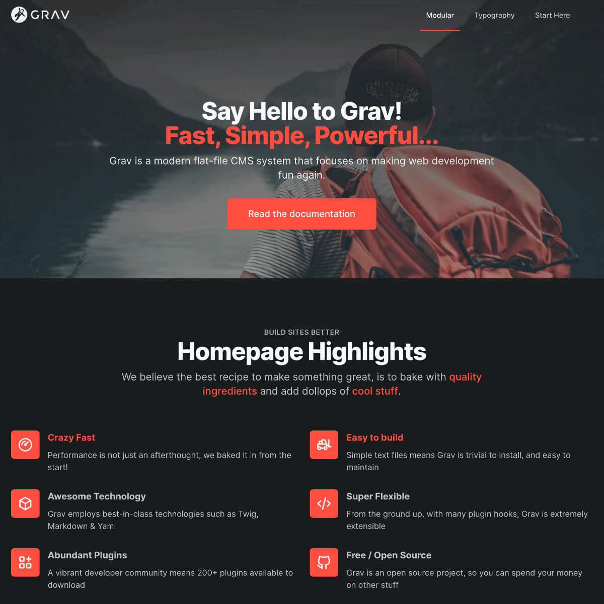
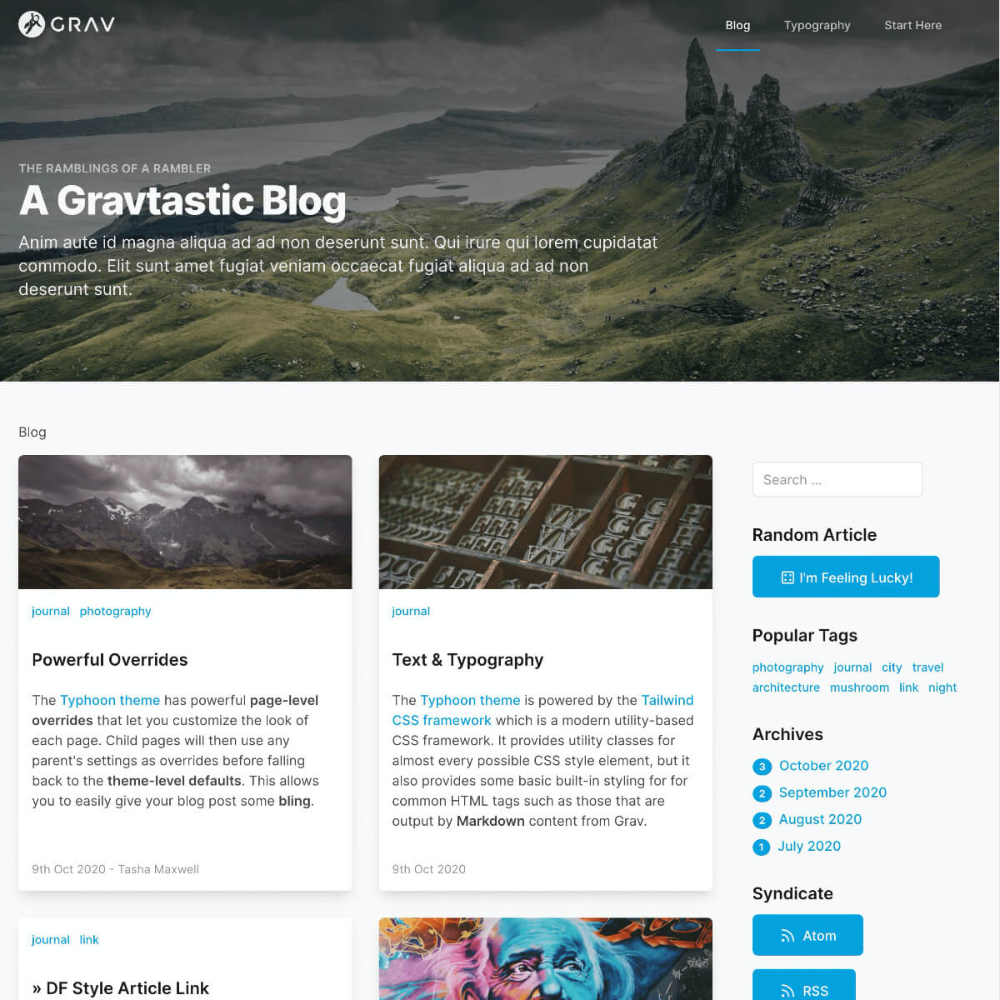
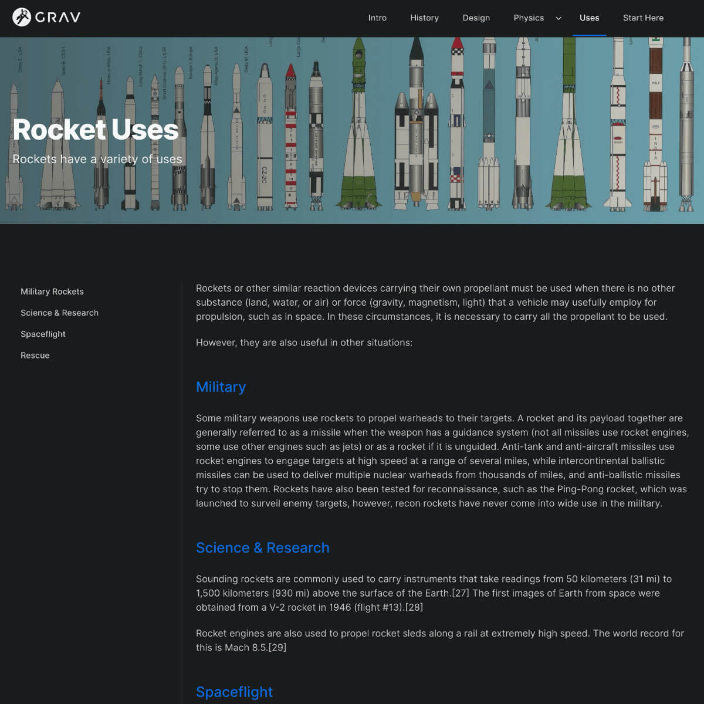

# Typhoon {: #typhoon }

``

> [!IMPORTANT] Важно
> Продуктам Premium нужен бесплатный плагин [License Manager](../license-manager/index.md). Установите его и добавьте лицензию продукта перед установкой этого продукта.

## Установка {: #installation }

Сначала убедитесь, что у вас последняя версия **Grav 1.7** (`-f` принудительно обновляет индекс GPM).

```
$ bin/gpm selfupgrade -f
```

Тема Typhoon использует несколько других плагинов для полной работы: **color-tools**, **svg-icons**, **shortcode-core**. Они доступны через GPM, а поскольку у плагина есть зависимости, просто установите тему Typhoon и подтвердите установку остальных, когда вас спросят:

```
$ bin/gpm install typhoon
```

Тему также можно установить через раздел **Themes** в плагине админки.

## Обновление {: #upgrading }

Из-за природы этой темы мы не рекомендуем изменять её напрямую: всегда создавайте **копию** темы, как [описано в разделе «Создание собственной темы на основе Typhoon» ниже](#create-a-custom-theme-from-typhoon). Причина в том, что при **обновлении** темы все файлы темы из нового пакета перезапишут внесённые изменения. Создав собственную тему на основе Typhoon, вы всё равно сможете обновлять Typhoon, не боясь за свои изменения, а затем легко сравнить изменения с собственной темой и вручную перенести нужное инструментом diff/merge.

### ВАЖНО: обновление Typhoon 2.x до Typhoon 4+ {: #important-upgrading-typhoon-2-x-to-typhoon-4 }

При обновлении с Typhoon 2.x до Typhoon 4+ изменения значительны, и хотя в последней версии есть несколько новых файлов, требуется ручная очистка.

Typhoon 4 полностью переработан под TailwindCSS 4 из-за фундаментальных архитектурных изменений во фреймворке. Поэтому после обновления с Typhoon 2.x до Typhoon 4+ останутся лишние файлы, которые больше не нужны и их можно удалить.

**Удалите вручную эти файлы:**

* `/postcss.config.js` (перенесён в vite для сборки Tailwind)
* `/tailwind.config.js` (перенесён в `/css/site.css` для конфигурации Tailwind 4 на CSS-переменных)
* `/tailwind-full.config.js` (не используется)
* `/css/custom/bugs.css` (больше не нужен, Safari больше не требует этого исправления)
* `/css/custom/dark.css` (тёмные стили перенесены в `/css/custom/typography.css`)
* `/css/custom/social.css` (переведён на CSS-переменные, остальное перенесено в `/css/custom/typography.css`)
* `/js/alpine.js` (заменён последним `/js/alpine.js.min`)

### Обновление существующей темы Typhoon 2.x до TailwindCSS 4+ {: #upgrading-an-existing-typhoon-2-x-theme-to-tailwin }

Если вы уже создавали собственную тему на Tailwind и хотите обновить её до TailwindCSS 4+, я написал короткую и ясную статью в блоге: [TailwindCSS 4.0 upgrade for Typhoon Premium Theme](https://getgrav.org/blog/tailwindcss4-upgrade-for-typhoon-premium-theme), где подробно разобрана эта тема.

## Пакеты-скелеты {: #skeleton-packages }

Ищете пакеты-скелеты Typhoon для быстрого старта? Их можно **скачать прямо с GitHub** и следовать инструкциям в `README.md` каждого репозитория.

<div class="grid cards" markdown>

-   __[Одностраничный скелет](https://github.com/trilbymedia/grav-skeleton-typhoon-onepage)__

    

-   __[Скелет блога](https://github.com/trilbymedia/grav-skeleton-typhoon-blog)__

    

-   __[Скелет Rockets](https://github.com/trilbymedia/grav-skeleton-typhoon-rockets)__

    

</div>

Самый быстрый способ скачать файлы — нажать зелёную кнопку **Code**, затем **Download ZIP**.

``

## Конфигурация {: #configuration }

У темы Typhoon много параметров настройки. Они разбиты на организованные разделы, но есть и несколько уровней их переопределения. Например, у самой темы есть набор значений «по умолчанию», которые задают значения для всего сайта. Затем многие из этих настроек можно переопределить на уровне отдельной страницы. Если сделать это на родительской странице с дочерними, дочерние унаследуют переопределения родителя, но их можно переопределить ещё дальше. Это даёт очень гибкую архитектуру; простой пример — возможность задать основной цвет, уникальный для каждой страницы верхнего уровня.

### Настройка на уровне темы {: #theme-level-configuration }

#### Значения темы по умолчанию {: #theme-defaults }

``

Typhoon из коробки поставляется со светлой и тёмной темами.

* **Theme** → Можно настроить Typhoon на текущую настройку `System` (то есть если на компьютере уже выбрана конкретная опция или тема автоматически переключается между светлой и тёмной в зависимости от времени суток), `Light` или `Dark`.

* **User Selector** → Включает или выключает переключатель для переопределения темы в подвале сайта.

* **Remember Selection** → Когда включено, используется локальное хранилище, чтобы предпочитаемая пользователем тема запоминалась между визитами. Когда выключено, она помнится только в текущей сессии.

* **Append Site Title to HTML Title** → Удобная опция, которая автоматически добавляет настроенный Meta Site Title в HTML-заголовок на всех страницах.

#### Цвета по умолчанию {: #default-colors }

``

Есть разные параметры цвета. Этот раздел настраивает цвета по умолчанию, используемые по всему сайту.

* **Text Color** → Цвет основного текстового содержимого. Может быть любым допустимым цветом Tailwind, например `text-primary`, `text-gray-800`, `text-blue-700` и так далее. Подробнее — в документе [Доступные классы цветов](./) или в [документации Tailwind](https://tailwindcss.com/docs/text-color?target=_blank).

* **Primary Color** → Основной акцентный цвет сайта. Обычно используется для заголовков, ссылок и фонов, где нужен контраст. Должен быть допустимым HEX-цветом.

* **Lighter Brightness** → У основного цвета есть вариант `lighter` (например, `text-primary-lighter`). Насколько он светлее, зависит от этого значения.

* **Darker Brightness** → У основного цвета есть вариант `darker` (например, `text-primary-darker`). Насколько он темнее, зависит от этого значения.

#### Макет по умолчанию {: #layout-defaults }

``

Эти параметры дают контроль над структурой макета через классы Tailwind.

* **Body Classes** → Эти классы задают класс на уровне тега `<body>`, который используется на каждой странице. Их можно задавать или переопределять на уровне страницы.

* **Wrapper Classes** → Классы обёртки управляют максимальной шириной контейнера и отступами. Tailwind — mobile-first фреймворк, поэтому значения по умолчанию рассчитаны на самый маленький экран, а большие экраны получают префикс контрольной точки. Например, `md:px-6 px-4` означает отступ 4 по умолчанию для маленьких экранов и 6 для средних и больше.

* **Section Classes** → Управляют классами по умолчанию для секции. Секцией может быть вся страница или модульная страница.

#### Настройка меню {: #menu-configuration }

``

* **Primary Menu Location** → По умолчанию меню находится в **Header**. Но можно выбрать и **Sidebar**.

* **Primary Header Levels** → Число уровней в основном меню. Более глубокие уровни показываются в боковой навигации. Действует только для основного меню «header».

* **Display Mobile Navigation** → Показывать меню-гамбургер для мобильной навигации на маленьких устройствах.

* **Icon Classes** → Когда вы используете значки в меню, эти классы задают поведение по умолчанию. Можно добавить дополнительные классы Tailwind CSS для уникального оформления на уровне страницы.

* **External URLs in new tab** → По умолчанию все внешние URL открываются в новой вкладке браузера, а не в текущей.

##### Раздел входа в меню {: #menu-login-section }

* **Enable Login Menu** → Если у вас включён плагин login, можно включить или выключить возможность входа на сайт, отображаемую в меню.

* **Login Icon** → Значок, совместимый с **SVGIcon**, для пункта входа. Оставьте пустым, чтобы убрать значок. Оформление задаётся настройкой **Icon Classes** в предыдущем разделе.

* **Logged-in Display** → Когда пользователь вошёл, показывается это значение со ссылкой на его профиль. По умолчанию `username`, но можно `fullname` или `email`.

* **Logout Icon** → Значок, совместимый с **SVGIcon**, который показывается справа в пункте выпадающего меню **Logout**.

##### Раздел переключателя языка {: #menu-langswitcher-section }

* **Enable Langswitcher Menu** → Если у вас включён плагин langswitcher и настроена многоязычность сайта, можно включить или выключить переключатель языка в меню.

* **Langswitcher Icon** → Значок, совместимый с **SVGIcon**, для пункта переключения языка. Оставьте пустым, чтобы убрать значок. Оформление задаётся настройкой **Icon Classes** в предыдущем разделе.

#### Шапка по умолчанию {: #header-bar-defaults }

``

* **Fixed Header Bar** → По умолчанию Typhoon использует **статичную** шапку вверху страницы, которая уходит из виду при прокрутке. Теперь Typhoon поддерживает **фиксированную** шапку, которая остаётся вверху браузера и поверх содержимого при прокрутке.

* **Height** → Высота шапки настраивается этим классом Tailwind CSS.

* **Custom Logo** → По умолчанию в шапке используется логотип Grav. Вы можете легко загрузить свой логотип PNG, JPG или SVG. SVG особенно полезен: он может рисоваться цветом **текста** шапки, поэтому логотип отлично выглядит на светлой, тёмной или прозрачной шапке.

* **Strip Logo SVG Style** → При использовании собственного SVG этот параметр удаляет встроенные в файл SVG теги `<style></style>`, чтобы использовался цвет **текста** шапки.

* **Custom Favicon** → Позволяет загрузить favicon для всего сайта вместо стандартного значка Grav.

* **Background** → Задаёт используемый фон. По умолчанию это **Automatic**, **Light**, **Dark**, **Transparent** или **Custom**. Light и Dark используют предварительно настроенный светлый или тёмный градиент, а Custom позволяет задать собственный CSS фона.

* **Custom Background Style** → Когда `Background` задан как **Custom**, этот CSS используется как фон шапки.

* **Text** → Цвет текста. Это **Automatic**, **Dark** или **Light** — что даёт наибольший контраст.

* **Primary Header Levels** → По умолчанию `3`. Это значит, что главное меню поддерживает 3 уровня навигации. Первый — горизонтальное меню, второй и третий — выпадающие меню. Четвёртый уровень автоматически доступен как боковое меню. Если изменить значение на `1`, будет просто строка пунктов верхнего уровня без выпадающих меню. Все остальные уровни навигации показываются в боковом меню.

 ! Конкретная страница может решить, показывать ли её дочерние элементы в боковом меню, даже если они не на этом настроенном уровне.

#### Hero по умолчанию {: #hero-defaults }

 ``

 Hero — секция шапки под логотипом и меню вверху страницы. Её можно включить по умолчанию для всех страниц или выключить по умолчанию, а затем включать на отдельных страницах. Значения по умолчанию управляют только внешним видом общей секции hero; содержимое hero всегда задаётся на уровне страницы.

 * **Display** → Переключатель, показывать ли hero на каждой странице. Можно переопределить на уровне страницы.

 * **Hero Alignment** → Выравнивание текста в секции hero. Варианты: **Left**, **Center**, **Right**.

 * **Image** → Хотя изображение hero скорее всего будет задаваться на странице, можно задать и изображение по умолчанию на случай, если конкретное не задано. Надёжный вариант — поток: `theme://...` для расположения внутри текущей темы или `page://...` для изображения в структуре `user/pages`.

 * **Padding Classes** → Классы отступов для пространства в секции Hero. Значения по умолчанию дают разные отступы и обычно увеличивают их с ростом контрольных точек. Это классы отступов Tailwind. Подробнее — в [документации Tailwind](https://tailwindcss.com/docs/padding).

#### Наложение Hero {: #hero-overlay }

``

Эти параметры управляют необязательным наложением, которое может закрывать изображение и давать дополнительный контраст содержимому в секции hero. Доступно несколько вариантов.

* **Overlay** → Выберите встроенное значение **Dark**, **Darker**, **Light**, **Lighter**, **Primary**, **None** или **Custom**. **Custom** позволяет задать свой цвет.

* **Custom Overlay Color** → При использовании варианта «Custom» выше здесь задаётся собственный цвет.

* **Overlay Gradient Opacity** → Наложение по умолчанию градиентное, поэтому задайте начальную и конечную прозрачность (от 0 до 1).

* **Overlay Gradient Direction** → Направление: **Right**, **Bottom**, **Left** или **Top**.

#### Подвал {: #footer }

``

##### Поддержка многоязычности {: #multi-language-support }

Для поддержки многоязычности Typhoon теперь позволяет создать отдельную модульную страницу подвала. В разделе **Pages** нажмите кнопку `+ Add` на панели инструментов и выберите **Add Module**. В модальном окне выберите заголовок, имя папки и родительскую страницу. Убедитесь, что в шаблоне модуля выбран **Footer**. Эта страница будет использоваться для всего содержимого подвала, а настройка на уровне темы игнорируется.

``

* **Page Route for Footer data** → Если вы создали модульную страницу Footer, укажите здесь маршрут к ней. Если страница найдена и подтверждено, что её тип — `modular/footer`, она используется для всей настройки подвала. Раздел ниже игнорируется.

Подвал появляется внизу каждой страницы и по умолчанию состоит из 3 разделов:

* **Menu** → Меню подвала со ссылками на страницы, не входящие в основное меню. Это могут быть Условия использования, Политика конфиденциальности, FAQ или ещё одна ссылка на страницу контактов. Ссылка должна быть маршрутом Grav, если она локальная (например, `/contact-us`), или полным URL внешней страницы (например, `https://somesite.com/terms-and-conditions`).

* **Social Links** → Удобное место для ссылок на соцсети. Админка предлагает параметры для:
  * Github
  * Twitter
  * Facebook
  * Instagram
  * LinkedIn
  * Pinterest
  * YouTube
  * Vimeo
  * 500px
  * Gitbook

* **Footer Copyright** → Содержимое в самом низу подвала. Может быть Markdown, использовать шорткоды Grav или быть просто HTML.

#### Уведомления {: #notices }

``

##### Поддержка многоязычности {: #multi-language-support-1 }

Для поддержки многоязычности Typhoon теперь позволяет создать отдельную модульную страницу уведомлений. В разделе **Pages** нажмите кнопку `+ Add` на панели инструментов и выберите **Add Module**. В модальном окне выберите заголовок, имя папки и родительскую страницу. Убедитесь, что в шаблоне модуля выбран **Notices**. Эта страница будет использоваться для всего содержимого уведомлений, а настройка на уровне темы игнорируется.

``

* **Page Route for Notices data** → Если вы создали модульную страницу Notices, укажите здесь маршрут к ней. Если страница найдена и подтверждено, что её тип — `modular/notices`, она используется для всей настройки уведомлений. Раздел ниже игнорируется.

Можно создать несколько уведомлений для сайта, и они настраиваются так:

* **Notices Content** → Уведомление может быть простым текстом, HTML или Markdown.

* **Enabled** → Быстрый способ включить или выключить уведомление, не удаляя его.

* **Only Homepage** → Включите, чтобы показывать уведомление только на главной странице. Если задано **No**, оно показывается на каждой странице.

* **Type** → По умолчанию доступны 4 типа: **Alert** (синий), **Critical** (красный), **Note** (жёлтый) и **Success** (зелёный).

* **Learn More Link** → Если задать, добавляется ссылка «Learn More», ведущая на указанное значение. Это может быть локальный маршрут или внешний URL.

### Настройка на уровне страницы {: #page-level-configuration }

Typhoon даёт возможность переопределять большинство настроек по умолчанию на уровне страницы. Когда Typhoon рисует шаблон Twig и ищет переменную, он сначала проверяет текущую страницу, затем, если переменная там не определена, родительскую страницу и так до корня структуры страниц. Если переменная так и не найдена, используется значение по умолчанию из темы.

Это даёт очень мощные возможности: можно задать настройки для определённого раздела сайта, а затем при необходимости переопределить конкретную страницу в этом разделе. Остальной сайт продолжит использовать значения по умолчанию.

### Параметры Hero {: #hero-options }

#### Содержимое Hero {: #hero-content }

У каждого стандартного типа страницы есть новая вкладка **Hero**, где настраиваются параметры Hero. Вверху этой вкладки находится раздел **Hero Content**, где вы управляете тем, что показывается в Hero на этой странице. Если содержимое не задано, по умолчанию показывается текущий **Title** страницы поверх изображения по умолчанию. Наложение использует значения темы по умолчанию.

``

Этот раздел позволяет управлять следующим:

* **Subtitle** → Текст, который показывается **над** основным заголовком hero.

* **Title Text** → Основной текст заголовка hero.

* **Title Color** → Конкретный цвет заголовка. Если не задан, по умолчанию белый на тёмном наложении и чёрный на светлом. Подробнее — в документе [Доступные классы цветов](./) или в [документации Tailwind](https://tailwindcss.com/docs).

* **Title 2 Text** → Вторая строка текста, лучше всего работает с другим цветом. По умолчанию того же цвета, что основной Title.

* **Title 2 Color** → То же, что Title Color, но для второго Title.

* **Default Text** → Переопределяет автоматически выбранный цвет для секции Hero. Значения: **Auto**, **Light** и **Dark**.

* **Hero Text** → Короткий абзац текста hero, который можно размечать Markdown.

  !!! note
      Если хотите оформить гиперссылку, используйте классы TailwindCSS. Например: `[Typhoon Theme](https://getgrav.org/premium/typhoon?classes=bg-black,bg-opacity-50,hover:text-orange-300,p-1,px-2,rounded,text-orange-500)`

* **Buttons** → Одна или несколько необязательных кнопок, каждая со своими настройками:
    * **Text** → Текст кнопки.
    * **Link** → Допустимая ссылка: маршрут страницы Grav (например, `/somepath/somepage`) или полный URL (например, `http://somesite.com/somepage`).
    * **Classes** → Строка допустимых классов Tailwind для цвета и стиля кнопки.

Примеры на скриншоте выше дадут такой hero:

``

Более полный пример:

``

#### Настройки Hero и наложение {: #hero-settings-overlay }

Вы полностью управляете **Hero Settings** и **Hero Overlay** на уровне страницы. Здесь можно переопределить любые настройки по умолчанию. Подробнее о них — в разделе «Настройка на уровне темы».

### Продвинутые параметры Typhoon {: #advanced-typhoon-options }

Typhoon позволяет задавать некоторые продвинутые параметры на уровне страницы. Они находятся на вкладке **Advanced** стандартных страниц содержимого.

``

Большинство этих параметров точно такие же, как в настройках темы.

Единственный важный, которого нет в теме, — переключатель, управляющий тем, где дочерние элементы показываются в меню.

* **Show Children in Secondary Menu** → Если включить, дочерние страницы этой страницы, которые обычно показываются в выпадающем меню, принудительно отображаются в боковой панели как вторичное меню. Это переопределение настройки **Primary Header Levels** темы.

* **Menu "Before" Icon** → Теперь можно добавить собственный значок, совместимый с **SVGIcons**, **перед** пунктом меню, указав его здесь. Например: `tabler/stars.svg`.

* **Menu "After" Icon** → Теперь можно добавить собственный значок, совместимый с **SVGIcons**, **после** пункта меню, указав его здесь. Например: `tabler/arrow-right.svg`.

* **Menu Icon Classes** → Дополнительные классы Tailwind CSS для уникального оформления этих конкретных пунктов меню.

### Модульное меню на странице {: #modular-on-page-menu }

Модульные страницы Typhoon могут показывать собственную навигацию по странице со ссылками на каждую модульную подстраницу. Это настройка уровня страницы, она задаётся на вкладке **Advanced** страницы типа **Modular**. Доступны два режима отображения, управляемые парой переключателей.

* **Modular On-Page Menu** → Включает меню разделов (модульных подстраниц) на этой модульной странице. По умолчанию `Off`, то есть вы включаете его на каждой странице отдельно. Когда `Off`, ни один из двух режимов ниже не отображается.

* **Replace Main Menu** → Управляет тем, как показывается меню на странице. Параметр действует, только когда включён **Modular On-Page Menu**.
    * **Yes** (по умолчанию) → Меню на странице **заменяет основную навигацию в шапке** для этой страницы. Это исходное поведение меню на странице, хорошо подходящее для отдельных лендингов, где модульная страница самодостаточна и глобальная навигация сайта не должна отвлекать.
    * **No** → Основная навигация в шапке **остаётся**, а отдельная закреплённая **панель scrollspy** выезжает при прокрутке страницы. Активный раздел автоматически подсвечивается, когда посетитель проходит каждую модульную подстраницу. Это правильный выбор, если нужны и глобальная навигация сайта, и навигация по разделам на одной странице.

Панель scrollspy учитывает настройку **Fixed Header Bar**, поэтому активная позиция прокрутки и смещение выезда панели выравниваются правильно независимо от того, фиксированная шапка или статичная.

## Поддерживаемые типы страниц {: #supported-page-types }

#### Стандартные типы страниц {: #standard-page-types }

Typhoon стандартно включает несколько распространённых типов страниц:

* **Default** → Стандартная страница с необязательной секцией hero и областью содержимого
* **Modular** → Страница, позволяющая создавать сложные модульные страницы из модульных дочерних подстраниц. При использовании настройте Hero как модульную подстраницу.
* **Blog** → Страница списка блога. Дочерние страницы должны быть типа **Post**.
* **Post** → Страница записи блога.
* **Error** → Простая страница ошибки для использования вместе с плагином `error`.

#### Модульные типы страниц {: #modular-page-types }

Typhoon также включает разные типы модульных подстраниц. Их следует использовать как дочерние страницы **Modular**. Лучший способ увидеть их в действии — установить скелет [typhoon-onepage-site](https://github.com/trilbymedia/grav-skeleton-typhoon-onepage?target=_blank).

* **Starter Module** → Стартовый модуль, который можно использовать для создания других модульных типов страниц
* **Hero** → Содержит те же параметры, что и секция Hero на уровне страницы (при использовании должен идти первым)
* **Features** → Позволяет создать список фич в горизонтальном или вертикальном режиме
* **Image Block** → Простой блок с изображением и текстом. Можно задать **Subtitle**, **Title Color**, **Image**, **Image Alignment** и содержимое.
* **Text Columns** → Ещё один простой модульный блок, использующий CSS-колонки для вывода содержимого в несколько колонок. Число колонок уменьшается на контрольных точках, но можно задать максимум.
* **Gallery** → Использует плагин [Lightbox Gallery](https://getgrav.org/premium/lightbox-gallery) для сетки изображений: по ним можно щёлкать, открывать лайтбокс с заголовком и описанием и переходить между изображениями галереи.
* **Contact** → Простая контактная форма. Примечание: чтобы изменить саму форму, нужно использовать режим **Expert**.

## Изменение темы {: #theme-modification }

### Создание собственной темы на основе Typhoon {: #create-a-custom-theme-from-typhoon }

Настоятельно рекомендуется создать новую тему на основе Typhoon, если вы хотите изменить шаблоны Twig, CSS и так далее. Typhoon — отличная базовая тема для собственной, потому что она уже сделана адаптивной и с мощной системой навигации. Это самые сложные и трудоёмкие аспекты создания любой темы.

Чтобы создать новую тему, просто установите плагин `devtools` для Grav. Затем из CLI выполните:

```shell
bin/plugin devtools new-theme
```

Он спросит информацию о новой теме. Когда спросит, как создавать тему, выберите **copy** (_настоятельно рекомендуется_) или **Inheritance**, затем выберите **Typhoon** как тему для копирования или наследования. Конечно, Typhoon уже должен быть установлен в вашей установке Grav.

###### Если вы выбрали **copy** (РЕКОМЕНДУЕТСЯ) {: #if-you-chose-copy-recommended }
Будет создана копия Typhoon с именем вашей новой темы. С этого момента вносите все изменения в новую тему.

###### Если вы выбрали **inheritance** (НЕ РЕКОМЕНДУЕТСЯ) {: #if-you-chose-inheritance-not-recommended }
Чтобы настроить тему с теми же фичами, что у Typhoon, в админке Grav нужно скопировать раздел `form:` из `typhoon/blueprints.yaml` в `blueprints.yaml` новой темы. Также рекомендуется скопировать раздел `dependencies:`.

### Изменение CSS {: #modify-the-css }

Хотя Typhoon хорошо настраивается, вам наверняка захочется внести собственные правки в дизайн темы. Часть делается через CSS на основе фреймворка [TailwindCSS](https://tailwindcss.com/). С ним нужно познакомиться, но не бойтесь: у него очень хорошая документация и активное сообщество.

#### Установка NPM для сборки CSS {: #installing-npm-to-compile-css }

> [!TIP] Совет
> **Нет доступа к терминалу или NPM?** Если вы используете **Grav 2** с новой панелью **Admin Next (Admin2)**, можно полностью обойтись без Node. Установите бесплатный плагин [**Tailwind4**](https://github.com/trilbymedia/grav-plugin-tailwind4) и собирайте Tailwind CSS Typhoon прямо из админки одной кнопкой, без `npm install` и шага сборки. Он сканирует шаблоны темы, страниц, конфигурации и плагинов на классы Tailwind, собирает CSS на чистом PHP и пишет результат в тот же `build/css/site.css`, который использует сборка npm, поэтому в шаблонах ничего менять не нужно. Typhoon полностью с ним совместим. Остальной раздел описывает традиционный процесс NPM, который тоже работает, если он вам нравится.

99% всего, что нужно для изменений, уже есть в утилитарных классах Tailwind, и их можно применять прямо в шаблонах Twig или даже в содержимом через HTML либо шорткоды.

Установка NPM зависит от платформы, поэтому следуйте официальной [инструкции по установке NPM](https://docs.npmjs.com/downloading-and-installing-node-js-and-npm?target=_blank). После установки NPM сначала нужно установить необходимые пакеты: просто введите `npm install` в корне темы typhoon:

> [!NOTE] Примечание
> Замените `typhoon` на имя вашей темы, если вы уже создали собственную тему на основе Typhoon.

```shell
cd user/themes/typhoon
npm install
```

Если когда-нибудь понадобится обновить пакеты (например, до последней версии TailwindCSS), выполните:

```shell
npm update
```

###### Дополнительные шаги для **наследующих** тем {: #additional-steps-for-inheriting-themes }

> [!IMPORTANT] Важно
> Если вы [не создаёте собственную тему](#create-a-custom-theme-from-typhoon) или выбрали вариант **copy**, этот шаг можно пропустить.

Если вы выбрали наследование от Typhoon при [создании темы](#create-a-custom-theme-from-typhoon), для правильной работы NPM нужны ещё несколько шагов.

1. Из папки оригинальной темы Typhoon скопируйте в папку новой темы файлы `package.json` и `vite.config.ts`.
2. Создайте в новой теме файл `css/site.css` с таким содержимым:
  ```sass
  @import '../../typhoon/css/site.css';
  ```
  В дальнейшем в этом файле можно добавлять свои объявления и импорты CSS.
3. Наконец, выполните `npm install`, как описано в предыдущем разделе, и можно продолжать.

#### Разработка собственного CSS {: #developing-custom-css }

Иногда нужно выйти за пределы утилитарных классов TailwindCSS и использовать собственный CSS. Чаще всего это случается, когда нет возможности изменить вывод и добавить нужные классы. В таких ситуациях или когда нужно изменить основной файл `site.css` либо добавить свой CSS, требуется пересобрать рабочий файл `build/css/site.css`. Лучший способ — запустить динамический режим `dev`, который автоматически пересобирает при изменениях:

> [!NOTE] Примечание
> Если вы используете Windows, нам известна проблема с JIT Tailwind и **Powershell**. Используйте **WSL** вместо Powershell, и сборка должна заработать ([документация WSL](https://docs.microsoft.com/en-us/windows/wsl/install?target=_blank&rel=noopener%20noreferrer)).

```shell
npm run dev
```

Если нужна быстрая сборка без отслеживания, сразу в сжатом виде:

```shell
npm run prod
```

Собственные изменения стоит класть в папку `css/custom/`. Если вы создаёте новый файл, сошлитесь на него в верхнем `css/site.css`, чтобы он подхватился и собрался. Лучшие практики разработки собственного Tailwind CSS требуют по возможности использовать существующие классы Tailwind через директиву `@apply`, чтобы глобальная настройка переходила в ваш CSS.

Хороший пример этого подхода — файл `css/custom/typography.css`, вот короткий отрывок:

```sass
[x-cloak] {
    @apply hidden;
}

.site-logo {
  img, svg {
    @apply h-full;
  }
}
```

#### Сборка Tailwind для продакшена {: #building-tailwind-for-production }

До поддержки JIT в Tailwind CSS было важно собирать CSS для продакшена перед использованием. Файл `site.css` всегда **очищается** и уже оптимизирован, чтобы включать только нужный CSS. Это значит, что больше не нужно собирать отдельную продакшен-версию CSS. Можно просто использовать стандартный `site.css`.

Однако всё равно стоит запускать `npm run dev` или `npm run prod`, чтобы `site.css` всегда содержал используемые классы Tailwind CSS.

#### Устранение проблем с CSS {: #troubleshooting-css-issues }

Файл Tailwind CSS, собираемый в `build/css/site.css`, строится из `css/site.css` и полностью настраивается здесь. Полную информацию можно найти на сайте TailwindCSS, но в последней версии 4.0 файлы с классами CSS автоматически находятся внутри темы. Если у вас есть другие места вне темы, используйте новую команду `@source`, чтобы включить их. По умолчанию это выглядит так:

`css/site.css`
```sass
/* Указывает дополнительные исходные папки относительно текущего файла */
@source "../../../config";
@source "../../../pages";
@source "../../../plugins/sandbox-support/templates";
```

Смело редактируйте этот файл, чтобы включить пути и файлы, которые нужно проверить на классы Tailwind CSS.

В корне темы Typhoon есть файл `available-classes.md`, к которому можно обращаться в любой момент. Он также позволяет сохранять определённые классы при очистке, которая используется для сборки продакшен-CSS, даже если они никогда не использовались.

> [!NOTE] Примечание
> Примечание: если вы меняете имя темы, измените также раздел `typhoon.yaml` и `typhoon.php` в конфигурации очистки.

### Изменение шаблонов Twig {: #modify-twig-templates }

Большинство изменений — это редактирование [шаблонов Twig](https://twig.symfony.com/doc/3.x/templates.html), которые управляют HTML, а также используются для задания утилитарных классов Tailwind для CSS. Они организованы в папке темы `templates/`.

Если вы уже создали новую тему на основе Typhoon, редактируйте её как нужно. Также можно переопределять другие файлы Twig, например из плагинов: просто скопируйте файл Twig из плагина (со всей структурой папок внутри `templates` плагина) в папку `templates` вашей темы. Затем меняйте Twig, чтобы получить желаемый результат.

Хороший пример — `templates/partials/pagination.html.twig`, где существующий partial Twig плагина `pagination` скопирован в Typhoon и изменён для использования утилитарных классов Tailwind CSS. Собственный CSS не понадобился, потому что все изменения сделаны прямо в файле Twig.

### Использование SVG-значков в Typhoon {: #using-svg-icons-in-typhoon }

Если хотите использовать SVG-значки в Typhoon, возьмите модульную подстраницу **Features** как пример.

В Markdown определена собственная переменная frontmatter `features`:

```yaml
features:
    -
        title: 'Markdown Syntax'
        icon: tabler/pencil.svg
    -
        title: 'Twig Templating'
        icon: tabler/template.svg
    -
        title: 'Smart Caching'
        icon: tabler/bolt.svg
...
```

Соответствующий код Twig (`templates/modular/features.html.twig`) выглядит так:


```twig

        <div class="flex duration-300 transform hover:scale-105">
        

            <div class="flex flex-col w-full rounded-md group hover:bg-gray-100 dark:hover:bg-gray-800">
                
                <a class="group-hover:text-primary dark:group-hover:text-primary" href="{{ url(feature.link) }}">
                
                    <div class="text-gray-500 group-hover:text-primary rounded-md p-3 text-center">
                            {{ svg_icon(feature.icon, 'w-16 h-16 stroke-current stroke-3/2 mx-auto')|raw }}
                    </div>
```


Здесь мы перебираем `page.header.features` и назначаем каждую запись переменной `feature`. Внизу фрагмента вызывается функция Twig `svg_icon()`, которая принимает имя значка и второй аргумент — строку классов Tailwind для правильной обводки, цвета и так далее.

Если хотите обратиться к конкретному значку напрямую или использовать другой набор, просто измените путь, например:


```twig
{{ svg_icon('brands/codeship.svg', 'w-16 h-16 stroke-current stroke-3/2 mx-auto')|raw }}
```


Также смело экспериментируйте с классами Tailwind, чтобы изменить размер, цвет и так далее.

### Добавление другого шрифта заголовков {: #adding-a-different-title-font }

Частая задача — изменить существующий шрифт или добавить новый уникальный шрифт только для заголовков (`h1`, `h2`, `h3` и так далее). Процесс предполагает, что вы уже скачали веб-шрифт на локальную машину. Мы рекомендуем использовать только файлы `.woff2`: их поддерживают все современные браузеры, они лучше сжимаются и дают лучшую производительность.

1. Включите режим **watch**: `npm run dev`.

2. Добавьте скачанный шрифт в папку `fonts/`. Например, `Sora-VariableFont_wght.woff2`.

3. Добавьте определение `@font-face` в файл `css/custom/fonts.css`. Убедитесь, что имя файла точно совпадает с именем добавленного файла шрифта:

```css
@font-face {
  font-family: 'Sora var';
  src: url("../../fonts/Sora-VariableFont_wght.woff2?v=3.12") format("truetype");
  font-weight: 100 900;
  font-display: swap;
  font-style: normal;
}
```

4. В файле `site.css` найдите блок `@theme`, где есть существующее определение `--font-sans`. Ниже добавьте запись для шрифта заголовков:

```sass
--font-title: 'Sora var', '-apple-system', 'BlinkMacSystemFont', '"Segoe UI"', 'Roboto', '"Helvetica Neue"', 'Arial', '"Noto Sans"', 'sans-serif', '"Apple Color Emoji"', '"Segoe UI Emoji"', '"Segoe UI Symbol"', '"Noto Color Emoji"';
```

5. Теперь отредактируйте `css/custom/typography.css` и добавьте определение, назначающее всем заголовкам новый класс `font-title`. Конечно, можно ограничить это нужными уровнями заголовков:

```css
h1, h2, h3, h4, h5, h6 {
  @apply font-title;
}
```

6. Пересоберите, если watch ещё не запущен: `npm run prod`.

7. Если шрифт не отображается из-за кэша браузера, зажмите `SHIFT` и нажмите значок **Reload**.

### Удаление тёмного режима {: #removing-dark-mode }

Если нужно убрать «тёмный» режим из темы Typhoon, потребуется несколько ручных шагов. Лучше делать их в текстовом редакторе.

Отредактируйте файл `css/site.css` и закомментируйте (или удалите, если уверены!) следующую запись:

```js
/* Включает тёмный режим через класс .dark, если он доступен */
@custom-variant dark (&:where(.dark, .dark *));
```

Не забудьте сохранить файл. Теперь нужно удалить все определения классов `dark:` в собственном CSS. Это ручной процесс, поэтому используйте хороший редактор вроде VSCode или PHPStorm.

Сделайте «поиск по файлам» в папке `css/` по всем файлам на `dark:` и по одному удаляйте эти тёмные записи. Если запись CSS содержит только тёмные варианты, можно удалить весь блок. Например, можно удалить весь раздел:

```css
.notices a {
  @apply dark:text-gray-100;
  &:hover {
    @apply dark:text-white;
  }
}
```

но этот CSS:

```css
.has-submenu:hover {
    @apply bg-gray-100 dark:bg-gray-800 transition duration-300;
}
```

нужно просто отредактировать, убрав только записи `dark:`:

```css
.has-submenu:hover {
    @apply bg-gray-100 transition duration-300;
}
```

Когда записей `dark:` не останется, CSS должен собраться командой:

```
npm run prod
```

Если ошибок нет, тёмный режим из CSS успешно удалён.

При желании можно убрать все классы `dark:` из папки `templates/`: они больше не будут действовать. Это не вызовет ошибок, но сэкономит несколько байт HTML.

### Настройка меню в шапке {: #customizing-the-header-menu }

Бывают ситуации, когда нужно управлять чем-то сверх встроенных возможностей Typhoon. Шапка — яркий пример, и один из самых мощных подходов — просто использовать CSS для своих целей.

Предположим, вы уже использовали плагин **devtools** и [создали собственную тему по инструкции выше](#create-a-custom-theme-from-typhoon). Убедитесь, что прочитали раздел о [разработке собственного CSS](#developing-custom-css) и находитесь в режиме **watch**, чтобы изменения CSS подхватывались и собирались.

В этом примере мы напишем собственный CSS, чтобы **уменьшить высоту шапки** при прокрутке.

Сначала создадим новый файл CSS `css/custom/headerbar.css` и сошлёмся на него в `css/site.css`:

`css/site.css`:
```css
...
@import "./custom/headerbar.css";

@tailwind base;
@tailwind components;
@tailwind utilities;
```

Затем создаём собственный CSS:

`css/custom/headerbar.css`:
```scss
header.scrolled {
    & > div, & nav > div > ul  {
        @apply h-10;
    }
}
```

Он просто ищет класс `.scrolled`, добавленный к тегу `<header>`, и в этом случае применяет меньшую высоту `h-10` (вместо стандартной `h-16`) к div, который является прямым потомком (тому, где по умолчанию применяется `h-16`). Также нужно применить `h-10` к тегу `<ul>` внутри `<nav>`, потому что у него тоже задана высота.

Вот и всё! CSS должен пересобраться при сохранении файла, и вы увидите желаемое поведение на сайте.

### Программное создание пунктов меню {: #programatic-menu-items }

В Grav меню строится автоматически по структуре страниц. Все «видимые» страницы (включая страницы, автоматически видимые при включённом **Numeric Prefix**, или когда `visible` включён вручную) попадают в меню. Дочерние страницы автоматически показываются как пункты выпадающего меню, а текст `menu` можно переопределить независимо от `title`. В последней версии Typhoon можно даже добавлять собственные значки к пунктам меню.

Однако часто нужно добавить в меню пункты, выходящие за возможности страниц. Плагины вроде **Login** и **Langswitcher** — хорошие примеры динамической логики, которую логично показывать в меню. Последняя версия Typhoon поддерживает и **Login**, и **Langswitcher**, но также появилось событие `onSiteThemeMenu()`, которое можно слушать, чтобы программно изменять и добавлять пункты меню. Лучший способ понять, как это работает, — пример ниже.

#### 1. Слушайте событие `onSiteThemeMenu()` {: #1-listen-to-the-onsitethememenu-event }

В собственном плагине или теме нужно слушать `onSiteThemeMenu()` и создать функцию для своей логики. В этом примере мы используем собственный плагин, уже созданный через **DevTools**, с именем `sandbox-support` и соответствующим файлом `sandbox-support.php`:

```php
// user/plugins/sandbox-support/sandbox-support.php
public static function getSubscribedEvents()
{
    return [
        'onPluginsInitialized' => [
            ['autoload', 100001],
            ['onPluginsInitialized', 0]
        ],
        'onSiteThemeMenu' => ['onSiteThemeMenu', 0],
    ];
}
```

#### 2. Создайте метод-обработчик события {: #2-create-a-method-to-handle-event }

Затем в том же классе конфигурации плагина нужно создать публичный метод для обработки события:

```php
// user/plugins/sandbox-support/sandbox-support.php
public function onSiteThemeMenu($event)
{
    $menu = $event['menu'];
}
```

`$menu` — PHP-объект `stdClass` с пунктами меню, которым можно управлять как нужно.

Мы получаем текущее состояние меню из события и можем с ним работать. Если используете Xdebug, поставьте точку останова на этой строке и посмотрите вывод, либо используйте метод Grav `dump($menu);`, чтобы получить вывод в браузере.

#### 3. Создайте простой пункт меню {: #3-create-a-simple-menu-item }

Самый простой способ добавить пункт — создать объект `SiteMenuItem` и задать `title`, `href`, `rawroute` и `id`:

```php
// user/plugins/sandbox-support/sandbox-support.php
use Grav\Common\Utils;
use Grav\Theme\SiteMenuItem;

...

public function onSiteThemeMenu($event)
{
    $menu = $event['menu'];

    $link = new SiteMenuItem();
    $link->text = 'Custom Link';
    $link->href = Utils::url('/custom-page');
    $link->rawroute = $link->href;
    $link->id = 'custom-page';

    $menu->{$link->id} = $link->toArray();
}
```

#### 4. Создайте выпадающее меню {: #4-create-a-dropdown-menu }

```php
// user/plugins/sandbox-support/sandbox-support.php
public function onSiteThemeMenu($event)
{
    $menu = $event['menu'];

    $link = new SiteMenuItem();
    $link->text = 'Custom Link';
    $link->href = Utils::url('/custom-page');
    $link->rawroute = $link->href;
    $link->id = 'custom-page';

    $submenu = [];
    foreach ([1,2,3,4,5] as $counter) {
        $sublink = new SiteMenuItem();
        $sublink->text = "Item $counter";
        $sublink->href = Utils::url("/item-$counter");
        $sublink->rawroute = $sublink->href;
        $sublink->id = "item-$counter";
        $sublink->level = 2;
        $submenu[$sublink->id] = $sublink->toArray();
    }
    $link->links = $submenu;

    $menu->{$link->id} = $link->toArray();
}
```

Это создаст такое выпадающее меню:

``

#### 5. Добавьте значок {: #5-add-an-icon }

Также можно добавить значок к пунктам меню. Добавим синий значок к пункту верхнего уровня:

```php
use Grav\Plugin\SVGIconsPlugin;

...

// user/plugins/sandbox-support/sandbox-support.php
public function onSiteThemeMenu($event)
{
    $menu = $event['menu'];

    $icon_classes = $this->config->get('theme.menu.icon_classes');

    $link = new SiteMenuItem();
    $link->text = 'Custom Link';
    $link->href = Utils::url('/custom-page');
    $link->rawroute = $link->href;
    $link->id = 'custom-page';
    $link->before_icon = SVGIconsPlugin::svgIconFunction('tabler/gift.svg', $icon_classes . ' text-primary');
...
```

Это создаст такой пункт меню:

``
