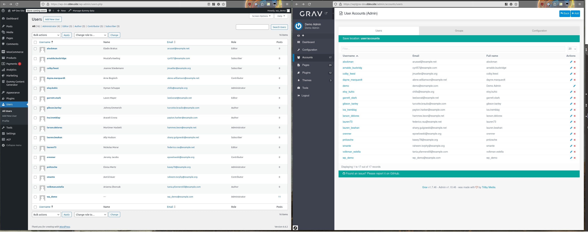
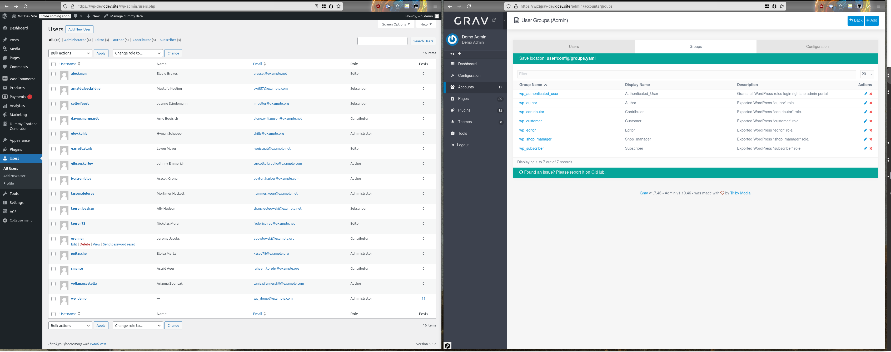
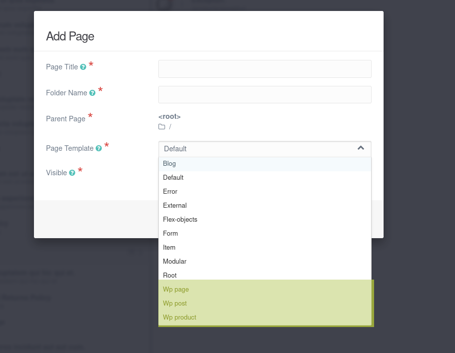
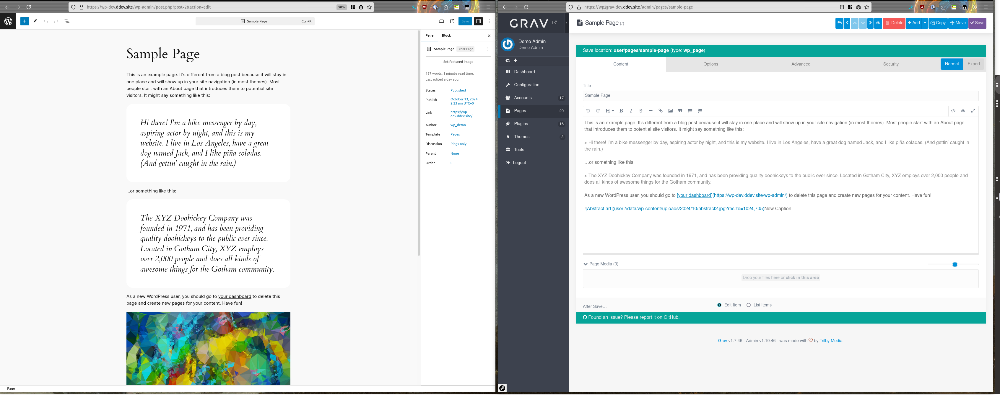
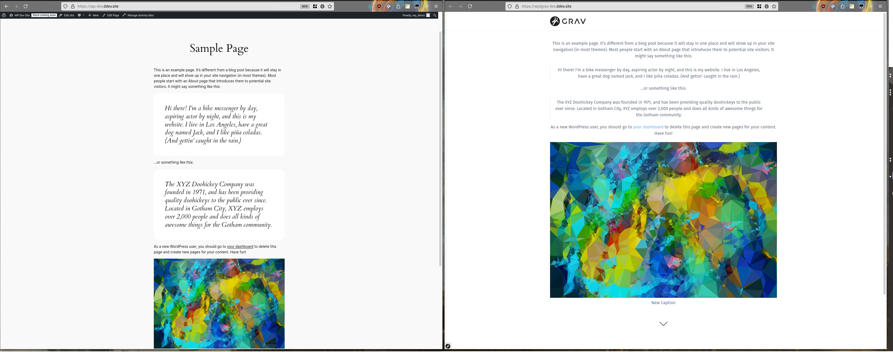
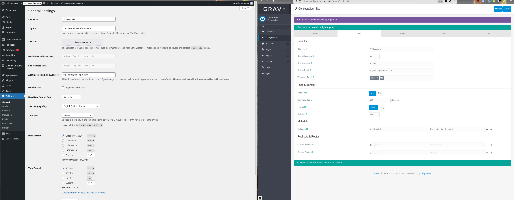

# Переход с WordPress на Grav

## Требования

* PHP v7.1 или выше для зависимостей composer.
* [WP-CLI](https://wp-cli.org/), установленный на хосте WordPress
* Работающий сайт WordPress, из которого будет экспортирован контент.
* Доступ на чтение и запись к `wp-content/uploads` на сайте WordPress.
* [Composer](https://getcomposer.org/), установленный на хосте Grav.

## Установка

1. Скачайте последний релиз плагина [wp2grav_exporter](https://github.com/jgonyea/wp2grav_exporter/releases) и загрузите его в папку `wp-content/plugins` вашего WordPress.
2. Выполните `composer install --no-dev` в папке `wp2grav_exporter`, чтобы установить зависимости.
3. Включите новый плагин:
   - Через wp-cli: `wp plugin activate wp2grav_exporter`, или — через графический интерфейс администрирования.
4. Выполните `wp wp2grav-all`, чтобы экспортировать все элементы. Другие варианты см. ниже.
5. Экспортированные файлы находятся в `WP_ROOT/wp-content/uploads/wp2grav-exports/DATE`
6. Для сайтов Grav v1.6 рекомендуется [https://github.com/david-szabo97/grav-plugin-admin-addon-user-manager](https://github.com/david-szabo97/grav-plugin-admin-addon-user-manager) для просмотра и управления пользователями. Для сайтов Grav 1.7+ это не требуется.

## Примечания

> Выполнение `wp wp2grav-all` запустит все шаги экспорта ниже сразу. После этого выполните каждый раздел ниже, чтобы импортировать новые данные в установку Grav.

## Экспорт пользователей из WordPress

Пользователи WordPress слева экспортированы в Grav справа.

### Команда

`wp wp2grav-users` создаст файлы учётных записей Grav.

### Результаты

* Учётные записи в папке экспорта `EXPORT/accounts/`.
  * Имена пользователей дополняются до минимума в 3 символа и максимума в 16.
  * Если имя пользователя усечено или дополнено, к нему также добавляется uid WordPress, чтобы избежать конфликтов.
  * Пароли в каждой учётной записи генерируются случайно и не связаны с соответствующей учётной записью WordPress. Открытый пароль автоматически преобразуется в `hashed_password` при первой аутентификации учётной записи.

### Импорт пользователей в Grav

Скопируйте папку `EXPORT/accounts` в вашу папку `user` (например, файлы `username.yaml` должны оказаться в `user/accounts`).

## Экспорт ролей пользователей из WordPress

Пользователи WordPress с ролями слева экспортированы в группы Grav справа.

### Команда {: #command-1 }

`wp wp2grav-roles` создаст файл `groups.yaml` Grav.

### Результаты {: #results-1 }

Роли пользователей WordPress экспортируются как группы Grav в файл `groups.yaml` по пути `config/groups.yaml`. Несколько замечаний об экспорте ролей:

* Каждая роль WordPress преобразуется в группу Grav `wp_<ROLE_WITH_UNDERSCORES>` (например, `subscriber` становится `wp_subscriber`).
* Пользователи WordPress с ролью администратора получают группу `wp_administrator`.
* Группа `wp_administrator` получает доступ `admin.super` вместе с доступом `admin.login`. Учётные записи с этими разрешениями — полные администраторы сайта!
* Новая группа Grav `wp_authenticated_user` получает доступ `admin.login`.
* Все учётные записи получают группу «wp_authenticated_user».

### Импорт ролей пользователей

Скопируйте папку `EXPORT/config` в `users/config`.

## Экспорт типов записей из WordPress

Типы записей WordPress преобразуются в типы страниц Grav с приставкой «WP» перед каждым типом (здесь выделено жёлтым).

### Команда {: #command-2 }

* `wp wp2grav-post-types` создаст базовый плагин Grav вместе с типами страниц, соответствующими типам записей WordPress.

### Результаты {: #results-2 }

* Будет создан плагин Grav, который предоставит базовую функциональность полей в инструменте админки.

### Импорт типов записей в Grav
* Скопируйте папку `EXPORT/plugins` в вашу папку `user`
* Перейдите в папку плагина Grav `user/plugins/wordpress-exporter-helper` и выполните `composer install`.

## Экспорт записей из WordPress

Вид «Sample Page» WordPress в админке слева экспортирован в Markdown Grav справа.

Вид «Sample Page» WordPress для пользователя слева экспортирован и отрендерен через Grav справа.

### Команда {: #command-3 }

* `wp wp2grav-posts` экспортирует все записи.

### Результаты {: #results-3 }

* Каждая запись или страница экспортируется в папки, соответствующие метаданным записи, обычно заголовку записи или страницы.
* Медиафайлы библиотеки будут скопированы в `data/wp-content`, а встроенный контент (в итоге) будет включён в папку страницы.

### Импорт записей в Grav

* Скопируйте папку `EXPORT/pages` в вашу папку `user`
* Скопируйте папку `EXPORT/data` в вашу папку `user`

## Экспорт метаданных сайта из WordPress

Общие настройки WordPress в админке слева экспортированы в конфигурацию сайта Grav справа.

### Команда {: #command-4 }

* `wp wp2grav-site` экспортирует метаданные сайта.

### Результаты {: #results-4 }

* Метаданные сайта Grav хранятся в `EXPORT/config/site.yaml`.

### Импорт метаданных сайта в Grav

* Скопируйте файл `EXPORT/config/site.yaml` в Grav по пути `user/config/site.yaml`.
