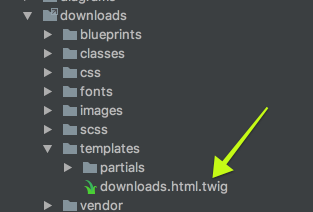

# Хуки событий

В предыдущей главе [Урок по созданию плагина](../plugin-tutorial/index.md) вы могли заметить, что логика нашего плагина была заключена в двух методах. Каждый из этих методов, `onPluginsInitialized` и `onPageInitialized`, соответствует **хукам событий**, доступным на протяжении всего жизненного цикла Grav.

Чтобы полностью использовать возможности плагинов Grav, нужно знать, какие хуки событий доступны, в каком порядке они вызываются и что доступно во время этих вызовов. **Хуки событий** напрямую связаны с общим [жизненным циклом Grav](../grav-lifecycle/index.md).

## Порядок событий

Большинство событий в Grav срабатывают в определённом порядке, и этот порядок важно понимать, если вы создаёте плагины:

1. [onFatalException](#onfatalexception) _(без определённого порядка, может произойти в любое время)_
1. `PluginsLoadedEvent` class (1.7)
1. `PluginsLoadedEvent` class (1.7)
1. [onPluginsInitialized](#onpluginsinitialized)
1. `FlexRegisterEvent` class (1.7)
1. onThemeInitialized
1. onRequestHandlerInit (1.6)
1. onTask (1.6)
   1. onTask.{task}
1. onAction (1.6)
   1. onAction.{action} (1.6)
1. onBackupsInitialized
1. onSchedulerInitialized (1.6)
1. [onAssetsInitialized](#onassetsinitialized)
1. [onTwigTemplatePaths](#ontwigtemplatepaths)
1. [onTwigLoader](#ontwigloader)
1. [onTwigInitialized](#ontwiginitialized)
1. [onTwigExtensions](#ontwigextensions)
1. [onBuildPagesInitialized](#onbuildpagesinitialized) _(один раз при повторной обработке страниц)_
   1. [onPageProcessed](#onpageprocessed) _(каждая страница, ещё не закэшированная)_
   1. onFormPageHeaderProcessed (1.6) _(каждая страница, ещё не закэшированная)_
   1. [onFolderProcessed](#onfolderprocessed) _(для каждой найденной папки)_
1. [onPagesInitialized](#onpagesinitialized)
1. [onPageInitialized](#onpageinitialized)
   1. [onPageContentRaw](#onpagecontentraw) _(каждая страница, ещё не закэшированная)_
   1. [onMarkdownInitialized](#onmarkdowninitialized)
   1. [onPageContentProcessed](#onpagecontentprocessed) _(каждая страница, ещё не закэшированная)_
   1. onPageContent _(вызывается при первом вызове Page::content(), даже если страница закэширована)_
1. [onPageNotFound](#onpagenotfound)
1. onPageAction (1.6)
   1. onPageAction.{action} (1.6)
1. onPageTask (1.6)
   1. onPageTask.{task} (1.6)
1. [onTwigPageVariables](#ontwigpagevariables) _(каждая страница, ещё не закэшированная)_
1. onHttpPostFilter (1.5.2)
1. [onTwigSiteVariables](#ontwigsitevariables)
1. [onCollectionProcessed](#oncollectionprocessed) _(при запросе коллекции)_
1. [onOutputGenerated](#onoutputgenerated)
1. [onPageHeaders](#onpageheaders)
1. [onOutputRendered](#onoutputrendered)
1. [onShutdown](#onshutdown)

Прочие события:

1. [onBlueprintCreated](#onblueprintcreated)
1. onTwigTemplateVariables
1. onTwigStringVariables
1. [onBeforeDownload](#onbeforedownload)
1. [onPageFallBackUrl](#onpagefallbackurl)
1. [onMediaLocate](#onmedialocate)
1. [onGetPageBlueprints](#ongetpageblueprints)
1. [onGetPageTemplates](#ongetpagetemplates)
1. onFlexObjectRender (1.6)
1. onFlexCollectionRender (1.6)
1. onBeforeCacheClear
1. onImageMediumSaved (ImageFile)
1. onAfterCacheClear (1.7)
1. onHttpPostFilter (1.7)
1. `PermissionsRegisterEvent`class (1.7)

## Основные хуки событий Grav

Во время обработки страницы срабатывают несколько основных хуков событий Grav:

<a name="onFatalException"></a>

#### onFatalException

Это событие может быть вызвано в любой момент, если PHP выбрасывает фатальное исключение. Сейчас его использует плагин `problems`, чтобы показать список возможных причин, по которым Grav выбрасывает фатальное исключение.

<a name="onPluginsInitialized"></a>

#### onPluginsInitialized

Это первое доступное событие плагина. На этот момент инициализированы следующие объекты:

* Uri
* Config
* Debugger
* Cache
* Plugins

> [!TIP] Совет
> Плагин вообще не будет загружен, если для него задана опция `enabled: false`.

<a name="onAssetsInitialized"></a>
#### onAssetsInitialized

Событие означает, что менеджер ресурсов инициализирован и готов к добавлению и управлению ресурсами.

<a name="onPagesInitialized"></a>
#### onPagesInitialized

Событие означает, что все страницы в папке `user/pages` Grav загружены как объекты и доступны в **объекте Pages**.

<a name="onPageNotFound"></a>
#### onPageNotFound

Это событие может быть вызвано, если ожидаемая страница не найдена. Сейчас его использует плагин `error`, чтобы показать красивую страницу ошибки 404.

<a name="onPageInitialized"></a>
#### onPageInitialized

Текущая страница, запрошенная по URL, загружена в **объект Page**.

<a name="onOutputGenerated"></a>
#### onOutputGenerated

Вывод обработан **шаблонизатором Twig** и теперь представляет собой просто строку HTML.

<a name="onPageHeaders"></a>
#### onPageHeaders

Позволяет манипулировать объектом заголовков страницы.

<a name="onOutputRendered"></a>
#### onOutputRendered

Вывод полностью обработан и отправлен на экран.

<a name="onShutdown"></a>
#### onShutdown

Новое и очень мощное событие, позволяющее выполнять действия после того, как Grav завершил обработку и соединение с клиентом закрыто. Особенно полезно для действий, не требующих взаимодействия с пользователем и потенциально влияющих на производительность. Возможные применения: отслеживание пользователей и обработка заданий.

<a name="onBeforeDownload"></a>
#### onBeforeDownload

Это новое событие передаёт объект события, содержащий `file`. Его можно использовать для логирования или для разрешения/запрета скачивания файла.

#### onGetPageTemplates

Это событие позволяет плагинам предоставлять собственные шаблоны в дополнение к шаблонам из структуры папок темы и ядра. Особенно полезно, если вы хотите, чтобы плагин предоставлял свой шаблон.

**Пример**

```twig linenums="1"
/**
 * Добавляет типы шаблонов страниц.
 */
public function onGetPageTemplates(Event $event)
{
    /** @var Types $types */
    $types = $event->types;
    $types->register('downloads');
}
```

Это позволяет плагину зарегистрировать шаблон (который он может предоставлять), чтобы он появился в выпадающем списке типов шаблонов страниц (например, при редактировании страницы). В примере выше добавляется тип шаблона `downloads`, поскольку в папке `downloads` есть файл `downloads.html.twig`.



#### onGetPageBlueprints

Это событие, как и `onGetPageTemplates`, позволяет плагину предоставлять собственные ресурсы в дополнение к ресурсам ядра и темы. В данном случае — схемы.

**Пример**

```twig linenums="1"
$scanBlueprintsAndTemplates = function () use ($grav) {
    // Сканировать схемы
    $event = new Event();
    $event->types = self::$types;
    $grav->fireEvent('onGetPageBlueprints', $event);

    self::$types->scanBlueprints('theme://blueprints/');

    // Сканировать шаблоны
    $event = new Event();
    $event->types = self::$types;
    $grav->fireEvent('onGetPageTemplates', $event);

    self::$types->scanTemplates('theme://templates/');
};
```

В этом примере мы используем оба хука, `onGetPageTemplates` и `onGetPageBlueprints`, чтобы сделать эти предоставляемые плагином ресурсы (шаблоны и схемы) доступными Grav для наследования и других целей.

## Хуки событий Twig

У Twig есть собственный набор хуков событий.

<a name="onTwigTemplatePaths"></a>
#### onTwigTemplatePaths

Базовые расположения путей к шаблонам заданы в **объекте Twig**. Если нужно добавить другие места, где Twig будет искать пути к шаблонам, используйте это событие.

**Пример**

```twig linenums="1"
/**
 * Добавляет папку шаблонов в путь поиска Twig.
 */
 public function onTwigTemplatePaths()
 {
     $this->grav['twig']->twig_paths[] = __DIR__ . '/templates';
 }
```

<a name="onTwigInitialized"></a>
#### onTwigInitialized

На этот момент шаблонизатор Twig инициализирован.

<a name="onTwigExtensions"></a>
#### onTwigExtensions

Основные расширения Twig загружены, но если нужно добавить [собственное расширение Twig](https://twig.symfony.com/doc/1.x/advanced.html#creating-an-extension), это можно сделать с помощью этого хука.

<a name="onTwigPageVariables"></a>
#### onTwigPageVariables

Когда Twig обрабатывает страницу напрямую, то есть когда в YAML-заголовках страницы задано `process: twig: true`. Здесь следует добавлять в Twig переменные, которые должны быть доступны Twig во время этой обработки.

<a name="onTwigSiteVariables"></a>
#### onTwigSiteVariables

Когда Twig обрабатывает всю иерархию шаблонов сайта. Здесь следует добавлять в Twig переменные, которые должны быть доступны Twig во время этой обработки.

<a name="onBuildTwigSandboxPolicy"></a>
#### onBuildTwigSandboxPolicy (2.0) {: #onbuildtwigsandboxpolicy-2-0 }

Срабатывает, когда Grav строит политику песочницы для контента Twig. Twig, написанный редактором в **контенте страницы**, выполняется внутри этой песочницы (файлы шаблонов темы и плагинов на диске считаются доверенными и никогда не помещаются в песочницу). Если ваш плагин предоставляет функцию, фильтр, тег, метод или свойство Twig, которые авторы должны вызывать из контента страницы, разрешите их здесь, иначе песочница заблокирует их.

Событие передаёт те же списки разрешений, что используются в `security.yaml`: плоские списки для `tags`, `filters` и `functions`, а также список строк `class`/`methods` для `methods` и `properties`. Добавляйте в нужный список способом чтения-изменения-записи (аргументы возвращаются по значению). Оно срабатывает только при построении политики, один раз за запрос, и кэшируется, поэтому затрат на каждый рендер нет.

Разрешайте только те члены, которые безопасно выполнять в отношении контента, созданного любым пользователем с правом редактирования страниц. Регистрация члена здесь — то же решение о доверии, что и его изначальное предоставление.

**Пример**

```php linenums="1"
/**
 * Разрешает функцию Twig этого плагина внутри контента страницы в песочнице.
 */
public function onBuildTwigSandboxPolicy(Event $event)
{
    $functions = $event['functions'];
    $functions[] = 'unite_gallery';
    $event['functions'] = $functions;
}
```

## Хуки событий коллекций

<a name="onCollectionProcessed"></a>
#### onCollectionProcessed

Если нужно манипулировать коллекцией после её обработки, это подходящий момент.

## Хуки событий страниц

<a name="onBuildPagesInitialized"></a>
#### onBuildPagesInitialized

Событие срабатывает один раз, когда страницы собираются для повторной обработки. Обычно это происходит, если кэш истёк или требует обновления. Полезное событие для плагинов, которым нужно манипулировать контентом и кэшировать результаты.

<a name="onBlueprintCreated"></a>
#### onBlueprintCreated

Используется для обработки и работы с формами.

<a name="onPageContentRaw"></a>
#### onPageContentRaw

После того как страница найдена и заголовки обработаны, но контент **не** обработан. Срабатывает для **каждой страницы** в системе Grav. Производительность не страдает, потому что событие не выполняется для закэшированной страницы — только при очистке кэша или событии, очищающем кэш.

<a name="onPageProcessed"></a>
#### onPageProcessed

После того как страница разобрана и обработана. Срабатывает для **каждой страницы** в системе Grav. Производительность не страдает, потому что событие не выполняется для закэшированной страницы — только при очистке кэша или событии, очищающем кэш.

<a name="onMarkdownInitialized"></a>
#### onMarkdownInitialized

Вызывается после инициализации Markdown. Позволяет переопределить стандартную реализацию обработки Parsedown. См. [пример использования в PR, где это было добавлено](https://github.com/getgrav/grav/pull/747#issuecomment-206821370).

<a name="onPageContentProcessed"></a>
#### onPageContentProcessed

Событие срабатывает после того, как метод страницы `content()` обработал контент. Особенно полезно, если нужно выполнить действия с постобработанным контентом, но гарантировать кэширование результатов. Производительность не страдает, потому что событие не выполняется для закэшированной страницы — только при очистке кэша или событии, очищающем кэш.

<a name="onFolderProcessed"></a>
#### onFolderProcessed

После того как папка разобрана и обработана. Срабатывает для **каждой папки** в системе Grav. Производительность не страдает, потому что событие не выполняется для закэшированной страницы — только при очистке кэша или событии, очищающем кэш.

<a name="onPageFallBackUrl"></a>
#### onPageFallBackUrl

Если маршрут не распознан как страница, Grav пытается получить доступ к медиаресурсу страницы. Событие срабатывает сразу в начале процедуры, чтобы плагины могли подключиться и предоставить дополнительную функциональность.

#### onMediaLocate

Добавляет поддержку пользовательских расположений медиафайлов для отрывков.

#### onTwigLoader

Добавляет поддержку использования пространств имён вместе с двумя новыми методами класса Twig: `Twig::addPath($path, $namespace)` и `Twig::prependPath($path, $namespace)`.
