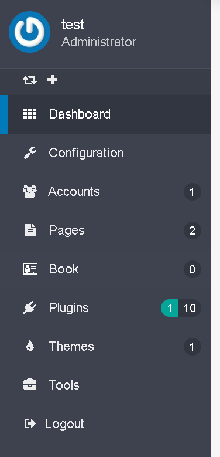
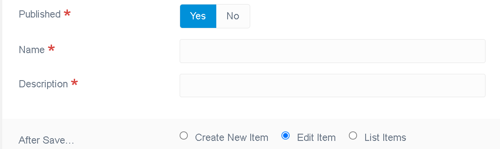
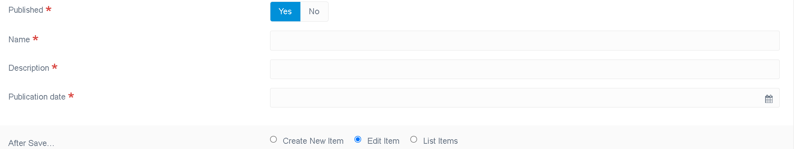

# Использование Flex в плагине

## Введение

Использование Flex — в Twig или в коде — здесь рассматривается только в рамках введения. Чтобы понять мощь и гибкость Flex, прочитайте [отдельную документацию по Flex](../../advanced/flex/index.md).

Flex позволяет создавать собственные CRUD-объекты — как отдельные объекты, так и коллекции — и предоставляет обширные API, доступные из кода плагина или шаблонов.

Интерфейс админки можно легко добавить, используя стандартные шаблоны или собственные списки и формы (или иные решения).

## Требования

Требуется Grav 1.7 или новее. В этой документации мы будем использовать установку grav+admin; убедитесь, что она работает, чтобы повторить шаги ниже. См. [документацию по установке](../../basics/installation/index.md), чтобы подготовить её.

## Создание плагина

Хотя плагин можно создать с Flex или без него с нуля, чтобы гарантировать наличие всех последних изменений, мы настоятельно рекомендуем использовать devtools для генерации скелета и базовой функциональности:

Для этого воспользуемся CLI devtools:

```bash
bin/gpm install devtools
```

Чтобы [создать новый плагин с помощью devtools](../plugin-tutorial/index.md), используется следующая команда; имя плагина — myflexplugin:

```bash
grav-admin bin/plugin devtools new-plugin
```

и ответьте на вопросы следующими ответами; важная часть — выбрать плагин, подготовленный для Flex:

```bash
 Enter Plugin Name:
 > myflexplugin

 Enter Plugin Description:
 > A little Flex plugin test

 Enter Developer Name:
 > grav@example.com

 Enter GitHub ID (can be blank):
 > gravcms

 Enter Developer Email:
 > grav@example.com

 Please choose an option:
  [blank] Basic Plugin
  [flex ] Basic Plugin prepared for custom Flex Objects
 > flex

 Enter Flex Object Name:
 > book

 Please choose a storage type:
  [simple] Basic Storage (1 file for all objects) - no media support
  [file  ] File Storage (1 file per object)
  [folder] Folder Storage (1 folder per object)
 > folder


SUCCESS plugin myflexplugin -> Created Successfully

Path: /home/pierre/project/grav/grav-admin/user/plugins/myflexplugin

Please run I0 and I1 to initialize the autoloader
```

В случае успеха нужно установить зависимости, если они есть, для нашего нового плагина:

```bash
cd /home/pierre/project/grav/grav-admin/user/plugins/myflexplugin
```

```bash
composer update
```

В случае успеха должен отобразиться следующий вывод:

```bash
Loading composer repositories with package information
Updating dependencies
Nothing to modify in lock file
Writing lock file
Installing dependencies from lock file (including require-dev)
Nothing to install, update or remove
Generating autoload files
No installed packages - skipping audit.
```

и вернитесь в корневую папку установки grav-admin:

```bash
cd -
```

Devtools сгенерировал очень простой flex-объект, состоящий из имени и описания, и его коллекцию. Интерфейс админки уже позволяет перечислять эти объекты book, создавать, редактировать и удалять их, не написав ни одной строки кода.

В левом боковом меню появился новый пункт:



Форма редактирования по умолчанию выглядит так:



Вы также должны увидеть различные папки и файлы, связанные с вашим плагином и его flex-объектом `book`.

## Что где находится

Папка плагина должна выглядеть так:

```bash linenums="1"
../grav-admin/user/plugins/myflexplugin
├── CHANGELOG.md
├── LICENSE
├── README.md
├── blueprints
│   └── flex-objects
│       └── book.yaml
├── blueprints.yaml
├── classes
│   └── Flex
│       └── Types
│           └── Book
│               ├── BookCollection.php
│               └── BookObject.php
├── composer.json
├── composer.lock
├── languages.yaml
├── myflexplugin.php
├── myflexplugin.yaml
└── vendor
    ├── autoload.php
    └── composer
        ├── ClassLoader.php
        ├── InstalledVersions.php
        ├── LICENSE
        ├── autoload_classmap.php
        ├── autoload_namespaces.php
        ├── autoload_psr4.php
        ├── autoload_real.php
        ├── autoload_static.php
        ├── installed.json
        ├── installed.php
        └── platform_check.php
```

### Определение flex-объекта
Ключевой файл — [определение схемы](../../advanced/flex/custom-types/blueprint/index.md). Именно здесь определяется схема этого flex-объекта вместе с многочисленными опциями для настройки практически всего, что с ним связано.

В нашем плагине схему book можно найти по адресу user/plugins/myflexplugin/blueprints/flex-objects/book.yaml.

> **ВАЖНО** Схема для каждого flex-объекта в вашем плагине (или основной установке /blueprints) должна находиться в папке `blueprints/flex-objects/`, иначе она не будет найдена.

Схема определяется с помощью раздела Form этой схемы. Независимо от того, используются ли формы админки, этот раздел определяет свойства flex-объекта.

Мы не будем здесь рассматривать все опции, а сосредоточимся на реализации объекта book. [Обширная документация по схемам Flex](../../advanced/flex/custom-types/blueprint/index.md) поможет углубиться и настроить его.

Схема ниже определяет два свойства:

```yaml linenums="1"
form:
    validation: loose
    fields:
        published:
            type: toggle
            label: Published
            highlight: 1
            default: 1
            options:
                1: PLUGIN_ADMIN.YES
                0: PLUGIN_ADMIN.NO
            validate:
                type: bool
                required: true
        name:
            type: text
            label: Name
            validate:
                required: true
        description:
            type: text
            label: Description
            validate:
                required: true
```

### Хуки плагина

`myflexplugin.php` — обычное основное определение для реализации плагина, хуков и т. д.

Эти части необходимы для включения Flex:

```php linenums="1"
public $features = [
    'blueprints' => 0,
];

/**
 * @return array
 *
 * Метод getSubscribedEvents() даёт ядру список событий,
 *     на которые хочет подписаться плагин. Ключ каждой
 *     секции массива — событие, которое слушает плагин,
 *     а значение (в виде массива) содержит вызываемый
 *     объект (или функцию) и приоритет. Чем выше число,
 *     тем выше приоритет.
 */
public static function getSubscribedEvents(): array
{
    return [
        'onPluginsInitialized' => [
            // Раскомментируйте следующую строку, если плагину требуется Grav < 1.7
            // ['autoload', 100000],
            ['onPluginsInitialized', 0]
        ],
        FlexRegisterEvent::class       => [['onRegisterFlex', 0]],
    ];
}
```

Остальные файлы стандартны и хорошо описаны в предыдущих разделах документации по плагинам. Здесь мы их не рассматриваем.

Папка _classes_ содержит классы, используемые для flex-объекта book и flex-коллекции book. В этих классах можно добавить пользовательские методы, доступные в каждом экземпляре объекта или коллекции. См. [добавление пользовательских методов в flex-объект](#add-custom-method-to-the-flex-object).

## Изменение схемы flex-объекта

Давайте добавим в объект поле — скажем, поле datetime, представляющее дату публикации книги. Это можно сделать, просто добавив поля `pub_date` в схему:

```yaml linenums="1"
form:
    validation: loose
    fields:
        published:
            type: toggle
            label: Published
            highlight: 1
            default: 1
            options:
                1: PLUGIN_ADMIN.YES
                0: PLUGIN_ADMIN.NO
            validate:
                type: bool
                required: true
        name:
            type: text
            label: Name
            validate:
                required: true
        pub_date:
            type: datetime
            label: Description
            validate:
                required: true
```

Теперь форма редактирования по умолчанию показывает поля ввода даты публикации:



Список всех доступных типов полей можно найти [здесь](../../forms/blueprints/fields-available/index.md)

<a id="addcustommethod"></a>
## Добавление пользовательского метода в flex-объект {: #add-custom-method-to-the-flex-object }

Текущий flex-объект book, user/plugins/myflexplugin/classes/Flex/Types/Book/BookObject.php, реализует только GenericObject (используя трейты):

```php linenums="1"
<?php

declare(strict_types=1);

/**
 * @package    Grav\Common\Flex
 *
 * @copyright  Copyright (c) 2015 - 2021 Trilby Media, LLC. All rights reserved.
 * @license    MIT License; see LICENSE file for details.
 */

namespace Grav\Plugin\Myflexplugin\Flex\Types\Book;

use Grav\Common\Flex\Types\Generic\GenericObject;

/**
 * Класс BookObject
 * @package Grav\Common\Flex\Generic
 *
 * @extends FlexObject<string,GenericObject>
*/
class BookObject extends GenericObject
{

}
```

Добавим метод для получения краткого описания книги, используя разделитель краткого описания сайта:

```php linenums="1"
<?php

declare(strict_types=1);

/**
 * @package    Grav\Common\Flex
 *
 * @copyright  Copyright (c) 2015 - 2021 Trilby Media, LLC. All rights reserved.
 * @license    MIT License; see LICENSE file for details.
 */

namespace Grav\Plugin\Myflexplugin\Flex\Types\Book;

use Grav\Common\Flex\Types\Generic\GenericObject;

/**
 * Класс BookObject
 * @package Grav\Common\Flex\Generic
 *
 * @extends FlexObject<string,GenericObject>
*/
class BookObject extends GenericObject
{
    public function getSummary() {
        $delimiter = \Grav\Common\Grav::instance()['config']['site']['summary']['delimiter'] ?? '===';
        $summary = explode($delimiter, $this->content);
        return $summary[0] ?? '';
    }
}
```

Теперь этот метод можно вызвать везде, где используется flex-объект book, например в шаблоне:

```twig linenums="1"


    <h1>{{ book.header.title}}</h1>
    <p>{{ book.getSummary()}}</p>

```

Метод `::getSummary` также можно использовать в любом PHP-коде.

То же можно сделать в классе коллекции, user/plugins/myflexplugin/classes/Flex/Types/Book/BookCollection.php. Например, чтобы добавить удобный метод для поиска с нетривиальными запросами. Коллекция уже предоставляет все общие методы коллекций. Может быть удобно добавить несколько помощников, если у объекта много разных полей, где стандартные методы коллекции могут легко привести к ошибкам.
