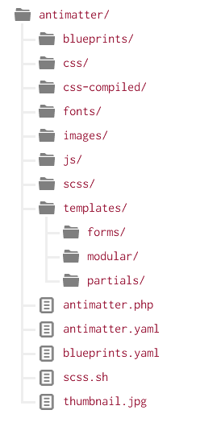

# Основы тем

Темы в Grav устроены довольно просто и очень гибко, поскольку построены на мощном [шаблонизаторе Twig](https://twig.symfony.com/). Каждая тема создаётся из набора Twig-файлов (смеси Twig-подобного PHP-кода и HTML), называемых шаблонами, и CSS. Обычно мы используем [Sass CSS Extension](http://sass-lang.com) для генерации CSS-файлов, но ничто не мешает вам использовать [Less](http://lesscss.org/) или даже обычный CSS. Всё сводится к вашим личным предпочтениям.

## Страницы контента и шаблоны Twig

Первое, что нужно понять, — это прямая связь между **страницами** в Grav и **файлами шаблонов Twig**, которые предоставляет тема.

Каждая созданная вами страница ссылается на конкретный файл шаблона — либо по имени файла страницы, либо через переменную заголовка страницы. Для простоты сопровождения мы советуем по возможности использовать имя страницы, а не переопределять его через переменную заголовка.

Разберём простой пример. Если вы [установили пакет **Grav Base**](../../basics/installation/index.md), то заметите, что в папке `user/pages/01.home` есть файл `default.md` с контентом страницы в Markdown. Имя этого файла, то есть `default`, сообщает Grav, что страницу нужно рендерить шаблоном Twig `default.html.twig`, который находится в папке `templates/` темы.

> [!CAUTION] Внимание
> Шаблоны страниц должны быть в нижнем регистре: `default`, `blog` и т. п.

Если бы у вас был файл страницы `blog.md`, Grav попытался бы отрендерить его шаблоном Twig `<your_theme>/templates/blog.html.twig`.

> [!CAUTION] Внимание
> Имена файлов в Grav не отображаются на фронтенде. Отображаются только имена папок. Не волнуйтесь, если у всех ваших записей блога одинаковое имя файла. Это нормально.

## Организация темы

### Определение и конфигурация

У каждой темы должен быть файл определения `blueprints.yaml` с информацией о теме. В нём также можно опционально описать **формы**, используемые в [**админке**](../../advanced/flex/administration/introduction/index.md) для редактирования параметров темы. У темы **Antimatter** есть такой файл `blueprints.yaml`:

```yaml linenums="1"
name: Antimatter
slug: antimatter
type: theme
version: 1.6.7
description: "Antimatter is the default theme included with **Grav**"
icon: empire
author:
  name: Team Grav
  email: devs@getgrav.org
  url: https://getgrav.org
homepage: https://github.com/getgrav/grav-theme-antimatter
demo: https://demo.getgrav.org/blog-skeleton
keywords: antimatter, theme, core, modern, fast, responsive, html5, css3
bugs: https://github.com/getgrav/grav-theme-antimatter/issues
license: MIT

dependencies:
    - { name: grav, version: '>=1.6.0' }

form:
  validation: loose
  fields:
    dropdown.enabled:
        type: toggle
        label: Dropdown in navbar
        highlight: 1
        default: 1
        options:
          1: Enabled
          0: Disabled
        validate:
          type: bool
```

Если вы хотите использовать параметры конфигурации темы, укажите настройки по умолчанию в файле `<your_theme>.yaml`. Например:

```yaml linenums="1"
enabled: true
color: blue
```

> [!CAUTION] Внимание
> Параметр `color: blue` на самом деле ничего не делает. Он приведён лишь как пример переопределения настройки.

Подробнее о доступных формах читайте в [главе 6. Формы](../../forms/index.md). Также стоит добавить изображение темы размером `300px` на `300px` с именем `thumbnail.jpg` в корень темы. Оно появится в разделе тем вашей админки.

### Шаблоны

**Строгих правил** структуры темы Grav **нет**, кроме одного: в папке `templates/` должны быть подходящие шаблоны Twig для каждого типа страниц, используемого в контенте.

> [!CAUTION] Внимание
> Из-за такой тесной связи между контентом страниц и шаблонами Twig в теме часто имеет смысл разрабатывать тему вместе с контентом, для которого она предназначена. Хороший способ создавать _универсальные_ темы — поддерживать типы шаблонов, используемые пакетами-скелетами с нашей [страницы загрузок](https://getgrav.org/downloads). Например, поддерживать: **default**, **blog**, **error**, **item** и **modular**.

Вообще говоря, в корне папки `templates/` следует размещать основные поддерживаемые шаблоны, а в подпапке `partials/` — части или более мелкие _фрагменты_ шаблонов.

Если вы хотите поддерживать в теме **модульные** шаблоны, создайте в `templates/` подпапку `modular/` и храните модульные файлы Twig там.

С **формами** история та же. Создайте ещё одну подпапку `forms/` и храните в ней пользовательские шаблоны форм.

### SCSS / LESS / CSS

Здесь тоже нет ничего обязательного, но хорошая практика — завести подпапку `scss/`, если вы хотите разрабатывать с Sass, или `less/`, если предпочитаете Less, а также папку `css/` для статических CSS-файлов и `css-compiled/` для файлов, автоматически генерируемых при компиляции Sass или Less.

Как организовывать файлы — полностью ваше решение. Можете последовать нашему примеру в теме **antimatter** по умолчанию из пакета Grav Base. Мы используем вариант **scss** синтаксиса Sass: он ближе к CSS и, честно говоря, естественнее для написания.

Чтобы установить Sass на компьютер, просто [следуйте инструкциям на sass-lang.com](http://sass-lang.com/install).

1. Запустите простой scss shell-скрипт, набрав `./scss.sh` в корне темы.
2. Или выполните команду напрямую: `scss --source-map --watch scss:css-compiled` — это то же самое.

По умолчанию scss-файлы компилируются в папку `css-compiled/`. Затем вы можете подключить получившийся CSS-файл в теме.

### Схемы

Папка `blueprints/` используется для определения форм с параметрами и конфигурацией для каждого файла шаблона. Их использует **админка**, и они необязательны. Тема на 100% работает и без них, но без схем её параметры нельзя будет редактировать через админку.

### События темы и плагинов

Ещё одна мощная фича, полностью опциональная, — взаимодействие темы с Grav через архитектуру **плагинов**. Если коротко: во время инициализации Grav есть несколько точек, где можно «зацепить» собственный код. Это может пригодиться, например, чтобы определить дополнительные сокращения путей в теме при инициализации Twig и затем использовать их в шаблонах Twig. Эти хуки доступны через набор «пустых» функций с именами, предопределёнными системой Grav, которые вы можете заполнить по своему усмотрению. В [главе 4. Плагины](../../plugins/index.md) подробнее описана система плагинов и доступные хуки событий. Чтобы использовать эти хуки в теме, создайте файл `mytheme.php` такого вида:

```php linenums="1"
<?php
namespace Grav\Theme;

use Grav\Common\Theme;

class MyTheme extends Theme
{

    public static function getSubscribedEvents(): array
    {
        return [
            'onThemeInitialized' => ['onThemeInitialized', 0]
        ];
    }

    public function onThemeInitialized(): void
    {
        if ($this->isAdmin()) {
            $this->active = false;
            return;
        }

        $this->enable([
            'onTwigSiteVariables' => ['onTwigSiteVariables', 0]
        ]);
    }

    public function onTwigSiteVariables(): void
    {
        $this->grav['assets']
            ->addCss('plugin://css/mytheme-core.css')
            ->addCss('plugin://css/mytheme-custom.css');

        $this->grav['assets']
            ->add('jquery', 101)
            ->addJs('theme://js/jquery.myscript.min.js');
    }
}
```

Как видите, чтобы использовать хуки событий, сначала нужно зарегистрировать их в списке функцией `getSubscribedEvents`, а затем определить собственным кодом. Если вы подписываетесь на событие, определите и его. Иначе получите ошибку.

### Другие папки

Мы рекомендуем создавать в корне темы отдельные папки `images/`, `fonts/` и `js/` для собственных изображений темы, веб-шрифтов и необходимых JavaScript-файлов.

## Пример темы

Возьмём тему **antimatter** по умолчанию как пример. Ниже показана общая структура этой темы:



В этом примере сами файлы `css`, `css-compiled`, `fonts`, `images`, `js`, `scss` и `templates` не показаны, чтобы структура читалась легче. Важно обратить внимание на общую организацию темы.
