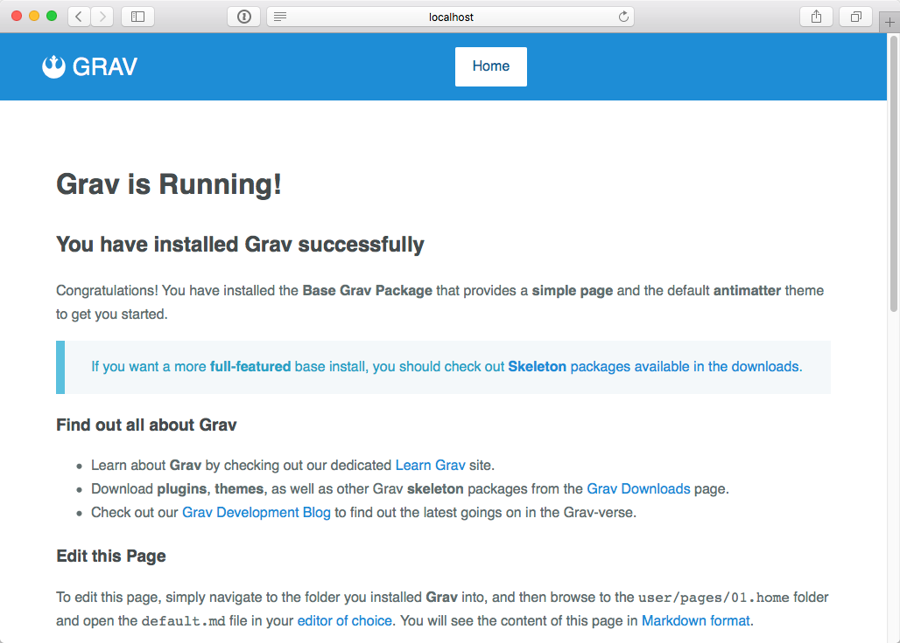

# Урок по теме

Часто лучший способ изучить новое — взять пример и попробовать создать на его основе что-то своё. Мы будем использовать тот же подход для создания новой темы Grav.

## Quark

Grav поставляется с чистой современной темой **Quark**, использующей [фреймворк Spectre.css](https://picturepan2.github.io/spectre/).

Spectre.css — лёгкий, адаптивный и современный CSS-фреймворк для быстрой и расширяемой разработки.

Spectre предоставляет базовые стили для типографики и элементов, адаптивную систему раскладки на основе flexbox, чистые CSS-компоненты и утилиты, следующие лучшим практикам и единому языку дизайна.

Однако часто лучше начать с чего-то ещё более простого.

## Pure.css {: #pure-css }

В рамках этого урока мы создадим тему на основе популярного [фреймворка Pure.css](http://purecss.io/), разработанного Yahoo!

Pure — небольшой, быстрый и адаптивный CSS-фреймворк, содержащий основы, чтобы начать разработку сайта без лишнего веса больших фреймворков вроде [Bootstrap](http://getbootstrap.com/css/) или [Foundation](http://foundation.zurb.com/). Он состоит из нескольких модулей, которые можно использовать независимо, но вместе итоговый пакет весит всего **4,0 КБ в минифицированном и сжатом виде**!

Обо всех фичах Pure можно прочитать на [сайте проекта Pure.css](http://purecss.io/).

Также прочитайте статью [Важные обновления тем](https://getgrav.org/blog/important-theme-updates) в блоге, где описаны ключевые изменения в темах Grav для лучшей поддержки плагинов в будущем.

## Шаг 1 — Установка плагина DevTools

> [!CAUTION] Внимание
> В предыдущих версиях этого урока требовалось сначала создать базовую тему. Весь этот процесс можно пропустить благодаря новому **плагину DevTools**.

Первый шаг в создании новой темы — **установить плагин DevTools**. Это можно сделать двумя способами.

#### Установка через CLI GPM

* Перейдите в командной строке в корень установки Grav.

```bash
bin/gpm install devtools
```

#### Установка через админку

* После входа перейдите в раздел **Плагины** в боковой панели.
* Нажмите кнопку :fontawesome-solid-plus: **Добавить** в правом верхнем углу.
* Найдите **DevTools** в списке и нажмите :fontawesome-solid-plus: **Установить**.

## Шаг 2 — Создание базовой темы

Для следующего шага вам действительно понадобится [командная строка](../../cli-console/command-line-intro/index.md), потому что DevTools предоставляет несколько CLI-команд, которые значительно упрощают создание новой темы!

Из корня установки Grav выполните команду:

```bash
bin/plugin devtools new-theme
```

В процессе вас спросят несколько вопросов, необходимых для создания новой темы:

> [!WARNING] Предупреждение
> Мы будем использовать **pure-blank** для создания новой темы, но вы можете создать простой шаблон в стиле **наследования**, который наследует другую базовую тему.

```bash
bin/plugin devtools new-theme

Enter Theme Name: MyTheme
Enter Theme Description: My New Theme
Enter Developer Name: Acme Corp
Enter Developer Email: contact@acme.co
Please choose a template type
  [pure-blank ] Basic Theme using Pure.css
  [inheritance] Inherit from another theme
  [copy       ] Copy another theme
 > pure-blank

SUCCESS theme mytheme -> Created Successfully

Path: /www/user/themes/my-theme
```

Команда DevTools сообщает, где создан новый шаблон. Этот шаблон полностью рабочий, но очень простой. Вы захотите изменить его под свои нужды.

Чтобы увидеть новую тему в действии, смените тему по умолчанию с `quark` на `my-theme` в файле `user/config/system.yaml`:

```yaml linenums="1"
...
pages:
    theme: my-theme
...
```

Перезагрузите сайт в браузере — тема должна измениться.

## Шаг 3 — Основы темы

Теперь у нас есть новая базовая тема, которую можно изменять и развивать. Давайте разберём, из чего состоит тема. Если заглянуть в папку `user/themes/my-theme`, вы увидите:

```text
.
├── CHANGELOG.md
├── LICENSE
├── README.md
├── blueprints.yaml
├── css
│   └── custom.css
├── fonts
├── images
│   └── logo.png
├── js
├── my-theme.php
├── my-theme.yaml
├── screenshot.jpg
├── templates
│   ├── default.html.twig
│   ├── error.html.twig
│   └── partials
│       ├── base.html.twig
│       └── navigation.html.twig
└── thumbnail.jpg
```

Это примерная структура, но некоторые элементы обязательны:

### Обязательные элементы для работы

Эти элементы критичны, и тема не будет надёжно работать без них.

* **`blueprints.yaml`** — файл конфигурации, из которого Grav получает информацию о теме. В нём также можно определить форму, которую админка отображает при просмотре сведений о теме. Эта форма позволяет сохранять настройки темы. [Этот файл описан в главе о формах](../../forms/blueprints/index.md).
* **`my-theme.php`** — имя файла соответствует имени вашей темы. В нём может находиться любая логика темы. Можно использовать любой [хук события плагина](../../plugins/event-hooks/index.md) кроме `onPluginsInitialized()`, но для тем есть специальный хук `onThemeInitialized()`, который можно использовать вместо него.
* **`my-theme.yaml`** — конфигурация, используемая плагином для настройки параметров темы.
* **`templates/`** — папка с шаблонами Twig для рендеринга страниц.

### Обязательные элементы для выпуска

Эти элементы нужны, если вы хотите выпустить тему через GPM.

* **`CHANGELOG.md`** — файл, следующий [формату списка изменений Grav](../../advanced/grav-development/index.md), где показаны изменения в релизах.
* **`LICENSE`** — файл лицензии; вероятно, MIT, если у вас нет особой необходимости в другой.
* **`README.md`** — readme с документацией по теме: как установить, настроить и использовать.
* **`screenshot.jpg`** — скриншот темы 1009px x 1009px.
* **`thumbnail.jpg`** — скриншот темы 300px x 300px.

## Шаг 4 — Базовый шаблон

Как вы знаете из [предыдущей главы](../theme-basics/index.md), каждый элемент контента в Grav имеет определённое имя файла, например `default.md`, которое указывает Grav искать шаблон Twig `default.html.twig`. Можно поместить всё необходимое для отображения страницы в один файл, и это будет работать. Но есть решение лучше.

Используя тег Twig [Extends](https://twig.symfony.com/doc/1.x/tags/extends.html), можно определить базовый макет с [блоками](https://twig.symfony.com/doc/1.x/tags/block.html), которые вы задаёте. Это позволяет любому шаблону Twig **расширять** базовый шаблон и предоставлять определения для любого **блока**, определённого в базе. Посмотрите файл `templates/default.html.twig` и его содержимое:

```twig linenums="1"



    {{ page.content|raw }}

```

Здесь происходят две вещи.

Во-первых, шаблон расширяет шаблон, расположенный в `partials/base.html.twig`.

> [!WARNING] Предупреждение
> В шаблонах Twig не нужно указывать `templates/`, поскольку Twig уже ищет шаблоны в `templates/` как в корне.

Во-вторых, блок `content` переопределяется из базового шаблона, и на его место выводится контент страницы.

> [!CAUTION] Внимание
> Для единообразия стоит хранить в папке `templates/partials` шаблоны Twig, представляющие небольшие фрагменты HTML или общие части. Мы также используем `templates/modular` для модульных шаблонов и `templates/forms` для форм. Вы можете создавать любые подпапки, если предпочитаете другую организацию.

Если посмотреть в `templates/partials/base.html.twig`, вы увидите основную часть HTML-макета:

```twig linenums="1"

<!DOCTYPE html>
<html lang="{{ (grav.language.getActive ?: theme_config.default_lang)|e }}">
<head>

    <meta charset="utf-8" />
    <title>{{ header.title|e }} | {{ site.title|e }}</title>

    <meta http-equiv="X-UA-Compatible" content="IE=edge">
    <meta name="viewport" content="width=device-width, initial-scale=1">
    

    <link rel="icon" type="image/png" href="{{ url('theme://images/logo.png')|e }}" />
    <link rel="canonical" href="{{ page.url(true, true)|e }}" />



    
    
    



    



    {{ assets.css()|raw }}
    {{ assets.js()|raw }}


</head>
<body id="top" class="{{ page.header.body_classes|e }}">


    <div class="header">
        <div class="wrapper padding">
            <a class="logo left" href="{{ (base_url == '' ? '/' : base_url)|e }}">
                <i class="fa fa-rebel"></i>
                {{ config.site.title|e }}
            </a>
            
            <nav class="main-nav">
                
            </nav>
            
        </div>
    </div>



    <section id="body">
        <div class="wrapper padding">
        
        </div>
    </section>



    <div class="footer text-center">
        <div class="wrapper padding">
            <p><a href="https://getgrav.org">Grav</a> was <i class="fa fa-code"></i> with <i class="fa fa-heart"></i> by <a href="http://www.rockettheme.com">RocketTheme</a>.</p>
        </div>
    </div>



    {{ assets.js('bottom')|raw }}


</body>
```

> [!WARNING] Предупреждение
> **СОВЕТ:** если переменная безопасна для рендеринга и содержит HTML, всегда используйте фильтр `|raw`, чтобы шаблон работал при включённом `autoescape`.

> [!CAUTION] Внимание
> Очень важно либо включить настройку `autoescape` в [конфигурации системы](../../basics/grav-configuration/index.md#twig), либо не забывать экранировать каждую переменную в шаблонах, чтобы защитить сайт от [XSS-атак](https://developer.mozilla.org/en-US/docs/Glossary/Cross-site_scripting).

## Шаг 5 — Разбор

Прочитайте код в `base.html.twig`, чтобы лучше понять, что происходит. На что стоит обратить внимание:

1. Переменная `theme_config` задаётся конфигурацией темы. Поскольку Twig плохо работает с дефисами, для получения переменных с дефисами (например, `config.themes.my-theme`) мы используем функцию Twig `attribute()`, чтобы динамически получить данные `my-theme` из `config.themes`.

1. Элемент `<html lang=...` задаётся на основе активного языка Grav, если он включён, иначе используется `default_lang` из `theme_config`.

1. Синтаксис `` определяет область в базовом шаблоне Twig. Обратите внимание: указывать `head` в теге `` не обязательно, но здесь это сделано для читаемости. В этом блоке размещается то, что обычно находится в HTML-теге `<head>`.

1. Тег `<title>` динамически задаётся на основе переменной `title` страницы из заголовка страницы. `header.title` — сокращённый способ, эквивалентный `page.header.title`.

1. После пары стандартных метатегов идёт включение `partials/metadata.html.twig`. Этот файл находится в папке `systems/templates/partials` и содержит цикл по метаданным страницы. Фактически это объединение метаданных из `site.yaml` и переопределений конкретной страницы.

1. Элемент `<link rel="icon"...` указывает на изображение темы. В данном случае оно находится в папке темы `images/logo.png`. Синтаксис: `{{ url('theme://images/logo.png') }}`.

1. Элемент `<link rel="canonical"...` задаёт канонический URL страницы, который всегда равен полному URL страницы через `{{ page.url(true, true) }}`.

1. Затем мы определяем блок `stylesheets` и с помощью [менеджера ресурсов](../asset-manager/index.md) добавляем несколько ресурсов. Первый подключает фреймворк Pure.css. Второй — [FontAwesome](http://fontawesome.io/) для полезных иконок. Последний указывает на файл `custom.css` в папке темы `css/`. В нём есть несколько полезных стилей для начала, но вы можете добавить больше. Также можно добавлять другие CSS-файлы по мере необходимости.

1. Вызов `{{ assets.css()|raw }}` заставляет шаблон вывести все теги подключения CSS.

1. Блок `javascripts`, как и `stylesheets`, — хорошее место для JavaScript-файлов. В этом примере мы добавляем только библиотеку `jquery`, которая уже входит в Grav, поэтому путь к ней указывать не нужно.

1. `{{ assets.js()|raw }}` выведет все теги JavaScript.

1. У тега `<body>` есть атрибут class, который выводит всё, что задано в переменной `body_classes` в метаданных страницы.

1. Блок `header` содержит несколько элементов, формирующих HTML-заголовок страницы. Важно, что логотип ссылается на `base_url` по логике `{{ base_url == '' ? '/' : base_url }}`. Это гарантирует, что при отсутствии подпапки ссылка будет просто `/`.

1. В этой примерной теме заголовок сайта выводится как логотип через `{{ config.site.title }}`, но при желании его можно заменить тегом `` с логотипом.

1. Тег `<nav>` содержит ссылку на `partials/navigation.html.twig` с логикой перебора всех **видимых** страниц и вывода их в виде меню. По умолчанию поддерживаются выпадающие меню для вложенных страниц, но это можно отключить в конфигурации темы. Посмотрите этот файл навигации, чтобы понять, как генерируется меню.

1. Использование `` создаёт заполнитель, позволяющий передать контент из шаблона, расширяющего этот. Помните, мы переопределили его в `default.html.twig`, чтобы вывести контент страницы.

1. Блок `footer` содержит простой подвал, который легко изменить под свои нужды.

1. Как и блок content, `` предназначен для шаблонов, добавляющих собственную инициализацию JavaScript или коды аналитики. В этом примере мы выводим любой JavaScript, добавленный в группу ресурсов `bottom`. Подробнее — в документации по [менеджеру ресурсов](../asset-manager/index.md).

## Шаг 6 — CSS темы

Вы могли заметить, что в `partials/base.html.twig` мы подключаем собственный CSS темы через менеджер ресурсов: `do assets.add('theme://css/custom.css', 98)`. Этот файл содержит любой пользовательский CSS, который восполняет пробелы, не покрытые фреймворком Pure.css. Pure — очень минималистичный фреймворк: он даёт самое необходимое, но почти не содержит стилей.

1. В папке `user/themes/my-theme/css` посмотрите на `custom.css`:

```css linenums="1"
/* Основные стили */
* {
    -webkit-box-sizing: border-box;
    -moz-box-sizing: border-box;
    box-sizing: border-box;
}

body {
    font-size: 1rem;
    line-height: 1.7;
    color: #606d6e;
}

h1,
h2,
h3,
h4,
h5,
h6 {
    color: #454B4D;
}

a {
    color: #1F8CD6;
    text-decoration: none;
}

a:hover {
    color: #175E91;
}

pre {
    background: #F0F0F0;
    margin: 1rem 0;
    border-radius: 2px;
}

blockquote {
    border-left: 10px solid #eee;
    margin: 0;
    padding: 0 2rem;
}

/* Утилитарные классы */
.wrapper {
    margin: 0 3rem;
}

.padding {
    padding: 3rem 1rem;
}

.left {
    float: left;
}

.right {
    float: right
}

.text-center {
    text-align: center;
}

.text-right {
    text-align: right;
}

.text-left {
    text-align: left;
}

/* Стили контента */
.header .padding {
    padding: 1rem 0;
}

.header {
    background-color: #1F8DD6;
    color: #eee;
}

.header a {
    color: #fff;
}

.header .logo {
    font-size: 1.7rem;
    text-transform: uppercase;
}

.footer {
    background-color: #eee;
}

/* Настройки меню */
.main-nav ul {
    text-align: center;
    letter-spacing: -1em;
    margin: 0;
    padding: 0;
}

.main-nav ul li {
    display: inline-block;
    letter-spacing: normal;
}

.main-nav ul li a {
    position: relative;
    display: block;
    line-height: 45px;
    color: #fff;
    padding: 0 20px;
    white-space: nowrap;
}

.main-nav > ul > li > a {
    border-radius: 2px;
}

/* Активный пункт выпадающего меню */
.main-nav ul li:hover > a {
    background-color: #175E91;
}

/* Выбранный пункт выпадающего меню */
.main-nav ul li.selected > a {
    background-color: #fff;
    color: #175E91;
}

/* CSS выпадающего меню */
.main-nav ul li {position: relative;}

.main-nav ul li ul {
    position: absolute;
    background-color: #1F8DD6;
    min-width: 100%;
    text-align: left;
    z-index: 999;

    display: none;
}
.main-nav ul li ul li {
    display: block;
}

/* CSS выпадающего меню */
.main-nav ul li ul ul {
    left: 100%;
    top: 0;
}

/* Активно при наведении */
.main-nav li:hover > ul {
    display: block;
}

/* Индикатор дочернего пункта */
.main-nav .has-children > a {
    padding-right: 30px;
}
.main-nav .has-children > a:after {
    font-family: FontAwesome;
    content: '\f107';
    position: absolute;
    display: inline-block;
    right: 8px;
    top: 0;
}

.main-nav .has-children .has-children > a:after {
    content: '\f105';
}
```

Это довольно стандартный CSS с базовыми отступами, шрифтами, цветами и утилитарными классами. Здесь есть немного стилей контента и более объёмные стили для выпадающего меню. Не стесняйтесь изменять этот файл или добавлять новые CSS-файлы (только не забудьте подключить их в блоке `head` по примеру `custom.css`).

## Шаг 7 — Проверка

Чтобы увидеть тему в действии, откройте сайт Grav в браузере. Вы должны увидеть что-то вроде этого:



Поздравляем, вы создали свою первую тему!
